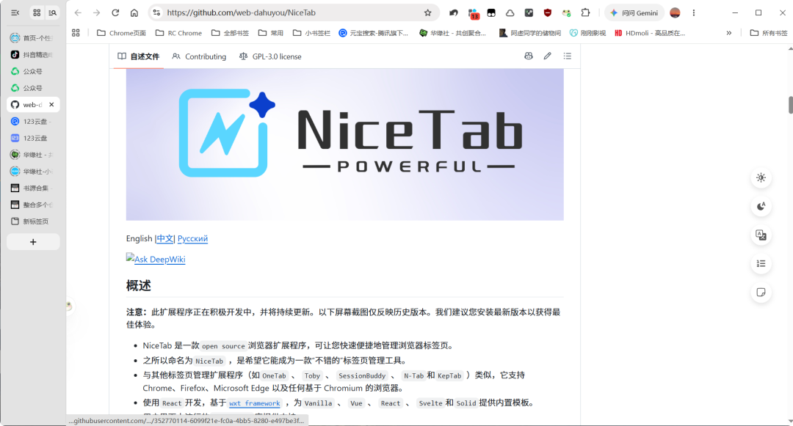
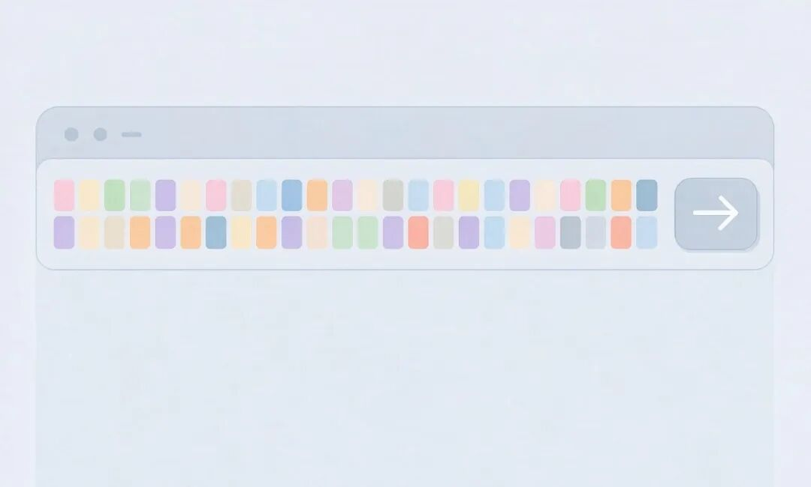
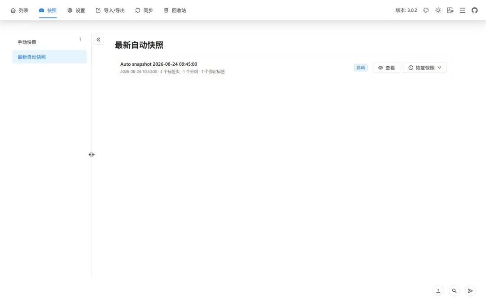
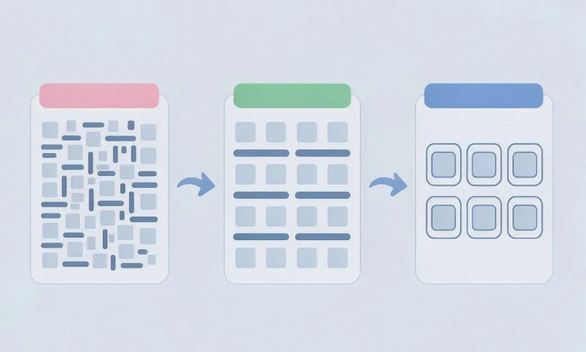
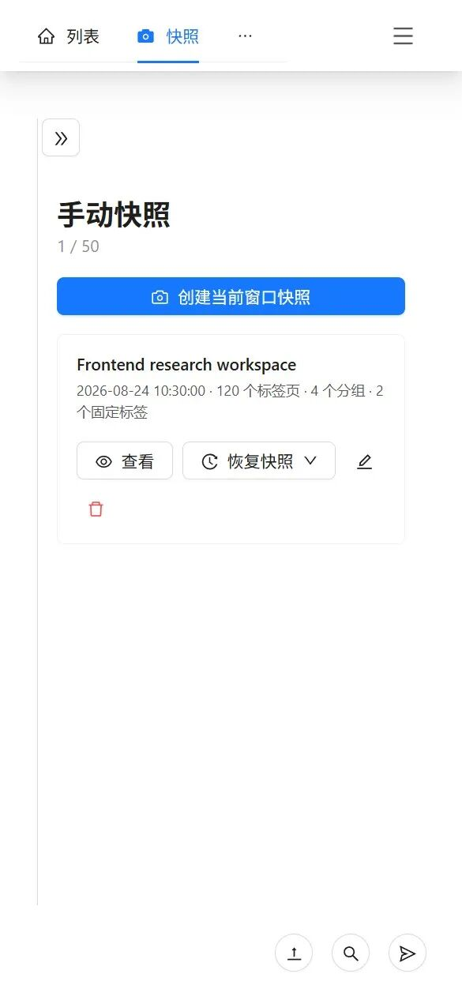
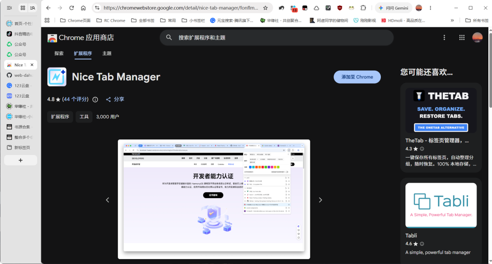

# 标签太多找不到？这款免费插件一键收好
> 💡 备注属性未写入，可能是备注属性名称或者类型被修改了，建议将字段类型设置为 rich_text，可以在小程序-操作-修改文章数据库页面进行调整
> 💡 原文链接:[https://mp.weixin.qq.com/s?__biz=Mzk0NDQyMzE1OA==&mid=2247499004&idx=1&sn=87494db3a1ae13e12dcb3b08e6b274e5&chksm=c22ad06c58486998345f1498d27ed7c2d11c2ac4923291767a8e643156c40022c39bee704a23#rd](https://mp.weixin.qq.com/s?__biz=Mzk0NDQyMzE1OA%3D%3D&mid=2247499004&idx=1&sn=87494db3a1ae13e12dcb3b08e6b274e5&chksm=c22ad06c58486998345f1498d27ed7c2d11c2ac4923291767a8e643156c40022c39bee704a23#rd)
NO.01

软件介绍

电脑上网久了，浏览器顶部一排小标签挤得密密麻麻，想找刚才那个页面，得一个一个点过去看。关掉吧，一会儿还要用；不关吧，越堆越多。如果你也常被这件事烦到，可以看看这款叫 NiceTab 的浏览器插件。
它是免费开源的标签页管理工具，相当于给浏览器标签装了一个「收纳盒」。这篇从小白角度讲清怎么装、怎么用、什么人最适合，以及它比常见的同类插件强在哪。

#### 它是干什么的
NiceTab 能把浏览器里开着的标签页，一键收进一个管理后台，按「分类 → 标签组 → 标签页」的层级整理好，需要的时候再打开。它支持 Chrome、Edge、Firefox 等浏览器，代码开源，采用 GPL-3.0 许可。
它常被拿来和 OneTab、Toby、SessionBuddy 这些老牌标签管理插件比较，官方也把自己定位成它们的「升级替代品」。

标签太多找不到？示意（根据功能说明绘制）
#### 怎么获取和安装
不用找什么安装包，走官方商店最稳妥：
- Chrome 用户：在 Chrome 网上应用店搜索「Nice Tab Manager」，认准名字安装。
- Edge 用户：在 Microsoft Edge 加载项商店搜索安装（官方说明 Edge 审核慢，版本可能比 Chrome 旧一点）。
- Firefox 用户：在 Firefox 附加组件页面搜索「nice-tab-manager」。
- 爱折腾的话：项目在 GitHub 上开放，也能下载 zip 包手动加载，官方文档里写了方法。
装好之后，浏览器工具栏会多出一个 NiceTab 图标。建议把它固定显示，用起来方便。第一次打开管理后台时列表是空的，正常，发几个标签进去就有内容了。
#### 日常使用：三步上手
**第一步，把标签收进去。** 在浏览器顶部右键点击 NiceTab 图标，菜单里有「发送所有标签页」「发送当前标签页」「发送左侧/右侧标签页」等选项，点一下就收好了。首次使用直接选「发送所有标签页」最省事。
**第二步，在管理后台整理。** 点图标打开面板，进入管理后台，就能看到刚收进来的标签。左侧是分类和标签组，右侧是具体的网页。可以拖拽排序、改名字、星标、锁定，也能多选后批量移动或删除。

管理后台界面：分类、标签组与标签页（图：项目仓库）
**第三步，要用时打开。** 在管理后台找到那一条，点开就能回到原网页。也可以右键图标用「全局搜索」，在任意网页上直接搜已经存起来的标签标题或网址，找到后跳转过去。
#### 核心场景：哪些时候最顺手
**查资料、写东西的时候。** 一个课题打开十几个网页，查完先全收进 NiceTab，按「参考资料」「待读」「已用完」分好，电脑桌面清爽了，回头也好找。
**动手做项目的时候。** 文档、教程、代码页面一大堆，按项目建标签组，切换项目时整组打开，不用一个个翻。
**购物比价、旅行规划的时候。** 几个商品页、几家酒店和攻略先收着，回头在同一处对比。
**设备多的人。** 它支持 GitHub Gist、Gitee Gist 和 WebDAV 远程同步，配置和标签页都能同步到自己的账号或网盘，在家和在公司接着用。

按类别整理好的标签组示意（根据功能说明绘制）
#### 和 OneTab 这类插件比，特别在哪
市面上的标签管理插件不少，OneTab 最知名，Toby、SessionBuddy、Tab Manager Plus 也都有人用。它们大多解决同一个痛点：标签太多，先收起来。NiceTab 的不同之处在于把「收完之后」这件事做细了：
**能兼容别家数据。** 支持导入 OneTab、Toby、SessionBuddy、KepTab 等格式，从别的插件转过来不用从头再来，也能导出到本地。
**有回收站。** 分类、标签组、标签页删掉后会进回收站，误删了能还原，不用再「删了就没了」。
**有快照功能。** 当前版本支持「窗口快照」，能把一整个工作环境存下来，之后一键恢复。这是 3.0.4 版本新增的能力，老牌插件里不多见。
**能自定义新标签页、换主题。** 支持亮色/暗黑主题、多种主题色切换，还能把浏览器新标签页改成自己想要的样子；界面语言支持简体中文、繁体中文、英文、俄文。
**能手动休眠标签页。** 暂时不用的页面可以休眠释放内存，仍留在标签栏里，激活时重新加载。

快照管理界面：保存与恢复工作环境（图：项目仓库）
#### 注意事项
- 装插件认准官方商店和项目名称，别从陌生网盘或第三方下载站装「增强版」。
- 远程同步要填自己的 GitHub/Gitee token 或 WebDAV 账号，token 权限只勾 gists 那一项就够了。
- 官方说明里提到，合并推送模式不会做删除对比，标签页可能越同步越多，想同步删除要手动「覆盖推送」。
- Firefox 上有些特殊页面（比如 about:config）出于安全限制点不开，需要手动复制链接访问。
- 插件在持续更新，界面和功能入口以你装到的当前版本为准。

#### 相关链接
项目仓库（GitHub）：
https://github.com/web-dahuyou/NiceTab
Chrome 网上应用店：
https://chromewebstore.google.com/detail/fonflmjnjbkigocpoommgmhljdpljain
功能要点与安装说明来自项目官方中文文档，当前版本信息来自官方变更日志；文中标注的示意图为根据功能说明绘制，界面截图来自项目仓库。
标签页一多就找不到，是很多人的日常困扰。如果你也一天开着几十个网页，不妨装一个试试：先把当前这一堆收进去，按自己的习惯分几类，用两天看看顺不顺手。你平时是怎么管理一堆标签页的，欢迎在评论区聊聊。

往期精彩推荐

[弹幕、小窗、双语字幕都能调：PiliNara 怎么装怎么用](https://mp.weixin.qq.com/s?__biz=Mzk0NDQyMzE1OA%3D%3D&mid=2247498963&idx=1&sn=097b7c973376697ca2afb6e1c586438c&scene=21#wechat_redirect)
[按一下快捷键就出字：开源听写工具 OpenWhispr，本地与云端自己选](https://mp.weixin.qq.com/s?__biz=Mzk0NDQyMzE1OA%3D%3D&mid=2247498963&idx=2&sn=0765e33e8566149cf9f36832f47e3b8e&scene=21#wechat_redirect)
[免费、界面熟，还能下 BT：Mister Download Manager 上手](https://mp.weixin.qq.com/s?__biz=Mzk0NDQyMzE1OA%3D%3D&mid=2247498951&idx=1&sn=54d123af71fe398cc93d4eb0f9447859&scene=21#wechat_redirect)
