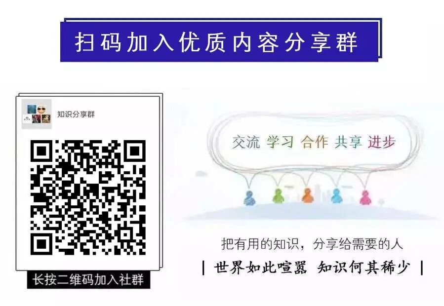

# 梁晓声：警局有人的，孩子都在上警校；医院有人的，孩子都在读医学；法院有人的，孩子都在学法律；供电局的学电力，水利局的学工程
> 💡 备注属性未写入，可能是备注属性名称或者类型被修改了，建议将字段类型设置为 rich_text，可以在小程序-操作-修改文章数据库页面进行调整
> 💡 原文链接:[https://mp.weixin.qq.com/s?__biz=MzkzMTYwNjkwMQ==&mid=2247515611&idx=1&sn=032b0e6b8a44462ebf0b52dc6bcfd0be&chksm=c3aab81c9936a72c6f41d2e3f4a71b2b297591d040b9b9b4a738d766143103b771751c7de080#rd](https://mp.weixin.qq.com/s?__biz=MzkzMTYwNjkwMQ%3D%3D&mid=2247515611&idx=1&sn=032b0e6b8a44462ebf0b52dc6bcfd0be&chksm=c3aab81c9936a72c6f41d2e3f4a71b2b297591d040b9b9b4a738d766143103b771751c7de080#rd)

梁晓声的这段话，戳中了很多人不愿承认的现实：普通人的前路多是摸索，而有资源的家庭，早已为孩子铺好了最稳妥的路。

**简单来说就是：**
警察简单来说就是：家的小孩，不少会去读警校。爸妈身在体系里，懂里面的规矩，认识的人也多，以后孩子想进来，路子顺很多。
医生家的孩子，很多选择学医。从实习、找科室到最后定岗，家里多多少少都能搭把手、指条明路。
还有电力、水利这类安稳单位的，父母在里面上班，孩子就报对口专业，时机合适了，顺理成章接过来。
**为啥会出现这种情况？**
首先就是信息差。外人摸不清里面弯弯绕绕，父母天天泡在行业里，清楚要准备什么、卡点在哪、找谁咨询少走弯路。
其次是资源顺着往下传。多年攒下的经验、圈子人脉，甚至对岗位的理解，都能间接给到下一代。
再往朴素了说，当爸妈的，谁不想让孩子走一条自己看得懂、风险小的稳路，这份心思其实很好理解。
**换到咱们普通人身上看：**
如果你刚好有这份便利，确实是一手好牌，但别觉得有靠山就万事大吉，长久立足，终究还是得靠自己的硬实力。
要是家里没这些资源，也不用丧气。看清这个现实不用焦虑，踏实攒本事就好。自身能力，才是冲破这层隐形门槛最靠谱的底气。
说到底，天下父母心都差不多，都想提前给孩子铺平一点路。可路终究要自己踩，有人铺路也好，空手起步也罢，能走成什么样，最后还是靠自己一步一步蹚出来。
好的社会，应当允许经验传承，也必须守住公平的底线。可以有耳濡目染，但不能关上公开竞争的大门；可以有行业内的代代接续，但考核、招录、评价的标尺，必须对外一致透明。**内部人可以提前拿到地图，但不能独自拥有入场券。**
志愿和职业，本应遵从热爱与禀赋。最好的状态，不该是 “家里干什么，孩子就学什么”，而是无论父母从事哪一行，无论身在城市还是乡村，每一个年轻人，都有机会看见全部的选项，凭着自己的能力，去往自己想去的地方。

[查理·芒格的100个思维模型（完整版）](https://mp.weixin.qq.com/s?__biz=MzU0Njc5NDYzMw%3D%3D&mid=2247527502&idx=2&sn=ec7ec597226f343e27bb1d81f396a0db&scene=21#wechat_redirect)
[19个终身受用的世界顶级思维](https://mp.weixin.qq.com/s?__biz=MzIzMzI5ODc5OQ%3D%3D&mid=2247494960&idx=4&sn=d596e72cf0785647c11756698bb6fd59&scene=21#wechat_redirect)
[《人民日报》：世界公认的十大名著，人生至少要读一遍](https://mp.weixin.qq.com/s?__biz=Mzk0NzcyNTUwNw%3D%3D&mid=2247484629&idx=4&sn=94409fa79aabfebc45f8068b5c518fbe&scene=21#wechat_redirect)
[中国人必读的10本书](https://mp.weixin.qq.com/s?__biz=MzkzMTYwNjkwMQ%3D%3D&mid=2247505319&idx=4&sn=5986cc4f67448893ec7e3ff0591083b0&scene=21#wechat_redirect)
[麦肯锡报告：2030年，8亿人被机器取代](https://mp.weixin.qq.com/s?__biz=MzIzMzI5ODc5OQ%3D%3D&mid=2247499912&idx=2&sn=82ff0f0a8a7c73fff20dbcb9b20cc3a8&scene=21#wechat_redirect)
[麦肯锡报告：2030年，哪些行业会衰落](https://mp.weixin.qq.com/s?__biz=MzIzMzI5ODc5OQ%3D%3D&mid=2247498959&idx=2&sn=eb1c3069c569d424c48f02bc29e30651&scene=21#wechat_redirect)
[麦肯锡重磅报告：未来15年，最具潜力的高成长赛道](https://mp.weixin.qq.com/s?__biz=MzU0Njc5NDYzMw%3D%3D&mid=2247509972&idx=3&sn=4fde79bf750049743f069cac7af05d1a&scene=21#wechat_redirect)
[麦肯锡：到2040年，最具盈利前景的18个行业](https://mp.weixin.qq.com/s?__biz=Mzk0NzcyNTUwNw%3D%3D&mid=2247484647&idx=1&sn=900388bf4fff0376ffd88192657de5cd&scene=21#wechat_redirect)！
[麦肯锡最新报告《工作新未来》，2030年，应该做什么工作？](https://mp.weixin.qq.com/s?__biz=MzU0Njc5NDYzMw%3D%3D&mid=2247498597&idx=2&sn=6de4f62f2d394ed3e2aabf520688ef52&scene=21#wechat_redirect)
[麦肯锡报告：中美竞技的18个关键产业](https://mp.weixin.qq.com/s?__biz=MzU0OTcwODg1MA%3D%3D&mid=2247512120&idx=2&sn=992e58f9ff83773bcc19271b7bdb69ae&scene=21#wechat_redirect)
[麦肯锡工作培训9大手册，职场必备圣经！](https://mp.weixin.qq.com/s?__biz=MzU0OTcwODg1MA%3D%3D&mid=2247526174&idx=3&sn=4cfb578bd768a59f90cd9f5189672fc3&scene=21#wechat_redirect)
[中年危机报告：35岁，中国式中年](https://mp.weixin.qq.com/s?__biz=MzIzMzI5ODc5OQ%3D%3D&mid=2247502331&idx=2&sn=53ecc6538c6f254ddde7d91802dbe6a3&scene=21#wechat_redirect)
[重磅！100大产业链全景图发布](https://mp.weixin.qq.com/s?__biz=MzkzMTYwNjkwMQ%3D%3D&mid=2247513161&idx=3&sn=a976b62fcb25042fce2814da0fb0a955&scene=21#wechat_redirect)
[58大新质生产力产业链图谱](https://mp.weixin.qq.com/s?__biz=Mzk0NzcyNTUwNw%3D%3D&mid=2247484647&idx=4&sn=3b2692c1986b95b9420ad75f37d7a468&scene=21#wechat_redirect)
[WorkBuddy教师手册](https://mp.weixin.qq.com/s?__biz=Mzk0NzcyNTUwNw%3D%3D&mid=2247486562&idx=1&sn=5c4b7f306dfcff887bf5c4bfcd978e75&scene=21&click_id=770338660#wechat_redirect)
[WorkBuddy橙皮书：实战案例全链路使用指南](https://mp.weixin.qq.com/s?__biz=MzU1NjI0ODkxNw%3D%3D&mid=2247535215&idx=1&sn=a3f659b8b35b6c01f88208ab5159fdf1&scene=21#wechat_redirect)
[WorkBuddy入门手册橙皮书](https://mp.weixin.qq.com/s?__biz=Mzk0NzcyNTUwNw%3D%3D&mid=2247486771&idx=2&sn=efcac88273c83a0a8be86ff5f999dfcd&scene=21#wechat_redirect)
[WorkBuddy企业岗位应用全景白皮书](https://mp.weixin.qq.com/s?__biz=Mzk0NzcyNTUwNw%3D%3D&mid=2247486141&idx=1&sn=405469fcc19cf84b17f3feb2c9c0705f&scene=21#wechat_redirect)
[清华大学：人工智能通识教育红皮书](https://mp.weixin.qq.com/s?__biz=MzkzMTYwNjkwMQ%3D%3D&mid=2247515257&idx=2&sn=0fbc0010acf528cb0c41ce3fb92619d5&scene=21#wechat_redirect)
[普华永道：2026年智能机器人产业发展白皮书](https://mp.weixin.qq.com/s?__biz=Mzk0NzcyNTUwNw%3D%3D&mid=2247486372&idx=2&sn=e6761a3826b17711677ee3522cc0b6b7&scene=21#wechat_redirect)
[机遇之城2026：与世界共享中国城市多样性机遇](https://mp.weixin.qq.com/s?__biz=Mzk0NzcyNTUwNw%3D%3D&mid=2247486361&idx=1&sn=436b2284c30a9854b474b3c62ae88b60&scene=21#wechat_redirect)
[清华《2026智能体工具大全》（建议收藏）](https://mp.weixin.qq.com/s?__biz=MzU0Njc5NDYzMw%3D%3D&mid=2247530794&idx=2&sn=28001b133557d7382074b0f6c0ca29fd&scene=21#wechat_redirect)
[清华大学《大模型工具大全》 40+AI赛道，300+实用工具（建议收藏）](https://mp.weixin.qq.com/s?__biz=Mzg3MzU4NzMzNw%3D%3D&mid=2247520965&idx=2&sn=dd7fae7dfb28d77744a5996df4232835&scene=21#wechat_redirect)
[清华大学：中国2025-2100年人口预测报告](https://mp.weixin.qq.com/s?__biz=MzU0Njc5NDYzMw%3D%3D&mid=2247506985&idx=2&sn=ab8ffeeae05054d5cac1837d5ef9b08a&scene=21#wechat_redirect)

**扫码进入知识分享社群**
**为读者找知识，为知识找读者**
** 分享知识，创造价值 **
**终身学习是最好的投资！**

**▼公众号后台回复 “社群”, 加入知识社群**
