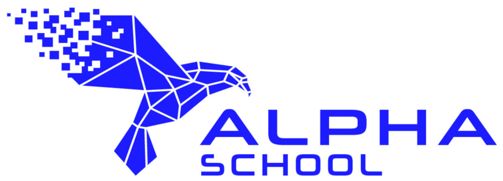
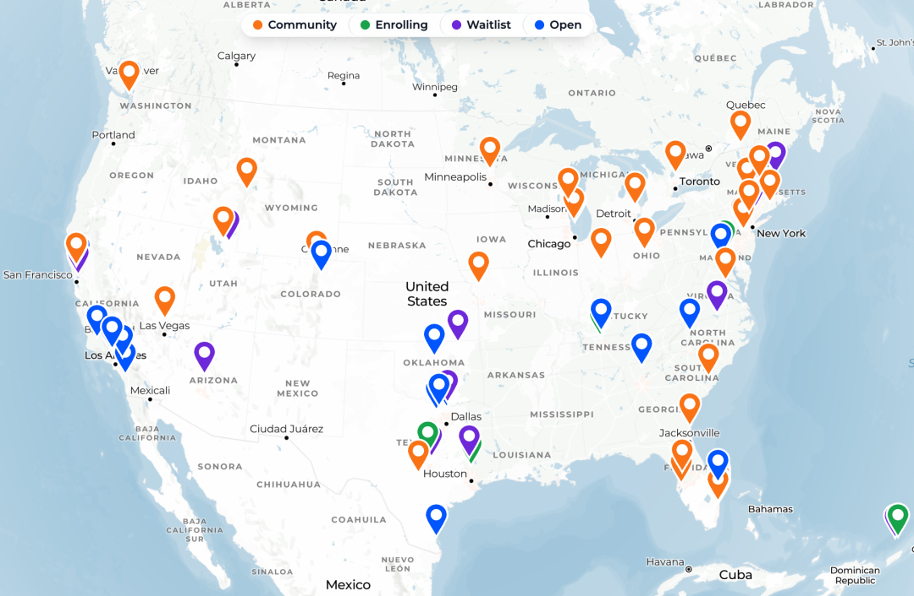
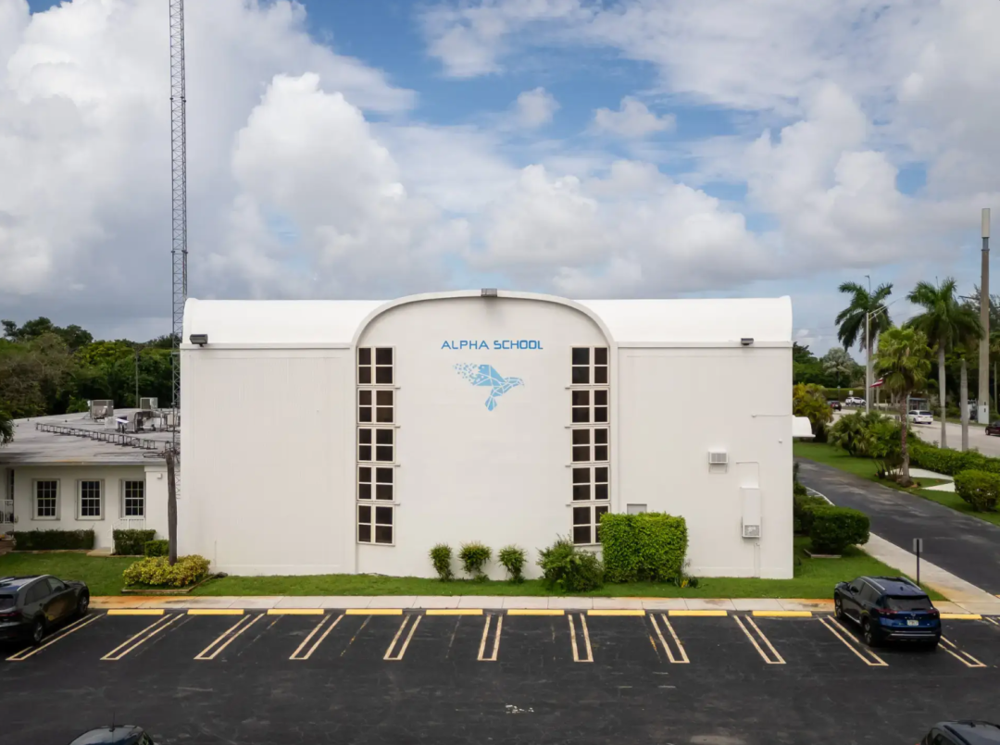
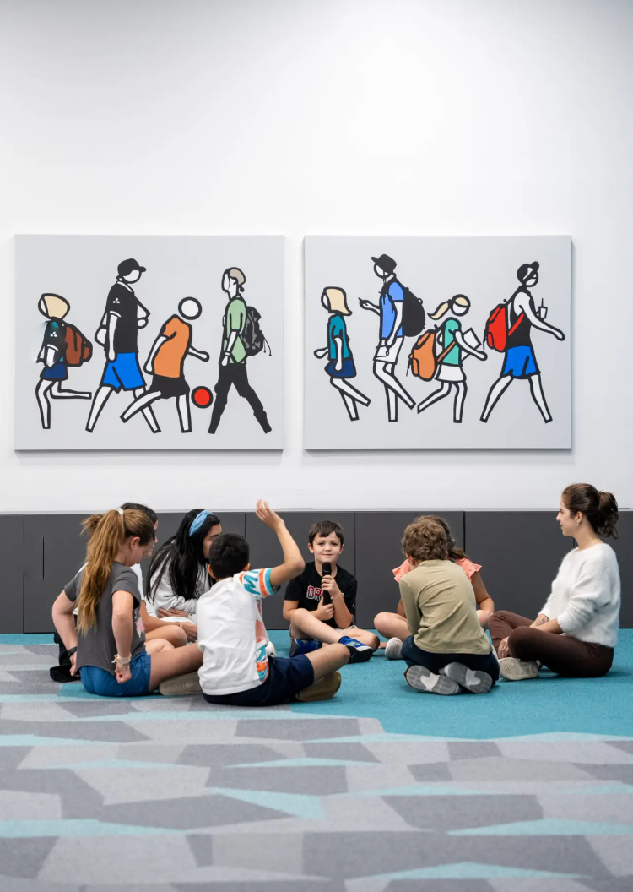
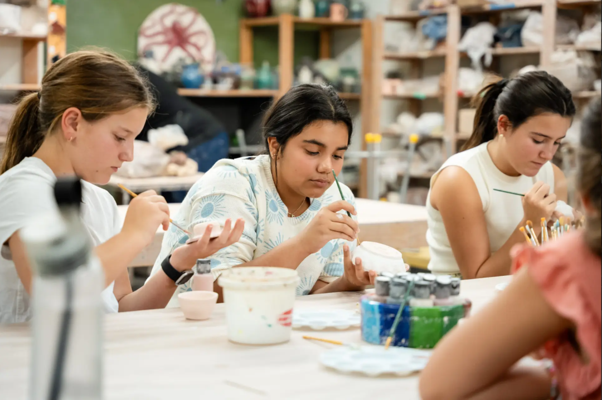

# 每天仅学2小时，成绩却跻身全美前1%：AI驱动的Alpha School如何彻底颠覆传统教育
> 💡 备注属性未写入，可能是备注属性名称或者类型被修改了，建议将字段类型设置为 rich_text，可以在小程序-操作-修改文章数据库页面进行调整
> 💡 原文链接:[https://mp.weixin.qq.com/s?__biz=MzAwNzQ2MjkyMQ==&mid=2247487691&idx=1&sn=ab4442599cf265925dba5489a6142dbc&chksm=9afd45e9ec99637441b03e3f35999576fb092bd82e7094fe63d420c9015b13721173fd711f9d#rd](https://mp.weixin.qq.com/s?__biz=MzAwNzQ2MjkyMQ%3D%3D&mid=2247487691&idx=1&sn=ab4442599cf265925dba5489a6142dbc&chksm=9afd45e9ec99637441b03e3f35999576fb092bd82e7094fe63d420c9015b13721173fd711f9d#rd)
_在未来一年内，我们可能就会看到身边的同事、朋友乃至自己面临被 AI 替代的风险。如果人类社会已经进入全新的现实，我们为什么还在用早已作废的“旧世界标准”去培养下一代？_
1. 引言：工业时代教育模式的终结与AI带来的革命性破局
我们正在经历一场前所未有的时代变革。随着人工智能以周为单位快速进化，越来越多的成年人陷入了深刻的职场焦虑。然而，比当下职业危机更严峻的，是我们的教育体制——全美乃至全球绝大多数学校，依然在沿用工业革命时期的标准流水线模式。那个旨在培养“听从指令、守纪律、服从安排的工厂工人”的教育体系，正在源源不断地输送着无法适应未来社会的学生。

面对这一断层，全美首家 AI 驱动学校 Alpha School 的创始人 MacKenzie Price 提出了一个震撼教育界与科技界的实践答案：**在 Alpha School，学生每天只需要进行 2 小时的纯学术学习，但他们在全美标准化测试中的成绩却全面跻身全美前 1%。**
从 8:30 到 15:30 的完整校园日里，Alpha 并没有把精力消耗在漫长的讲授上。这不是一个针对极少数天才的挑选机制，而是一场利用人工智能重新量身打造教育体验的系统性革命。Alpha 证明了一个极其深刻的教育真相：**传统教育的瓶颈从来不在于学习时长不够，而在于授课效率的低下与人类内在动机的被动压抑。**
2. 颠覆一：精简至2小时——“掌握度学习”如何击碎一刀切的传统课堂？
在传统学校，学生的一天被切割为多节 45 分钟的漫长课程，老师在讲台上用统一的节奏面对几十名进度迥异的学生。而在 Alpha School，每天的核心学术学习被精准压缩为仅 **2 小时**（高中阶段微调为 3 小时）。学生在这段时间内完成由 25 分钟专注单元构成的核心学术任务，涵盖数学、阅读、科学、历史和语言等标准科目。

这种指数级提升效率的底层机制，是 AI 导师（AI Tutor）所实现的**一对一掌握度学习（Mastery-Based Learning）**：
**·90% 以上的绝对掌握门槛**：传统课堂无论学生听懂了三成还是八成，到了时间就会强行推进下一课；而在 Alpha 系统中，学生必须对当前知识点达到 90% 以上的掌握度才能解锁下一个难度。
**·回溯性的基石漏洞自动填补**：通过权威的 NWEA MAP 等标准评估作为实时反馈工具，AI 能够精准定位知识死角。例如，一个六年级学生如果在数学上遇到困难，AI 不会强行灌输高阶公式，而是自动回溯并填补其在三、四、五年级遗留的基石漏洞。
**·指数级跨越的无门槛普适性**：Alpha School 绝非仅招收原本就在 95% 分位的优等生。即便是入学时处于全美 25% 分位（低水平）的学生，在 AI 自适应教学下也能实现指数级的成长跨越。
传统“基于时间的固定进度”教学（Time-Based System）的最大弊端，在于让已经掌握的学生因为无聊而发呆，让尚未理解的学生因为跟不上而彻底放弃。
_“利用人工智能最终让孩子们获得一对一的‘掌握度学习’辅导体验，多年来研究人员早已证实这种方式能让学习速度提升 2 倍、5 倍乃至 10 倍，只是在过去的体制中这根本不可能实现。” —— MacKenzie Price_
3. 颠覆二：“没有老师”的学校，却拥有全行业最顶级的激励专家
外界常将 Alpha 误读为“一所没有老师的学校”。事实上， Alpha 拥有极高的成年人配置比（师生比达到 1:15，低年级甚至达到 1:5）。学校不称呼他们为“Teacher”（教师），而是称为 **“Guide”（引导员）**。
剖析“EdTech 坟场”与动机占比

全美教育科技领域充斥着无数失败的平台（Graveyard of failed EdTech platforms）。MacKenzie 洞察到，这些平台失败的原因在于误以为软件可以解决一切。**在教育中，技术只能解决 10% 的内容交付，而剩下的 90% 依赖于动机的激发。** Alpha 的成功，正是因为让技术与人各司其职。
职责的分工与人机闭环干预
引导员将 90% 的精力集中于**激发学习动机、提供情感支持、心理辅导与生命技能培养**。但如果学生在 AI 导师处遇到极其复杂的知识卡点，系统并非完全不管—— Alpha 建立了专门的**学习科学团队与学术教练（Learning Science Team / Academic Coaches）机制**。当学生出现严重阻碍时，学术教练会介入进行针对性的人工辅导；更关键的是，这一辅导干预的数据会立刻反哺并优化 AI 算法，形成持续自我进化的“人机协同闭环”。
顶级跨界人才与高薪回报
Alpha 的引导员约 50% 来自传统教师群体，另一半则招募自**前职业教练、退役运动员以及商业领域的精英**。学校通过支付远高于传统教育行业的高薪，吸引那些最擅长点燃情绪、建立信任与激励他人的顶级人才。

当孩子在 AI 导师辅助下以适合自己的节奏学习时，他们会迅速建立起**能力（Competence）**，而能力会立刻转化为**自信（Confidence）**，最终驱动他们主动接管自己的学习。
_“我们的引导员能够把时间完全聚焦在创造伟大学习者最核心的 90% 比重上——那就是动机。” —— MacKenzie Price_
4. 颠覆三：从“无聊刷屏者”到“奥运级创作者”——将荒谬兴趣转化为世界级成果
在完成 2 小时的学术学习后， Alpha 学生全天剩余的时间都在进行 **“Alpha X 奥运级项目”（Olympic-Level Projects）**。Alpha 拒绝用“对孩子来说还算不错”的低标准要求学生，而是追求在同年龄段达到世界顶级水平，引导孩子从“被动消费者（Consumers）”转变为“主动构建者（Creators/Builders）”。
案例一：14岁女孩从“刷TikTok”到论文进《Nature》终审
一名 14 岁女孩在参加学校的“68小时时间追踪工作坊”时承认，自己平时除了刷 TikTok 就是想男生。引导员没有训斥她，而是帮助她将兴趣转化为研究：
**1.洞察痛点**：针对疫情后青少年社交与约会困境展开深度调研；
**2.积累受众**：在 TikTok 上发布青少年社交健康建议，斩获数百万播放量；
**3.构建 AI 模型**：基于自身积累的领域知识，搭建了一个专为青少年提供社交建议的 LLM 与 AI 分身；
**4.学术对比验证**：撰写学术论文，对比该 LLM、ChatGPT 与郊区妈妈（Suburban Moms）给出的建议质量（实验证明妈妈们的建议质量排名垫底，该 LLM 排名第一）；
**5.顶级成果**：该论文已进入全球顶级学术期刊《Nature》（自然）的最终审核阶段。若成功发表，她将成为《Nature》史上最年轻的女性作者及唯一的高中生发表者。目前，她已收到斯坦福大学录取相关活动的邀请。
案例二：6岁孩子的商业实战与千美元利润
当一个 6 岁孩子提出想做“柠檬水摊”时，引导员引导她思考流量与客户需求：
·分析发现自家车道车流稀少，决定将销售地点改在健身房外；
·考虑到健身人群不喝高糖柠檬水，改卖椰子水和自制古法健身饼干（Paleo Cookies）；
·6 岁的小女孩亲自给健身房老板打电话谈判并获得许可，最终在一场体育赛事中赚取了 **$1,600 净利润**。
真实世界的驱动力：从“为了拿学分”到“为了构建事业”
传统教育的项目往往是“为了拿 A 或拿学分（Grade-driven）”，一旦课程结束项目即告终结。而在 Alpha，学习是“事业驱动（Venture-driven）”的。在一次面对风投机构（VC）的融资路演中，风投人询问高中生：“夏天放假了你的项目怎么办？”学生反问：“为什么放假项目就要停？我还有工作要做！”甚至高年级学生主动要求学校在暑期继续开放场地与辅导。
_“在当今社会，成为被动消费者太容易了——刷 TikTok、玩游戏、看视频。我们必须培养创作者与贡献者。人们天生想要去构建，他们只是缺乏工具、时间和导师。” —— MacKenzie Price_
5. 颠覆四：释放时间红利——手写手绘、手作与户外挑战的反向复苏
不少家长对“AI 驱动”的最大担忧是屏幕依赖。然而， Alpha 学生的日均屏幕时间仅为 **2 小时**，甚至低于全美儿童 2.5 小时的平均水平。且这 2 小时完全处于高互动、维持在**近端发展区（Zone of Proximal Development, ZPD）**的高效专注状态。

由于学术学习时间被压缩了近三分之二，学校得以利用释放出的巨大时间红利，全面复苏丰富的实体技能与体能挑战：
**·传统手艺与脑力塑造**：手把手教授**圆体英文手写（Cursive）**以训练手眼协调与大脑发育；开展缝纫、木工与实体手作项目。
**·深度阅读与文化积淀**：保留纸质书阅读，由阅读专家提供一对一出声朗读辅导；引入自研 AI 应用《Teach Tales》（根据学生兴趣定制专属难度故事）；深入研读莎士比亚等经典名著与 ED Hirsch 提出的 5000 个核心常识概念。
**·极限体能与团队协同**：
**·低年级**：5-6 岁的孩子组成单车队骑行跨越金门大桥，挑战 40 英尺岩壁攀爬；
**·初中阶段**：全员集体完成铁人三项挑战；
**·高中阶段**：通过航海训练，亲自驾驶帆船从佛罗里达一路航行至巴哈马（该高端私立体系年学费为 $40,000 - $75,000）。
当学术效率提升后，省下的时间红利没有被用来无限加码刷题，而是真正用来滋养完整的人性、体魄与户外探索力。
6. 颠覆五：告别“工厂工人”流水线，构建 AI 时代不可替代的终身学习力
随着生成式 AI 的爆发，单纯依靠知识记忆、流程化合规与重复性劳动的专业人士正面临脱节风险。例如，律师可以在几秒钟内生成标准法律文件，皮肤科医生可以用 AI 摄像头比对历年痣的变化。未来的核心竞争能力，将不可逆转地转向策略思考、复杂谈判、人际共情以及与 AI 协作的能力。
为了应对这一演进，家长与成年人需要一套可落地的行动工具路线图：
1. 抛弃传统职业框框，转向“Ikigai 动态再平衡”
不要再问孩子或自己“长大后想做什么职业”，职业名称正以空前的速度失效。转向使用 **Ikigai（生存价值）分析框架**：定期探索“你喜欢做什么”、“你擅长做什么”以及“世界需要什么”，在三者的交集点寻找动态定位。
2. 家长每日行动：抛出开放式好奇问题
每天向孩子抛出一个开放式问题：_“你最近对什么事情感到好奇？”_ 当孩子给出答案后，不要基于成年人的偏见去评价好坏，而是引导他们思考：“如果我们想针对这个兴趣做深度研究，我们可以怎么做？”
3. 引入高效自适应工具
对于家庭自学或补充学习，可直接采用源文本推荐的高质量工具：
**·Math Academy**：全美顶尖的自适应数学学习 App，能精确识别并补齐数学漏洞；
**·Alpha Anywhere**：Alpha 官方推出的家庭自学体系平台（$10,000/年），将这套 AI 学术交付系统引入家庭。
4. 构建个人“Brain Lift”（知识库）与专属 LLM 闭环
成年人同样需要进行终身深度学习。挑选一个你想要攻克的专业领域：
**·每日研究**：每天抽出 30 分钟研究该领域顶级专家（Experts）的论文、观点与实战经验；
**·整理知识库**：将提炼出的硬核干货整理为专属的“Brain Lift”知识资产清单；
**·喂养 LLM**：将这份 Brain Lift 作为知识库喂给定制大语言模型，构建辅助自身决策的个人 AI 智囊。
_“不要问孩子长大后想做什么职业，这会框住他们。我们要问的是：你喜欢做什么过程？你拥有什么技能？以及你如何用它们去解决真实世界的需求。” —— MacKenzie Price_
7. 结语：准备迎接全新的现实
Alpha School 的实践向全社会传递了一个清晰的信号：**人工智能绝非剥夺人类思考的懒人工具，而是解锁人类无限潜能的超级催化剂。**
工业时代遗留下来的流水线教育剧本体系已经破损。面对未来 5 年、10 年乃至 20 年的剧烈变局，我们是继续固守安全却早已脱节的旧轨道，还是勇敢拥抱以好奇心、主动构建与终身学习力为核心的教育新纪元？
正如 MacKenzie Price 所言，面对新现实，我们不需要陷入末日式的悲观与妥协，而应当心怀兴奋——前提是，我们必须立刻行动起来，为孩子和我们自己装配好驾驭未来的真正能力。
