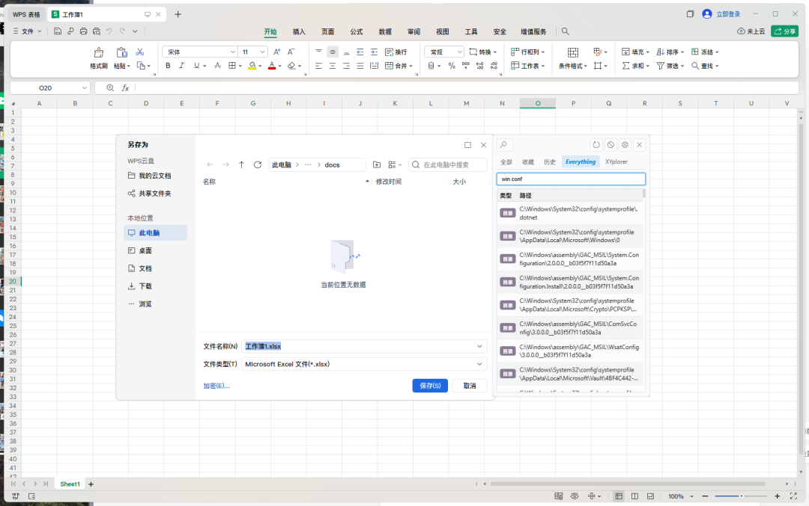
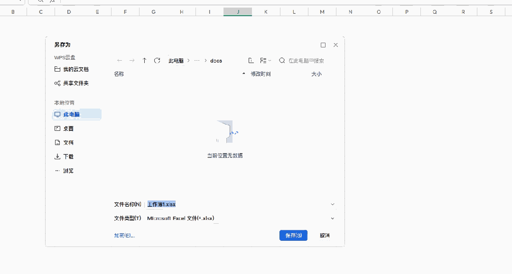

# 每天在微信、钉钉收文件？一入一出，这次 JumpPather 把对话框路径闭环了
> 💡 备注属性未写入，可能是备注属性名称或者类型被修改了，建议将字段类型设置为 rich_text，可以在小程序-操作-修改文章数据库页面进行调整
> 💡 原文链接:[https://mp.weixin.qq.com/s?__biz=MzA5MDM1MDIxMg==&mid=2647907965&idx=1&sn=4a3d6b2866e776f2b1b6400f3f658033&chksm=89e9f58b6c218f3e8938f6e01a7959bccb76f21c4c548c1c8daf95fad732ba4b5cb7b0ad957e#rd](https://mp.weixin.qq.com/s?__biz=MzA5MDM1MDIxMg%3D%3D&mid=2647907965&idx=1&sn=4a3d6b2866e776f2b1b6400f3f658033&chksm=89e9f58b6c218f3e8938f6e01a7959bccb76f21c4c548c1c8daf95fad732ba4b5cb7b0ad957e#rd)
**1. 微信、钉钉收的文件，你总要"另存为"一下**
合同、报表、会议纪要、设计稿……从微信、钉钉里收到，第一件事往往是"另存为"。
然后就是那个熟悉的动作：**打开对话框，一层层翻到要存的目录。**
客户目录、项目目录、年份文件夹……翻得多了，路径记得比密码还熟，也烦得比谁都清楚。
这可能是每天最不起眼、也最耽误事的一步。
JumpPather 从第一天起，就是为这一步而生的——**对话框出现时，贴边弹出，让你少走目录。**
它最早帮你的，是"入"：**跳进目标目录。**
但过去有个缺口：你要去的目录，得先"已经在某个地方打开过"。要么在文件管理器里，要么在收藏夹里。没打开过，就得停下来去翻。
这次更新，把这个缺口补上了。JumpPather 现在能做到"**一入一出**"：
**想去的目录，跳进去；**
**正在用的目录，收回来。**
路径在 JumpPather 里，进出形成闭环。先看"出"这一头。
> JumpPather（跳跳板）
> 文件对话框旁的路径跳板
> 感知路径 · 跨域联动 · 影随其形 · 瞬时跳转 —— 全场景桌面路径感知与瞬时跳转引擎
> 
---
**2. 出：正在用的目录，一键收进收藏**
打开、另存为、选文件夹时，JumpPather 会认出**你正处在哪个目录**。
收藏页底部多了一个按钮——**"把当前对话框路径加入收藏"**。点一下，这个正在使用的真实目录就进了收藏夹，不用再去后台文件管理器翻找。
它覆盖常见的对话框场景：Win32 经典打开/另存为、WPS 表格与文字的 Qt 对话框、以及 Chrome / Edge 浏览器的另存为。
也包括**聊天工具里收文件时的"另存为"**——微信、钉钉上收到合同、报表、附件，要保存到指定目录时，路径就能被直接抓住、一键收进收藏。下一次再存同一个地方，直接从收藏里走。
**你经常在某个目录工作?，它就帮你把那个目录留住。** 下次再想"入"，直接从收藏鼠标点双击。
---
**3. 入：想去的目录，直接搜到——还能找到文件**
另一头是"入"。过去你要跳进去，得先知道路径在哪。
「路径发现」版块首次接入 Everything：输入关键词，全盘搜目录，**双击直接跳进对话框**。这版它更强了：
**结果里，目录和文件一起显示。** 双击文件，直接跳到它所在目录——想"另存到同一个地方"时，再顺手不过。比如微信、钉钉上刚收到的文件，你把它另存后，下次同类文件想存到同一目录，搜到、双击，就到了。
**多个关键词能命中路径的不同层级。** 输入 `项目 素材`，即使"项目"和"素材"在不同层级（如 `D:\项目\2024\素材库`），也能找到，不用记全路径。
**"我在这儿"标得更准。** 结果里标记当前位置的行，识别的是你正在用的对话框路径，而不是后台文件管理器；标签也改成了直白的"在此"二字。
**常用的话，还能将Everything设成默认标签**，少点一次 Tab。

---
**4. 一个前提，说清楚**
路径发现依赖 Everything 这个免费工具，官网即可下载。
**如果电脑上没装 Everything，这个标签页会自动隐藏，不影响其他任何功能。**
路径发现 Everything 模块基于 Everything SDK 实现（© voidtools，MIT License）。我没有把它做死绑——"路径发现"会逐步接入更多搜索来源，本次先落地 Everything 这一个模块。这也是 JumpPather 一贯的脾气：不打扰，只在需要的时候伸出手。
> 好工具的修养：需要时唾手可得，不需要时安静如初。
> 
---
**5. 弹窗与感应，也更跟手了**
老用户应该能感觉到，从 v3 正式版起，弹出速度一直在被反复打磨：
对话框一出现，JumpPather 很快就在旁边就位，出现即可点击使用，路径内容短时间内自动补齐，不用反复刷新。
这版后台程序运行状态的检测**快了 4 倍**——打开或关闭文件管理器/搜索工具后，标签栏更快自动响应；点击【刷新】即时同步，刚启动或关闭的程序瞬间反映出来。**未运行的后台程序，绝不会被意外拉起。**
稳定、跟手、不打扰，是我最在意的事。

---
**6. 对你来说，意味着什么**
**老用户**：你熟悉的跳转、五大文件管理器、影随其形都在，路径闭环让"进进出出"更顺了。覆盖安装即可，设置收藏全保留。
**新朋友**：你只需要记住一句话——**对话框旁的目录，能跳进去，也能收回来。** 安装即 30 天全功能试用，试试就知道。
**你需要做的，就是下载试试。**
---
### 底部引导
**下载**：https://shonken.lanzout.com/il2xr4bwm5hc 密码:3t06
**试用**：安装即 30 天全功能试用；到期自动降级免费版，不锁死
**购买**：运行JumpPather，WIN系统右下角托盘图标菜单，查看"关于"，扫码
**运行环境**：Windows 10 / 11 x64
**数据存储**：本地保存（收藏/历史/设置），路径数据默认不上传
**署名与反馈**：童彦 / shonken@163.com
#微信 #钉钉 #文档 #方案 #路径

## 摘要

（待补充）

## 我的笔记

（待补充）
