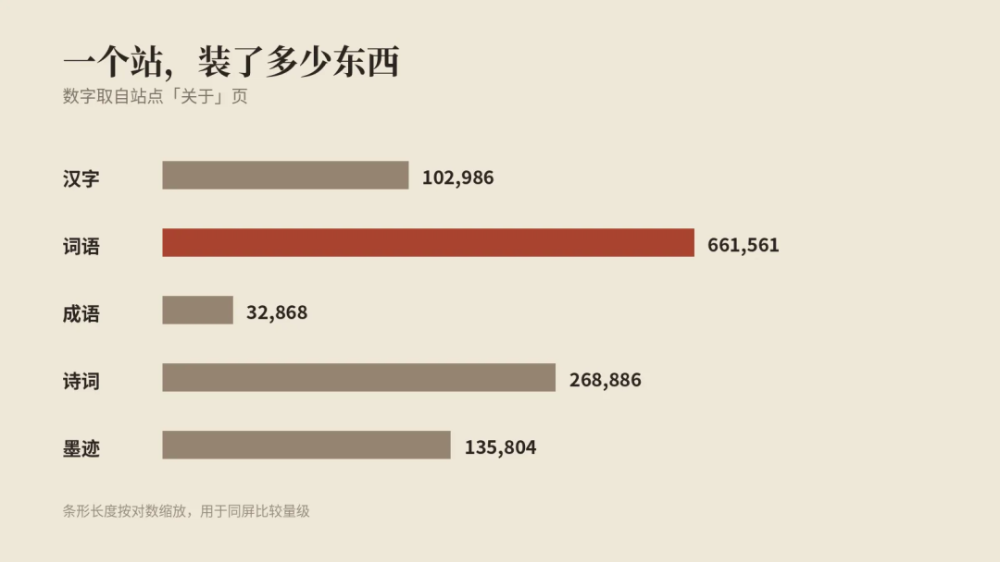
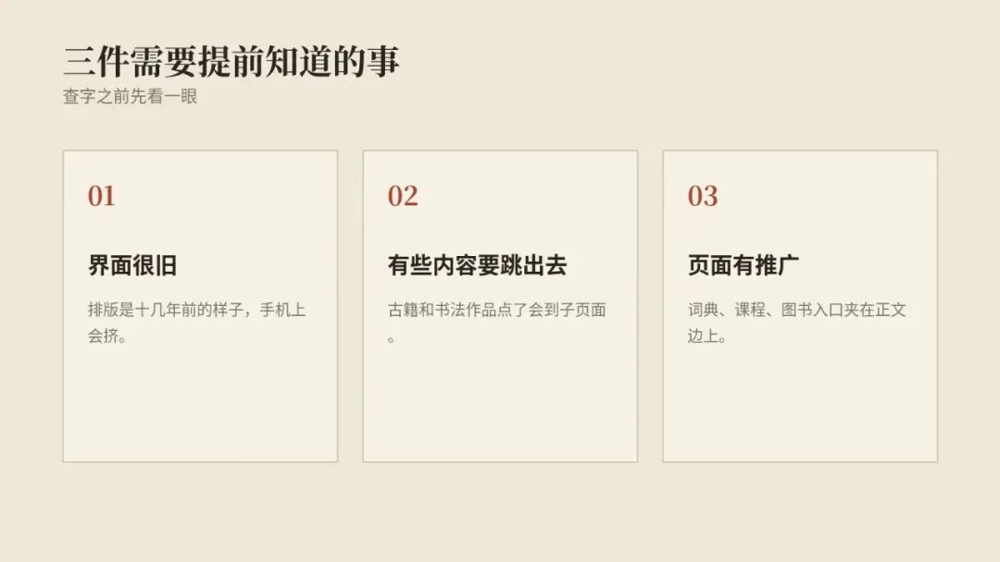

# 每天认识一个宝藏网站｜十万多个汉字、六十六万个词语，从甲骨文查到粤语读音
> 💡 备注属性未写入，可能是备注属性名称或者类型被修改了，建议将字段类型设置为 rich_text，可以在小程序-操作-修改文章数据库页面进行调整
> 💡 原文链接:[https://mp.weixin.qq.com/s?__biz=MzYyMjQ3NTkwMA==&mid=2247485641&idx=1&sn=70e70d1c13cd0b9de93b9f32db73df71&chksm=feb6ed55757f42190770bdc4f7233ad3701ec03fb89df89677843f296b8207298b4b7c0ed287#rd](https://mp.weixin.qq.com/s?__biz=MzYyMjQ3NTkwMA%3D%3D&mid=2247485641&idx=1&sn=70e70d1c13cd0b9de93b9f32db73df71&chksm=feb6ed55757f42190770bdc4f7233ad3701ec03fb89df89677843f296b8207298b4b7c0ed287#rd)
帮朋友查一个字，输入法打不出来。
只记得左边是「龠」，右边是个「禾」。
两个字拼一起念什么、什么意思，我完全不知道。
搜索引擎给了一堆不相干的词条，没一个告诉我它念什么。
后来我按部首查进去，一个字页里全都有。
那天查完，我把它加进了书签。
## 它是什么站点
汉典，2004 年建的站。
关于页写「甲申之岁，汉典肇建」，甲申就是 2004 年。
二十多年过去，页面还是当年那个样子。
没有公司背景，联系页只留一个邮箱和一个群号。
做的是最笨的活：把字书、词典、成语、古籍一部部录进去。
这种活别处通常交给团队，这边一直自己扛着。
不用注册，打开就能查。

## 里面有多少东西
关于页把数字写得很清楚，一共十万二千九百八十六个字。
词语六十六万一千五百六十一，成语三万二千八百六十八。
古籍一千零五十五部，三万八千五百二十九章。
古文二百零三篇，诗词二十六万八千八百八十六首。
还有名家墨迹十三万五千八百零四幅。
数字是二十多年一点一点攒的，不是买来的现成库。
随便点一个字，能翻出小半本工具书。
## 几个值得玩的功能
第一，字形演变。
以「永」字为例，甲骨文、金文、小篆、隶书、楷书排成一列。
下面还标着大陆、香港、台湾、日本、韩国五种字形。
一个字怎么变过来的，看一遍就有数。
第二，原文直给。
《说文解字》和段玉裁的注都在页面上，不是转述。
看不懂文言也没关系，前后能对照。
第三，读音查得细。
普通话、注音、中古音、上古音都列了。
古音怎么念，这里给的是音标，不是描述。
往下还有粤语、客家话、潮州话的读法。
第四，输入法编码。
五笔、仓颉、郑码、四角号码、笔顺，一页看全。
生僻字打不出来，照着笔画也能找。
第五，诗词库单独收着。
二十六万多首，按朝代、作者、词牌都能翻。
查同题诗、查某个意象，顺着就能找下去。

## 什么时候你会打开它
给孩子起名，想查字的来历，别只看字面意思。
读古文卡住，一个生僻字挡住整段。
按部首一查，整句的意思就顺了。
练字写篆书，要确认异体字怎么写。
写稿改稿，两个字读音一样，得挑准那个。
朋友问某个字的粤语怎么念，当场就能查。
对得上音，比凭印象猜靠得住。
翻旧书看到不认识的繁体字，拍照记下来回头查。
## 三件需要提前知道的事
第一件，界面很旧。
排版是十几年前的样子，手机上会挤。
第一眼会让人怀疑这站是不是早没人管了。
第二件，有些内容要跳出去。
古籍、书法作品这些，点了会到子页面。
第三件，页面有推广。
词典、课程、图书的入口夹在正文边上，别点错。
不影响查字，只是看着乱。

## 网址
zdic.net
查生僻字，先用部首检索，比直接搜快。
好用的东西 不该只停在眼前
这样的站，我一周挑一个，攒在这个号里。
关注一下，下次遇到能让你停下来的网站，你就不用自己翻。
顺手转给那个总在收藏夹里囤链接的朋友。
你上一次翻字典，是为了查哪个字？
标签：#宝藏网站 #汉典 #字典 #汉字 #每天认识一个宝藏网站
