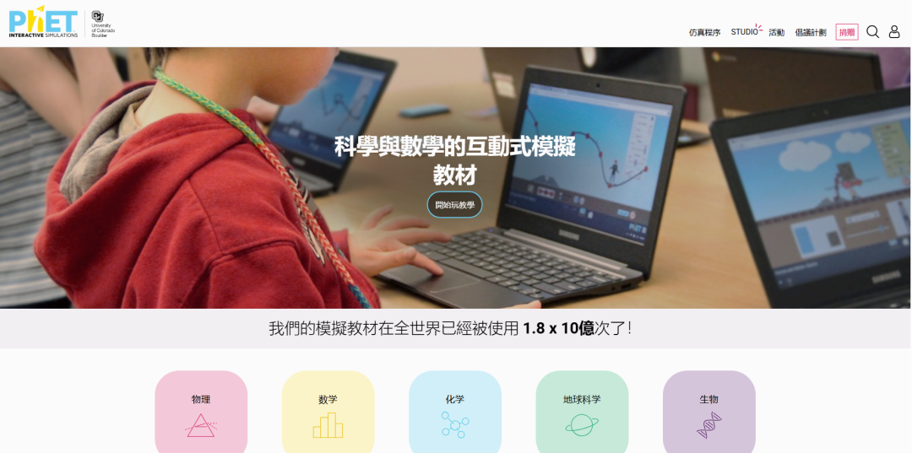
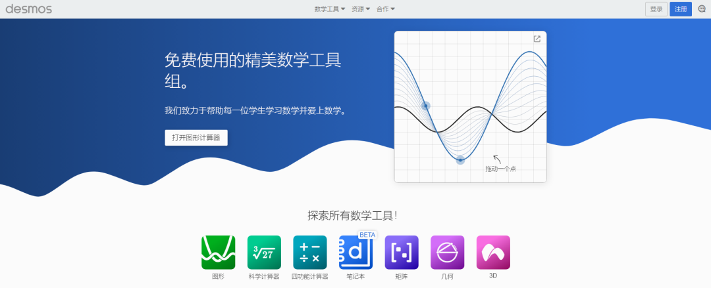
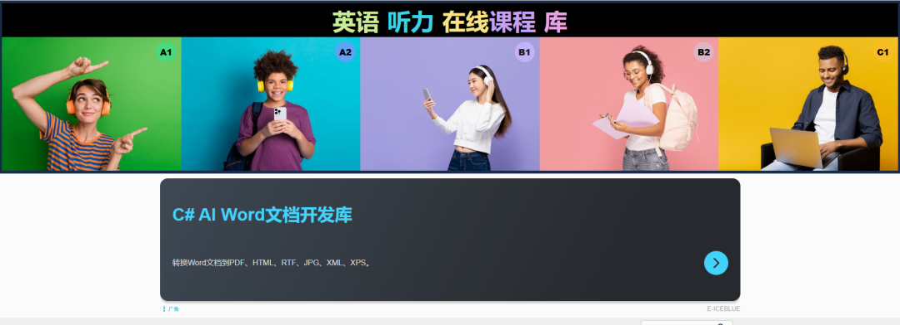
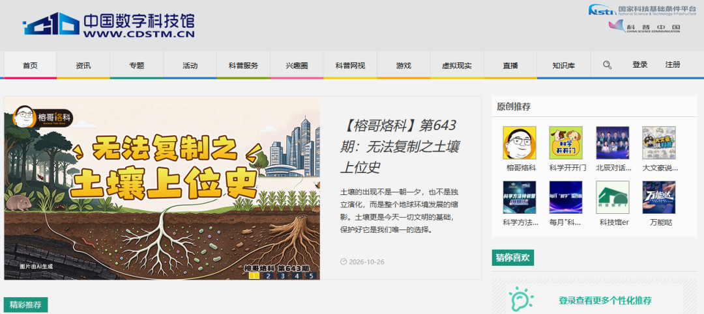
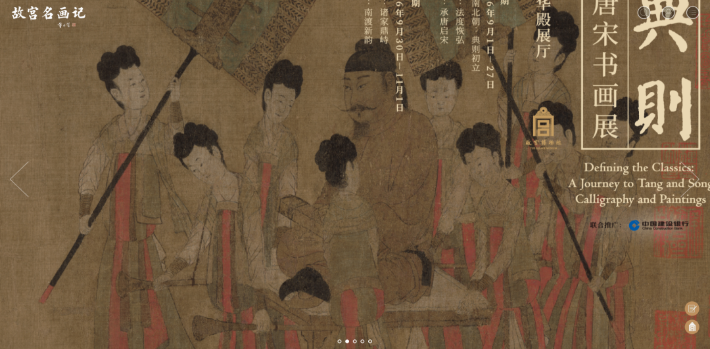
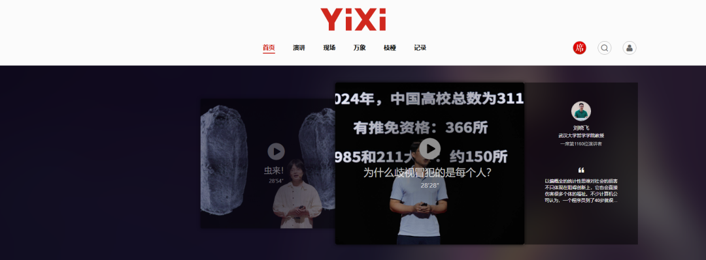

# 比B站还好用的6个学习网站，知道的人还不多！
> 💡 备注属性未写入，可能是备注属性名称或者类型被修改了，建议将字段类型设置为 rich_text，可以在小程序-操作-修改文章数据库页面进行调整
> 💡 原文链接:[https://mp.weixin.qq.com/s?__biz=MzA3NDU2Njc4Nw==&mid=2652234621&idx=1&sn=51cc13f0d08259978ec9142b01eaa2ba&chksm=85831b803ea63626ef56626c68452fc90497536706e83d65296a6c93e1655b2094c2ee0e7f9e#rd](https://mp.weixin.qq.com/s?__biz=MzA3NDU2Njc4Nw%3D%3D&mid=2652234621&idx=1&sn=51cc13f0d08259978ec9142b01eaa2ba&chksm=85831b803ea63626ef56626c68452fc90497536706e83d65296a6c93e1655b2094c2ee0e7f9e#rd)
刷B站学习，大概是很多人的日常。
但B站的问题也明显：**算法一推，你就从"看一节课"滑到了"看一晚上视频"，真正学进去的东西没多少。**
其实还有一批专门做学习的网站，没有弹幕、没有推荐流，打开就是干正事。它们免费、没广告，知道的人却不多。
下面这6个，覆盖理科、英语、科普、艺术和人文，建议先收藏。
**一、PhET 互动仿真实验**

**网址：https://phet.colorado.edu/zh_CN/**
美国科罗拉多大学团队做的公益项目，发起人里有拿过诺贝尔物理学奖的 Carl Wieman，**全程免费，也没有广告弹窗。**
它把**物理、化学、生物、地球科学和数学**里那些看不见摸不着的概念，做成能上手拖一拖的互动仿真。
比如电路那块，你直接拖动电压和电阻，灯泡当场变亮变暗，比在视频里看别人演示直观得多；几何光学里还能自己拖着光线看折射怎么变。
**界面有中文，打开就能用。**
适合初高中理科生自己琢磨，也适合家长陪孩子弄明白一个"为什么"。

**二、Desmos 图形计算器**

**网址：https://www.desmos.com/?lang=zh-CN**
严格说它是个在线函数图像工具，但用过就知道，函数题一旦画出来，理解起来完全是另一回事。
输入一个函数，图像立刻出来；拖动滑块，参数怎么变看得清清楚楚。还能用表格描点、画不等式区域、给图像加动画。
从初中一次函数、高中抛物线到大学微积分都能用上。
家长辅导时不用干讲"开口朝哪边"，直接把参数拉给孩子看，比手画草图快也准。
它界面极简，第一次打开可能有点"就这？"的错觉，多用两次就离不开了。

**三、ELLLO 英语听力**

**网址：https://www.elllo.org/**
一个免费英语听力资源库，三千多节听力课，从A1到C1分了级，素材是各国口音的真人对话和短视频。
每节课都配文本、词汇讲解和互动小测，练听力不用再翻来覆去找素材。
我比较喜欢它按口音和难度挑素材的设定——想让孩子听惯不同国家的发音，这儿比只放美音的材料更实用。
适合中学生自己练，也适合家长陪着一起做。

**四、中国数字科技馆**

**网址：https://www.cdstm.cn/**
中国科协和中国科技馆办的官方公益科普平台，**不收费，内容也靠谱。**
它有虚拟展厅，能在家"云逛馆"——漫游科技馆、移动 VR 馆，加上科学微课、展品荟萃几个栏目，孩子对哪件展品感兴趣都能点进去看。
每月还有个"科学流言榜"，专门拆常见的伪科学说法，家长自己看也挺有用。
适合家长带孩子周末在家逛一逛，尤其是不方便跑实体馆的时候。

**五、故宫名画记**

**网址：https://minghuaji.dpm.org.cn/**
故宫博物院官方做的，把院藏历代名画高清数字化。
最大的好处是能放大——笔触、印章、题跋看得一清二楚，旁边配作品综述和解读，等于把一幅画看进了细节里。
适合语文、美术、历史爱好者，也适合给孩子做美育启蒙。想让孩子对古画有兴趣，干讲不如直接让他自己放大盯着看。

**六、一席**

**网址：https://yixi.tv/**
国内一个做深度演讲的平台。讲者来自各行各业，话题偏人文、社会、艺术和科学，一个视频就是一个完整观点，看完总能留下点什么。
它没有算法推荐，也没有弹幕，就是安安静静看一场演讲——这一点在刷惯了短视频之后其实挺难得。
适合家长自己拓宽视野，也适合放给高中生看，帮他们了解不同行业真实的思考方式。

**写在最后**
这6个网站有个共同点：**都不靠算法留住你，而是靠内容本身**。打开它们，你不会被推着往下滑，只会想着"这个我再看一会儿"。
学习这件事，工具从来不是关键，但选对了工具，至少能少走点弯路。
上面这些大多免费、无广告，挑一两个先用起来，比收藏一堆吃灰强。
如果你也有私藏的好用学习网站，欢迎在评论区分享，让更多人少踩坑。
**觉得有用的话，点个关注，我会继续挖这类不靠算法、只靠内容的好东西。下次更新，别错过。**
#学习网站 #免费资源 #自学 #学习方法 #家长必看 #英语听力
