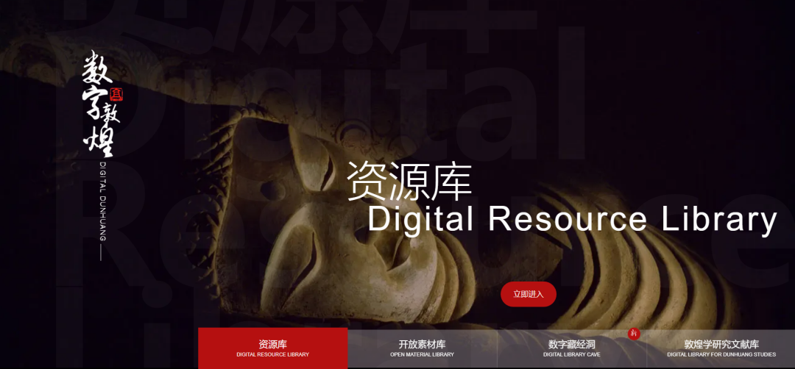
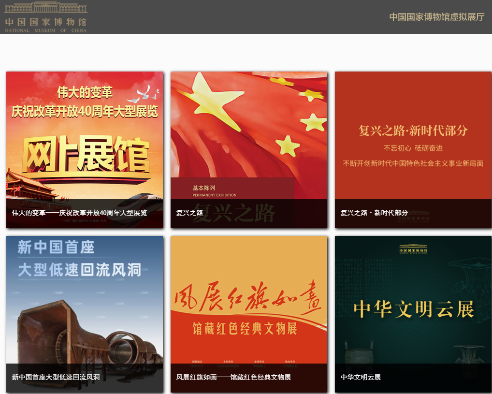
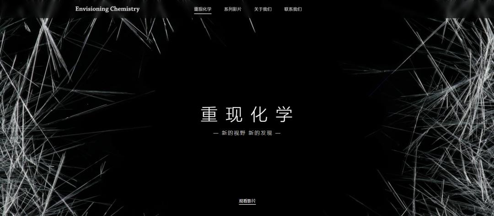
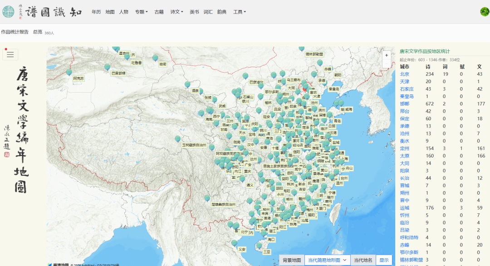
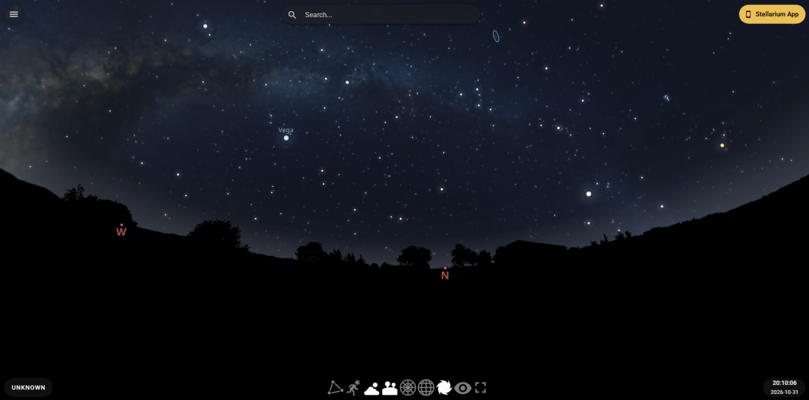

# 比刷视频还爽的学习网站，我居然一口气学了5小时
> 💡 备注属性未写入，可能是备注属性名称或者类型被修改了，建议将字段类型设置为 rich_text，可以在小程序-操作-修改文章数据库页面进行调整
> 💡 原文链接:[https://mp.weixin.qq.com/s?__biz=MzA3NDU2Njc4Nw==&mid=2652234633&idx=1&sn=064d0110a594490ff5baa3224f6ade83&chksm=85f890a2f43cc79865dac7e992886a433bc23876fe4dfb08dbb7a70ee30aca53bf685187aa72#rd](https://mp.weixin.qq.com/s?__biz=MzA3NDU2Njc4Nw%3D%3D&mid=2652234633&idx=1&sn=064d0110a594490ff5baa3224f6ade83&chksm=85f890a2f43cc79865dac7e992886a433bc23876fe4dfb08dbb7a70ee30aca53bf685187aa72#rd)
如果你家里有正在上学的孩子，想让他少刷点短视频、把时间花在真正有营养的地方，这5个网站值得进收藏夹。
**它们全部免费，大多不用注册就能看**，出品方是国家研究院、故宫博物院、中科大和开源团队这类正经机构，不是临时拼起来的课件站。
道理很简单：真正做得好的资源往往不在广告里，而在这些安静的地方，孩子一旦点进去，常常一口气看上几个小时还嫌不够。
下面这些网站个个做得像好玩的东西——它们不靠题目留人，靠的是"原来还能这样"。也正因为好玩，他才愿意一直看下去。
**1、数字敦煌**
**网址:https://www.e-dunhuang.com/**
**敦煌研究院做的官方网站**，把莫高窟里平时进不去、或者进去了也看不清的洞窟搬到了屏幕上。
30个精品洞窟的高清图像可以放大到看清壁画上的每一笔线条，还能全景漫游，像自己举着火把一个个走进去；配套的数字化藏经洞和敦煌学研究文献库也在同一片资源里。
截至2024年，全球已有2300 多万人次打开过它，用户来自78个国家。
适合对历史、美术和古代生活感兴趣的孩子，尤其是正在背历史朝代的那几年——亲眼看过一遍洞窟，比死记年代有用得多。

**2、中国国家博物馆数字展厅**
**网址：https://www.chnmuseum.cn/portals/0/web/vr/**
中国国家博物馆把历年办过的专题展做成了线上实景展厅，打开就能像在馆里一样"边走边看"。
目前收录的展览有70余种，从"古代中国""复兴之路"这类基本陈列，到"中国古代服饰文化展""舟楫千里——大运河文化展""科技的力量"等专题展，还有"意大利之源——古罗马文明展""伦勃朗和他的时代"这类国外主题展。
每个展厅都能看到实景、藏品说明，部分还配了语音讲解，支持第一视角漫游和展品热点点击。
适合想让孩子"逛一次博物馆"却抽不出整块时间的家庭，也适合历史、美术课上需要找实物素材的学生——一件器物放进它所属的朝代里看，比单看课本插图记得牢。

**3、重现化学**
**网址：https://www.envisioningchemistry.cn**
由中科大、清华大学出版社和"美丽科学"团队联合做的化学影像项目，出品人是梁琰，有完整的中文版。

它把结晶、沉淀、金属置换这些课本上一句带过、老师在讲台上也演示不出来的过程，用显微摄影和延时拍摄拍成了短片，美得不像实验，倒像自然纪录片。

适合正在学化学的初高中生——抽象的反应方程式如果先看过一遍真实的画面，理解起来会容易很多，也适合纯粹想看点好看的东西的人。

**4、唐宋文学编年地图**
**网址：https://cnkgraph.com/Map/PoetLife**
由王兆鹏教授领衔、上百人团队历时五年建成的数字人文项目，上线当天浏览量就超过一百万，2020 年拿过数字人文年会的最佳题材奖。
它把李白、杜甫、苏轼这些诗人的一生行迹画在了地图上：点一个诗人，能看他一生去过哪里、在哪个地方留下哪些作品；点一座城市，能看到有多少诗人来过、留下多少首诗；地图还能在唐代、宋代、五代十国的版图之间切换。
适合背古诗背到心累的学生——当你知道诗人是在被贬的路上、在哪个渡口写下那句诗，诗就不再只是一行要默写的字。

**5、Stellarium Web 在线星图**
**网址：https://stellarium-web.org/**
开源天文软件 Stellarium 的网页版，不用下载安装，打开就能用，界面支持简体中文。
它会根据你所在的时间和位置，把此刻头顶真实的星空画出来——恒星、行星、星座、银河一条条对得上；拖一下时间轴，还能看今晚月亮几点升起、冬天和夏天的星空有什么不一样。
它是全世界天文爱好者用了二十多年的软件，网页版让这件事连注册都不需要。
适合对宇宙好奇的孩子，也适合想带孩子在楼下认一次星星的家长；拿着它对一次，比看十条天文短视频记得牢。

你家孩子会先点开哪一个？如果他私藏着别的"一打开就停不下来"的学习网站，也欢迎在评论区告诉我，我下期接着整理。
#学习网站 #免费资源 #学习网站推荐 #学习方法 #家庭教育小妙招
