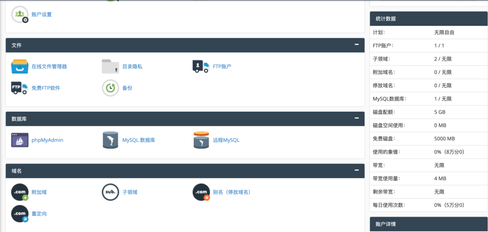

# 永久免费的虚拟主机又来了！5GB空间+PHP+MySQL，免费搭建个人网站、WordPress博客！
> 💡 备注属性未写入，可能是备注属性名称或者类型被修改了，建议将字段类型设置为 rich_text，可以在小程序-操作-修改文章数据库页面进行调整
> 💡 原文链接:[https://mp.weixin.qq.com/s?__biz=MzIwMjUyMjQ2Ng==&mid=2247485430&idx=1&sn=8f16d6af391ff50ecd406fb19078d518&chksm=97eb567fe1528c0dc8c534f6402d5577edf743bbac2ef5a142a2eedcca6794302a1e72edfd7f#rd](https://mp.weixin.qq.com/s?__biz=MzIwMjUyMjQ2Ng%3D%3D&mid=2247485430&idx=1&sn=8f16d6af391ff50ecd406fb19078d518&chksm=97eb567fe1528c0dc8c534f6402d5577edf743bbac2ef5a142a2eedcca6794302a1e72edfd7f#rd)
很多刚开始学习建站的小伙伴，都会遇到一个共同的问题：
想拥有一个属于自己的网站，但是第一步就被成本和技术门槛劝退。
❌ 买服务器需要花钱
❌ 不懂 Linux 环境配置
❌ 不知道怎么安装网站程序
❌ 只是想学习 WordPress，却不想一开始投入太多成本
其实对于新手来说，刚开始并不一定需要购买昂贵的服务器。
今天给大家分享一个适合入门学习的免费虚拟主机平台：**InfinityFree** 🎉
它提供免费的虚拟主机空间，支持 PHP 和 MySQL 数据库，可以用来学习网站搭建、体验 WordPress 博客建设。
本期我也录制了详细的**InfinityFree免费虚拟主机领取 + WordPress博客搭建保姆级教程**，从注册到网站上线，一步一步带大家完成。🔥
---
## 🌟 InfinityFree 是什么？
InfinityFree 是一个提供免费虚拟主机服务的平台。
简单理解：
它相当于给你提供了一块免费的“网站空间”。
你不需要购买服务器，也不需要自己从零开始配置网站运行环境，只需要注册账号，就可以创建自己的免费空间。
对于：
✅ 想学习建站的小白
✅ 想体验 WordPress 的用户
✅ 想搭建个人博客的人
✅ 想学习网站后台管理的人
都是一个不错的入门选择。
---
## 💻 InfinityFree 免费虚拟主机有什么功能？
### 📦 1、免费 5GB 网站存储空间
平台提供：
📁 5GB 网站空间
可以存放：
✅ WordPress程序文件
✅ 网站主题
✅ 插件文件
✅ 图片资源
✅ 网站内容数据
对于个人博客来说，前期学习和测试完全够用。
很多刚开始建站的小伙伴，其实并不需要太大的服务器配置，一个稳定的空间就可以帮助你快速入门。
---
## 🗄️ 2、支持 MySQL 数据库
WordPress 是目前非常流行的博客系统，而数据库是它运行的重要组成部分。
InfinityFree支持：
✅ MySQL数据库
✅ 数据库管理
✅ PHP运行环境
可以满足 WordPress 安装需求。
通过数据库，可以保存：
📝 文章内容
👤 用户信息
⚙️ 网站配置
📌 插件数据
让你体验完整的网站运行流程。
---
## ⚙️ 3、支持 PHP 程序运行
很多网站程序都是基于 PHP 开发。
InfinityFree支持 PHP 环境，可以运行：
✅ WordPress
✅ PHP博客程序
✅ 小型网站项目
✅ 开源程序测试
对于学习网站开发来说，可以更加直观地了解：
网站程序 → 数据库 → 浏览器访问
整个网站运行过程。
---
## 📂 4、FTP 文件管理
搭建网站过程中，经常需要上传和管理网站文件。
通过 FTP，可以方便：
📤 上传网站程序
📥 下载网站文件
📝 修改代码文件
📁 管理网站目录
对于第一次搭建网站的新手来说，比自己管理服务器更加简单。
---
## 🔥 为什么推荐新手体验免费虚拟主机？
### ❌ 传统服务器建站的问题
很多教程一开始就让购买云服务器。
但是对于新手：
购买服务器只是第一步。
后面还需要：
安装系统
配置环境
安装宝塔面板
配置数据库
设置网站运行环境
整个流程比较复杂。
如果只是想：
“我想看看 WordPress 是什么样”
“我想搭建一个自己的博客”
其实免费虚拟主机更加适合入门。
---
## 😍 InfinityFree 可以解决哪些用户痛点？
### 🚩 痛点一：想做博客，但是成本太高
很多人都有一个想法：
“我想拥有一个自己的博客。”
但是想到：
服务器费用
网站环境
技术问题
最后放弃。
免费虚拟主机可以降低开始门槛：
✅ 不需要购买服务器
✅ 直接开始学习
✅ 体验完整建站流程
先行动起来，比一直观望更重要。
---
### 🚩 痛点二：不会服务器部署
对于小白来说：
Linux命令
SSH连接
环境配置
这些内容学习成本比较高。
虚拟主机已经准备好了基础环境。
你只需要：
上传程序
创建数据库
完成安装
即可看到属于自己的博客网站。
---
### 🚩 痛点三：想学习 WordPress，但是不知道怎么开始
WordPress虽然简单，但是第一次搭建还是会遇到很多问题：
❓程序怎么下载？
❓数据库怎么创建？
❓网站怎么安装？
❓后台在哪里登录？
所以我这次录制的视频，就是帮助大家解决这些问题。
---
## 📝 使用 InfinityFree 可以搭建什么？
### ✍️ 1、WordPress个人博客
这是最常见的用途。
可以搭建：
📚 技术博客
📚 学习笔记网站
📚 个人分享平台
📚 资源整理网站
记录自己的成长和经验。
---
### 🧑‍💻 2、学习网站搭建
适合：
网站新手
学生
程序学习者
通过实际搭建：
了解网站结构
熟悉后台操作
学习网站维护
---
### 🧪 3、测试网站程序
如果你发现一个开源项目：
想体验一下效果。
可以先部署到免费空间测试。
比如：
WordPress主题
PHP插件
简单网站程序
---
## 🎬 本期视频教程内容
这次我录制的是：
《InfinityFree永久免费虚拟主机领取 + WordPress博客搭建保姆级教程》
视频包含：
🛠️ 注册免费账号
🛠️ 创建免费虚拟主机
🛠️ 查看空间信息
🛠️ 登录网站后台
🛠️ 完成WordPress安装
🛠️ 多应用同时创建
即使是第一次接触建站，也可以跟着教程一步一步完成。
---
## ⚠️ 关于免费虚拟主机
免费资源更加适合：
✅ 学习
✅ 测试
✅ 个人博客
✅ 小型项目
如果以后网站访问量增加，或者用于正式商业项目，可以再考虑升级更高配置的服务器。
建站最重要的是：
先开始。
很多优秀的网站，都是从一个简单的小项目慢慢成长起来的。
---
## 📌 总结
InfinityFree 是一个非常适合新手入门的免费虚拟主机平台。
它降低了建站门槛，让更多人可以：
🚀 免费体验网站搭建
🚀 学习 WordPress 博客建设
🚀 熟悉网站运行流程
🚀 开始自己的建站之路
如果你一直想拥有一个自己的博客，但是又觉得服务器太复杂、成本太高，那么可以从这个免费虚拟主机开始尝试。🔥
## 🖼️相关截图

```javascript
视频教程地址：https://aixmb.com/1140.html
```
🔝🔝🔝
**--完--**

读到这里说明本文对你有所帮助，欢迎**置顶（标星）公众号 Ai 星码**，这样就能第一时间接收干货推送了～

## 摘要

（待补充）

## 我的笔记

（待补充）
