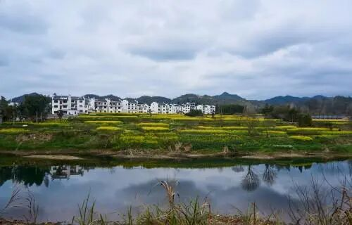
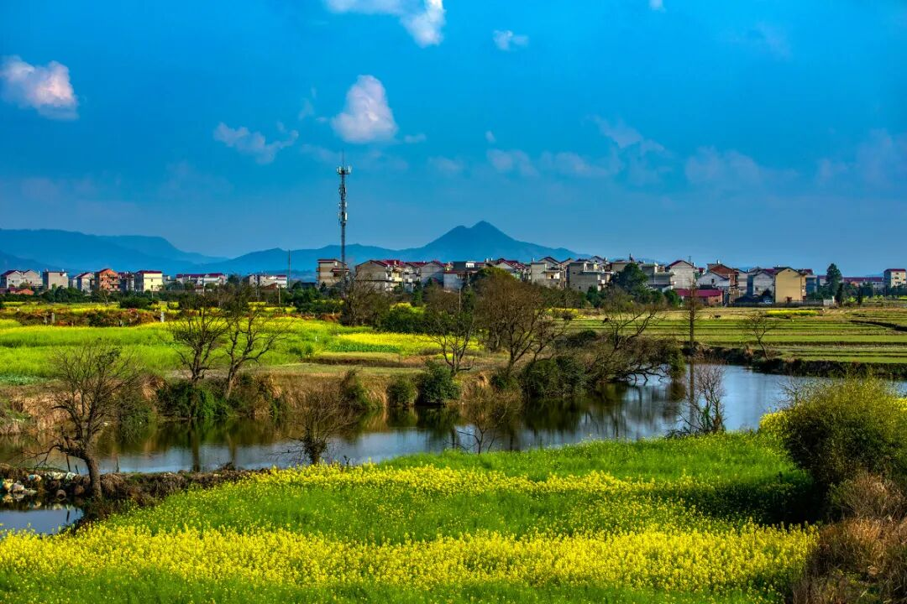
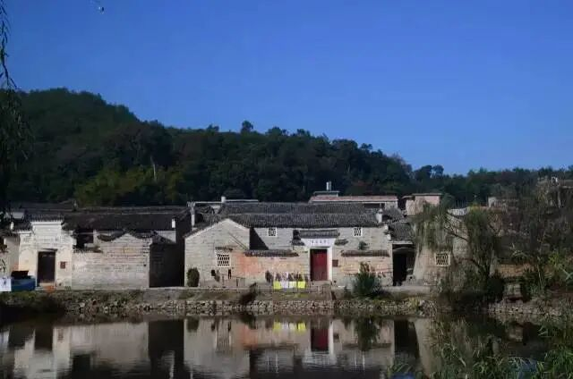

# 江西人的宿命一定是离开江西吗？
> 💡 备注属性未写入，可能是备注属性名称或者类型被修改了，建议将字段类型设置为 rich_text，可以在小程序-操作-修改文章数据库页面进行调整
> 💡 原文链接:[https://mp.weixin.qq.com/s?__biz=MjM5NTAyOTY0MQ==&mid=2452784101&idx=1&sn=7fdb18ae3dbfcfc46baac948761ff0fa&chksm=b0f8e73551f5c60b177ab8bb9e775211b4dd243efe0cdd77a0e085f27a16499744e82c1a5b30#rd](https://mp.weixin.qq.com/s?__biz=MjM5NTAyOTY0MQ%3D%3D&mid=2452784101&idx=1&sn=7fdb18ae3dbfcfc46baac948761ff0fa&chksm=b0f8e73551f5c60b177ab8bb9e775211b4dd243efe0cdd77a0e085f27a16499744e82c1a5b30#rd)
**“江西人的宿命一定是离开江西吗？”**

这句话，经常出现在赣籍打工人、创业者的朋友圈。每到节假日，沪昆高铁、昌赣高铁上挤满了归乡的人，车厢里是带着乡愁的江西口音；可年节一过，很多人又收拾好行囊，踏上开往长三角、珠三角、福建的列车。长久以来，外出务工、外出打拼，仿佛成了刻在很多江西人身上的惯性，甚至被解读成一种逃不开的宿命。
 
但细细想来，离开从来都不是最终的归宿。**很多江西人背井离乡奔赴远方，与其说是逃离故土，不如说是一场奔赴历练的远行，而远行的初衷，很多时候，就是为了将来有能力归来。**

大批江西人选择向外走，从来不是单纯不想留在家乡，背后是很现实的生存与发展考量。江西山地丘陵多，早年工业基础薄弱，本地高薪岗位稀缺，可供年轻人挑选的就业赛道十分有限。隔壁浙江成熟的制造业与电商生态，广东蓬勃的科创、外贸产业，上海、苏州集聚的高端产业链，能提供更高的收入、更广阔的发展平台。
 
不少寒窗苦读出来的年轻人，学计算机、生物医药、先进制造这类专业，想要找到和自身专业匹配的岗位，早些年大多只能向外寻找机会。除此之外，过去很长一段时间，对比沿海城市，江西在产业链配套、高薪岗位密度上存在差距。**没有人天生愿意远离家人，只是很多人在家乡，很难找到一份足以撑起家庭开支、实现自我价值的工作。**

于是一代又一代江西人，带着期盼走出红土地。有人进厂务工，有人求学深造，有人外出闯荡做生意。在外的日子并不轻松，远离亲人，独自面对陌生的环境，熬过无数个想家的夜晚。在很长一段时间里，不少人外出之后，目标就是在外地定居落户，把他乡当成长久的家。
**
**
**只是时代在变，江西也在变，“外出”这件事，正在慢慢从永久的逃离，变成一段阶段性的修行。**
 
如今越来越多在外打拼的赣籍创业者，在沿海攒下资本、技术、行业资源之后，选择把项目、工厂甚至研发中心搬回江西。沃格光电的易伟华，早年在深圳沉淀积累，最后回到新余深耕光电显示与半导体玻璃基技术；三越高新的袁志军在广东、江浙历练20年后扎根家乡永丰，依托本地资源攻坚高端新材料，打破海外技术壁垒；甘源食品的严斌生，在广东摸清零食赛道的机遇后，2006年将工厂迁回萍乡，一步步把本土企业做成上市公司。
 
他们都是最生动的例子：**走出去，是去取经，去见识更前沿的商业模式，积累人脉和资本；等羽翼丰满，再带着一身本领回到家乡落地生根。**
 
现在年轻人的规划，也慢慢有了新的模样。不少人选择先去沿海读书、上班，在成熟的产业环境里打磨自己，等到家乡对应的产业赛道兴起，再考虑回乡发展。离开不是放弃家乡，只是先去外面积攒底气。
 
当然，**我们不必刻意鼓吹所有人都要返乡，每一种人生选择，都值得尊重。**
 
不是每一个江西人，最终都适合回来。有人在沿海站稳脚跟，安家立业，把小日子经营安稳，他们同样是江西的孩子，在外踏实奋斗，也是在为家族争光，也在向外传递江西人的韧劲。有人舍不得故土，选择留下来，深耕乡村农业、经营本地生意，或是安稳做好本职工作，默默参与家乡建设。
 
还有**大量身在外地的江西人，没有回乡定居，却在用别的方式反哺这片土地。**逢年过节回乡消费，带动家乡的小店、乡村经济；主动帮老家亲友对接资源渠道，把外面的项目信息、商机带回江西；主动为江西文旅、农特产品宣传带货，向外推介家乡。这种身在他乡、心系故土的牵挂，也是另一种形式的归来。
 
这些年江西的变化，所有人都有目共睹。强省会南昌持续发力，各地市找准赛道发力，锂电、航空、中医药、文旅等特色产业慢慢成型。产业不断壮大，配套持续完善，带来最直接的改变，就是本地优质岗位越来越多。
 
过去很多人往外走，是被动的选择，是没有更好出路之下的无奈突围；而放在今天，外出和留乡，慢慢变成一道可以自主选择的选择题。
 
从来没有什么既定的宿命，没有一条规矩写着江西人必须离开红土地。远行，是过去一代人面对现实的突围；而归来，是时代送给赣鄱儿女的新选项。走出去，是为了开阔眼界、积蓄力量；当家乡的舞台足够宽阔，自然会吸引漂泊在外的游子，找到回来的理由。
 
山还是江西的山，根永远是江西的根。
 

离开，只是赶路；扎根，才是藏在很多江西人心底长久的念想。不必纠结归宿到底是他乡还是故土。有人奔赴远方，在别处发光；有人守在家乡，建设故土；还有人暂时远行，等待时机荣归。
**
**
**无论身在何方，心里装着这片红土地，记得自己从哪里来，就是最好的答案。**
