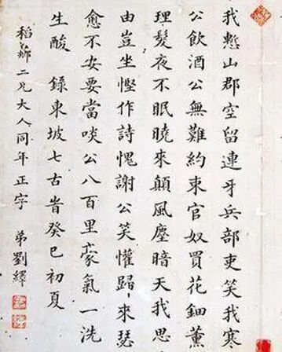
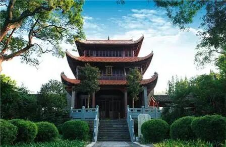
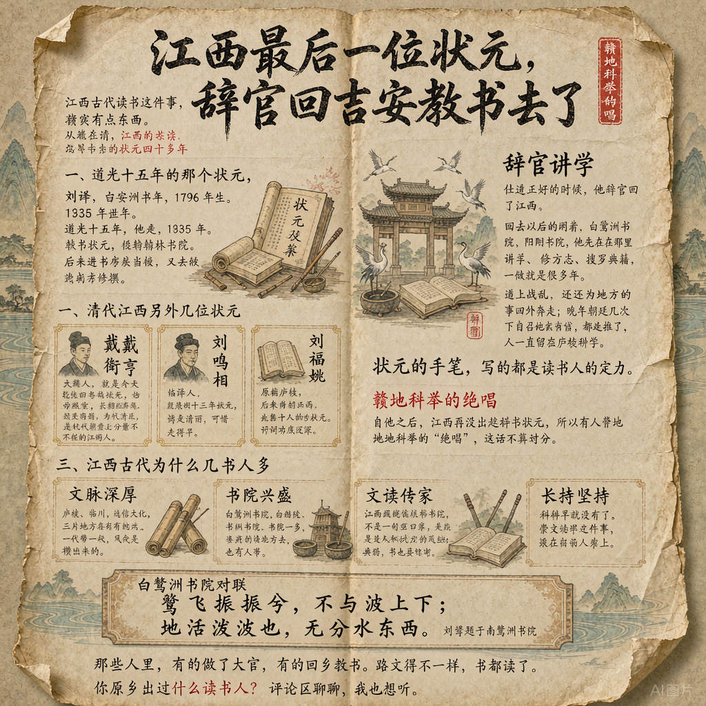

# 江西最后一位状元，辞官回吉安教书去了
> 💡 备注属性未写入，可能是备注属性名称或者类型被修改了，建议将字段类型设置为 rich_text，可以在小程序-操作-修改文章数据库页面进行调整
> 💡 原文链接:[https://mp.weixin.qq.com/s?__biz=MzU0MDg5MDU1Mg==&mid=2247483993&idx=1&sn=c30a7cdbe504f4ba27d63cd3b1ac5df3&chksm=fabeff40a9b9f79160a0736a0db49f844bd45c1049d0fc1c0209c8fd8a4f6cb59518ea516e39#rd](https://mp.weixin.qq.com/s?__biz=MzU0MDg5MDU1Mg%3D%3D&mid=2247483993&idx=1&sn=c30a7cdbe504f4ba27d63cd3b1ac5df3&chksm=fabeff40a9b9f79160a0736a0db49f844bd45c1049d0fc1c0209c8fd8a4f6cb59518ea516e39#rd)
## 前阵子整理家乡人文的老稿子，翻到科举那一段，看到一个名字，我停了一下。
刘绎。江西最后一个状元。
题外话先说一句，江西古代读书这件事，确实有点东西。
老辈人常挂嘴边一句话：翰林多吉水，朝士半江西。听着像夸张，其实就是实情。从唐到清，江西考出来的文科状元四十多位，在全国不算少。庐陵、临川一带，读书人是成片出来的。
只是科举这东西，走到清末也就到头了。刘绎，就是江西最后一位。

### 一、道光十五年的那个状元
### 
刘绎，吉安永丰人，1796 年生，1878 年去世，字瞻岩。
道光十五年，也就是 1835 年，他考中状元，授翰林院修撰。后来进南书房当值，又去做过山东学政。这份履历放当时看，标准的顺风顺水。
接下来他做的事，跟很多人想的不太一样。
仕途正好的时候，他辞官回了江西。
回去以后也没闲着。白鹭洲书院、阳明书院，他先后在那里讲学，教书、修方志、搜罗典籍，一做就是很多年。碰上战乱，他还为地方上的事四处奔走；晚年朝廷几次下旨召他回京做官，都被他推了，人一直留在庐陵讲学。后来地方上提晚清江西的教育，绕不开这个名字。
白鹭洲书院里有一副对联，是他写的：
鹭飞振振兮，不与波上下； 地活泼泼也，无分水东西。
状元的手笔，写的却是读书人的定力。
自他之后，江西再没出过科举状元。所以有人管他叫赣地科举的 “绝唱”，这话不算过分。
### 二、清代江西另外几位状元
### 
顺带记几个名字，都是江西出去的。
戴衢亨，大庾人，就是今天的大余。乾隆四十三年中的状元，学问扎实，长期在军机处当值，为官清正，是清代朝堂上分量不轻的江西人。
汪鸣相，彭泽人，道光十三年状元。诗文清丽，可惜走得早。
刘福姚，原籍庐陵，后来寄籍广西，光绪十八年的状元。诗词功底很深。
三个人，三种命。状元这顶帽子，换不来一生的顺遂，但名字到底留下来了。
### 三、江西古代为什么读书人多
### 
这个问题，后台常有老乡问。
说法不止一种，比较实在的大概这么几条。
一是底子在。庐陵文化、临川文化、饶信文化，三片地方各有各的文脉，一代带一代，风气是攒出来的。
二是书院多。白鹭洲书院、白鹿洞书院、象山书院，书上都能查到。书院一多，读书就有地方去，也有人带。
三是家里认这个。江西民间说耕读传家，不是一句空口号，是很多普通人家的实际过法：地要种，书也要读。这种观念传下来，比什么倡导都管用。
至于状元，说白了就是金榜上的一个名字。名字后面是什么，熬夜读书，家里省下来的灯油钱，几十年没断过的坚持。
科举早就没有了。崇文向学这件事，还留在江西人身上。

### 写在后面
### 
白鹭洲书院还在吉安，赣江中间那块洲子也在，水绕着走。书上写的金榜题名看不见了，字还留着。
那些人里，有的做了大官，有的回乡教书。路走得不一样，书都读了。
各位老乡，你老家出过什么读书人？评论区聊聊，我也想听。

