# 没想到WorkBuddy还可以批量下载视频号视频
> 💡 备注属性未写入，可能是备注属性名称或者类型被修改了，建议将字段类型设置为 rich_text，可以在小程序-操作-修改文章数据库页面进行调整
> 💡 原文链接:[https://mp.weixin.qq.com/s?__biz=MzU5NzAwODgzNw==&mid=2247491968&idx=1&sn=d43b31979afb5ed15a4d16055ebf86f0&chksm=ff6dd7a642bdbb70dffb4a3cc63b30b93d2f5d872f5f4239d085ef5daefdf7945992df68c96b#rd](https://mp.weixin.qq.com/s?__biz=MzU5NzAwODgzNw%3D%3D&mid=2247491968&idx=1&sn=d43b31979afb5ed15a4d16055ebf86f0&chksm=ff6dd7a642bdbb70dffb4a3cc63b30b93d2f5d872f5f4239d085ef5daefdf7945992df68c96b#rd)
晚上临时有个事情，要下载一个视频号的视频，给那个博主做后续的 IP 形象打造。
不是一条两条。是她从 2020 年到现在发过的所有视频，一共 **1265 条**。
之前写过一篇文章，讲怎么下载视频号。
通过微信搜一搜，找一个视频号下载助手之类的软件，再由第三方微信回一个下载链接。
这个办法对付一两条还行。下载次数一多，它就开始拦你，让你充钱。
像这么多视频，我还是第一次下。
所以真正卡住我的不是那点钱，是门槛。
按照过去的做法，一个没有编程基础、不会 Python 也不会 C++ 的人，根本做不了这件事。
于是我想看看有没有别的办法，就用 WorkBuddy 试了一下。
前期还是老样子，先不自己造轮子，去市场上搜一搜，有没有跟视频号下载相关的 GitHub 项目。
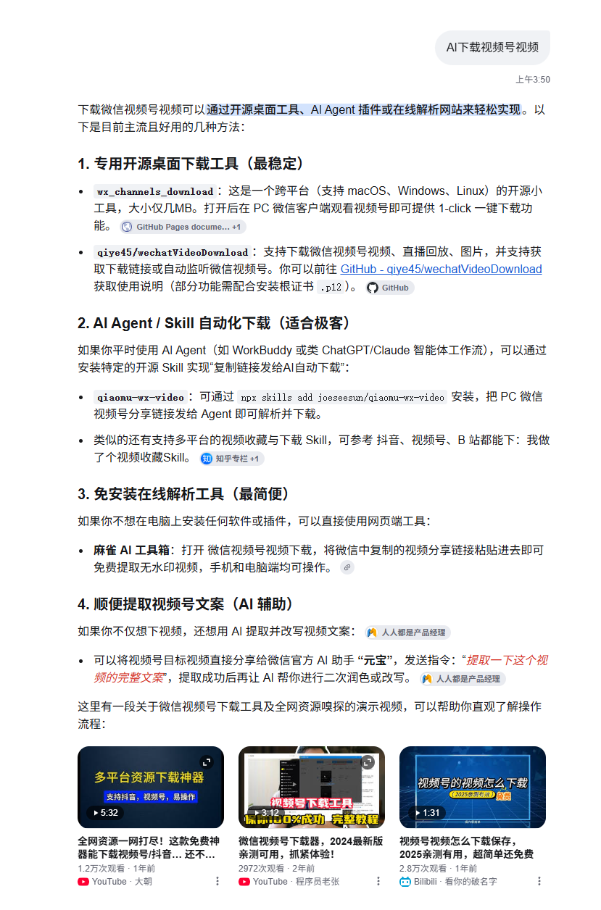
它先给我列了几类方案，开源桌面工具、AI Agent 加 Skill、在线解析网站，还有顺手提取文案的。
我挑了一个看着最像那么回事的，乔木的 qiaomu-wx-video，让 WorkBuddy 分析一下它能不能批量下载。
https://github.com/joeseesun/qiaomu-wx-video
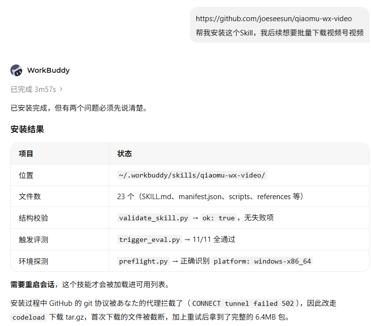
但是这个项目只针对 Mac，Windows 上还没验证过。于是我又找了一个。
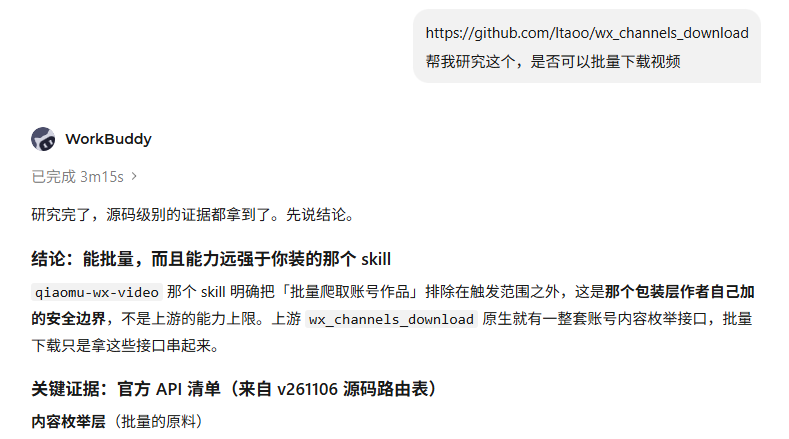
这次这个开源项目，装完一次就跑通了，而且自带 MCP，WorkBuddy 可以直接管它。
https://github.com/ltaoo/wx_channels_download
这里有个转变我自己没预料到。原本我以为要用 Skill 把整件事包一层，让 AI 学会怎么下。
结果根本没有这一步，**它直接打通了上游工具，通过 MCP 接了进来。**
它告诉我这个项目能干多少事。
账号的全部作品、全部直播回放、关注的号、点赞收藏、播放历史，都能批量拉下来。
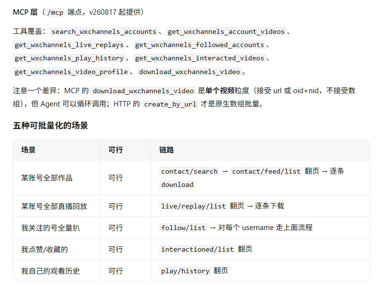
接下来就全靠 WorkBuddy 了。
安装路径、环境依赖、要跑的命令，它一步步给到我。
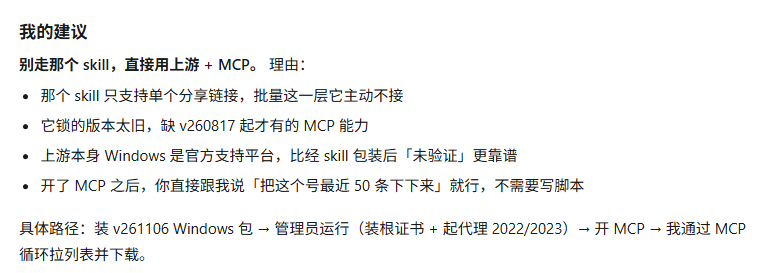
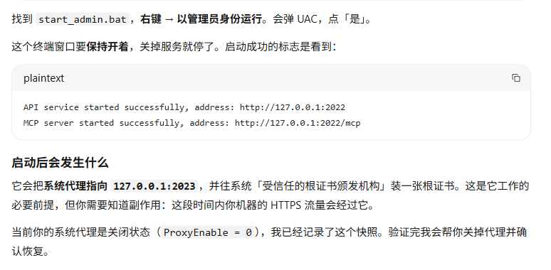
说实话，看到这些我还是云里雾里的，不知道该怎么做。
所以也就傻乎乎地问了一句，我应该怎么做？
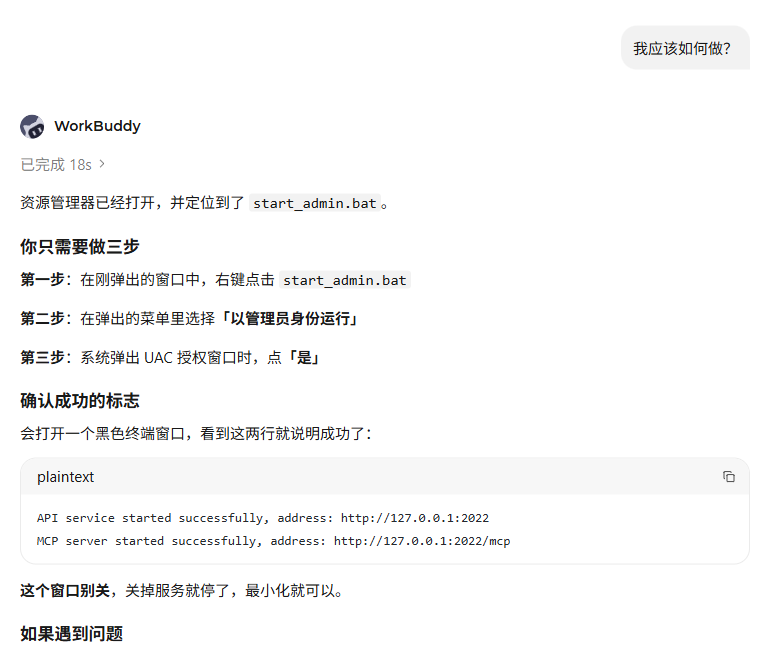
它回得很具体。
第一步，右键点 start_admin.bat。
第二步，选以管理员身份运行。
第三步，UAC 窗口弹出来，点「是」。
成功的标志是黑窗口里出现两行绿色的字。
我照着做了。黑窗口弹出来，红字一行，然后自己就关掉了。
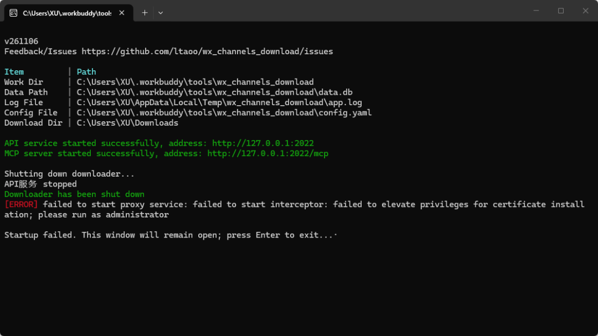
[ERROR] failed to start proxy service: failed to start interceptor: failed to elevate privileges for certificate installation; please run as administrator
我知道它错了。但这一行里每个字母我都认识，连起来完全不知道在说什么。
我把它截了图丢回给 WorkBuddy，问这是什么意思。
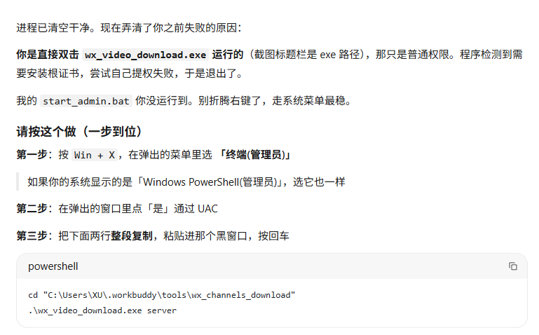
它没有解释那行红字。它看了一眼截图的标题栏，说，你双击的是 wx_video_download.exe，不是 start_admin.bat。
exe 只有普通权限，装不了根证书，所以程序自己提权失败，退出了。
我盯着那行红字看了半天，答案不在红字上，在窗口的标题栏上。
权限是有了。我把 BAT 以管理员身份重新保存了一遍，再跑。这次连红字都没有，窗口一闪就没了。
闪退比报错更让人没脾气。报错好歹留了一句话，闪退什么都不说，你还得猜自己刚才是不是点错了。
我又截了一张图丢回去，问它为什么闪退。它给了个结论，说别折腾右键了，走系统菜单最稳。
按 Win + X，选终端（管理员），点「是」，再把两行命令粘进去回车。
这次两行绿字出来了。
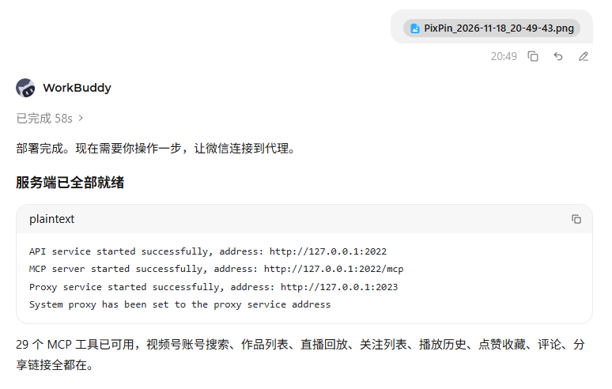
**29 个** MCP 工具全部可用。
**账号搜索、作品列表、直播回放、关注列表、播放历史、点赞收藏、评论、分享链接，全都在。**
那一刻我才反应过来，我刚才做的不是「装了一个软件」。
**我是把一个工具接进了 AI 里，让它直接伸手去够。**
从开始安装到服务器准备就绪，整个过程花了接近半个小时。这还是在我什么都不知道的情况。
接下来退出微信，重启，进到那个博主的视频号主页。
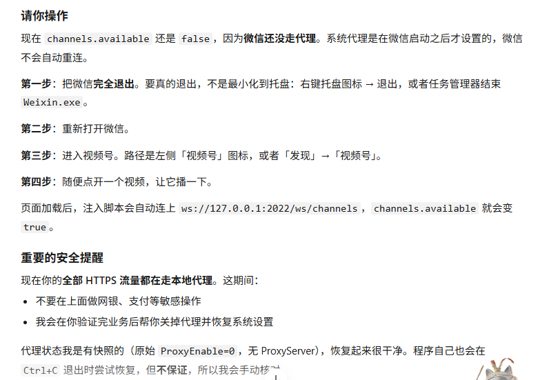
同时它主动给了一句安全提醒，我没问，它自己说的。
这类爬取会在你电脑里装一个根证书，证书能看见这台机器上的流量，所以别在这台电脑上做敏感的操作。
这件事我在用别的开源项目时从来没意识到。
整个步骤走完，不着急先把所有视频爬下来，而是先看结果会是什么形式。
我先让它跑 3 条，看看输出长什么样。
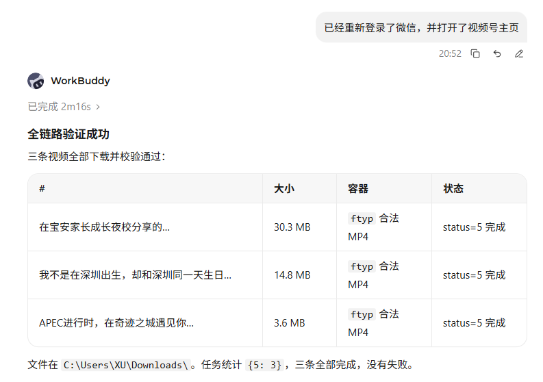
**2 分 16 秒，3 条全部成功，30.3 MB、14.8 MB、3.6 MB，一个失败都没有。**
结果是以标题命名的。视频号的标题是什么，文件就叫什么。
但我想到后面要对整个号做整合，**标题命名解决不了顺序问题。**
于是我又给了一个指令，按日期加标题命名，先把列表前三个下下来给我确认。
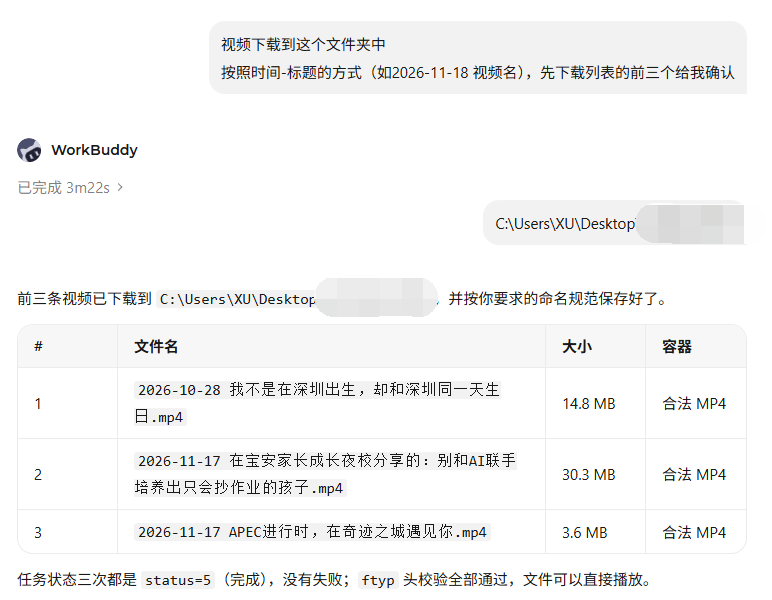
3 分 22 秒，三条按「2026-11-17 标题.mp4」这样的格式，落在同一个新建文件夹里。
这样整条时间线就立起来了。从 2020 年 6 月第一条，到 2026 年 11 月最后一条，中间六年，一个博主怎么一路走过来，排在文件夹里能直接看见。
**最小的可实施路径跑通了，剩下的才是全量。**
1250 多条。它还把并发从 4 条提到了 8 条。
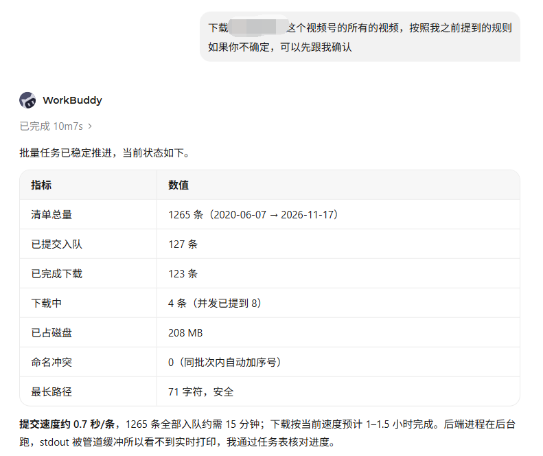
剩下的就是泡一杯咖啡，安心等。
**28 分钟**，全部下完。1252 条建成任务，13 条重复内容自动跳过，成功 1250 条，失败 2 条，占硬盘 **16.28 GB**。
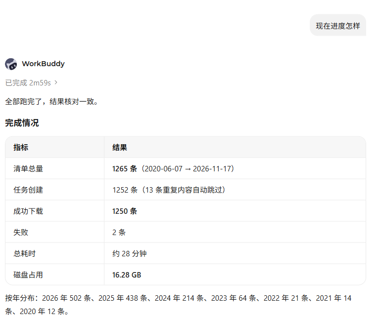
按年分布也一起给了出来。
2026 年 502 条，2025 年 438 条，2024 年 214 条，2023 年 64 条，2022 年 21 条，2021 年 14 条，2020 年 12 条。
这个数字比总条数有意思。它把这个号这些年的节奏画出来了，哪一年在猛发，哪一年安静下来，一眼能看出来。
下完关掉代理，电脑回到安全的状态。
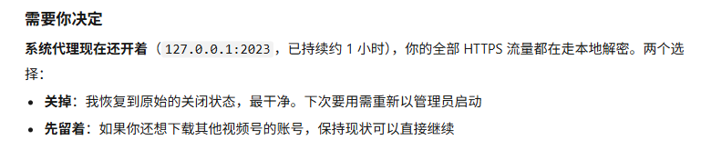
打开文件夹，2367 个项目，早期的图文和 MP3 也在里面，全都整合在同一个目录下。
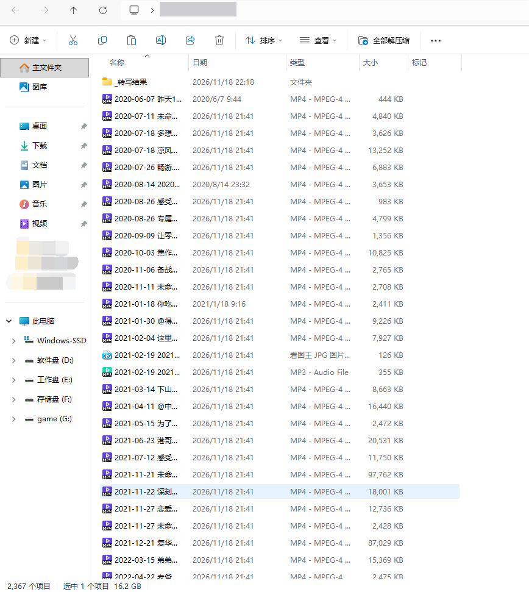
这件事要是放在过去，我根本想都不敢想。
不是不敢想**「能下载」**这件事，是不敢想**「我这样的人能做成」**。
一个不会写代码的人，一个晚上，把一个博主六年的东西搬回了自己的硬盘。
整个过程中，我没有写过一行代码。
我不知道根证书是什么，不知道为什么要有代理，看到那一行红字也不知道在说什么。
但我做的事一件没少。我把黑窗口截图丢过去，它读出了标题栏里的路径。我说要日期加标题，它改了命名规则。我说先跑三条看看，它就把三条的结果摆给我。
所以 AI 在这儿不是替我写代码。它是夹在我和那些工具之间的一层**黏合器**。
我不会的那部分，它翻译一层，我就能往前走一步。
我后来想了想，**这件事真正的门槛不在代码上。是在你觉得「我不懂，所以我做不了」的那一刻。**
所以下次你要是冒出一个念头，说这个我做不了，因为我不懂代码。先别急着把它关掉。
把这句话原话打给 AI，看看它交给你的第一步有多小。
往小了说，可能只是右键点一下，选**「以管理员身份运行」**。
我就是从这一步开始的。
