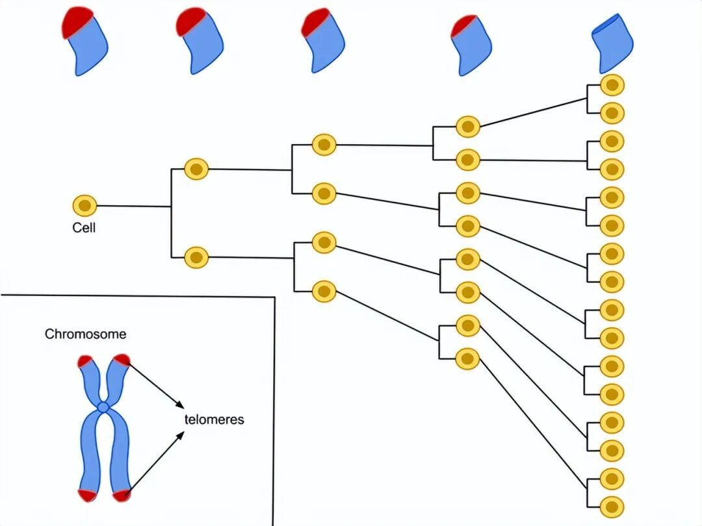
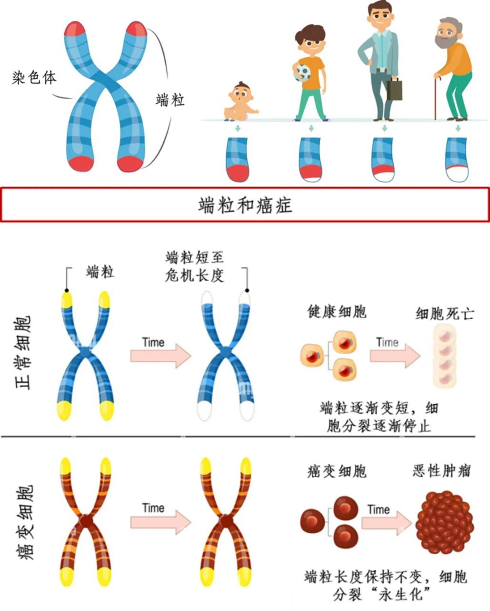
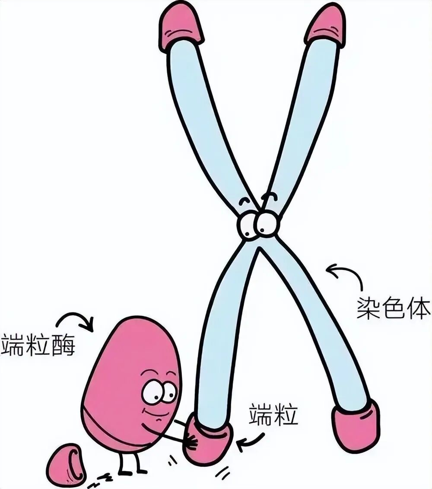
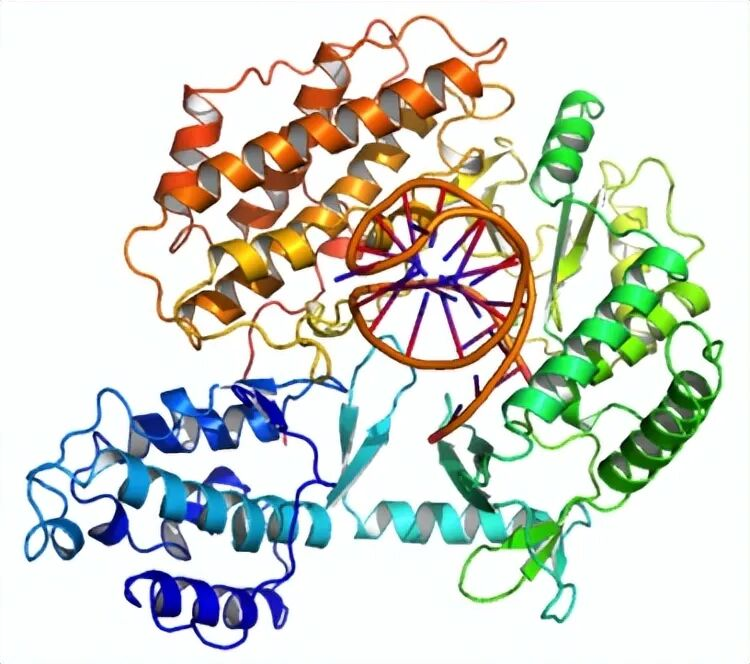
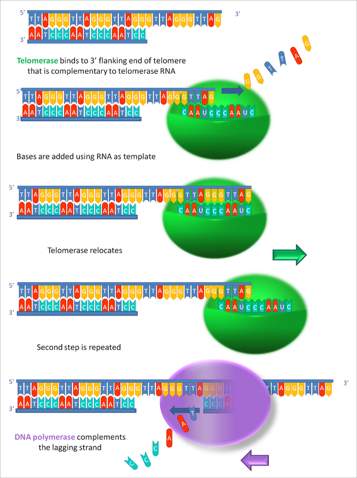
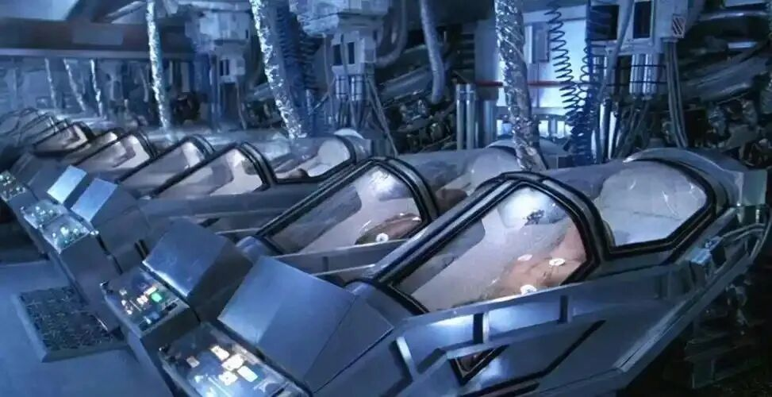
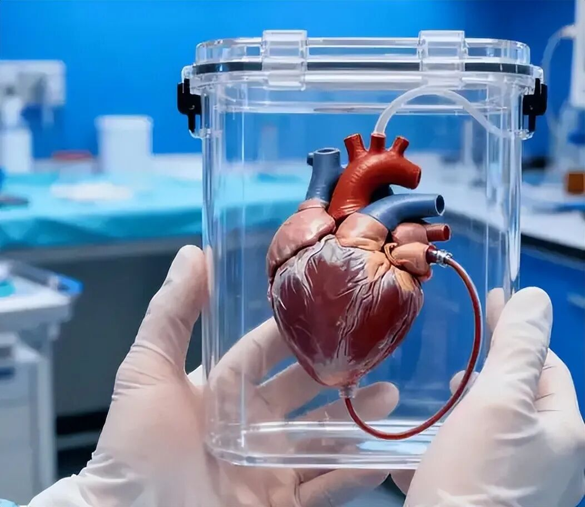
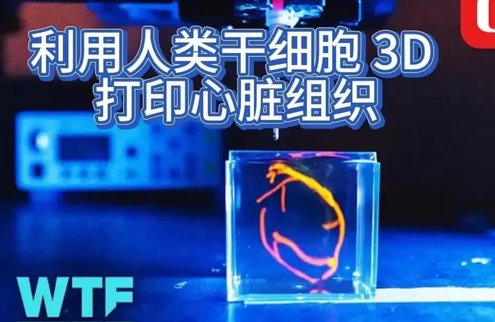
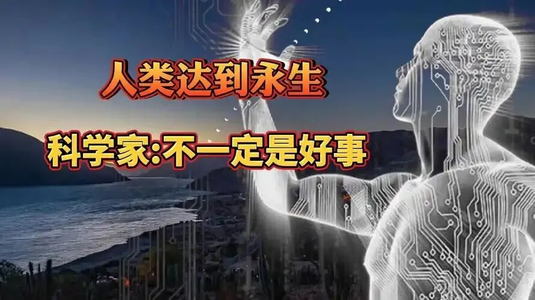

# 深度长文：人类永生的残酷真相，我们为何终究难逃一死？
> 💡 备注属性未写入，可能是备注属性名称或者类型被修改了，建议将字段类型设置为 rich_text，可以在小程序-操作-修改文章数据库页面进行调整
> 💡 原文链接:[https://mp.weixin.qq.com/s?__biz=MzI1MDEyMDQyOQ==&mid=2649405407&idx=2&sn=705cf90dbbaab46a730e7cdc78601d66&chksm=f039e09e02f40dbceebb10b9b4675c4a4a5550b4b07668547b15dff073950cbf4e3a9a520fc9#rd](https://mp.weixin.qq.com/s?__biz=MzI1MDEyMDQyOQ%3D%3D&mid=2649405407&idx=2&sn=705cf90dbbaab46a730e7cdc78601d66&chksm=f039e09e02f40dbceebb10b9b4675c4a4a5550b4b07668547b15dff073950cbf4e3a9a520fc9#rd)
从古至今，永生都是人类最执着、最浪漫也最极致的终极追求。

古人仰望明月，脑补出嫦娥奔月、求取不老仙药的传说，渴望挣脱生死轮回的束缚；近现代科幻作品里，星际冬眠、躯体再造、意识永存的设定层出不穷，寄托着人类对抗死亡、延续生命的美好期许。
但神话终究是神话，科幻也只是想象。
褪去浪漫滤镜，我们不得不直面一个残酷的现实：人类的寿命有着与生俱来的硬性极限。
在一百多年前，科学界普遍存在一个笃定的认知：人体细胞可以无限分裂、无限再生，只要细胞持续更新，人类就能无限延寿。
这个观点统治生物学界多年，直到1961年，一个颠覆性的发现彻底推翻了这套理论，也让人类首次摸到了寿命极限的底层逻辑。
美国微生物学家列奥那多·海弗里克通过大量体外细胞培养实验证实：**人体正常体细胞的分裂次数，存在无法突破的天然上限**。
无论培养环境多么适宜、营养多么充足，人类细胞最多只能分裂40至60次，之后就会彻底停止增殖，进入衰老、凋亡状态。这个不可逆的细胞分裂阈值，就是后来大名鼎鼎的**海弗里克极限**。

这个发现完美解释了生老病死的底层规律：人体的衰老，本质上就是细胞分裂次数耗尽、新生细胞不足以替换衰老细胞的过程。
皮肤松弛、器官老化、机能衰退，所有衰老表象，根源都在于细胞的增殖潜能被逐步耗尽。
那到底是什么东西，给细胞分裂装上了“计数器”和“终止键”？
答案在二十年后被科学家揭晓，这个关键物质就是**端粒**。
我们可以把人体的染色体想象成一根承载生命遗传信息的鞋带，而端粒就是鞋带两端的塑料保护头。
它不携带任何遗传基因，没有任何生理功能，唯一的作用就是保护染色体末端，避免基因复制过程中出现错位、破损、紊乱，保障细胞分裂的稳定性。
但端粒有一个致命的缺陷：**每一次细胞分裂，端粒都会被动损耗一截**。

细胞复制基因、完成分裂的过程，无法完整复刻染色体最末端的端粒片段，每分裂一次，端粒就缩短一点。随着分裂次数越来越多，端粒越来越短，当它损耗到临界值，再也无法保护染色体时，细胞就会失去分裂能力，走向衰老、休眠甚至死亡。
这就是海弗里克极限的本质：**端粒的磨损长度，直接锁死了细胞的分裂上限，也锁死了人类的自然寿命**。
后续研究中，科学家又发现了能逆转端粒损耗的关键物质，**端粒酶**。

这种酶可以主动修复、延长损耗的端粒，让细胞重新获得分裂能力。我们人体的胚胎干细胞、生殖细胞之所以能够无限增殖，核心就是依靠端粒酶的持续修复作用。
看到这里，很多人会觉得：只要激活人体所有细胞的端粒酶，持续修复端粒，是不是就能实现细胞永生，进而实现人类永生？
想法很美好，但现实极其残酷。
端粒酶是一把典型的“双刃剑”。
正常人体体细胞中，端粒酶会被严格抑制，一旦体细胞中端粒酶过度活跃，端粒被无限制修复、细胞无限制分裂，就会打破人体的生长平衡，直接诱发癌变。

端粒酶分子
这也是癌细胞能够无限增殖、永不衰老的核心原因：癌细胞彻底激活了端粒酶的全部潜能，持续修复端粒，突破了海弗里克极限，实现了病态的“永生”。
不过科学界并非毫无突破。
早在2000年前后，研究者就通过**端粒酶异位表达技术**，精准修复体细胞端粒，成功培育出了无癌化的永生细胞系。这项技术规避了端粒酶过度活跃的致癌风险，精准突破细胞分裂上限，为生物永生打下了核心基础。

端粒酶和DNA聚合酶制造端粒的顺序
自然界其实早已给出答案：水螅、龙虾等生物拥有近乎无限的自然寿命，核心秘密就是它们的体细胞可以持续稳定激活端粒酶，终身修复端粒，不会出现细胞衰老损耗，也不会引发癌变。
但人类远比这些低等生物复杂，衰老从来不是“端粒损耗”这单一因素导致的。
2013年《Cell》期刊发布的经典研究，系统总结了人类衰老的九大核心特征，除了端粒损耗，还包含基因组不稳定、线粒体功能异常、干细胞耗竭、蛋白内稳态失衡等关键问题。
2023年最新研究更是将衰老特征更新为12项，多重因素相互交织、恶性循环，构成了人类衰老的完整闭环，这也是生物永生最难突破的天堑。
既然彻底逆转衰老、实现生物永生目前难以突破，科学家便退而求其次，寻找“延缓衰老、暂停生命”的延寿方案，其中最贴近现实的，就是**人体冬眠技术**。

很多人不知道，包括人类在内的所有动物，体内都自带冬眠基因。
冬眠并不是动物的专属技能，而是生物与生俱来的生命潜能。只不过在进化过程中，绝大多数灵长类动物都关闭了冬眠基因的表达，目前仅有脂尾倭狐猴保留着天然冬眠能力。
冬眠的核心原理极其简单：通过降低体温、放缓新陈代谢速率，让人体细胞、器官的衰老进程近乎暂停。
简单来说，就是**把生命按下暂停键，时间流逝但身体不衰老**。
如果能成功激活人类冬眠基因，就能让衰老停滞，实现“时间穿越式延寿”。
比如身患绝症的人，可以通过冬眠暂停身体机能，等待未来医学技术成熟后苏醒治愈；普通人也能通过长期冬眠，跨越百年时光，迎接未来的永生技术。
目前人类冬眠技术已经实现了初步突破。
现阶段医学可以通过人工干预，将人体体温稳定降至32℃左右，实现短期休眠，最长安全维持记录达到14天，由中国科研团队保持。
这项技术已经具备落地应用的潜力，NASA计划在2035年的载人火星探测任务中，启用宇航员冬眠技术，通过长期休眠降低物资消耗、规避太空辐射风险，实现超长距离星际航行。
但现阶段的冬眠技术依旧存在明显短板：仅能实现短期休眠，无法支撑数年、数十年的长期冬眠，且低温状态下人体代谢紊乱、免疫力下降，长期休眠会引发多器官损伤，距离民用延寿还有很长的路要走。
比人工冬眠更激进、也更受争议的延寿方案，就是**人体冷冻技术**。

如果说冬眠是“暂停生命”，人体冷冻就是“封存生命，等待重生”。
人体冷冻技术的研究起源于19世纪50年代，英国科学家率先开展啮齿动物冷冻复苏实验。
自然界中，很多生物早已掌握冷冻复苏的能力，13种脊椎动物、大量无脊椎动物都可以在极低温下冻结身体，环境适宜后重新复苏，最典型的就是北美林蛙、水熊虫。
这些生物的抗冻秘密，并非天生特殊，而是体内可以合成特殊溶质：水熊虫的海藻糖、林蛙的葡萄糖与尿素，能够彻底规避低温下细胞冰晶的形成，保护细胞结构不被破坏。
受此启发，人类研发出了各类人工冷冻保护剂，比如甘油、二甲基亚砜等，为人体冷冻提供了核心技术支撑。
人体冷冻技术发展至今，经历了两次关键技术迭代。
早期的控速慢冻技术，通过1℃/分钟的精准降温速率，让细胞提前排出水分，减少冰晶生成，成功实现了细胞、胚胎、干细胞、人体器官组织的安全冷冻，目前已经广泛应用于生殖医学、生物样本保存领域。
而现阶段最先进的**玻璃化冷冻技术**，彻底摒弃了传统慢速降温模式，通过高浓度冷冻保护剂配合极速降温，让人体组织直接进入无冰晶玻璃化状态，最大程度避免细胞破损，是目前人体冷冻的核心技术。
2015年，《三体》编审杜虹女士离世后，采用这项技术完成头部冷冻保存，成为中国人体冷冻第一人，计划50年后等待技术复苏。
即便技术不断迭代，人体冷冻的复活概率依旧极其渺茫，面临着三大无法规避的致命难题。
第一是**不可逆的大脑损伤**。目前所有人体冷冻案例，全部是在临床死亡后开展。人体心跳、呼吸停止的5至8分钟内，大脑神经细胞就会开始不可逆坏死，3分钟出现功能损伤，5分钟后损伤彻底固化。而冷冻预处理、置换保护剂的过程，会进一步加剧大脑损伤，几乎无法保留完整的神经与意识结构。
第二是**冷冻保护剂的长期毒性**。为了实现玻璃化冷冻，人体血液会被全部置换为冷冻保护剂，这类物质短期使用安全，但数十年、上百年的长期封存，会持续侵蚀细胞结构，造成不可逆的细胞损伤。
第三是**宇宙辐射与时间限制**。长期低温封存无法隔绝宇宙射线辐射，辐射会持续破坏人体DNA。按照目前测算，人体冷冻的安全封存上限仅有1000年，超过这个时间，DNA会彻底碎裂，完全失去复苏可能。
还有一个最核心的哲学难题：未来即便可以通过纳米机器人修复受损的大脑细胞，重构人体组织，**修复后的生命体，是否还是原本的那个人？**
如果大脑90%的结构都是人工修复重构，仅保留10%的原始意识记忆，这种“复活”本质上是创造了一个全新的相似个体，并非真正的生命延续，这也是人体冷冻技术最大的伦理与认知争议。
相比于遥遥无期的端粒修复永生、充满争议的人体冷冻技术，**器官再造技术**是目前最成熟、最贴近临床应用的延寿路径。

人类的自然死亡，90%以上源于器官衰老、病变衰竭。
心脏、肝脏、肾脏、肺部等核心器官老化报废，是终结生命的主要原因。
如果可以无限替换衰老、病变的器官，用新生的自体器官替代老化器官，就能大幅突破寿命上限，实现长期延寿。
传统的器官移植依赖他人捐献，不仅资源稀缺、匹配难度大，还存在严重的免疫排斥反应，术后需要长期服药维持。而自体器官再造技术，可以完美规避这些问题，实现无排斥、按需培育器官。目前主流的器官再造技术主要分为三类。
第一类是**治疗性克隆技术**。
很多人谈“克隆”色变，担心克隆人引发伦理危机，但治疗性克隆和生殖性克隆完全是两回事。治疗性克隆仅提取人体体细胞基因，培育胚胎干细胞，进而分化、培育出心脏、肾脏、皮肤等人体器官，全程不会培育完整人体。
这项技术发展已经十分成熟，1996年克隆羊多莉诞生，标志着哺乳动物克隆技术成型；2013年人类成功克隆胚胎并分离出干细胞；2018年中国科学家成功克隆灵长类食蟹猕猴，彻底打破了灵长类动物的克隆技术壁垒。目前这项技术的唯一限制，不是技术难度，而是全球统一的伦理与法律约束。
第二类是**诱导多能干细胞技术**。
2006年日本科学家率先突破，通过重编程技术，将人体普通体细胞逆转分化为多能干细胞，这类干细胞具备和胚胎干细胞一样的分化能力，可以培育各类人体器官组织。
这项技术的优势是无需胚胎参与，伦理争议更小，但短板十分明显：诱导效率极低，人体细胞诱导成功率仅有0.01%-0.1%，培育周期长达3至4周，且诱导过程极易引发基因突变，存在较高的致癌风险。目前多国团队正在尝试在猪体内培育人体器官，借助动物载体解决干细胞培育难题，距离临床落地还有不小距离。
第三类是**3D生物器官打印技术**，也是目前最接近商业化、临床化的器官再造技术。

简单来说，就是以生物相容性材料为支架，搭配人体活性干细胞，通过3D打印技术逐层构建器官结构，再放入孵化室培育成熟，形成具备完整生理功能的人体器官。
目前这项技术已经实现多项突破，成功打印出皮肤、血管、心脏模型等组织器官，其中3D打印膀胱已经成功完成人体移植，是目前唯一实现临床应用的3D打印器官。
当然，这项技术依旧存在核心瓶颈：**微血管网络构建难题**。
人体器官布满密密麻麻的毛细血管，负责输送营养、代谢废物，结构极其复杂，目前的打印技术无法精准复刻微血管系统，导致复杂内脏器官无法正常存活、运转。
未来随着干细胞技术、精密打印技术的升级，3D器官打印有望彻底解决器官衰竭难题。
盘点完所有延寿、永生技术，我们可以给出一个客观、直白的结论：**短期内，绝对意义上的生物永生无法实现，但极限延寿、大幅突破自然寿命上限，已经具备实现基础。**
端粒修复技术解决了细胞永生的核心难题，但受限于人体多重衰老机制与致癌风险，暂时无法全面落地；人体冬眠、器官再造技术日趋成熟，能够有效规避器官衰竭、衰老难题，实现数百年的寿命延伸；人体冷冻技术虽然争议极大，但为未来生命延续保留了可能性。
很多人会疑惑，科学家明明已经摸清了衰老的底层逻辑，为什么迟迟无法实现永生？
核心原因就是人体是一套极其精密、复杂的闭环系统，衰老从来不是单一问题，而是基因、细胞、器官、环境共同作用的结果。
端粒损耗、基因不稳定、线粒体老化、干细胞耗竭等问题相互嵌套，解决一个难题，还会面临连锁的新问题，不存在“一招破局”的永生捷径。
更值得深思的是，永生从来不止是技术问题，更是伦理、社会、人性的终极问题。
如果人类真的打破了死亡极限，寿命不再有终点，地球的资源承载、人口结构、社会秩序、竞争体系都会彻底崩塌。生死的边界被打破，生命的价值、奋斗的意义、时间的尺度，都会被彻底重构。

科学的本质是探索未知、突破极限，但科学的底线，永远是顺应自然、敬畏规律。现阶段的我们，不必执着于虚无的永生，深耕延寿技术、攻克疑难病症、延缓衰老进程，让人类活得更健康、更长久、更有质量，才是生命科学最有意义的追求。
或许在遥远的未来，人类终将破解所有衰老密码，真正站上永生的顶峰。
但在此之前，敬畏生死、珍惜当下，才是我们对生命最好的诠释。
