# 深度长文：所以，生命不断生殖繁衍的意义，到底是什么？
> 💡 备注属性未写入，可能是备注属性名称或者类型被修改了，建议将字段类型设置为 rich_text，可以在小程序-操作-修改文章数据库页面进行调整
> 💡 原文链接:[https://mp.weixin.qq.com/s?__biz=MzI1MDEyMDQyOQ==&mid=2649405427&idx=1&sn=dadbf6582a4b7658719d2e97c425b7c7&chksm=f075efad772ff96b8a467eac09ce12a97e2c8f978f9b298be80abaf7d87da5286e007adad156#rd](https://mp.weixin.qq.com/s?__biz=MzI1MDEyMDQyOQ%3D%3D&mid=2649405427&idx=1&sn=dadbf6582a4b7658719d2e97c425b7c7&chksm=f075efad772ff96b8a467eac09ce12a97e2c8f978f9b298be80abaf7d87da5286e007adad156#rd)
如果我说：生物繁殖本身没有任何意义，你会不会觉得我在胡说八道？
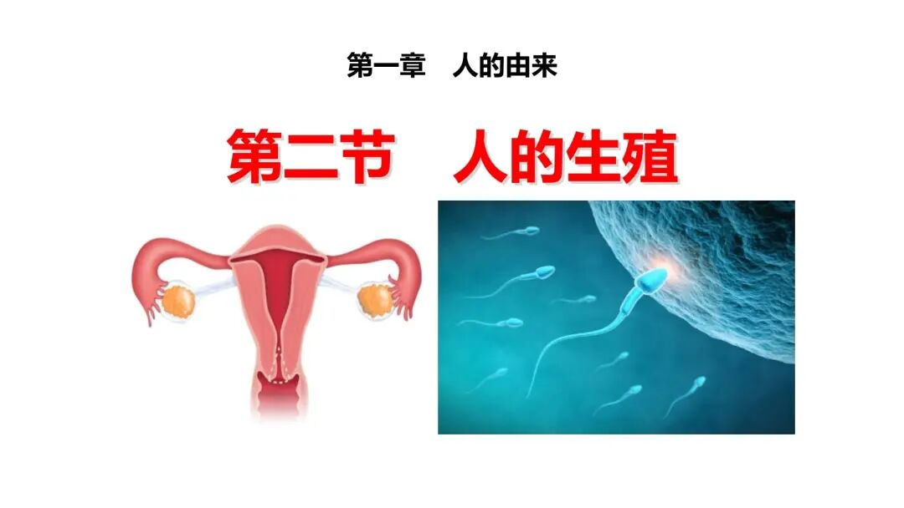
很多人之所以纠结“活着为了繁殖，繁殖为了活着”的死循环，本质上是把“人赋予的意义”和“客观存在的规律”搞混了。
绕来绕去出不来，其实就是踩进了“凡事都得有个目的”的思维陷阱里。
在聊繁殖之前，咱们得先搞懂一个最基础的问题：这个世界上，所有东西都有“意义”吗？
你看窗外的河，春天冰雪消融就涨水，秋冬降水减少就回落，它知道自己在“滋养两岸”吗？
太阳核心每秒发生亿亿次氢聚变，源源不断往外释放光和热，它有“普照大地”的目的吗？
再往小了说，你手上一个皮肤细胞，一秒钟就能完成上百万次生化反应，忙着合成蛋白、代谢废物，它清楚自己在“维持生命”吗？
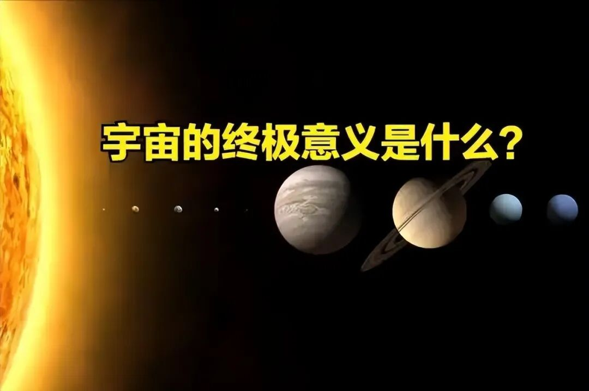
都不知道。
它们就只是安安静静地待在那儿，按照物理和化学的基本规则运行，该发生反应就发生反应，该怎么运动就怎么运动。
河流不懂什么叫奉献，太阳不懂什么叫伟大，细胞也不懂什么叫奇迹。
所有这些标签，全都是我们人类后来贴上去的。
说白了，我们眼睛看的、耳朵听的、鼻子闻的、手摸到的，所有这一切都只是“现象”。
而“意义”这个东西，从来都是人主观赋予的。
一杯茶放在桌上，它本质上就是一杯溶解了茶多酚、咖啡因和香精的水溶液，是我们给它赋予了“闲适”“治愈”“社交媒介”的意义；
一朵野花开在路边，它就是一团色素、纤维素和水分组成的植物器官，是我们给它赋予了“浪漫”“春天”“生命力”的意义。
甚至一份牵挂、一个拥抱、一个吻，拆穿了看也只是神经电信号和激素分泌，但我们愿意给它们加上“爱”的重量。
如果没有人的定义和感受，这一切都只是物质的运动和能量的转换，没有任何意义可言。
回到最开始的困惑：很多人想着想着就会问，世界好端端的，为什么要创造出生物？让生物不停繁殖到底是为了什么？
其实这个问题本身，就已经默认了“世界做什么事都有目的”。
但真实的世界，从来没有“要”做什么，它也不会回应任何人的叩问。
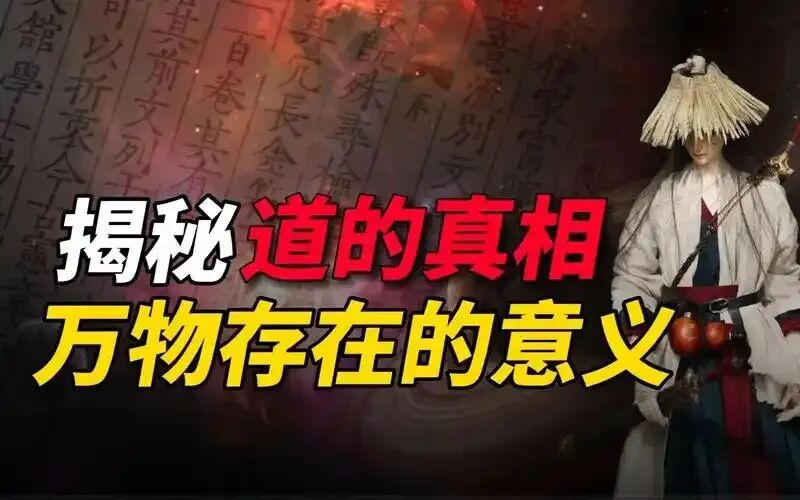
你可以把整个世界想象成一片特别大的平静湖面。
你蹲在湖边，往水里扔一块石头，湖面会跟你对话吗？会跳出来回答你“我为什么要泛起波纹”吗？当然不会。
它只会按照最基本的物理规律，泛起一圈一圈的涟漪，慢慢往外扩散，涟漪和涟漪互相碰撞，再加上风、水里的鱼、水底的石头各种因素影响，最后变成你根本预测不出来的复杂纹路。
世界就是这片湖。
你提问、你困惑、你半夜为了生命意义辗转反侧，这些本质上都是你大脑里神经元的电信号，是你身体里基本粒子的运动，就像那块扔进湖里的石头。
世界不会专门给你一个标准答案，不会跳出来告诉你“繁殖的意义就是XX”，但你的每一个想法、每一个动作，都实实在在地在这个世界里激起了属于自己的涟漪。
所以你去问不同的人，会得到完全不一样的答案。
有人说繁殖是为了传宗接代，有人说是为了参与一个生命的成长，有人会给你讲“100天后会死的鳄鱼”之类的小故事，有人会跟你说人生苦短及时行乐。
这些答案都对，也都不对。它们都是每个人基于自己的经历生出来的意义，不是世界本身的答案。
如果你要的是超越个人感受、绝对客观的答案，那咱们就抛开所有情绪和人文滤镜，只谈规律。
只谈客观规律的话，生命到底是什么？
说穿了，生命就是一个耗散系统。
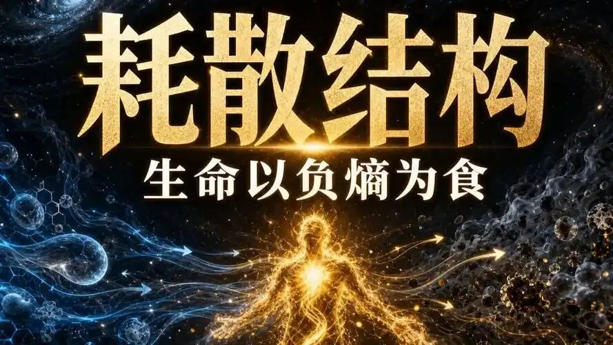
这话听着学术，其实特别好懂：这个系统必须不断从外界吸收能量、排出废物，才能维持自己的结构和秩序，一旦停止吸收能量，系统很快就会崩解。
就像你冬天屋里生的煤炉，你得不停往里添煤，它才能一直烧着、一直散发热量；煤一停，火很快就灭了，炉子也就凉透了。
我们的身体本质上就是这么一个“炉子”。
吃饭、喝水、呼吸，就是在往身体里“添燃料”；消化、吸收、把营养输送到全身各处，就是在“燃烧能量”；排泄二氧化碳、食物残渣和代谢废物，就是在“清炉灰”。
我们全身上下几十万亿个细胞，每一秒都在发生万亿次级别的生化反应，底层逻辑全都是同一件事：维持这个耗散系统的动态平衡，不让它垮掉。
而“生存”，就是这个平衡持续维系的过程。
我们走路、吃饭、睡觉、工作，所有行为追根溯源，都是为了让这个系统能一直运行下去。
那控制这一切运行的是什么？
是基因。
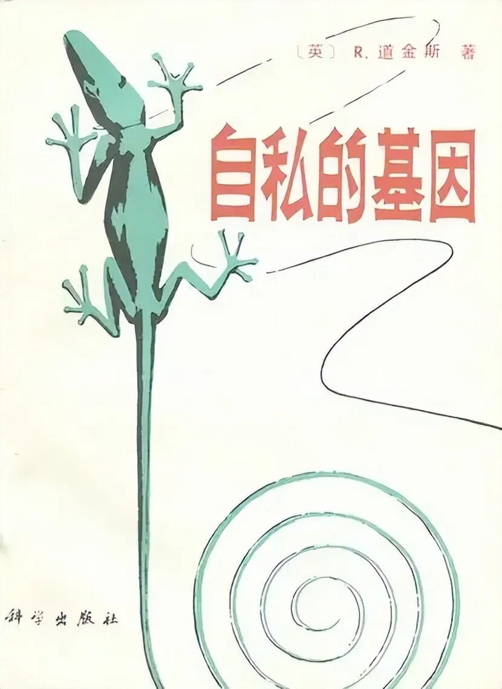
一说到基因和繁殖，很多人就会想起《自私的基因》，然后觉得基因是个老谋深算的幕后黑手，控制着所有生物，就为了让自己永生不灭。
其实这真的是高估它了。
基因是什么？
它就是一段由四种碱基对排列组合成的序列，就跟电脑程序里一行一行的代码没什么区别。
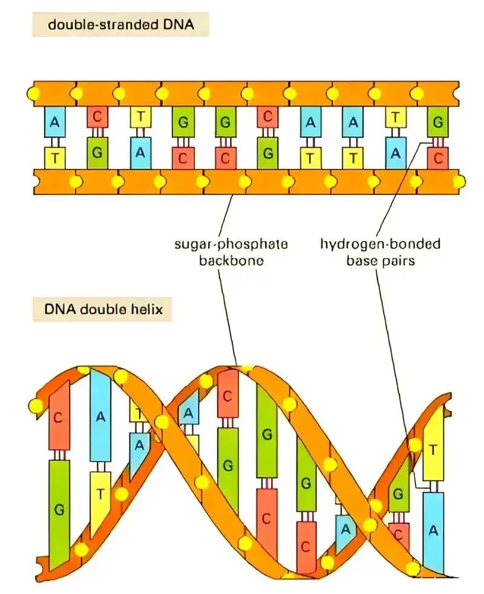
它没有思想，没有欲望，也没有什么远大目标。
就像早年流传很广的熊猫烧香病毒，它就是一串代码而已。它知道自己在破坏电脑系统吗？它“想”要复制自己吗？都没有。它就是碰巧具备了自我复制的特性，所以能一传十十传百扩散开。
基因也是一个道理。
地球生命这几十亿年的演化史，本质上就是一场基因的筛选大赛。
最开始的原始海洋里，可能出现过各种各样的基因序列：有的能让生物更好地获取能量，有的能让生物更快躲避天敌，有的能让生物繁殖更多后代。
那些既不利于生存、也不利于繁殖的基因，带着它的生物很快就死了，也没留下后代，慢慢就彻底从地球上消失了。
最后剩下来的基因，基本都具备两个特点：要么能帮生物好好活下去，要么能帮生物顺利繁殖后代。
所以你看，不是基因“想要”繁殖，而是只有能繁殖的基因，才能一直存在到今天。
这就好比你拿着网兜去沙滩捡石子，最后你兜里装的全是小石子，不是因为石子“想”被你捡到，是因为网眼太大，大石头都漏出去了。
演化就是那个网眼，自然而然筛选出了能繁殖的基因。
那我们平时感受到的生殖冲动、天伦之乐，又是怎么来的？
说白了，就是基因写好的“触发程序”。
到了青春期，身体开始分泌性激素，你会自然而然对异性产生好感，会有亲密的冲动，这就是基因在按下繁殖开关。
最开始的低等生物，这个开关只管“产卵/排精”这一步。
比如大多数鱼类，雌鱼把卵产在水草里，雄鱼在后面跟上排精，完事俩鱼就都游走了，受精卵能不能孵化、小鱼能不能活下来，全听天由命。
基因只管让你生，根本不管你养不养。
但随着生物越进化越复杂，身体结构越来越精密，幼体生下来的时候发育得越来越不完全，根本没法独立生存。
这时候，那些愿意花精力照顾后代的个体，后代活下来的概率就高得多。
慢慢的，“亲代照顾”的基因就扩散开了。
到了鸟类和哺乳动物这里，养孩子已经成了生存的标配。
我们歌颂伟大的母爱、深沉的父爱，这些感情背后，确实有催产素、多巴胺、内啡肽这些神经递质在起作用。
当然人类有复杂的大脑，有记忆、有思想、有社会文化，亲情早就不止是激素那么简单，但追根溯源，这个底层的驱动力，还是演化筛选出来的结果。
这儿特别重要，必须掰扯清楚：繁殖是物种存续的需要，从来不是每个个体的义务。
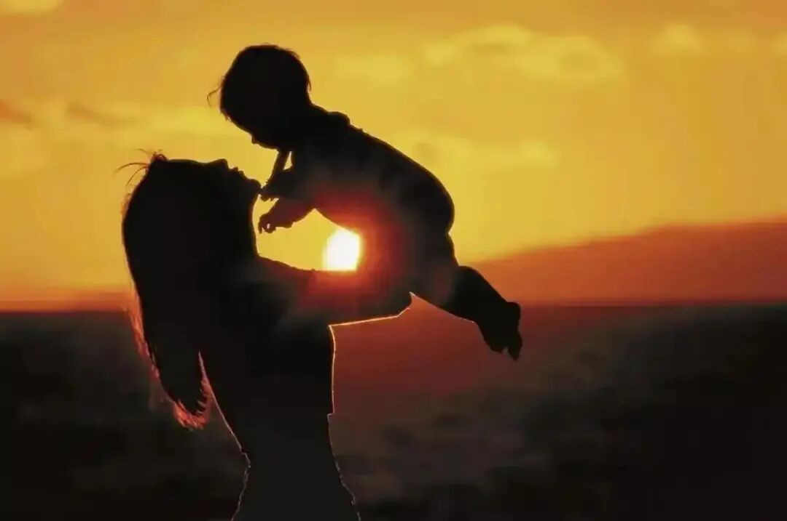
对一个种群来说，只要有一部分个体繁衍后代，整个物种就能延续下去，根本不需要人人都生孩子。
演化的筛选单位从来不是个体，而是种群和基因。
所以你看自然界里，当生存压力大的时候，很多动物的繁殖率会自动下降；当环境变好、食物充足的时候，繁殖率又会升上来。这都是很自然的种群调节。
放到人类身上也是一样。
现在很多年轻人不想结婚、不想生孩子，觉得自己活着都够累了，哪还有精力养孩子？
这太正常了。
基因只负责给你写好“到年龄有生殖冲动”，它可没考虑到你要还房贷、要996加班、要面对高昂的教育成本。
当个体的生存压力足够大的时候，人自然会先顾着自己活下去，主观的繁殖欲望就会降到最低。
这不是什么“自私”，也不是“违背天性”，这就是个体面对环境做出的最正常的反应。
从种群的角度看，生育率有高有低，人口有增有减，都是自然规律的一部分。
把人口问题的锅甩给单个的年轻人，说他们“不负责任”，其实既不公平，也没什么道理。
说白了，从客观规律来看，繁殖从来就不是什么人生的必选项。
它只是一部分人的选择，也是物种延续的方式而已。
说到这儿，可能有人会觉得：合着人就是基因控制的生化机器？那人生还有啥意思？
还真不是机器。
人体比任何机器都要复杂一万倍，它是一个典型的混沌系统。
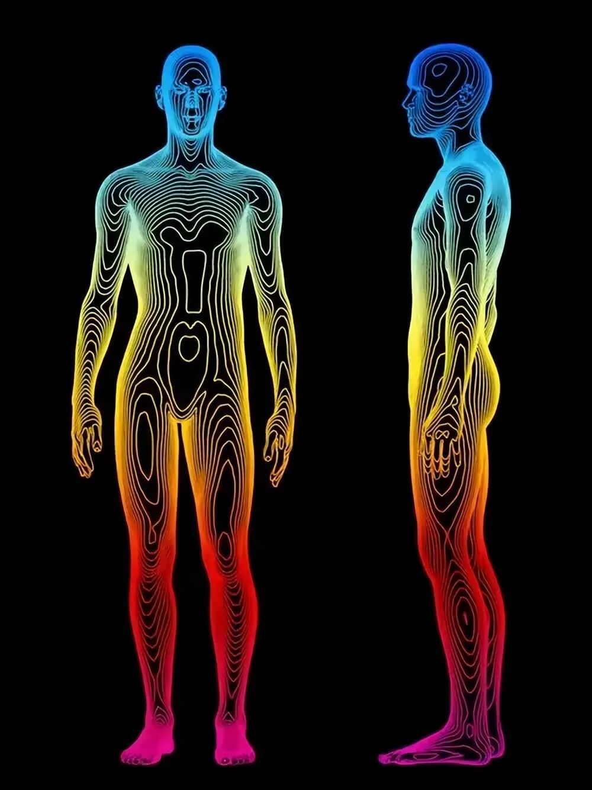
什么叫混沌？
不是乱七八糟的意思，是说系统对初始变化极其敏感，一点点微小的差异，最后会导致天差地别的结果。
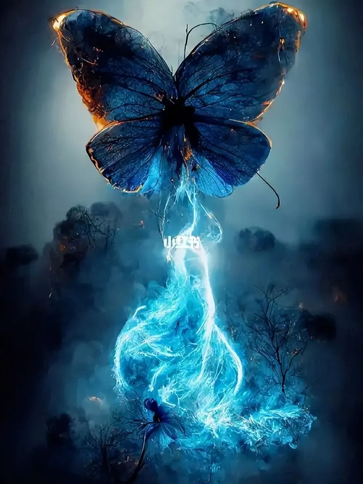
最经典的例子就是蝴蝶效应：南美洲的一只蝴蝶扇动一下翅膀，几周后可能在德克萨斯引发一场龙卷风。
人体里的混沌，比这还要夸张。
你有六十万亿个细胞，每个细胞里都有无数的分子在运动、反应。
你永远也不可能精准预测：明天你身上哪几个细胞会发生突变？会不会被免疫系统及时发现？你下一秒会突然想起哪件陈年往事？你今天出门多走了一步路，会对你的人生产生多大的影响？
这些都没法算。
你每一次呼吸、每一次心跳、每一个闪过的念头，都会让你身体里的基本粒子改变一点点轨迹。
这些微小的改变叠加起来，就是你独一无二、永远没法重来的人生。
所以生命从来不是按部就班的程序，也不是设定好目的的机器。它是一团流动的、不停变化的混沌，充满了偶然和不确定。
终有一天，你这个耗散系统会再也维持不下去。
能量交换停止了，生化反应停息了，身体的秩序慢慢崩解，生命也就走到了尽头。
不管你是充满遗憾，还是觉得解脱，到了这一刻都一样。
但这并不是彻底的消失。
构成你身体的那些原子、那些基本粒子，它们不会凭空消失。
它们会离开你的身体，回归到自然里去。
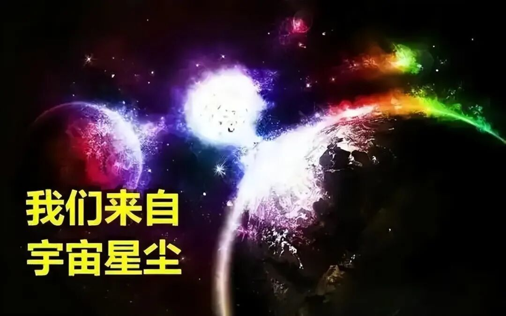
有的变成土壤里的养分，被植物吸收；有的变成空气里的二氧化碳和水，重新进入大气循环；有的可能会被别的动物吃进去，变成另一个生命的一部分。
它们在宇宙里不停的运动、碰撞、结合、分离，沿着自己的轨迹走下去。或许再过几十亿年，它们会成为另一颗星球的一部分，或许会成为另一个生命的组成部分。
循环往复，没有终点。
从这个角度说，我们每个人，其实都是星尘。
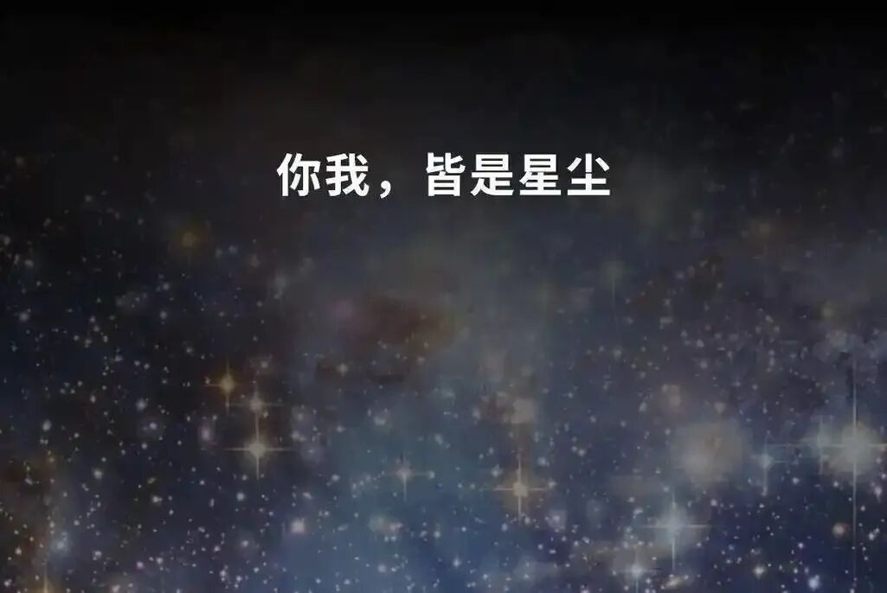
组成你身体的每一个原子，都曾经在某颗恒星的内部燃烧过，都走过了百亿年的漫长旅程，才在此时此刻，凑成了独一无二的你。
说了这么多，该结束了。
所以，生物繁殖的意义到底是什么？
如果站在纯客观的角度，答案非常简单：没有意义。
繁殖只是演化的产物，是基因延续的方式，是物质运动的一个过程。
就像河水会流、太阳会发光、电子会绕着原子核转一样，它就只是一种现象，没有什么目的，也没有什么意义。
但这从来不等于，你的人生没有意义。
因为“意义”这个东西，本来就是人类的专利。
世界不给我们意义，我们可以自己创造。
如果你就是喜欢刨根问底，想找那个最本质的答案，那你大可把生命和繁殖都看成一段自然规律。
就像看山是山，看水是水，它就那样存在着，不用纠结它有啥用。
想通了这一点，很多关于“意义”的烦恼自然就散了。
但如果你愿意慢下来，愿意去感受，那人生有意思的东西可太多了。

夏天冰可乐第一口的爽感，秋天踩在落叶上的咔嚓声，喜欢的人冲你笑一下的心跳，和朋友唠嗑到半夜的轻松，还有那些难过的、委屈的、激动的、难忘的瞬间……
这些独一无二的体验，这些你亲手赋予意义的小事，就是你自己人生的意义。
毕竟，这趟由星尘组成的单向旅程，你只能走一次。
怎么过，你说了算。
