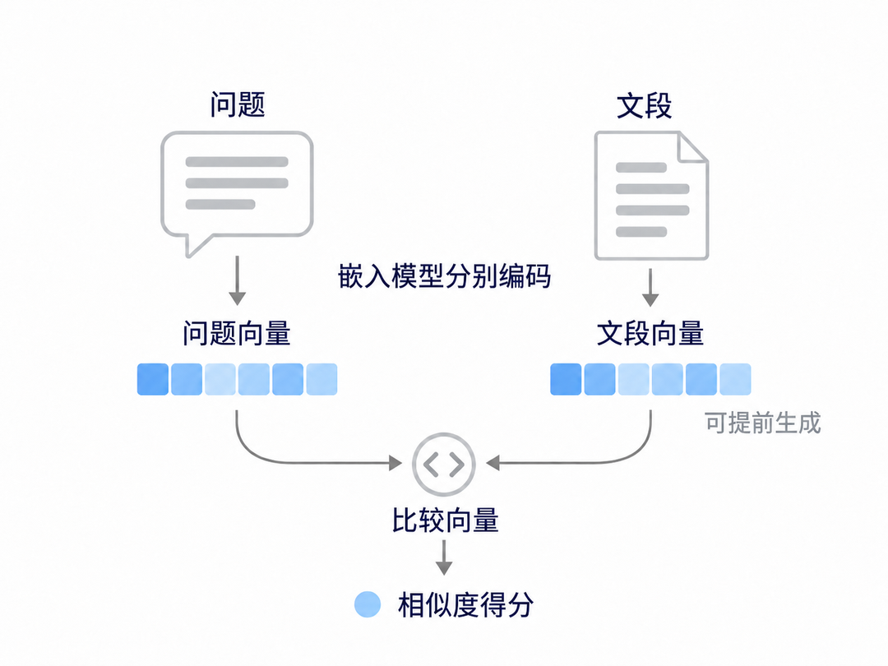
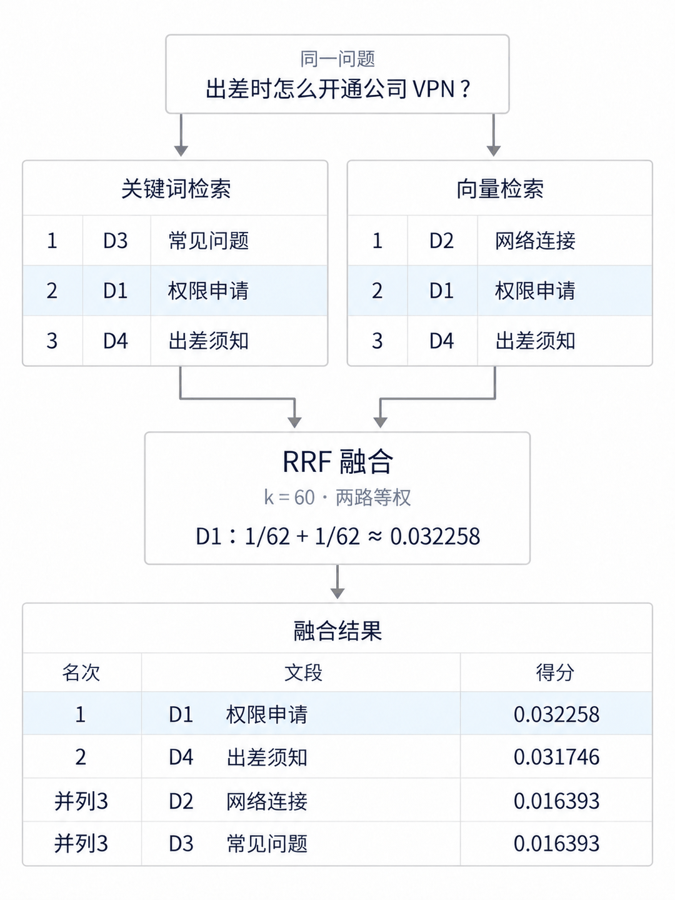
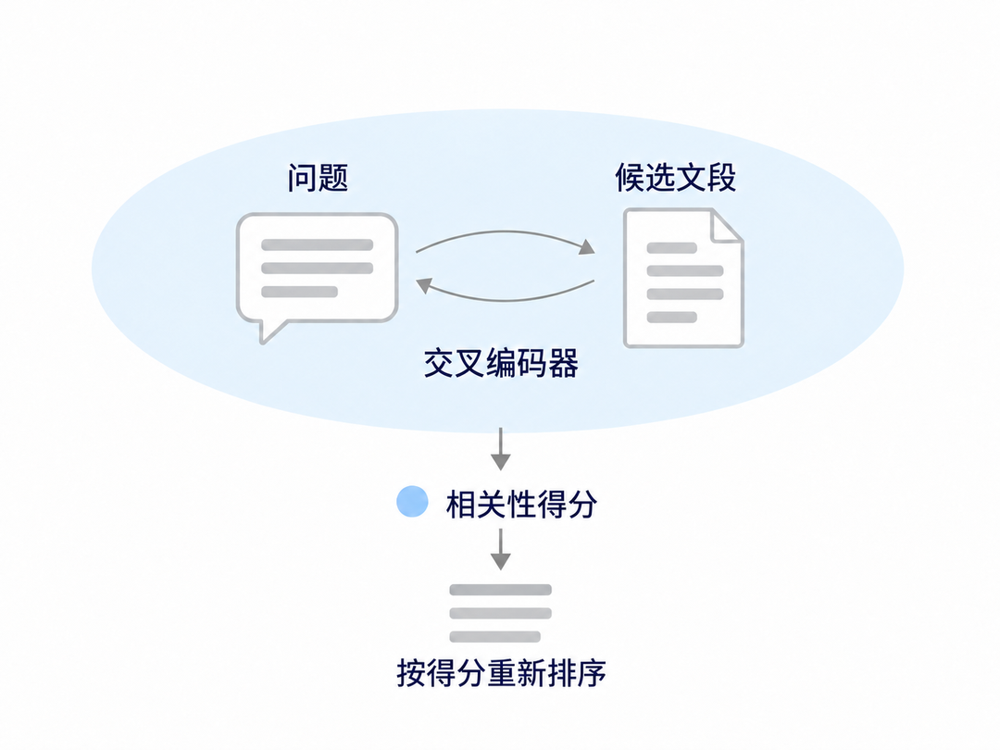

# 混合检索：RAG 怎么兼顾关键词和语义匹配
> 💡 备注属性未写入，可能是备注属性名称或者类型被修改了，建议将字段类型设置为 rich_text，可以在小程序-操作-修改文章数据库页面进行调整
> 💡 原文链接:[https://mp.weixin.qq.com/s?__biz=MzI3NDYxNzcxNw==&mid=2247483949&idx=1&sn=e7fd01ed75cde9efc8eab887f9c21e82&chksm=eaef4a6349be2c343f5b86c0e1bca115992ca0dc4d3249f96ef8cbaea62f0561dabe7bc9267c#rd](https://mp.weixin.qq.com/s?__biz=MzI3NDYxNzcxNw%3D%3D&mid=2247483949&idx=1&sn=e7fd01ed75cde9efc8eab887f9c21e82&chksm=eaef4a6349be2c343f5b86c0e1bca115992ca0dc4d3249f96ef8cbaea62f0561dabe7bc9267c#rd)
在公司知识库里问一句：“出差时怎么开通公司 VPN？”系统找来了客户端安装说明，又补了一段账号密码常见问题，却没有告诉你去哪里申请、由谁审批。几段资料都和 VPN 有关，拼起来仍然回答不了这个问题。
这类知识库问答常用RAG，也就是检索增强生成：先从资料中查找相关内容，再把找到的内容交给大模型组织回答。查资料时，员工的问法和文档的写法往往不同。“开通公司 VPN”可能写在“员工远程接入权限申请”里。系统怎样把这两种表达联系起来，又怎样保留 VPN 这样的关键词线索？
### 一、关键词检索与向量检索为什么需要配合
知识库通常会把长文档拆成较短的文段，并为这些文段建立检索索引。用户提问后，检索系统要判断哪些文段与问题相关，并按相关程度返回结果。关键词检索与向量检索的区别，就在于它们用什么依据进行判断。
关键词检索看词的匹配。系统先对资料进行分词等文本处理，记录每个词出现在哪些文段中；查询时也处理问题中的词，用它们查找匹配内容。比如常用的BM25，它根据词在文段中的出现频率、在整个资料库中的常见程度，以及文段长度计算相关性得分，再按得分排列结果。
向量检索看语义上的接近程度。嵌入模型把文本编码成一组数值，称为嵌入向量，用来表示文本的语义特征。资料的向量可以提前生成并保存；收到问题后，系统生成问题的向量，在同一个向量空间中，通过相似度或距离比较来寻找相关文段。这样，用词不同但含义相近的内容，也有机会被找出来。

先看下面四段简化资料。它们与后面的初始排名都是教学构造，用来解释处理过程，不对应某家公司的制度或真实模型的检索结果。
| 编号 | 文段 | 主要内容 |
| D1 | 员工远程接入权限申请 | 在内部服务门户提交申请，经部门负责人审批后开通 VPN 账号 |
| D2 | 远程办公网络连接说明 | 已有账号后，安装客户端、填写服务器地址并连接网络 |
| D3 | VPN 使用常见问题 | 登录失败、忘记密码及账号锁定的处理方法 |
| D4 | 出差办公须知 | 出发前准备电脑、检查网络与整理工作资料 |
对“出差时怎么开通公司 VPN”这个问题，D1 提供了需要的申请流程。D3 直接出现了 VPN，词匹配可以利用这条线索，但它讲的是账号已经开通后的问题。D2 与远程联网有关，语义上也可能接近，仍然缺少开通手续。
因此，两种检索都有用，也都有各自的遗漏和干扰项。混合检索的一种常见做法，是让同一个问题分别经过关键词检索和向量检索，两路各返回一份有序的候选文段，再把结果合并。
### 二、RRF：用名次合并两路检索结果
现在有了两份候选结果，每份都有自己的顺序。合并时，同一文段可能在两路都出现，也可能只被一路找到。最后该把谁排在前面？
一个直接的想法是把两路分数相加。但 BM25 分数与向量相似度来自不同计算，数值尺度也不同。未经校准就相加，某一路可能仅因为数值较大，就主导最终排名。
倒数排名融合，简称 RRF，提供了另一种办法：使用文段在各路中的名次计算贡献，再把贡献相加。它由 Cormack 等人在2009 年的论文中提出。本文使用两路等权的形式。名次从 1 开始，排名常数 k 调节不同名次之间的贡献差距；k 越大，相邻名次的贡献越接近。单路贡献为：
```
单路贡献 = 1 /（k + 文段名次）
```
同一文段按统一编号累计各路贡献，没有出现在某一路保留的候选中，该路贡献为零。这里的 k 是排名常数，候选取多少条是另一个参数。Elastic 的 RRF 文档给出了相应公式。
继续使用前面的资料，假设两路各返回三个候选：
- 关键词检索：D3 → D1 → D4
- 向量检索：D2 → D1 → D4
取 k = 60。D1 在两路都排第二，它的合并得分为：
```
D1 = 1 /（60 + 2）+ 1 /（60 + 2）≈ 0.032258
```
D2 和 D3 各自在一路排第一，未进入另一条路线的候选，因此各得 1 /（60 + 1）≈ 0.016393。D4 在两路都排第三，得分为 1 /（60 + 3）+ 1 /（60 + 3）≈ 0.031746。
按这些分数排序，得到：

D1 在两路都得到靠前的名次，累计贡献后超过了两个单路第一名。不过，D4 也排到了第二，它仍然没有申请步骤。RRF 使用的是已有名次，这次计算没有把问题与文段的内容重新交给模型评分。
### 三、重排序：重新判断问题与文段的相关性
融合后的结果如果已经够用，可以直接用于后续回答。候选较多、前几条仍混有用处不大的内容时，也可以增加重排序：用当前问题与候选内容重新评分，再排列一次。这是可选步骤，是否启用需要通过测试判断。
一种常见的重排序模型是交叉编码器（Cross-Encoder）。向量检索先把问题和文段分别编码成向量，再比较两个向量。交叉编码器则同时接收问题和一段候选资料，计算这段资料与问题的相关性得分。系统将同一个问题分别与每段候选资料配对评分，最后按得分从高到低重新排列。

对当前问题，其中一组输入是：
> 问题：出差时怎么开通公司 VPN？
> 候选 D1：在内部服务门户提交远程接入申请，经部门负责人审批后开通 VPN 账号。
> 
同一个问题还可以与 D4 的出差准备事项配对。这样，D1 和 D4 各得到一个针对当前问题的相关性分数，再按分数参与排序。
逐对评分增加了模型计算，因此通常先检索出一批候选，再对较小的集合重排序。这里要权衡的是：排序有没有改善，以及为此增加了多少耗时。
无论是否重排，得到最终排名后，系统还要按数量和文本长度限制选取资料。系统把选中的文段与用户的问题一起发给回答模型，模型据此组织答案。这些提供给模型的资料，就是本次回答的检索上下文。
### 四、检索命中率与回答正确率
前面的过程找到了资料，也决定了哪些资料交给模型。判断这次调整是否有效，要把[检索质量与回答质量分开评估](https://mp.weixin.qq.com/s?__biz=MzUzMjUzMzI0NA%3D%3D&mid=2247488022&idx=1&sn=45bf60bb1306a3f5486855baf04e7bc2&scene=21#wechat_redirect)：必要资料有没有找齐，模型有没有回答好。
检索命中率可以按“必要原文出现在最终排名前 K 条”的测试题比例记录，K 表示检查多少条结果。这里的最终排名，是当前配置完成排序后、交给资料选取步骤的结果：单路检索用本路排名，混合检索用融合后或重排后的排名。回答正确率则按“答案满足预先标注的正确性和完整性要求”的题目比例记录。问题需要多段资料时，还应检查必要内容是否找齐。
对 VPN 问题，D1 进入前 K 条，说明检索找到了申请流程。系统还需要把 D1 中的申请说明与问题一起交给回答模型，再检查回答有没有说清申请入口和审批要求。若模型已经收到 D1，却只介绍客户端安装，回答仍然没有解决开通问题。
回答出错时，先查看检索结果，再核对交给模型的资料和最终回答：
- 候选里没有 D1。 先核对原文是否被导入、解析后的内容是否完整，申请入口和审批条件有没有被切散，再检查过滤条件、两路查询与返回数量。
- 候选里有 D1，但最终排名靠后。 查看它在两路的名次及融合得分；启用重排时，再看重排是否改变了顺序。
- D1 已进入前 K 条，但没送进模型。 核对实际选取的资料，检查数量与长度限制是否省略了必要内容。
- 必要内容已送进模型，回答仍出错。 再检查模型是否使用对应资料、是否漏掉条件和步骤。
原文如果在[导入或切分](https://mp.weixin.qq.com/s?__biz=MzU4MzkwMTE1OQ%3D%3D&mid=2247484709&idx=1&sn=85606eb3e3feb4ea42f62416b20eb4a4&scene=21#wechat_redirect)时已经丢失，就不会进入两路候选。RRF 与重排序处理的是已有候选，无法把缺失的内容补回来。
另外文段切分还可能让办理步骤脱离适用条件。一段写怎样申请，另一段才说明适用部门、版本或前置要求，只找回步骤仍可能答错。Perplexity 与 turbopuffer 的上下文检索文章将答案内容与支撑证据分别检查，也是在处理这类资料完整性问题。
实际比较时，先从真实提问中整理测试题，标出每题的必要原文和回答要求。再用同一组问题、资料和判据，分别运行关键词检索、向量检索、混合检索，以及混合检索加重排序。保持相同的 K、业务过滤条件、回答模型、提示词和上下文长度限制，记录每种方案的检索命中率、回答正确率和耗时。再根据这些结果，选择单路或混合检索，并判断是否需要增加重排序。

## 摘要

（待补充）

## 我的笔记

（待补充）
