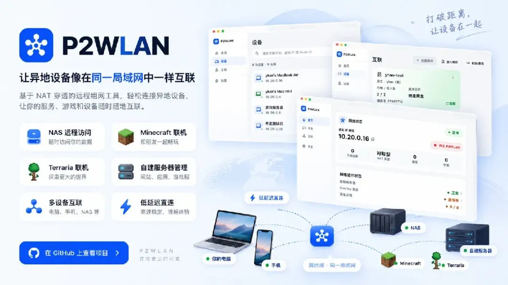
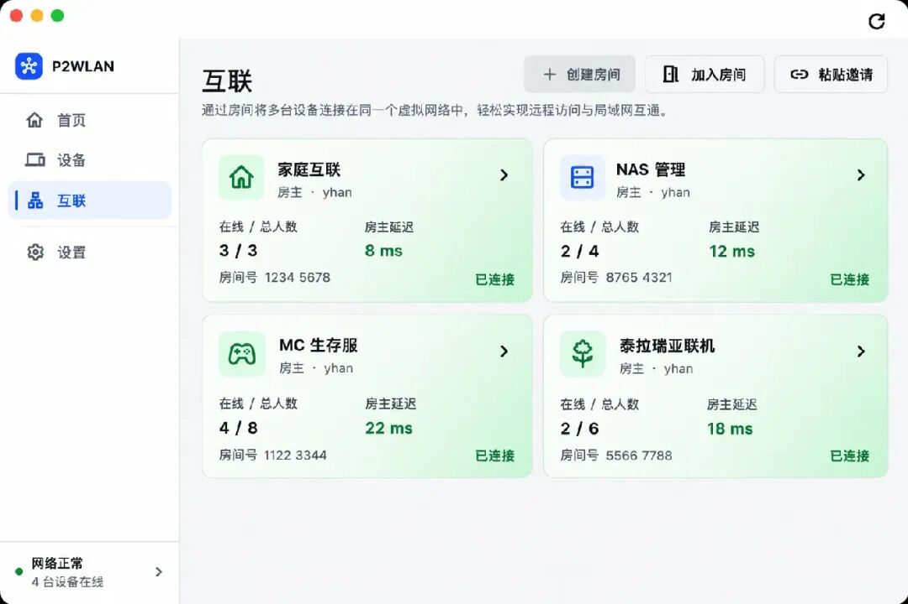
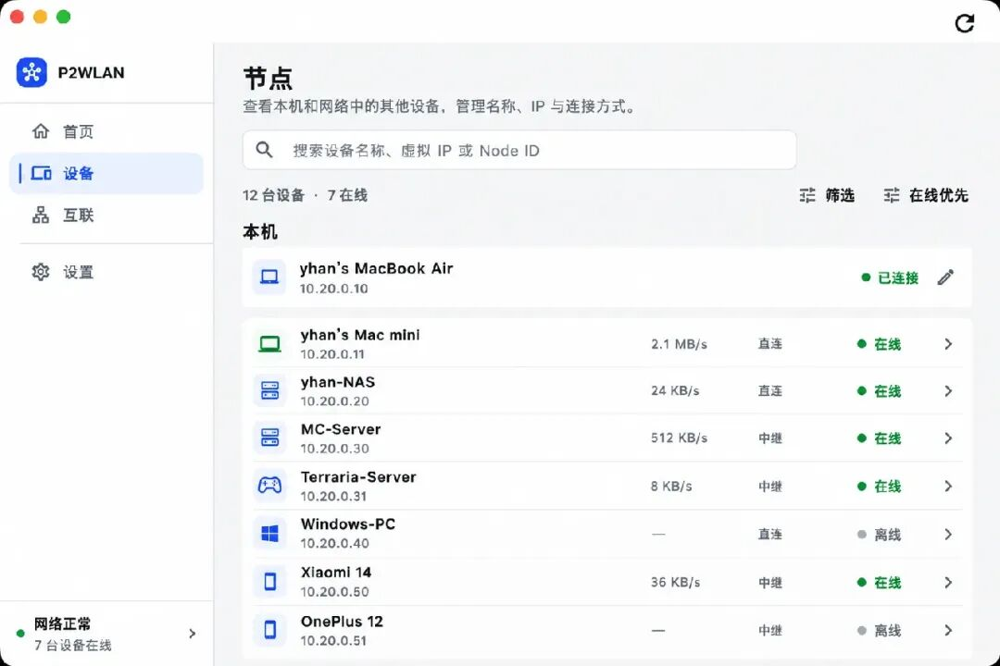
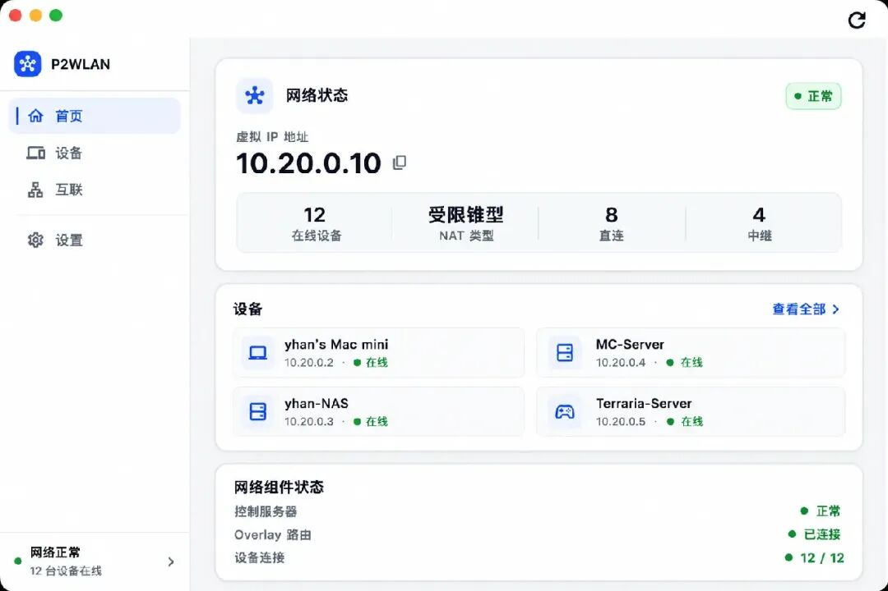
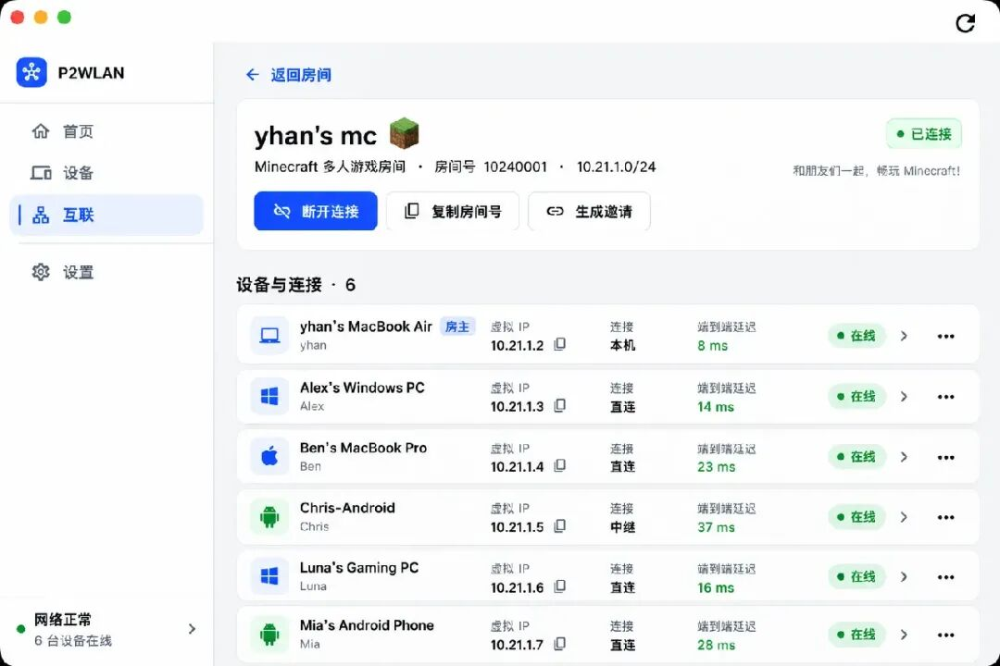

# 牛逼！GitHub 有人搞了个虚拟局域网，异地电脑也能像连着同一个路由器！
> 💡 备注属性未写入，可能是备注属性名称或者类型被修改了，建议将字段类型设置为 rich_text，可以在小程序-操作-修改文章数据库页面进行调整
> 原文链接:[https://mp.weixin.qq.com/s/C2IFk2-rXxEoifFxdMRw2w](https://mp.weixin.qq.com/s/C2IFk2-rXxEoifFxdMRw2w)
两台电脑，一台在南京，一台在北京，明明隔着几百公里，却能像连接在同一个局域网里一样通信。
朋友之间可以通过虚拟 IP 联机玩 Minecraft，出门在外可以访问家里的 NAS，甚至不用逐个开放公网端口，就能连接远程电脑上的开发环境。
听起来是不是有点像把家里的路由器延伸到了互联网？
最近，GitHub 上有个开源项目就专门在做这件事。
它叫P2WLAN，是一款免费开源的虚拟局域网工具，主打跨地域组网、P2P 直连、NAT 穿透和房间式联机。
简单来说，它能让分处不同网络的设备加入同一张虚拟私有网络，即使一台连接家庭宽带，另一台使用手机热点，也可以通过分配的虚拟 IP 相互访问。
如果网络条件允许，两台设备可以直接建立 P2P 连接；如果无法直连，还可以自动切换到加密中继，尽量保持通信可用。
项目支持 Windows、macOS、Linux 和 Android，客户端提供了图形化操作界面，客户端与服务器代码均采用 MIT 协议开源。

### 一、明明不在一个网络，怎么就能互相访问了？
先想一个非常常见的场景。
周末想和朋友一起玩 Minecraft，你在家里，他在学校。两台电脑分别连接不同的网络，即使你已经在本地启动了游戏服务器，朋友也不一定能直接连接。
因为家庭路由器通常会使用 NAT，将内部设备的私有 IP 转换成公网连接。外部设备想主动访问你电脑上的服务，往往需要端口映射、可访问的公网 IP，或者其他转发方式。
但很多家庭宽带、校园网和移动网络并没有方便使用的公网 IPv4，甚至还会受到多层 NAT 和防火墙限制。
P2WLAN 提供了另一种思路。
它会在参与组网的设备上创建虚拟网络接口，并为设备分配一个私有虚拟 IP。
例如你的电脑在虚拟网络中使用 10.21.0.2，朋友的电脑使用 10.21.0.5。即使两台电脑实际连接的是完全不同的网络，也可以通过这组虚拟地址相互通信。
对于支持指定 IP 地址连接的游戏或应用来说，就可以像访问普通局域网服务器一样，填写对方的虚拟 IP 和服务端口。
这也是 P2WLAN 最直观的价值：不需要把每项服务都单独暴露到公网，而是让需要互联的设备先加入同一张虚拟网络。
不过，这里说的“像同一个局域网”，主要指可以通过虚拟 IP 互通，并不意味着两台设备真的接入了同一个物理路由器。
### 二、朋友联机还专门做了“房间”，这设计挺实用
P2WLAN 不只是简单地展示一串设备 IP，还提供了一套房间管理功能。
例如你可以建立一个 Minecraft 生存服房间，把经常一起游戏的朋友加入进来；另外再建立一个 NAS 管理房间，只允许需要访问家庭存储的设备加入。
不同房间拥有独立的网络和虚拟 IP，彼此之间不需要混在同一张设备列表里。
房间可以通过房间号、邀请等方式加入，还能查看成员、在线状态、虚拟 IP、当前连接方式和延迟。
对于朋友联机来说，这种方式比让所有人分别配置网络参数要直观不少。
假设一个房间里有六名玩家，其中几人使用 Windows，另外有人使用 macOS 或 Android，大家可以通过对应平台的客户端加入网络。
连接成功后，玩家再通过游戏支持的服务器地址连接方式，访问运行在某台设备上的游戏服务器。
除了 Minecraft，Terraria 以及其他支持指定服务器 IP 的多人游戏，也可以探索类似的组网方式。
这里有一个容易忽略的细节：P2WLAN 提供的是三层 IP 网络，不提供以太网二层广播桥接。
因此，对于必须依赖局域网广播自动发现房间的游戏，未必能够直接搜索到对方。通常需要使用手动输入 IP 等方式连接，不能理解为安装后所有局域网游戏都能自动联机。

### 三、能 P2P 直连就直连，实在不行再走中继
现在的虚拟组网工具其实并不少，Tailscale、ZeroTier、EasyTier 都是这个方向中比较常见的选择。
P2WLAN 的一个重点，是把直连优先和中继回退结合到同一套连接流程中。
连接建立时，客户端会根据实际网络环境寻找双方可以使用的通信路径。
如果两端处于同一局域网，可以尝试局域网直连；如果双方具有可达的 IPv6 网络，也可以尝试通过 IPv6 建立直接连接。
对于常见的 IPv4 NAT 环境，P2WLAN 则会尝试 UDP 打洞，让双方在不手动配置端口映射的情况下建立点对点连接。
一旦成功，业务数据便可以直接在两端之间传输，不必全部经过中继服务器。
但真实网络环境并没有那么理想。
特别是在严格的校园网、运营商 CGNAT、多层 NAT 或企业防火墙环境下，UDP 打洞可能失败。
这时，P2WLAN 会尝试使用已经配置且可达的加密 Relay 进行数据转发。
它的连接策略可以理解为：
局域网直连 → IPv6 / IPv4 UDP 直连 → 加密 Relay 中继
这样即使无法建立真正的 P2P 连接，应用也不必重新配置另一套访问地址，而是继续使用原来的虚拟 IP。
当然，中继并不意味着完全没有代价。走 Relay 时，数据需要经过额外节点，实际延迟、吞吐和稳定性会受到中继服务器位置、线路和带宽影响。
因此，P2WLAN 的亮点不是保证任何网络都能秒级直连，而是让软件自动尝试更合适的路径，同时提供无法直连时的后备方案。
### 四、出了门，家里的 NAS 和开发机也能访问
其实我觉得，除了游戏联机，P2WLAN 在个人开发和家庭网络场景中也挺有价值。
例如家里有一台 NAS，用来保存照片、视频和重要文件。平时在同一个 Wi-Fi 下访问很方便，但出门以后，如何安全、稳定地连接回去，就成了问题。
类似情况还包括家里的 HomeLab、树莓派、Linux 服务器，以及只在内部网络开放的 Web 管理页面。
使用 P2WLAN 后，可以让实际提供服务的设备加入虚拟网络，再通过其虚拟 IP 访问对应端口。
例如在远程开发场景中，如果某台 Linux 开发机的虚拟 IP 为 10.20.0.5，就可以在网络和 SSH 服务均配置正确的情况下，使用：ssh user@10.20.0.5访问远程机器。
Windows 远程桌面、内部 Web 服务、开发测试数据库等，也可以通过类似方式连接。
这样一来，很多原本只方便在本地访问的服务，就有机会通过一张私有虚拟网络实现跨地域访问。
需要注意，安装 P2WLAN 并不会自动让家里所有设备都可以被访问。通常需要在目标设备上安装并运行客户端，目标服务也必须正确监听相应地址、开放业务端口，并允许对应的防火墙流量。

### 五、不是只有命令行，连接情况可以直接看
不少网络工具的能力很强，但普通用户第一次接触时，可能还需要理解各种参数、端口和命令。
P2WLAN 在这方面做得相对友好。
它使用 Flutter 构建图形客户端，将网络状态、在线设备、房间管理和连接信息集中放在界面里。
例如打开首页，可以看到当前虚拟 IP、网络运行状态、在线设备数量，以及正在使用直连或中继的连接情况。
进入设备列表以后，可以进一步查看其他节点的名称、虚拟 IP、在线状态、收发速率和连接路径。
软件会通过 LAN Direct、Direct、Relay 等状态区分不同的连接方式，方便用户判断当前设备之间究竟是直连，还是经过中继转发。
针对开发者，项目还提供了 CLI 和 daemon，可以在没有图形桌面的 Linux 服务器上使用。
如果遇到连接失败，也可以通过 p2wlan doctor、p2wlan route verify 等诊断命令检查网络状态。
这类工具真正需要解决的，不只是能不能把两台机器连接起来，还包括连接出现问题时，用户是否能够看懂目前发生了什么。

### 六、客户端免费开源，控制服务器也能自己部署
P2WLAN 采用了客户端与服务端分离的架构。
图形界面主要使用 Flutter 开发，Rust 负责虚拟网卡、数据传输、NAT 穿透和连接路径管理；服务端则主要使用 Go，并结合 SQLite 管理身份、设备、虚拟 IP 和连接协调等信息。
这里有两个比较关键的组件。
Control Plane负责账号认证、设备注册、分配虚拟 IP 和交换连接所需的信息；Relay则在设备无法直接连接时，承担加密数据的转发工作。
根据官方设计，设备间的业务数据采用端到端加密方式传输，Relay 转发的是密文，但中继节点仍可能观察到连接时间、数据量等元信息。
整个项目采用 MIT 许可证，客户端、控制面和中继服务端都有公开源码。
对于希望自主掌握网络基础设施的开发者来说，可以将 Control 和 Relay 部署到自己的 Linux 服务器上，而不是完全依赖第三方运营平台。
不过，这里也必须说清楚一个使用门槛：
P2WLAN 并不是下载安装以后，就能直接连接到一个免费的官方公共网络。
目前官方客户端不会默认填写项目运营的 Control 或 Relay 地址。首次使用需要获取可信的 Control 地址，或者先完成自托管部署。跨账号加入同一房间的设备，也需要使用同一个 Control。
这意味着，如果只是想和朋友临时联机，又没有可用的服务器或管理者提供的 Control，前期仍然需要准备相关环境。
软件本身免费，不代表服务器、域名和中继流量都不需要成本。

### 七、跟 Tailscale、ZeroTier 相比，它值得用吗？
既然都是虚拟组网工具，肯定有人会问：已经有 Tailscale、ZeroTier 和 EasyTier 了，为什么还要关注 P2WLAN？
其实这些工具并不是简单的谁取代谁。
Tailscale 的优势在于成熟的设备管理、连接体验和访问策略，适合希望快速建立个人或团队私有网络的用户。
ZeroTier 提供虚拟以太网等能力，适合需要二层网络语义、网络桥接和更复杂虚拟网络配置的场景。
EasyTier 则更加侧重去中心化组网、多协议传输以及子网代理等能力。
相比之下，P2WLAN 的特点是将房间式联机、图形化设备管理、P2P 直连优先、加密中继和完全开源的自托管组件结合在一起。
尤其是房间功能，对朋友联机、临时协作和多组设备分别管理的场景比较友好。
但它也有自己的取舍：需要准备 Control，采用三层网络而不是二层桥接，同时还在不断完善兼容性、连接恢复和部署体验。
还有一点值得关注：官方明确表示项目尚未完成独立安全审计。因此，对于普通家庭测试和开发验证，可以在了解限制后尝试；如果要用于企业核心系统或敏感生产环境，就需要更严格的安全评估，不能只因为使用了加密算法就默认完全安全。
### 写在最后
几年前，提到异地局域网互联，很多人首先想到的还是公网 IP、端口映射、VPN 配置，以及各种复杂的网络参数。
现在，随着虚拟网络、NAT 穿透和加密传输技术不断发展，让相隔千里的设备通过私有 IP 互相通信，已经不再是什么遥不可及的事情。
P2WLAN 也不是第一个解决这个问题的项目。
但它的特别之处，是把这些底层能力做成了一款更容易理解的工具：可以创建房间、邀请朋友、查看在线设备、判断连接路径，在网络条件允许时优先 P2P 直连，直连不可用时再尝试中继。
从朋友之间的游戏联机，到在外访问家里的 NAS，再到跨地域开发环境连接，都能找到对应的使用场景。
当然，“像在同一个局域网里”不代表可以完全忽略网络限制，也不代表所有游戏、所有设备都能自动发现彼此。
但对于喜欢折腾网络、HomeLab，或者经常需要异地联机的开发者来说，这样一个免费开源、支持多平台、还能自托管的项目，确实值得关注。
现实中隔着几百上千公里，网络里却可以通过一个虚拟 IP 找到彼此。
这大概就是虚拟局域网最有意思的地方。
### 开源地址
https://github.com/yhan-sun/p2wlan
项目采用 MIT 开源协议，支持 Windows、macOS、Linux、Android，并提供 Linux 服务器与部分 OpenWrt 环境的命令行客户端。
---
开源原力社
持续分享值得关注的开源软件、开发工具和有趣的技术项目。
关注开源原力社，一起发现更多实用、有意思的开源工具。
