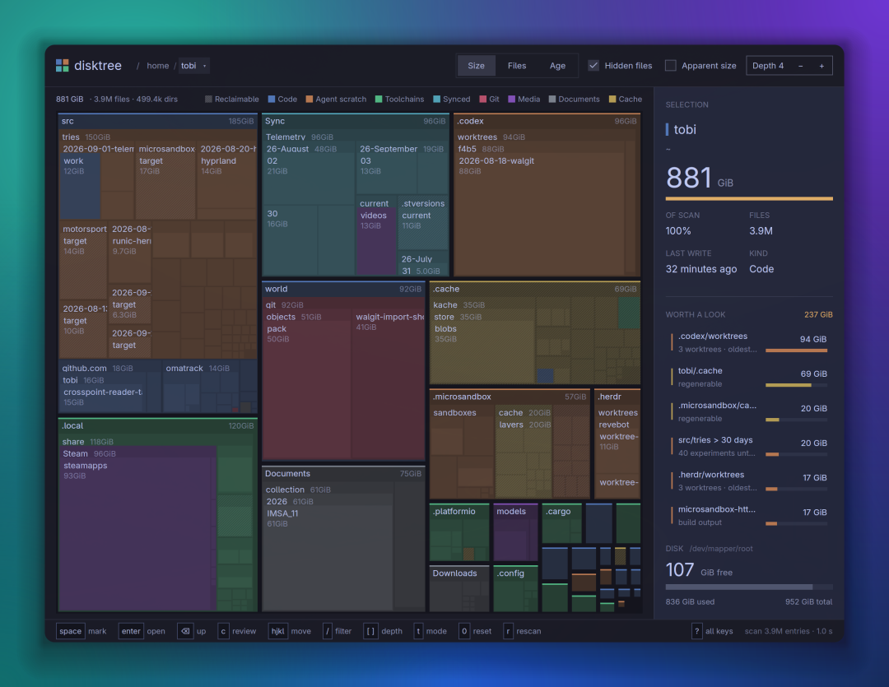
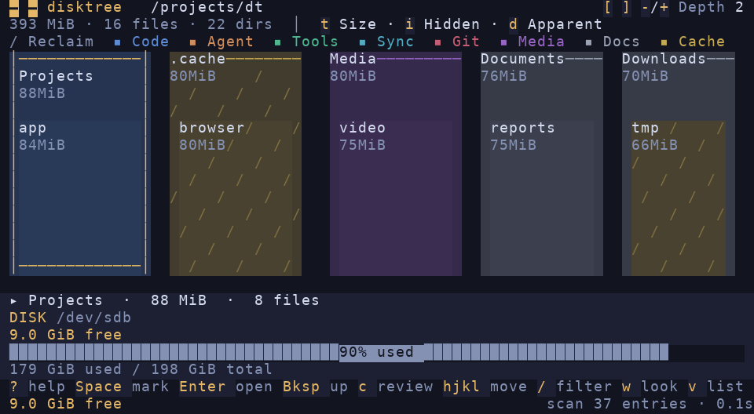
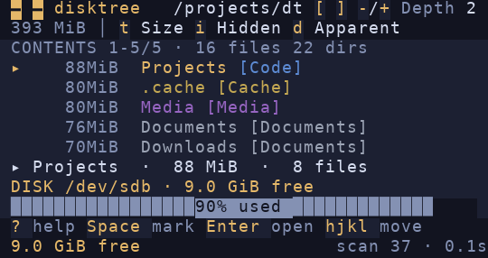
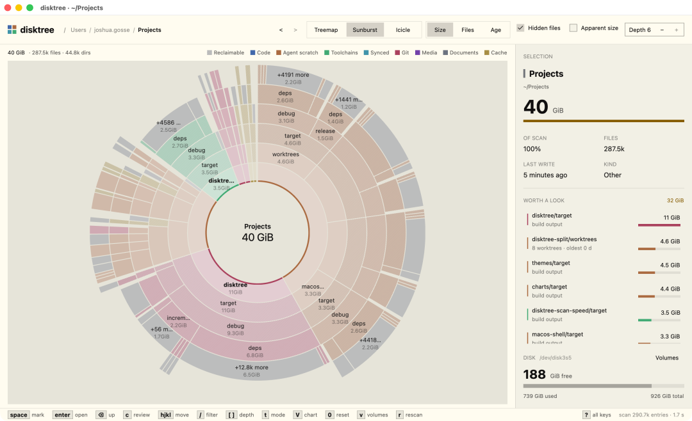
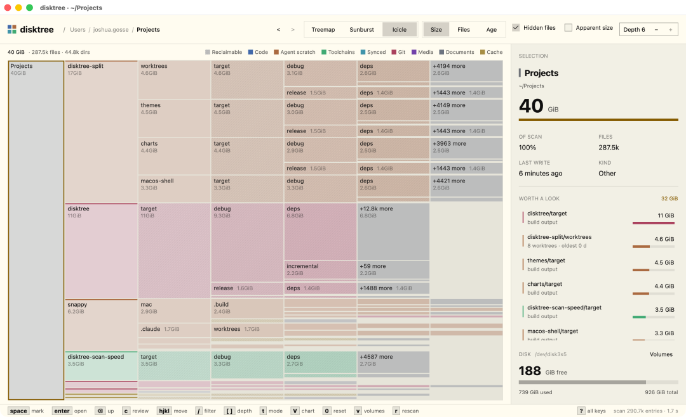
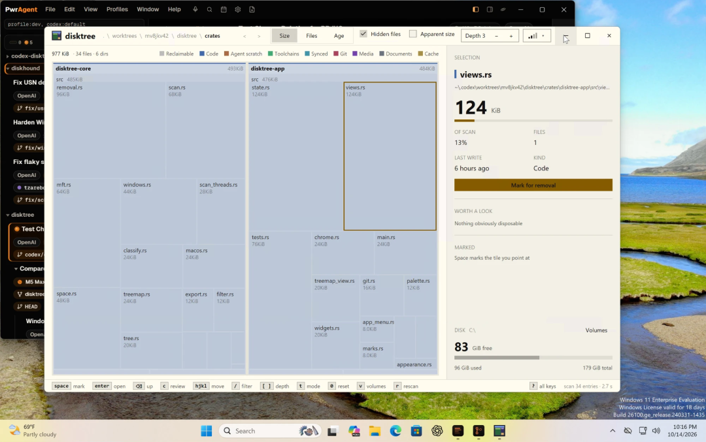

# 牛逼！比 WizTree 快 3 倍，400 万文件 3 秒多扫完。
> 💡 备注属性未写入，可能是备注属性名称或者类型被修改了，建议将字段类型设置为 rich_text，可以在小程序-操作-修改文章数据库页面进行调整
> 💡 原文链接:[https://mp.weixin.qq.com/s?__biz=MzY5MDQwOTk2Mw==&mid=2247484352&idx=1&sn=8282d23f6fdaa8068d9061ac71c4d685&chksm=f236f535fba7c4c8b7bf59756764dd0505b43d2c10747259b80ca5f93197884d4d399c65e1f2#rd](https://mp.weixin.qq.com/s?__biz=MzY5MDQwOTk2Mw%3D%3D&mid=2247484352&idx=1&sn=8282d23f6fdaa8068d9061ac71c4d685&chksm=f236f535fba7c4c8b7bf59756764dd0505b43d2c10747259b80ca5f93197884d4d399c65e1f2#rd)
400 万个文件，扫描完整个 C 盘需要多久？
如果用 Windows 自带的文件管理器逐层查看，光是找到占空间最大的目录，可能就要折腾半天。
但最近 GitHub 上有个新开源工具，直接把速度卷到了另一个程度。
开发者在项目 README 中公布了一组测试数据：面对一个包含约400 万文件的 Windows C 盘，WizTree 用了 11.2 秒，普通目录遍历大约需要 20 秒，而这个工具只用了3.4 秒。
也就是说，在这组测试里，它的扫描速度达到了 WizTree 的约3.3 倍。
需要说明的是，这不是所有电脑都能达到的成绩，而是作者在 Windows NTFS 全盘扫描、使用管理员权限等特定条件下得到的结果。
不过，能把一个拥有数百万文件的磁盘，在几秒钟内扫描并整理出空间分布，确实挺让人意外。
这个项目叫disktree，由开发者 tobi 在 GitHub 上开源，使用 Rust 和 GPUI 构建，目前已支持 Windows、macOS 和 Linux。
但速度还不是它唯一的亮点。
它不仅能告诉你硬盘被什么占满，还能把占用情况画成一张彩色的矩形图，支持逐层查看目录、识别缓存和构建产物，甚至能在真正删除文件之前，算出预计能腾出多少空间。

### 一、凭什么比 WizTree 还快？
先说最让人好奇的扫描速度。
了解磁盘分析工具的朋友，应该对 WizTree 不陌生。它最大的特点之一，就是在 Windows NTFS 文件系统上，能够利用主文件表（MFT）快速读取文件信息。
普通的磁盘扫描往往需要进入每个文件夹，逐一读取文件和目录信息。文件越多、目录层级越复杂，扫描过程就越繁琐。
而 NTFS 的 MFT 记录了文件系统中的大量文件元数据信息，工具可以直接读取这些记录，不必完全依赖传统的目录遍历方式。
disktree 在 Windows 上也采用了类似思路。
当用户以管理员权限扫描完整的 NTFS 分区时，它可以直接读取 MFT，通过较大批次的数据读取构建磁盘目录树。
项目作者记录的测试结果如下：
| 扫描方式 | 约 400 万文件的 C 盘 |
| disktree（MFT 扫描） | 3.4 秒 |
| WizTree | 11.2 秒 |
| 普通目录遍历 | 约 20 秒 |
这组结果确实很亮眼，不过也有必要客观看待。
首先，它来自项目作者的测试记录，尚不能代表不同硬盘、不同文件规模和不同运行环境下的普遍性能表现。
其次，MFT 快速扫描需要满足相应条件。如果没有管理员权限，或者只是扫描某个普通目录，disktree 仍然可能使用目录遍历方式，不会自动获得同样的速度。
所以，与其简单说它全面超越 WizTree，不如说：在作者公布的这组 Windows NTFS 测试中，disktree 展现出了非常有竞争力的扫描性能。
对于每天和海量文件打交道的开发者，这已经足够值得关注。
### 二、整个硬盘被画成了彩色拼图
如果说扫描速度是吸引人的第一点，那么 disktree 的界面就是第二点。
打开软件，选择要分析的磁盘或目录后，扫描结果会以一张巨大的彩色矩形树图呈现。
这种展示方式叫做 Treemap。
它的逻辑很直观：谁占用的磁盘空间越大，谁在画面中占据的矩形面积就越大。
例如电脑里有多个开发项目，其中一个项目可能因为保存了大量构建产物，占据几十 GB 的空间。那么在 disktree 的界面中，它就会是一块非常显眼的大矩形。
其他体积较小的目录，则会被压缩成不同大小的小方块。
更有意思的是，disktree 还会通过不同颜色区分文件类型和目录用途。
代码、Git 数据、工具链、媒体文件、文档、缓存以及 AI 编程工具产生的临时内容，都可能被归入不同类别。
一些可能可以回收的缓存、构建输出或历史数据，还会通过特殊纹理进行提示。
这样一来，打开软件以后，不需要先研究复杂的统计报表，就能直观看到哪些目录最占空间。
当然，这些分类主要依据目录名称和结构特征进行判断，并不意味着被标记的内容一定可以安全删除。

### 三、哪里占空间大，直接点进去看
仅仅把磁盘画成一张图，其实还不够。
因为当一个磁盘存在数百万个文件时，即使看到了某个目录特别大，也需要进一步知道里面究竟存了什么。
disktree 支持直接通过鼠标滚轮放大矩形树图。
例如发现一个项目目录占用了 80GB，就可以把鼠标移到对应区域，逐步放大并进入内部。继续查看以后，可能会发现真正占空间的是 target、缓存或者其他构建目录。
整个过程不需要反复打开文件夹属性，也不需要在文件管理器里来回切换。
除了鼠标操作，它还支持键盘导航、目录历史记录、名称筛选，以及 Size、Files、Age 三种不同的查看模式。
Size 主要关注空间占用，Files 可以帮助观察文件数量，Age 则用于了解文件的修改时间分布。
对于经常维护多个项目的开发者来说，这几种观察角度相当实用。
有时候硬盘空间不足，并不是因为几个特别大的文件，而是某个工具持续生成了成千上万个小文件。单纯看文件大小，很可能注意不到这类问题。

### 四、还会主动告诉你，哪些目录值得检查
很多磁盘分析工具解决的是“哪里占空间大”，但找到目标以后，用户依然需要自己判断下一步怎么办。
disktree 在右侧提供了一个叫Worth a look的区域，可以理解为“值得看一看”。
它会根据扫描结果，列出一些占用空间较大、可能值得进一步检查的目录。
例如旧项目工作区、开发缓存、构建产物、历史数据等，都可能成为候选对象。
这对开发者尤其友好。
毕竟很多开发工具都会在后台持续积累数据。项目可能早就不用了，但对应的构建目录仍然保留着；某个开发环境已经切换版本，旧缓存却一直没有清理。
disktree 还能够针对 Git 工作目录提供额外的信息，例如检查是否存在未提交的修改、stash 或未推送的提交。
这样在准备删除旧项目时，就能多一层提醒，避免把仍有价值的本地工作直接清掉。
不过，“值得检查”不代表“建议立即删除”。尤其是 Docker 数据目录、数据库存储文件和开发工具缓存，清理前仍然需要确认用途，必要时使用相应工具自己的清理方式。

### 五、想清理的文件先标记，删之前还能算账
disktree 的清理方式也挺有特点。
它不是看到一个大目录就让你马上删除，而是允许先标记多个准备处理的对象。
例如检查完磁盘以后，发现有三个不再需要的旧项目和两个可以清理的缓存目录，就可以先把它们标记起来。
软件会在右侧结合当前磁盘剩余空间，计算预计能够回收的容量。
假设现在只剩 15GB 可用空间，标记了几个占用较大的目录以后，就能提前看到清理完成后的预估变化。
等所有对象检查完成，再进入统一的 Review 页面，确认最终要处理的文件和目录。
对于本地文件，disktree 提供移动到回收站和永久删除两种方式。永久删除前还会要求用户再次确认，同时对部分系统关键路径设置了删除保护。
清理完成以后，软件会重新扫描，展示实际释放的磁盘容量。
这种设计的好处是，用户可以在操作前把所有目标集中检查一遍，而不是清理到一半才发现删错了内容。

### 六、不只是本地电脑，连服务器也能扫描
除了 Windows、macOS 和 Linux 的本地磁盘，disktree 还支持通过 SSH 分析远程 Linux 服务器。
这项功能对开发者和运维人员来说也很实用。
平时遇到服务器磁盘告警，通常会先 SSH 登录，再使用 df、du 等命令排查哪个目录占用了大量空间。
这种方式虽然有效，但遇到目录层级复杂、文件数量特别多的情况，排查过程可能比较烦琐。
disktree 则可以通过 SSH 连接远程机器，将扫描结果呈现在本地的可视化界面中。
例如：
disktree ssh user@server /var
就可以针对服务器上的 /var 目录进行分析。
远程扫描采用专门的扫描程序，读取目录结构并返回统计结果，不需要把服务器里的实际文件内容下载到本地。
需要注意的是，SSH 模式是只读分析，不支持直接在界面里删除远程文件。
用户可以导出待处理路径列表或清理脚本，再经过检查后自行执行。部分环境还需要提前在服务器上部署相应的扫描辅助程序。
对于生产服务器而言，这种将分析与实际删除分开的方式，反而更容易控制风险。

### 写在最后
WizTree 能够快速分析磁盘空间，早已不是新鲜事。
但 disktree 的出现，至少说明了一件事：即使是磁盘分析这种看起来相当成熟的工具，开源开发者依然可以在扫描性能、可视化交互和使用流程上继续优化。
在作者的测试中，约 400 万文件的 C 盘仅用 3.4 秒就完成了扫描，这个数字确实很有冲击力。
但相比单纯追求扫描速度，我觉得 disktree 更值得关注的，是它把磁盘扫描、空间可视化、目录定位、清理预估和批量审核整合进了一个工具。
对普通用户来说，可以更直观地找到占据硬盘空间的大文件和目录；对开发者而言，还能进一步检查构建产物、缓存、Git 工作目录，甚至查看远程服务器的磁盘占用。
它不一定会取代 WizTree，也不是所谓的“一键无脑清理神器”。
但它提供了一种比较舒服的使用方式：先让你看清楚磁盘空间被谁占用了，再决定哪些东西应该留下，哪些东西可以清理。
扫描速度只是让人点进来的理由，真正让人愿意留下来使用的，还是它对整个磁盘清理过程的重新组织。
如果你也经常遇到磁盘空间不足，或者只是想看看电脑里究竟藏着多少占空间的目录，这个项目值得试试。
### 开源地址
https://github.com/tobi/disktree
---
开源原力社
持续分享值得关注的开源软件、实用工具与前沿技术项目。
关注开源原力社，一起发现更多值得收藏的开源项目。
