# 牛逼，GitHub有人开源一个神级skills，一句话把复杂技术原理，做成可交互 3D 机械图。
> 💡 备注属性未写入，可能是备注属性名称或者类型被修改了，建议将字段类型设置为 rich_text，可以在小程序-操作-修改文章数据库页面进行调整
> 💡 原文链接:[https://mp.weixin.qq.com/s?__biz=MzY0MDk2Mzg5MA==&mid=2247486157&idx=1&sn=34ef5713474aeda2bfb31caa475f62fd&chksm=f09d558ba96176a3ef40fc6ea5e2c5d348788f43b1ba1627f5c7999a4d9ea4c92cf5392d59ac#rd](https://mp.weixin.qq.com/s?__biz=MzY0MDk2Mzg5MA%3D%3D&mid=2247486157&idx=1&sn=34ef5713474aeda2bfb31caa475f62fd&chksm=f09d558ba96176a3ef40fc6ea5e2c5d348788f43b1ba1627f5c7999a4d9ea4c92cf5392d59ac#rd)
在逛 GitHub 时找到一个把机械剖面和系统交互做绝了的开源 skills，太厉害了。一句话做出精美的SVG动画。
我装上试了一下，把一句复杂的技术原理丢给 Agent，它居然直接在屏幕上给我现场手搓出了一台带精密齿轮、能推油门、甚至能一键爆炸拆解的 3D 机械设备，误差控制在微米级。
项目叫 **Anatomy**，目前在 GitHub 上已经拿下了 **4500+ Star**，在外网也非常火热，支持直接挂到 Claude Code、Codex 和 OpenCode 等一系列agent里使用，今天来聊聊这个东西。
作者把物理机械的结构逻辑和几何渲染写成了底层的绘图模块，专门用来把看不见摸不着的抽象概念实体化。
**开发者把这个skills玩出了花**
通过这个skills你可以实现各种精美的SVG动画，在案例库里，它把 B 树索引做成带滑轨的抽屉柜，把消息队列做成传送带，把互斥锁做成机械门栓，把核聚变反应堆做成磁约束剖面。
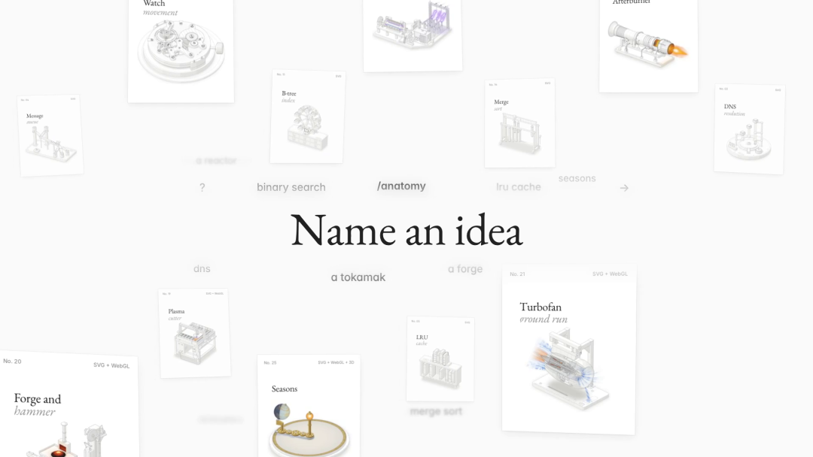
以前大模型只能画几个干瘪的方块流程图，但这个工具直接把它当成了一道严谨的三维几何题。
实测演示里最震撼的是空客 A380 巨型客机的高涵道比涡扇发动机。
终端里敲一句要求，让它解释飞机发动机怎么产生推力，并且要带交互。
大模型直接在后台分步计算三维坐标。从外部短舱流线罩、进气导流叶片，到内部多级压气机转子和燃烧室，一共算了 220 个独立零部件，写出 1725 行矢量代码。
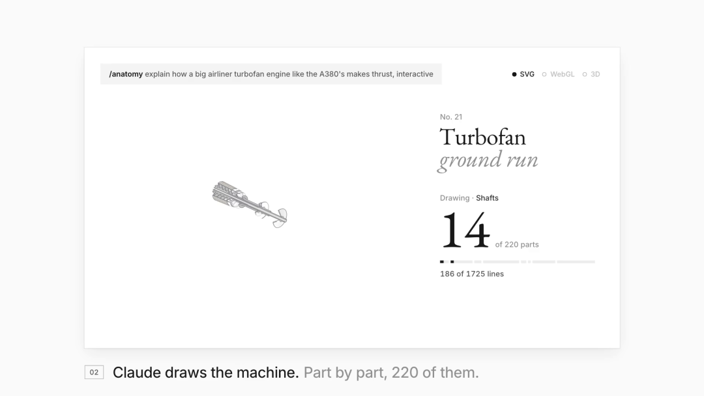
最后生成的交互卡片带着实时仪表盘，显示推力、转速和排气温度。在网页里把油门拉杆推到 100%，正面密密麻麻的风扇叶片瞬间飞速狂转，尾喷管实时喷出高温气浪，推力仪表读数直接平稳飙到了 153 kN。
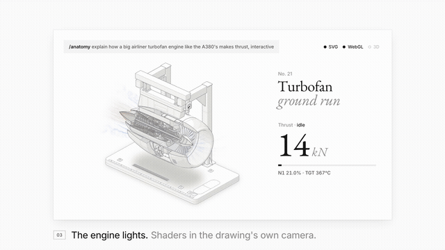
另一个高压变电站案例也很有代表性，让 AI 解释为什么隔离开关不能带负荷分闸。
模型在画面里构建了发电机组、主变压器和配电架构。在网页中用鼠标拖动断开开关，触头之间瞬间拉出长达 7.9 米的巨大紫色电弧，并通过慢动作回放等离子体放电过程，直接展示了带负荷拉闸的危险后果。
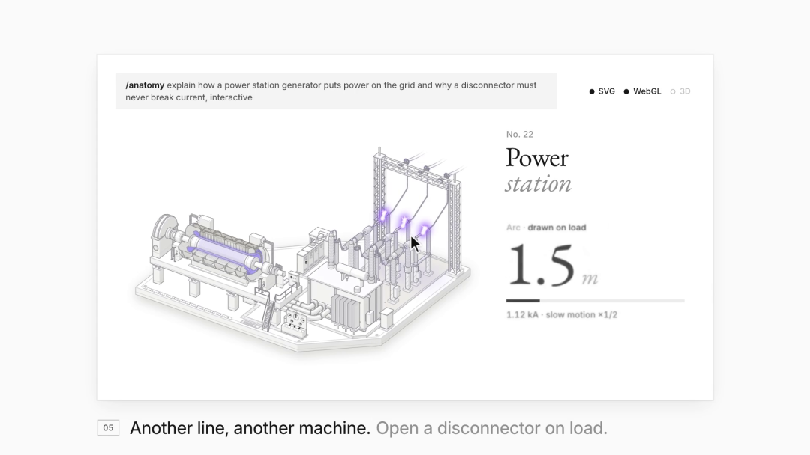
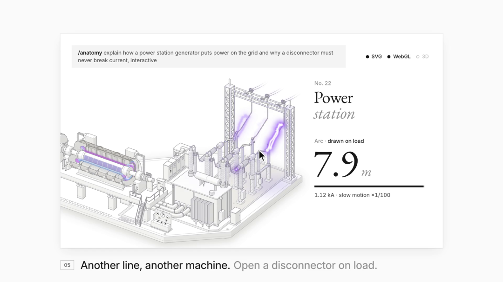
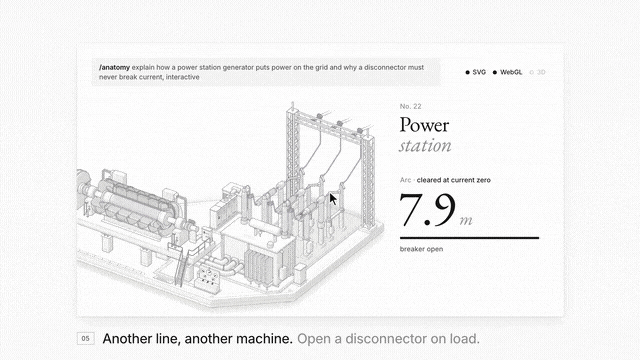
**还有很多实用的案例**
像这个案例借助这个skills实现了一些物理实验的具象化。左侧是天体运行仪，行星按真实周期运转；中间是牛顿摆，点击提起 4 个钢球，撞击后对面立刻弹起 4 个球，演示动量守恒；右侧搬出了量子双缝干涉实验台，电子枪逐个发射粒子，后方屏幕实时累积出波粒二象性干涉条纹。
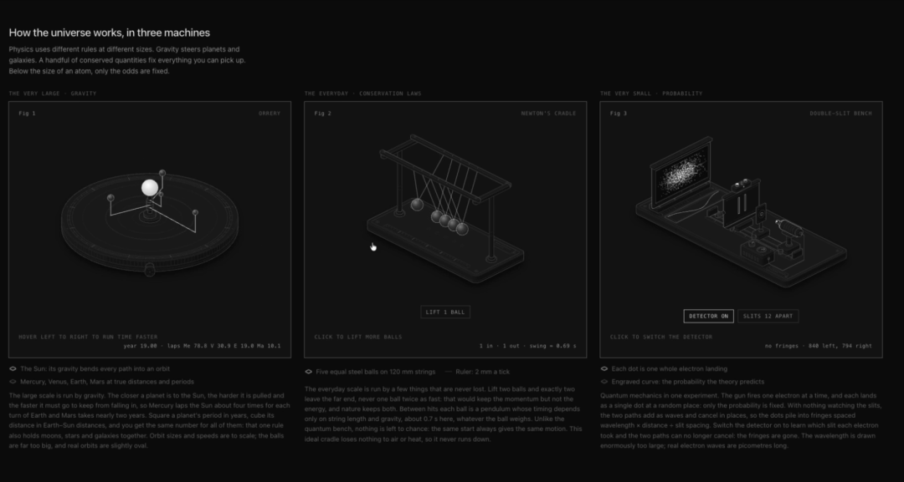
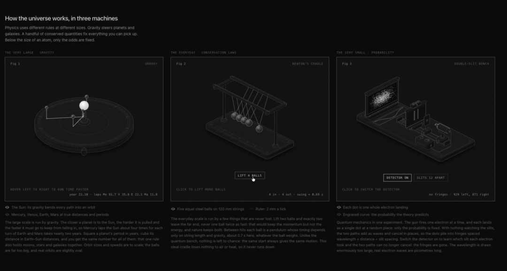
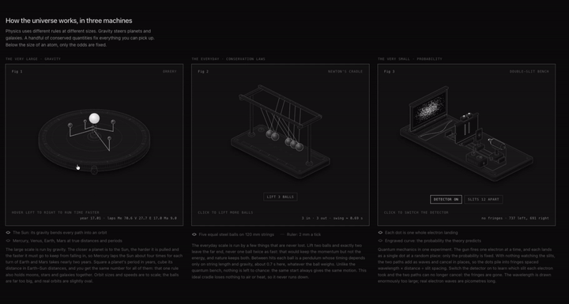
三套模型全由 SVG 和着色器计算，滑过去就能直接操控。
**包括设计一些工业发动机模型**
这个是SpaceX 猛禽 2 代火箭发动机。机体悬挂在测试台上，底部喷出带马赫环激波面的超音速尾焰。机身由纯矢量 SVG 构成，尾焰是 WebGL 着色器。
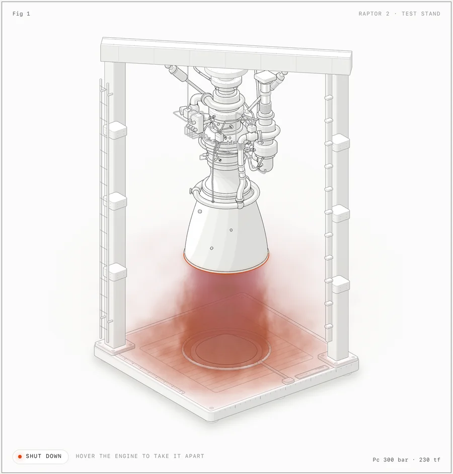
把鼠标悬停在图纸上方，整台发动机会自动触发爆炸拆解，顺畅分离成 11 个独立装配体，涡轮泵、法兰和管路整齐散开，方便查看细节。
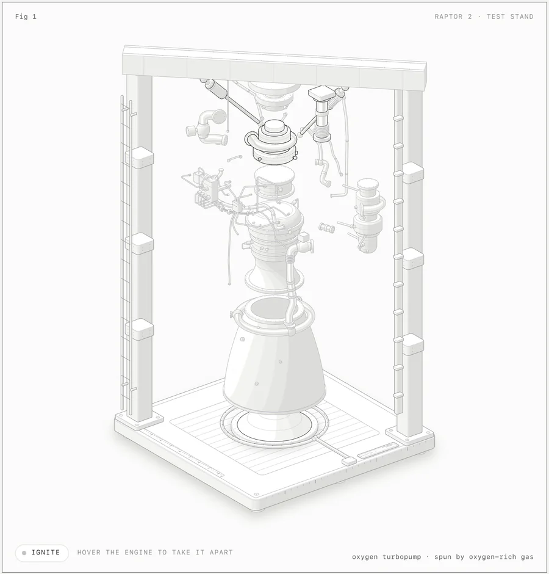
除了火箭发动机，案例库里还包括了双重 WebGL 光学模型驱动的水波槽物理实验台、支持三维转动交互的密码锁机械手，以及千分表测量仪。
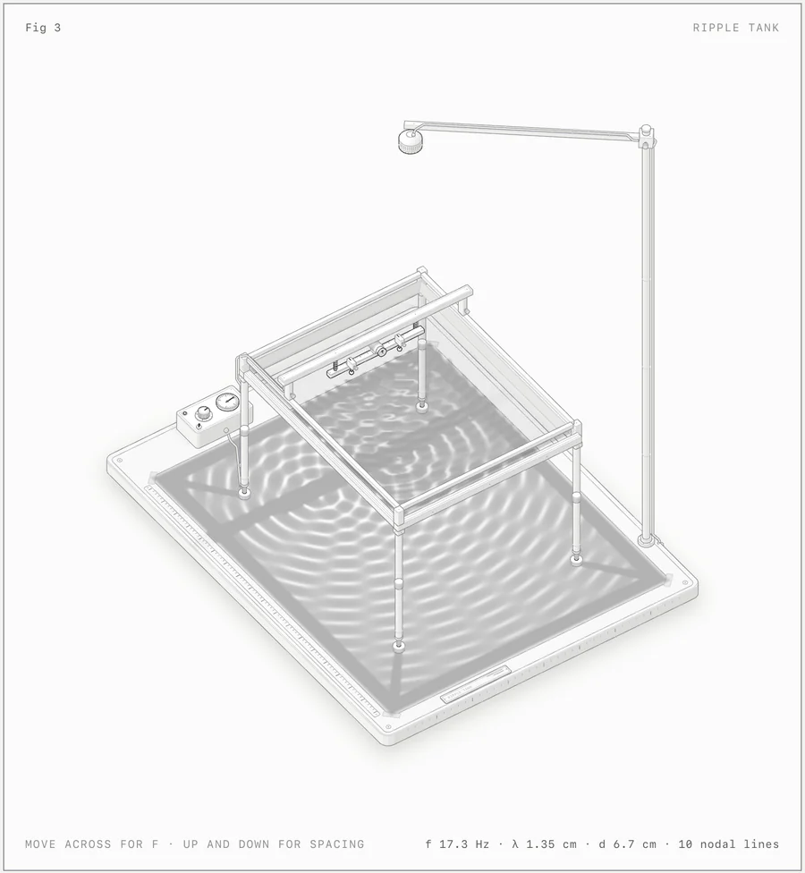
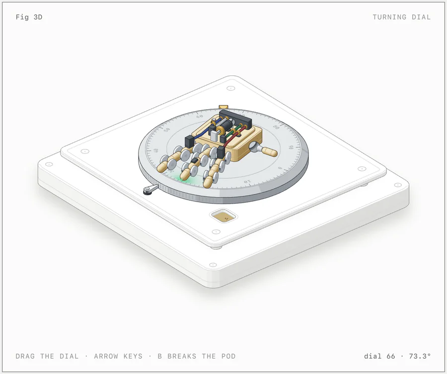
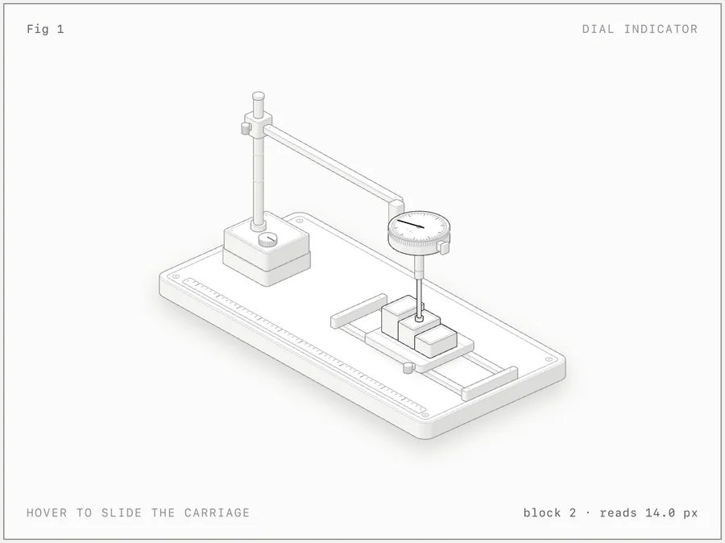
大模型生成密集的矢量线条，最容易遇到的问题是管线交叉穿模和端点悬空断裂。
为了解决这个问题，Anatomy 设计了一套后台自动化几何审计工具。
模型在生成图纸时，系统会在后台启动一个无头 Chrome 浏览器。
测试脚本会逐帧检验所有零部件的深度遮挡顺序，验证管道有没有穿模，核验螺丝接头有没有落在固定支座上。如果发现悬空断线或碰撞冲突，审计系统直接要求模型重新调整空间坐标，直到所有零件完全严丝合缝。
安装也非常省事，终端里跑一行命令就能自动配置到本地的各种 Agent 工具里：
```
npx skills add wheresryan22/anatomy -g -a claude-code
```
开源地址：
https://github.com/wheresryan22/anatomy
装好之后把任意技术概念发给 Agent，直接敲一句「用交互式等轴测图解释它」，它就会在后台自己算坐标绘图。
该说的问题也说一下，这个项目画一张复杂的图需要在后台跑无头几何审计，复杂场景跑完一趟往往要等上两三分钟。
另外它目前主要专注于机械仪器、物理设备和工业构件，不适合画人脸和地图。
### 写在最后
用了一圈下来，这个 skills 最让人佩服的地方，就是把原本枯燥抽象的代码逻辑，变成了普通人也能直观理解的实体机械。
以前写文档讲架构，总觉得除了画几个简陋方框或者花大钱找外包别无选择。
现在把几何计算、深度排序和遮挡校验全写成现成的脚本交给 Agent 去跑，哪怕概念再复杂，也能靠纯粹的代码把带交互的工业大作搓出来。
平时经常玩 Claude Code、Codex 或者需要制作技术演示的朋友，很建议把这个 skills 装进电脑里试一试，体验确实非常惊艳。
点击下方卡片，关注「拾码备忘录」
这里持续分享好玩实用的开源项目、AI 生产力工具和硬核开发实践，把复杂的技术拆解成看得懂、能落地的干货。觉得有帮助，欢迎在后台留言交流！

## 摘要

（待补充）

## 我的笔记

（待补充）
