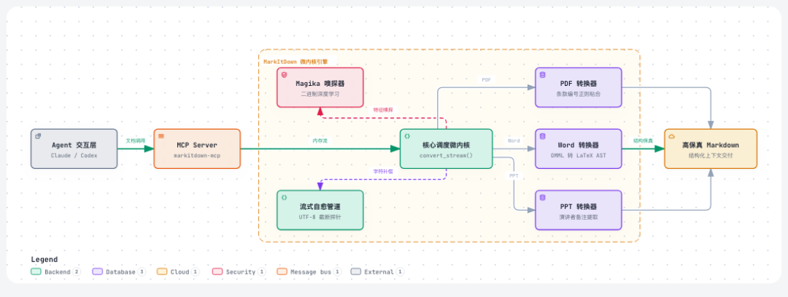
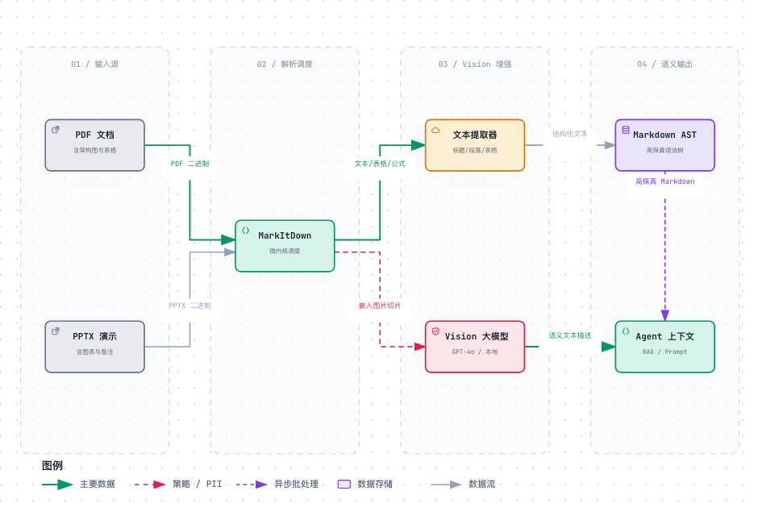
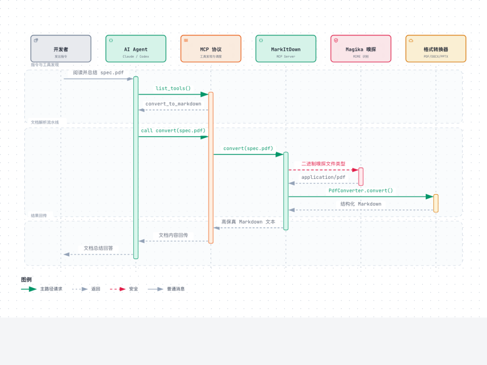

# 狂揽 19 万 Star！微软开源 MarkItDown：专为大模型与 Agent 打造的高保真文档解析器
> 💡 备注属性未写入，可能是备注属性名称或者类型被修改了，建议将字段类型设置为 rich_text，可以在小程序-操作-修改文章数据库页面进行调整
> 💡 原文链接:[https://mp.weixin.qq.com/s?__biz=MzkzOTc0MjY4MQ==&mid=2247483753&idx=1&sn=69e3d7db8a43f28be45768a6080535ed&chksm=c3488474bbb45e0ac1e0fd4cd995d58d06a617724dfccd0dcf4e6b499abb7af89f28f679b414#rd](https://mp.weixin.qq.com/s?__biz=MzkzOTc0MjY4MQ%3D%3D&mid=2247483753&idx=1&sn=69e3d7db8a43f28be45768a6080535ed&chksm=c3488474bbb45e0ac1e0fd4cd995d58d06a617724dfccd0dcf4e6b499abb7af89f28f679b414#rd)

---
做 RAG 知识库或给 Agent 喂私有文档时，最头疼的往往不是把文字抽出来，而是格式一转就全乱套：PDF 表格被揉碎、Word 标题层级丢失、公式变成乱码、PPT 备注直接被吞，内嵌的技术架构图更是变成大模型根本看不懂的死图。
如果直接把混着大量脏 HTML 标签或错位字符的内容塞进 Prompt，上下文空间被白白浪费不说，模型的推理准确率也会断崖式下跌。
微软开源的 MarkItDown（已狂揽 19 万 Star）就是专门治这个痛点的。它能在本地毫秒级把 PDF、Word、Excel、PPT 干净抽取为规整的 Markdown，更关键的是原生打通了**多模态视觉模型**与 **MCP 协议**，既能顺手看懂架构图并生成文本描述，又能让 Claude 等自主 Agent 开箱即用完成本地读档。
---
### 一、系统架构：专为大模型打造的四层微内核

翻看 MarkItDown 的底层代码，它的架构设计相当干脆利落，主要分为四层处理流水线：
**1协议接入层**：对外统一提供命令行 CLI、Python SDK 和原生 MCP 接口，不需要我们额外写胶水代码；
**2格式嗅探层**：内嵌了 Google 的 Magika 模型，通过扫描文件头部的二进制特征判定真实格式，哪怕文件后缀名被人故意改了或删了也能精准识别；
**3转换器矩阵**：按需分发给 PDF、Word、Excel、PPT 等专用转换插件，内部还支持优先级调度；
**4语义增强层**：负责把公式转成 LaTeX、把表格规整对齐、抽取 PPT 演说备注，并能联动多模态模型把图片解读成文字，最终吐出规整的 Markdown。
---
### 二、开箱即用：3 分钟上手 CLI 与 Python SDK
它的安装与使用都做得很轻，依赖清晰拆分，不强制捆绑一堆重型依赖：
#### 1. 细粒度安装与命令行操作
平时开发或打 Docker 镜像时，只需按需安装用得上的格式支持：
```bash
# 安装与命令行快速调用 pip install 'markitdown[pdf,docx,pptx,xlsx]'   # 安装常用办公三件套依赖  # 单文件转换并导出 markitdown financial_report.pdf -o financial_report.md  # 配合管道流直接喂给下游命令或大模型 CLI cat technical_spec.docx | markitdown | head -n 30 
```
#### 2. Python SDK 基础调用实战
三行代码即可建立本地文档抽取管道：
```python
# 基础文档转换管道 from pathlib import Path from markitdown import MarkItDown  md = MarkItDown() result = md.convert(Path("quarterly_architecture.pptx"))  print(f"文档标题: {result.title}") print(f"正文前 200 字:\n{result.text_content[:200]}") 
```
输入复杂 PPTX 后，MarkItDown 不仅按 `## Slide N` 结构化呈现幻灯片，还会将底部的**演讲者备注（Speaker Notes）**完整提取并追加在末尾，解决了传统提取器漏掉决策背景的通病。
---
### 三、进阶实战：大模型多模态喂料与 Agent 工具链集成
如果只做单纯的文本提取，Pandoc 或各类脚本也能凑合用。MarkItDown 在工程落地中好用的地方，在于它把多模态解构、智能体工具协议与流式处理做成了开箱即用的原生能力。
#### 1. 挂载 Vision 模型：自动解构文档内嵌图表

技术文档和研报里最怕遇到复杂的架构图或趋势图。传统工具只会留个 `` 占位符，大模型读到这里等于直接失明。
MarkItDown 允许在初始化时直接挂载多模态大模型客户端（如 GPT-4o 或本地 Vision 模型）。解析器会自动切片文档内图片并请求模型生成精准文本描述，直接内嵌进 Markdown：
```python
# 启用 Vision 多模态图片智能解读 import os from openai import OpenAI from markitdown import MarkItDown  client = OpenAI(api_key=os.environ.get("OPENAI_API_KEY")) md_vision = MarkItDown(llm_client=client, llm_model="gpt-4o")  result = md_vision.convert("system_design.pdf") # 示例：![架构图描述: 该图展现了分布式网关集群，左侧为 Envoy，右侧为服务发现...] print(result.text_content) 
```
死图被实时转化为富含语义的结构化文字，知识库问答的信噪比提升了一个量级。
#### 2. 语音转录：会议音频直接转 Markdown
不仅是办公文档，MarkItDown 还能处理音频。它内置了 Whisper 转换通道，开箱即用：
```python
# 音频文件直接转录为 Markdown from markitdown import MarkItDown  md = MarkItDown() audio_result = md.convert("team_meeting.mp3") print(audio_result.text_content) 
```
会议录音直接转为结构化文本输入知识库，开发者无需维护单独的语音处理服务。
#### 3. MCP 服务化：让 Claude 和 Agent 自主读档

在当前的智能体工作流中，**MCP（Model Context Protocol）** 是事实上的工具总线标准。
官方提供了独立包 `markitdown-mcp`，不需要开发者手写胶水代码，一行配置就能让 Agent 自行调用：
```json
// ~/.config/claude/claude_desktop_config.json 或 agent_tools.json {   "mcpServers": {     "markitdown": {       "command": "uvx",       "args": ["markitdown-mcp"]     }   } } 
```
配置后，Agent 将自动获得 `convert_to_markdown` 工具。当要求 Agent“阅读并总结当前目录下的 `spec.pdf`”时，Agent 能自主调用该工具原地解析，实现无缝读档。
#### 4. 内存流消费：消除高并发下的磁盘 I/O 损耗
在异步 Web API 或 RAG 消费队列中，频繁落盘会带来昂贵的 I/O 损耗。MarkItDown 支持直接消费内存流：
```python
# 内存流式无落盘转换 import io from pathlib import Path from markitdown import MarkItDown  md = MarkItDown()  def handle_upload(file_bytes: bytes, filename: str) -> str:     stream = io.BytesIO(file_bytes)     result = md.convert_stream(stream, file_extension=Path(filename).suffix)     return result.text_content 
```
---
### 四、底层细节：为什么它导出的 Markdown 更懂大模型？
相比简单的格式转码，MarkItDown 转换出来的质量明显更规整，核心在于底层这三个工程细节：
#### 1. 二进制特征嗅探替代后缀名（Google Magika）
外部上传的文件经常存在后缀名丢失、被篡改（如脚本伪装成 `.pdf`）或 MIME 混乱。MarkItDown 在调度层集成了 Google 开源的轻量深度学习模型 Magika，通过快速扫描文件头部的二进制特征字节，在毫秒级内准确定位文件真实物理类型。
#### 2. Word 原生 OMML 公式无损转标准 LaTeX
学术与工程文献中，Word 公式通常以微软专有的 OMML XML 格式存储。常规方案直接丢弃或生成模糊图片。MarkItDown 底层实现了一套 OMML AST 递归解析器，自动将其转换为标准 LaTeX 语法（例如 `\frac{a}{b}`、`\sqrt{x}`），大模型无需多模态介入即可直接理解数学逻辑。
#### 3. 表格规整对齐与自适应列宽
大模型按行理解 Markdown 表格时，列分隔符对齐混乱极易引发行列错位。MarkItDown 基于二维矩阵动态计算每列最大文本宽度，渲染出规整对齐的标准 Markdown 管道符表格，大幅消除了实体抽取的歧义。
---
### 五、生产避坑与选型裁决
#### 1. ⚠️ 生产高危红线：不可信 URI 导致的任意文件读取与 SSRF
官方安全指南明确强调：**MarkItDown 以当前宿主进程的全部权限执行 I/O 操作**。
在官方 MCP 实现或部分示例中存在 `convert_uri(uri)` 接口：若直接接收不可信的前端输入，攻击者可传入 `file:///etc/passwd` 读取服务器敏感文件，或尝试发起元数据 SSRF 攻击。
**生产防线**：在对外暴露的服务中，坚决禁用未加白名单的 `convert_uri`。严格使用 `convert_stream` 或经沙箱路径校验的本地文件路径，阻断文件遍历与内网探测漏洞。
#### 2. 选型适用边界与裁决
**强烈推荐场景**：原生数字格式（PDF/Word/Excel/PPTX）清洗；结合 Vision 大模型深度解读图表的端到端 RAG 管道；为本地 Agent 提供跨格式快速读档能力。
**不适用场景**：极度复杂的跨行合并单元格（Markdown 表格天生缺乏 `rowspan` 语义，复杂财务大表建议保留原始结构化 JSON）；低质量倾斜模糊的纸质扫描件（建议接入专用端到端 OCR 视觉大模型）。
---
### 结语：把文档清洗交给专业轮子
不论是给自己的 RAG 知识库做前置清洗，还是让 Agent 具备本地阅读办公文档的能力，MarkItDown 都是目前最轻快顺手的选择。一条命令就能直接跑起来：
```bash
# 立即体验 pip install 'markitdown[all]' && markitdown --help 
```

## 摘要

（待补充）

## 我的笔记

（待补充）
