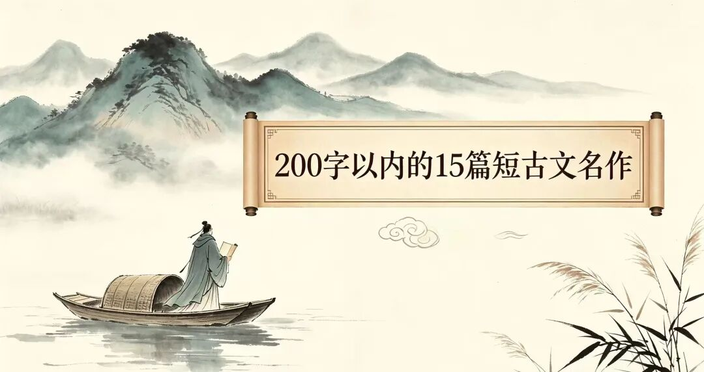

# 王炸奇文！15篇200字以内的千古名作，必须全文背诵！
> 💡 备注属性未写入，可能是备注属性名称或者类型被修改了，建议将字段类型设置为 rich_text，可以在小程序-操作-修改文章数据库页面进行调整
> 💡 原文链接:[https://mp.weixin.qq.com/s?__biz=MzY4MjM0NTY4NA==&mid=2247486518&idx=1&sn=8381c252657cfca936d1c931f5ad74aa&chksm=f2a7c2658e17d3fcd26a0b3b74cae97728ff98ff6827245088139d735eb149166920d2ddd7f4#rd](https://mp.weixin.qq.com/s?__biz=MzY4MjM0NTY4NA%3D%3D&mid=2247486518&idx=1&sn=8381c252657cfca936d1c931f5ad74aa&chksm=f2a7c2658e17d3fcd26a0b3b74cae97728ff98ff6827245088139d735eb149166920d2ddd7f4#rd)
今天整理了15篇200字以内的经典短文，基本都是课本上的名篇，你都会背了吗？

**01**
**马说（151字）**
**马说**
【唐】韩愈
世有伯乐，然后有千里马。千里马常有，而伯乐不常有。故虽有名马，祗辱于奴隶人之手，骈死于槽枥之间，不以千里称也。
马之千里者，一食或尽粟一石。食马者不知其能千里而食也。是马也，虽有千里之能，食不饱，力不足，才美不外见，且欲与常马等不可得，安求其能千里也？
策之不以其道，食之不能尽其材，鸣之而不能通其意，执策而临之，曰：“天下无马！”呜呼！其真无马邪？其真不知马也！
**译文：**世上先有伯乐，然后才有千里马。千里马常有，但伯乐不常有。所以即使有名贵的马，也只能在仆役的手中受辱，和普通马一起死在马槽之间，不被人以千里马著称。
日行千里的马，一顿有时能吃一石粮食。喂马的人不知道它能日行千里而喂养它。这样的马，虽有日行千里的才能，但吃不饱，力气不足，它的才能和美好的素质就不能表现在外面，想要和普通马一样尚且不可能，怎么能要求它日行千里呢？
驱使它不按照正确的方法，喂养它又不能使它充分发挥才能，它鸣叫却不能通晓它的意思，拿着马鞭面对它，说：“天下没有千里马！”唉！难道真的没有千里马吗？其实是他们真不认识千里马啊！
**02**
**陋室铭（81字）**
**陋室铭**
【唐】刘禹锡
山不在高，有仙则名。水不在深，有龙则灵。斯是陋室，惟吾德馨。苔痕上阶绿，草色入帘青。谈笑有鸿儒，往来无白丁。可以调素琴，阅金经。无丝竹之乱耳，无案牍之劳形。南阳诸葛庐，西蜀子云亭。孔子云：何陋之有？
**译文：**山不在于高，有了仙人居住就有名望；水不在于深，有了蛟龙潜藏就有灵气。这是一间简陋的房屋，只因我的品德美好而芳香远播。苔痕碧绿，长到台阶上；草色青葱，映入帘子里。谈笑往来的都是博学之人，没有浅薄无识之辈。可以弹奏素朴的古琴，阅读珍贵的佛经。没有世俗的音乐扰乱耳朵，没有官府的公文劳累身心。好比南阳诸葛亮的草庐，西蜀扬子云的亭子。孔子说：有什么简陋的呢？
**03**
**爱莲说（119字）**
**爱莲说**
【宋】周敦颐
水陆草木之花，可爱者甚蕃。晋陶渊明独爱菊。自李唐来，世人甚爱牡丹。予独爱莲之出淤泥而不染，濯清涟而不妖，中通外直，不蔓不枝，香远益清，亭亭净植，可远观而不可亵玩焉。
予谓菊，花之隐逸者也；牡丹，花之富贵者也；莲，花之君子者也。噫！菊之爱，陶后鲜有闻。莲之爱，同予者何人？牡丹之爱，宜乎众矣！
**译文：**水上、陆地上各种草木的花，值得喜爱的很多。晋代陶渊明唯独喜爱菊花。自唐朝以来，世人很喜爱牡丹。我唯独喜爱莲花从淤泥中长出却不被沾染，经过清水洗涤却不显得妖媚，花茎中空外直，不生蔓藤，不长旁枝，香气远播更加清幽，笔直洁净地立在那里，可以从远处观赏却不能随意玩弄。
我认为，菊花是花中的隐士；牡丹是花中的富贵者；莲花是花中的君子。唉！对于菊花的喜爱，陶渊明以后就很少听到了。对于莲花的喜爱，像我一样的还有谁呢？对于牡丹的喜爱，人数当然很多了！
**04**
**记承天寺夜游（84字）**
**记承天寺夜游**
【宋】苏轼
元丰六年十月十二日夜，解衣欲睡，月色入户，欣然起行。念无与为乐者，遂至承天寺寻张怀民。怀民亦未寝，相与步于中庭。
庭下如积水空明，水中藻、荇交横，盖竹柏影也。何夜无月？何处无竹柏？但少闲人如吾两人者耳。
**译文：**元丰六年十月十二日夜晚，我解开衣服正准备睡觉，月光照进窗户，高兴地起身出门。想到没有可以一起游乐的人，于是就到承天寺去找张怀民。张怀民也没有睡，我们便一起在庭院里散步。
月光照在庭院里，像积满了水一样清澈透明，水中的藻、荇交错纵横，原来是竹子和柏树的影子。哪个夜晚没有月光？哪里没有竹子和柏树呢？只是缺少像我们两个这样清闲的人罢了。
**05**
**诫子书（86字）**
**诫子书**
【三国】诸葛亮
夫君子之行，静以修身，俭以养德。非淡泊无以明志，非宁静无以致远。夫学须静也，才须学也，非学无以广才，非志无以成学。淫慢则不能励精，险躁则不能治性。年与时驰，意与日去，遂成枯落，多不接世，悲守穷庐，将复何及！
**译文：**德才兼备的人的品行，是依靠内心安静来修养身心的，是依靠俭朴的作风来培养品德的。不看淡眼前的名利得失，就不能有明确坚定的志向；不能安静平和地学习，就不能实现远大的理想。学习必须身心宁静、专心致志，增长才干必须不断学习。不努力学习就不能增长才智，不明确志向就不能学有所成。追求过度享乐和怠惰散漫就不能振奋精神；莽撞草率、轻薄浮躁就不能陶冶性情。年华随着光阴流逝，意志随着岁月消磨，最后就像枯枝败叶般凋零，大多对社会没有任何贡献，悲哀地守着穷困的屋舍，那时后悔又怎么来得及！
**06**
**伯牙鼓琴（77字）**
**伯牙鼓琴**
**【先秦】《吕氏春秋》**
**伯牙鼓琴，锺子期听之。方鼓琴而志在太山，锺子期曰：“善哉乎鼓琴，巍巍乎若太山。”少选之间而志在流水，锺子期又曰：“善哉乎鼓琴，汤汤乎若流水。”锺子期死，伯牙破琴绝弦，终身不复鼓琴，以为世无足复为鼓琴者。**
**译文：**伯牙弹琴，锺子期听他弹琴。伯牙在弹琴时心里想着高山，锺子期说：“你弹得真好呀，像大山一样高峻。”不一会儿，伯牙心里又想到流水，锺子期又说：“你弹得真好呀，就像那奔腾不息的流水。”锺子期死了以后，伯牙摔琴断弦，终生不再弹琴，认为世上再没有值得他为之弹琴的人了。
**07**
**春夜宴从弟桃花园序**
**春夜宴从弟桃花园序**
**【唐】李白**
**夫天地者，万物之逆旅也；光阴者，百代之过客也。而浮生若梦，为欢几何？古人秉烛夜游，良有以也。况阳春召我以烟景，大块假我以文章。会桃花之芳园，序天伦之乐事。群季俊秀，皆为惠连；吾人咏歌，独惭康乐。幽赏未已，高谈转清。开琼筵以坐花，飞羽觞而醉月。不有佳咏，何伸雅怀？如诗不成，罚依金谷酒数。**
**译文：**天地是万物的客舍，光阴是古往今来的过客。死生的差异，就好像梦与醒的不同，纷纭变换，不可究诘，得到的欢乐，又能有多少呢？古人夜间执着火炬游玩，实在是有道理啊。况且温和的春天以秀美的景色来招引我们，大自然又给我们展现锦绣风光。相聚在桃李飘香的花园中，畅叙兄弟间快乐的往事。
弟弟们英俊优秀，个个都有谢惠连那样的才情，而我作诗吟咏，却惭愧不如谢灵运。清雅的赏玩不曾停止，高谈阔论又转向清言雅语。摆开筵席来坐赏名花，快速地传递着酒杯醉倒在月光中。没有好诗，怎能抒发高雅的情怀？倘若有人作诗不成，就要按照当年石崇在金谷园宴客赋诗的先例，谁咏不出诗来，罚酒三杯。
**08**
**孙权劝学（152字）**
**孙权劝学**
**【宋】司马光**
**初，权谓吕蒙曰：“卿今当涂掌事，不可不学！”蒙辞以军中多务。权曰：“孤岂欲卿治经为博士邪！但当涉猎，见往事耳。卿言多务，孰若孤？孤常读书，自以为大有所益。”蒙乃始就学。及鲁肃过寻阳，与蒙论议，大惊曰：“卿今者才略，非复吴下阿蒙！”蒙曰：“士别三日，即更刮目相待，大兄何见事之晚乎！”肃遂拜蒙母，结友而别。**
**译文：**起初，孙权对吕蒙说：“你现在掌管政事，不可以不学习！”吕蒙用军中事务繁多来推托。孙权说：“我难道想要你研究儒家经典，成为专掌经学传授的学官吗？我只是让你应当粗略地阅读，了解历史。你说军务繁多，谁比得上我事务多呢？我经常读书，自己觉得获益颇多。”吕蒙于是开始从事学习。等到鲁肃经过寻阳的时候，鲁肃和吕蒙一起讨论议事，鲁肃十分吃惊地说：“你现在军事方面的才干和谋略，不再是在吴下时没有才学的阿蒙了！”吕蒙说：“与读书的人分别几天，就应当用新的眼光看待，大兄你知晓事情为什么这么晚呢？”于是鲁肃拜见吕蒙的母亲，和吕蒙结为好友后离开了。
**09**
**塞翁失马（168字）**
**塞翁失马**
**【两汉】刘安**
**近塞上之人，有善术者，马无故亡而入胡。人皆吊之，其父曰：“此何遽不为福乎？”居数月，其马将胡骏马而归。人皆贺之，其父曰：“此何遽不能为祸乎？”家富良马，其子好骑，堕而折其髀。人皆吊之，其父曰：“此何遽不为福乎？”居一年，胡人大入塞，丁壮者引弦而战。近塞之人，死者十九。此独以跛之故，父子相保。故福之为祸，祸之为福，化不可及，深不可测也。**
**译文：**靠近边境一带居住的人中有一个精通术数的人，他们家的马无缘无故跑到了胡人的住地。人们都前来慰问他。那个老人说：“这怎么就不能是一件好事呢？”过了几个月，那匹马带着胡人的良马回来了。人们都前来祝贺他们一家。那个老人说：“这怎么就不能是一件坏事呢？”他家中有很多好马，他的儿子喜欢骑马，结果从马上掉下来摔得大腿骨折。人们都前来安慰他们一家。那个老人说：“这怎么就不能是一件好事呢？”过了一年，胡人大举入侵边境一带，壮年男子都拿起弓箭去作战。靠近边境一带的人，绝大部分都死了。唯独这个人因为腿瘸的缘故免于征战，父子得以保全生命。所以福转化为祸，祸转化为福，其中的变化没有办法达到极点，其中的深奥没有方法来探测。
**10**
**与朱元思书（144字）**
**与朱元思书**
**【南北朝】吴均**
**风烟俱净，天山共色。从流飘荡，任意东西。自富阳至桐庐一百许里，奇山异水，天下独绝。**
**水皆缥碧，千丈见底。游鱼细石，直视无碍。急湍甚箭，猛浪若奔。**
**夹岸高山，皆生寒树，负势竞上，互相轩邈，争高直指，千百成峰。泉水激石，泠泠作响；好鸟相鸣，嘤嘤成韵。蝉则千转不穷，猿则百叫无绝。鸢飞戾天者，望峰息心；经纶世务者，窥谷忘反。横柯上蔽，在昼犹昏；疏条交映，有时见日。**
**译文：**烟雾都消散尽净，天空和群山融为一色。我乘着船随着江流漂荡，任凭船按照自己的意愿，时而向东，时而向西。从富阳到桐庐一百里左右的水路上，山水奇特独异，天下独一无二。
水都是浅青色的，深深的江水清澈见底。一直看下去，水底游动的鱼儿和细小的石头都可以看得很清楚，毫无障碍。湍急的水流比箭还快，凶猛的巨浪好像飞奔的骏马。
江两岸的高山上，全都生长着苍翠的树木，一看便让人心生寒意，高山凭依高峻的地势争着向上，往高处和远处伸展；群山竞争着高耸，笔直地向上，直插云天，形成千百座山峰。山间泉水冲击着岩石，发出泠泠的响声；美丽的鸟相互和鸣，鸣声嘤嘤，和谐动听。蝉长久不断地鸣叫，猿不停地啼叫着。看到这些雄奇的山峰，那些极力追求功名利禄的人，追逐名利的心就会平静下来；看到这些幽美的山谷，忙于治理国家大事的人，就会流连忘返。横斜的树木遮蔽了上面的天空，即使在白天，林间也昏暗如黄昏；稀疏的枝条互相掩映，有时还能露出阳光。
**11**
**湖心亭看雪（159字）**
**湖心亭看雪**
**【明】张岱**
**崇祯五年十二月，余住西湖。大雪三日，湖中人鸟声俱绝。是日更定矣，余拏一小舟，拥毳衣炉火，独往湖心亭看雪。雾凇沆砀，天与云与山与水，上下一白，湖上影子，惟长堤一痕、湖心亭一点、与余舟一芥、舟中人两三粒而已。**
**到亭上，有两人铺毡对坐，一童子烧酒炉正沸。见余大喜曰：“湖中焉得更有此人！”拉余同饮。余强饮三大白而别。问其姓氏，是金陵人，客此。及下船，舟子喃喃曰：“莫说相公痴，更有痴似相公者。”**
**译文：**崇祯五年十二月，我住在西湖边。大雪接连下了几日，湖中游人全无，连飞鸟的声音都消失了。这天晚上八点左右，我撑着一叶小舟，裹着裘皮衣服，围着火炉，独自前往湖心亭看雪。湖面上冰花一片弥漫，天、云、山、水混为一体，白茫茫一片。湖上的影子，只有西湖长堤在雪中隐隐露出的一道痕迹，一点湖心亭的轮廓，和我的微小如草的小舟，舟中的两三粒人影罢了。
到了湖心亭上，我看见有两人铺好毛毯，相对而坐，一个童子正把酒炉里的酒烧得滚沸。他们看见我，非常高兴地说：“想不到在湖中还会有您这样有闲情逸致的人！”于是拉着我一同饮酒。我尽力喝了三大杯，然后和他们道别。问他们的姓氏，得知他们是金陵人，在此地客居。等到了下船的时候，船夫喃喃地说：“不要说相公您痴，还有像相公您一样痴的人啊！”
**12**
**三峡（155字）**
**三峡**
**【南北朝】郦道元**
**自三峡七百里中，两岸连山，略无阙处。重岩叠嶂，隐天蔽日，自非亭午夜分，不见曦月。**
**至于夏水襄陵，沿溯阻绝。或王命急宣，有时朝发白帝，暮到江陵，其间千二百里，虽乘奔御风，不以疾也。**
**春冬之时，则素湍绿潭，回清倒影，绝巘多生怪柏，悬泉瀑布，飞漱其间，清荣峻茂，良多趣味。**
**每至晴初霜旦，林寒涧肃，常有高猿长啸，属引凄异，空谷传响，哀转久绝。故渔者歌曰：“巴东三峡巫峡长，猿鸣三声泪沾裳。”**
**译文：**在七百里的三峡之间，两岸都是相连的高山，完全没有中断的地方。重重叠叠的山峰像屏障一样，遮挡了天空和太阳。如果不是正午或午夜，就看不见太阳或月亮。
等到夏天江水漫上山陵的时候，下行和上行船只的航路都被阻断，无法通行。有时皇帝的命令要紧急传达，早晨从白帝城出发，傍晚就到了江陵，这中间有一千二百里，即使骑乘奔驰的快马，驾着风，也不如船快。
等到春天和冬天的时候，就可以看见白色的急流中回旋着清波，碧绿的潭水倒映着各种景物的影子。极高的山峰上生长着许多奇形怪状的松柏，山峰间悬泉瀑布飞流冲荡。水清，树荣，山峻，草盛，趣味无穷。
每逢初晴的日子或者下霜的早晨，树林和山涧就显出一片肃杀凄寒，常常有猿猴在高处拉长声音鸣叫，声音持续不断，显得非常凄惨悲凉，在空荡的山谷里传来猿叫的回声悲哀婉转，很久才停止。所以三峡中渔民的歌谣唱道：“巴东三峡之中巫峡最长，猿猴鸣叫几声凄凉得令人眼泪打湿衣裳。”
**13**
**卖油翁（133字）**
**卖油翁**
**【宋】欧阳修**
**陈康肃公善射，当世无双 ，公亦以此自矜。尝射于家圃，有卖油翁释担而立，睨之久而不去。见其发矢十中八九，但微颔之。**
**康肃问曰：“汝亦知射乎？吾射不亦精乎？”翁曰：“无他，但手熟尔。”康肃忿然曰：“尔安敢轻吾射！”翁曰：“以我酌油知之。”乃取一葫芦置于地，以钱覆其口，徐以杓酌油沥之，自钱孔入，而钱不湿。因曰：“我亦无他，惟手熟尔。”康肃笑而遣之。**
**此与庄生所谓解牛斫轮者何异？**
**译文：**康肃公陈尧咨擅长射箭，当时世上没有第二个人能跟他相媲美，他也凭借这种本领而自夸。曾经有一次，他在家里的场地射箭，有个卖油的老翁放下担子，站在那里不在意地看着他，很久都不离开。卖油的老翁看他射十箭中了八九次，只是微微点头。
陈尧咨问卖油翁：“你也懂得射箭吗？我的箭法不高明吗？”卖油的老翁说：“没有别的奥妙，不过是手法熟练罢了。”陈尧咨听后气愤地说：“你怎么敢看轻我射箭的本领！”老翁说：“凭我倒油的经验知道这个道理。”于是拿出一个葫芦放在地上，把一枚铜钱盖在葫芦口上，慢慢地用油杓舀油注入葫芦里，油从钱孔注入而钱却没有湿。于是说：“我也没有别的奥妙，只不过是手法熟练罢了。”陈尧咨笑着打发了他。
这与庄子所讲的庖丁解牛、轮扁斫轮的故事，有什么不同呢？
**14**
**临皋闲题（71字）**
**临皋闲题**
**【宋】苏轼**
**临皋亭下八十数步，便是大江，其半是峨眉雪水，吾饮食沐浴皆取焉，何必归乡哉！江山风月，本无常主，闲者便是主人。闻范子丰新第园池，与此孰胜？所不如者，上无两税及助役钱耳。**
**译文：**临皋亭下不远处就是长江，长江水有很大一部分是峨眉山上的雪水，我平时吃喝洗涮都是从江里打水，何必想着回家乡呢？江山风月，本来是没有主人的，谁在用便可以说是主人。听说范子丰新买了园子，不知和我这里比怎么样？我比他差的，也就是我这不能缴税吧。
**15**
**答谢中书书（68字）**
**答谢中书书**
**【南北朝】陶弘景**
**山川之美，古来共谈。高峰入云，清流见底。两岸石壁，五色交晖。青林翠竹，四时俱备。晓雾将歇，猿鸟乱鸣；夕日欲颓，沉鳞竞跃。实是欲界之仙都。自康乐以来，未复有能与其奇者。**
**译文：**山川景色的美丽，自古以来就是文人雅士共同谈赏的。巍峨的山峰耸入云端，明净的溪流清澈见底。两岸的石壁色彩斑斓，交相辉映。青葱的树林，翠绿的竹子，四季长存。清晨的薄雾将要消散的时候，猿、鸟的叫声此起彼伏；夕阳快要落山的时候，潜游在水中的鱼儿争相跳出水面。这里确实是人间仙境啊。自从南朝的谢灵运以来，就再也没有人能够欣赏这种奇异的山水景色了。
