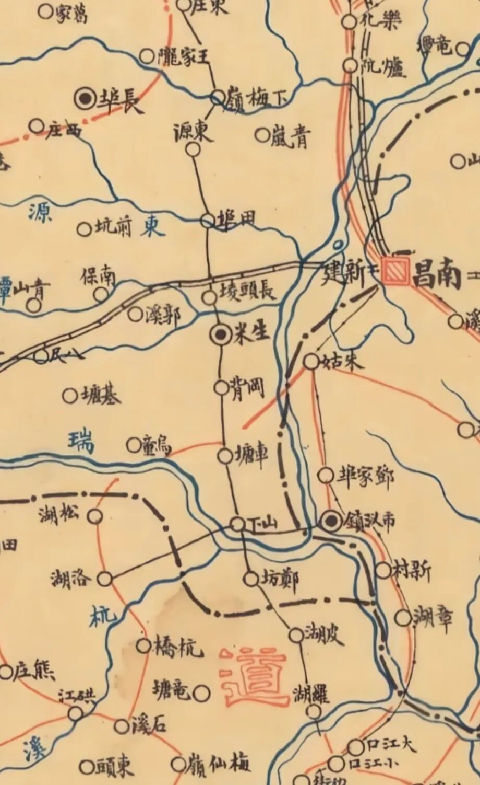
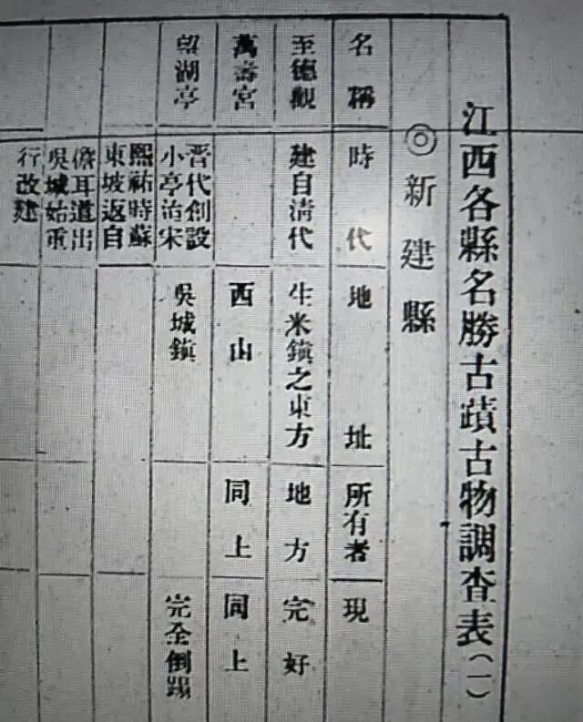
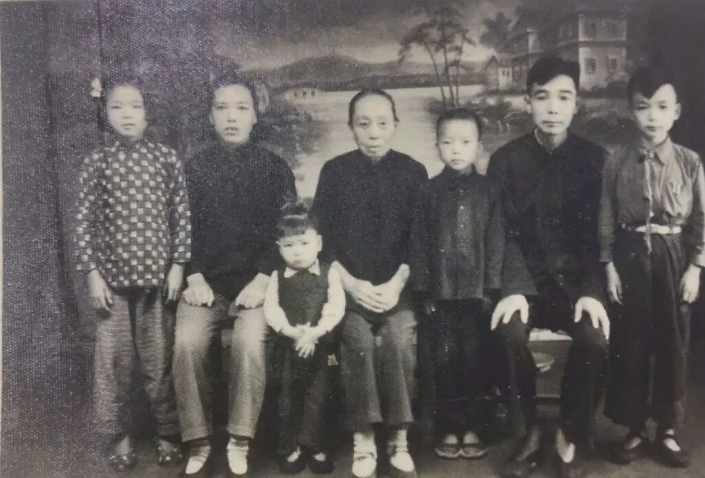
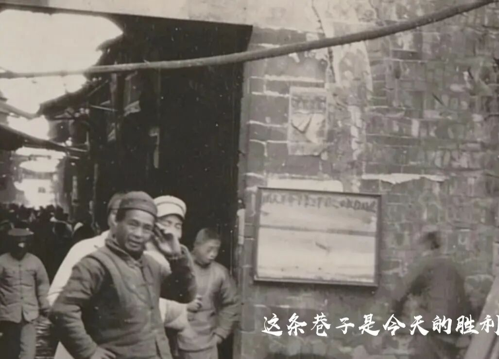
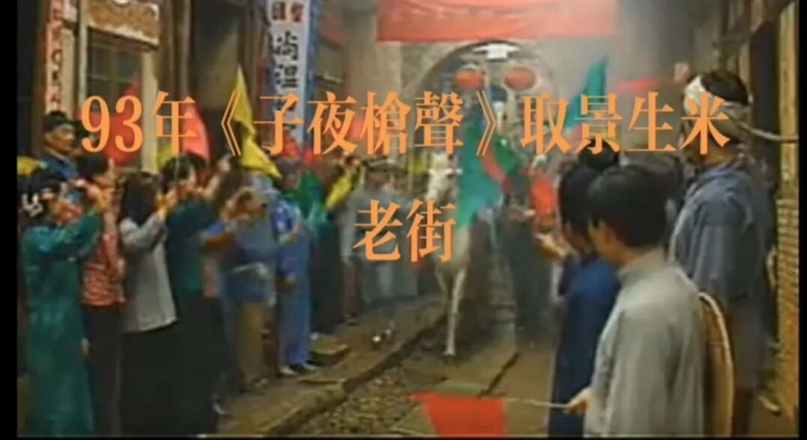

# 生米老街历史文化价值的简述
> 💡 备注属性未写入，可能是备注属性名称或者类型被修改了，建议将字段类型设置为 rich_text，可以在小程序-操作-修改文章数据库页面进行调整
> 💡 原文链接:[https://mp.weixin.qq.com/s?__biz=MzYyMjg5NzkyNg==&mid=2247484150&idx=1&sn=b0546186ef6be2290bce82b00f5829dc&chksm=fea2e6e816310655e5aa437d3f71075bbdbbfa42642574f43aca0c1d1892a566e18143d6da66#rd](https://mp.weixin.qq.com/s?__biz=MzYyMjg5NzkyNg%3D%3D&mid=2247484150&idx=1&sn=b0546186ef6be2290bce82b00f5829dc&chksm=fea2e6e816310655e5aa437d3f71075bbdbbfa42642574f43aca0c1d1892a566e18143d6da66#rd)
生米老街历史文化价值说明
一、区位概况
生米老街位于南昌市红谷滩区生米街道，地处省城赣江西岸，北接九龙湖，南连未来科创城方向，是南昌赣江沿岸重要的千年传统古商埠型街区。街区以胜利街主街为核心骨架，辅以后街、巷道及原有壕沟水系，街巷格局完整，保留了清末至民国时期、建国初期多阶段叠加的历史风貌，是红谷滩乃至南昌城区范围内为数不多、格局尚存千年古镇的传统老街遗存。

二、历史沿革
生米，古时地处赣、抚、锦交口，为楚头吴尾、西山(南昌山、梅岭)之南，南朝人雷次宗《豫章记》:“豫章水陆四通,山川特秀,咽扼荆淮,翼蔽吴越。″
 郡江之西岸,有磐石,下多良田,极膏腴者一亩二十斛。稻米之精者,如玉映澈于器中。《豫章记》称江西“嘉蔬精稻，擅味八方”。
 许大夫妻是一人得道，鸡犬升天的落榜人。但成就翻车冈米生米千年神话故事，也成就豫章郡人杰地灵，物华天宝之地。也是江右商帮江南鱼米之乡中国三大粮仓之一，即是生米集市之古镇。
 《南昌郡乘》：许大者，许真君之仆也，与妻运米于西岭，闻真君飞升，即奔驰而归，仓皇覆其车，遗米于地，米皆复生，后人名其地为生米镇，真君以其分未应仙，乃授以地。
 生米古镇历史悠久，赣江水运兴盛时期即为沿岸重要集市与商贸码头，货泊舟楫往来频繁，街市商铺连片，周边乡民多在此集散交易。历史上曾为新建县治驻地，区域行政地位突出，承载了南昌近郊乡镇发展的重要记忆。
近代以来，街区历经清末民初商贸繁荣、建国初期集体经济与基层治理建设等多个阶段，留存有原新建县委县政府旧址、唐氏宗祠、原新建法院旧址、老街合作社（胜利街62号）等一批不同时期的历史建筑与场所，完整见证了生米由水运商埠到乡镇集镇、再到城市片区的历史变迁。

三、核心历史文化价值
（一）格局价值：赣江水运商埠街巷格局保存完整
街区依托赣江水运商贸发展形成，以胜利街主街为轴线，巷道向两侧院落纵深延展，形成“一主街、多巷道、带内院、伴水系”的空间格局。街巷走向、院落边界、房屋进深与壕沟水系相互依存，至今仍可辨识传统商埠集镇的肌理特征。在红谷滩快速城市化的背景下，这样一片格局完整、肌理连续的传统老街，具有不可替代的空间见证价值。
（二）建筑价值：多时期乡土建筑风貌集中连片
街区内建筑以两层砖木结构民居、临街商铺为主，青砖墙体、木构架、木楼板、坡屋面、传统木门窗等本土营造做法保存较多，既有赣中滨湖地区传统民居的基本特征，也融合了建国初期乡镇商业建筑的形制特点。不同年代的构件、装修与使用痕迹叠加共存，真实反映了乡土建筑随时代演变的过程，是研究南昌近郊近现代乡土建筑与乡镇商业建筑的实物样本。

（三）历史价值：乡镇商贸与集体经济的实物见证
老街合作社（胜利街62号）、原新建县委县政府旧址、原新建法院旧址等场所，分别对应供销集体经济、基层政权建设等历史阶段，与老街商铺、民居共同构成了生动近现代社会生活的实物档案。街区不仅是居住与经商的空间，更是乡镇经济结构、社会组织方式与日常生活方式变迁的见证载体。
（四）人文价值：状元文脉与乡土记忆传承深厚
生米郡城邓氏一脉，南唐童子科状元邓伋（晚年更名邓斌）为本地历史文化名人，少年登科，后归乡创办秀溪书院讲学传道，留下“礼乐遵前代，诗书启后人”的文脉传统。街区内还留存有家族宗祠、老街商号、民俗生活记忆等乡土文化资源，具备延续地方文史、乡愁记忆与乡土教育的人文基础。

（五）社会价值：城市更新中承载社区认同与公共文化功能
生米老街现有居民世代聚居，邻里关系、街巷交往与生活习惯延续至今，是本地居民重要的情感归属地。在历史建筑修缮、街巷环境整治与活化利用过程中，街区可承担乡土文化展示、非遗民俗传承、社区文化活动与文旅公共服务等功能，成为连接历史记忆、居民生活与城市发展的公共文化节点。
四、价值综合评价
生米老街街巷格局清晰、历史建筑集中、历史层叠信息丰富，既有赣江水运商埠的空间底色，又有近现代乡镇商贸、集体经济与基层治理的历史遗存，同时兼具本土文脉与民俗记忆。街区真实、完整地保存了南昌近郊传统乡镇发展的历史脉络，在红谷滩区乃至南昌市历史文化遗产体系中具有独特性与代表性，符合历史文化街区认定所要求的格局完整性、风貌真实性与历史延续性。

五、保护与活化导向
后续保护工作应坚持保护优先、最小干预、修旧如旧、织补更新的原则，严格保护街巷格局、历史界面、传统建筑与历史信息载体；在消除结构、消防、防潮、白蚁等安全隐患的基础上，适度开展文化展示、民俗传承、便民服务与低密度活化利用，保留原住民生活气息，避免大拆大建与过度商业化，实现历史遗存保护、人居环境改善与街区可持续利用的有机统一。
