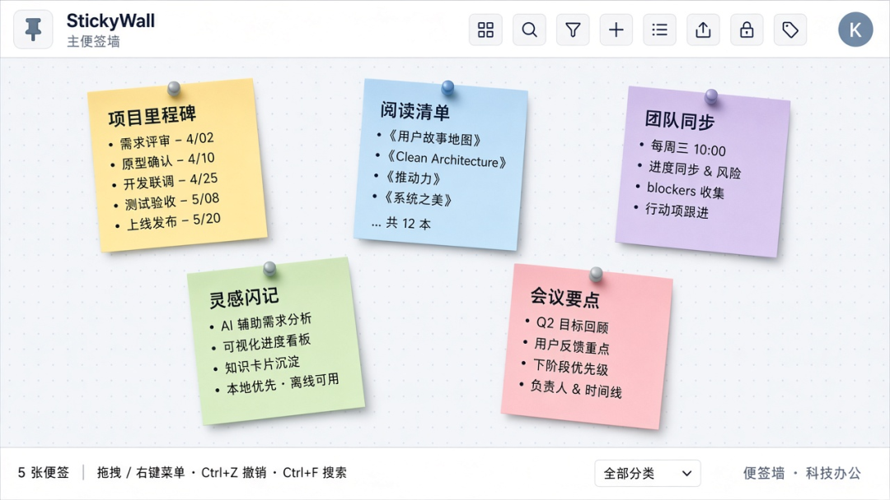

# 用 AI 亲手打磨一款效率工具｜StickyWall，属于开发者的本地便签画布
> 💡 备注属性未写入，可能是备注属性名称或者类型被修改了，建议将字段类型设置为 rich_text，可以在小程序-操作-修改文章数据库页面进行调整
> 💡 原文链接:[https://mp.weixin.qq.com/s?__biz=MzcwMzQxNDY3Mg==&mid=2247484101&idx=1&sn=d7f9f15bc3885813259b8bce0905f2e5&chksm=f56469787f2be5b0b1d16b0b4a4bda6e69cef1c71dd265118a6055908014501a2b56ba21bb99#rd](https://mp.weixin.qq.com/s?__biz=MzcwMzQxNDY3Mg%3D%3D&mid=2247484101&idx=1&sn=d7f9f15bc3885813259b8bce0905f2e5&chksm=f56469787f2be5b0b1d16b0b4a4bda6e69cef1c71dd265118a6055908014501a2b56ba21bb99#rd)
不知道你会不会常常有这种感受：脑子里一闪而过的灵感、项目的里程碑节点、开会记下的风险卡点，散落在记事本、备忘录、在线文档里，想找的时候到处翻。在线笔记又总让我担心两件事：网络断连就用不了、私密的账号资料上传云端心里不踏实。
于是，我萌生了一个想法：自己做一块无限画布便签墙。StickyWall 就是在这样的想法下，借助 AI 辅助完成落地的 Chrome 扩展。
这不是拿 AI 一键生成的半成品，而是一场「人定需求，AI 做辅助」的完整实践。我把日常工作里所有痛点整理清楚：我需要可以自由缩放平移的无限画布；既能随手拖拽便签自由排版，也能一键规整成清爽的瀑布流；支持 Markdown 写富文本笔记；要分类检索，快速定位内容；私密内容要有保险箱隔离；还要支持本地 ZIP 备份，防止数据丢失。
需求框架确定之后，AI 帮我完成了大量繁琐的工作：组件逻辑、画布拖拽缩放算法、本地存储方案、检索过滤、备份导出的代码实现，还有反复调试 UI 细节、修复边界 bug。我专注做产品判断：哪些功能是刚需、哪些是锦上添花、交互要符合程序员的直觉、坚持本地优先，离线可用的底线。

最终成品 StickyWall，就是截图里这块彩色便签墙。 你可以贴上项目里程碑、读书清单、团队例会要点、一闪而过的灵感；账号、密钥这类敏感信息，放进独立保险箱，不和普通便签混在一起。所有数据都存在浏览器本地，不上云。
很多人问我，用 AI 写工具，到底意义在哪？ 我的理解是：AI 不是用来替代思考，而是把我们从重复、枯燥的编码劳动里释放出来。从前想做一个小工具，要花大量时间写底层交互、调试存储逻辑，很容易做到一半就搁置。现在，我把精力放在「我真正想要什么」，AI 承接工程实现环节，让一个源于自身痛点的想法，快速变成可以每天用的工具。
工具先解决了我自己的效率问题。项目同步、灵感收集、待办追踪全部收拢在这一面便签墙上，工作流清爽了很多。同样有信息碎片化困扰的朋友，可以扫码进入页面自行下载。如下图：

它适合程序员、产品、设计师，适合需要随时捕捉想法、管理项目进度、整理阅读清单的人。没有花哨多余的功能，所有功能都来自真实工作场景的沉淀。
AI 落地最好的方式，从来不是宏大的 Demo，而是解决自己身边真实痛点的小工具。从一个脑子里的想法，到每天打开浏览器就能使用的便签墙，这一次，AI 是我的搭档，帮我把想法落地。后续我也会持续迭代 StickyWall，根据大家反馈新增能力。如果你也厌倦了杂乱的笔记、担心云端数据安全，不妨试试这块干净的本地便签墙。
🌱 **我们一起学习进步**
 关注我，一起看清真实面，变化本来就快，适应它，比抱怨它更有用。
