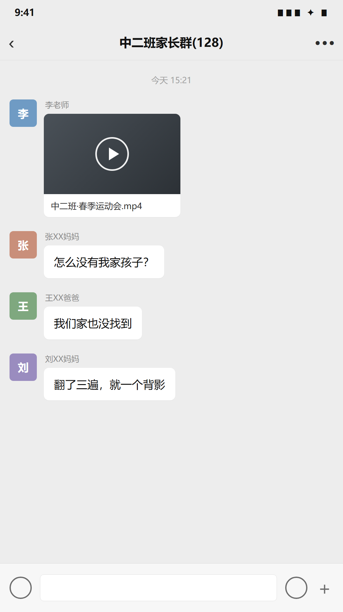
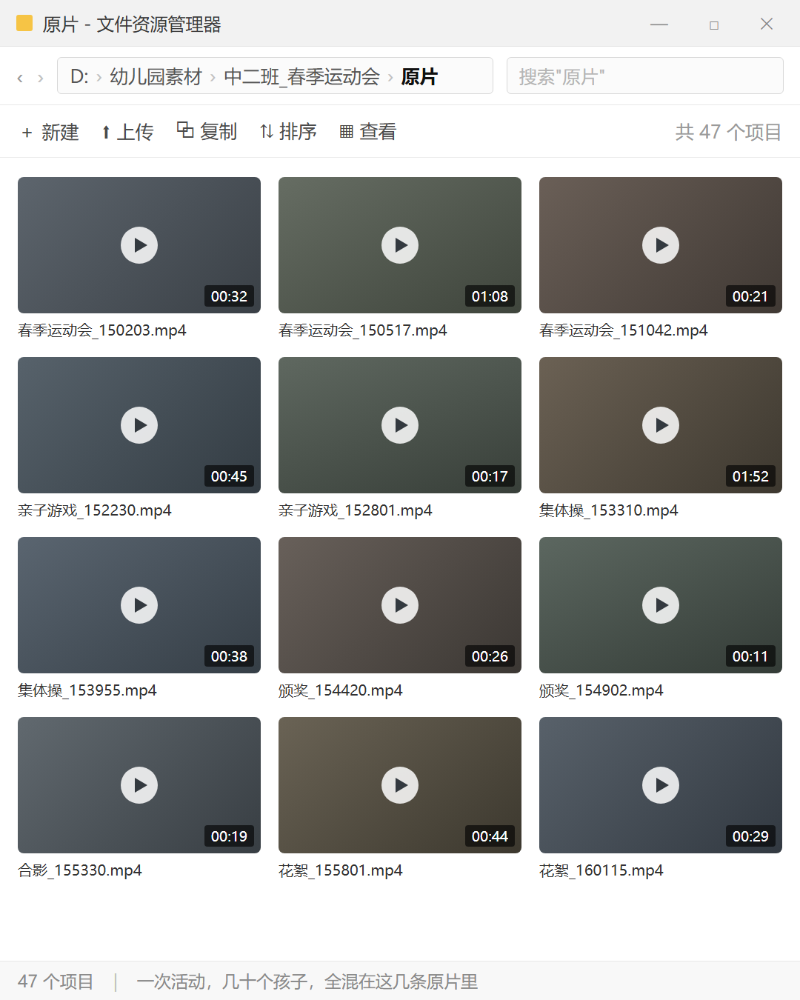
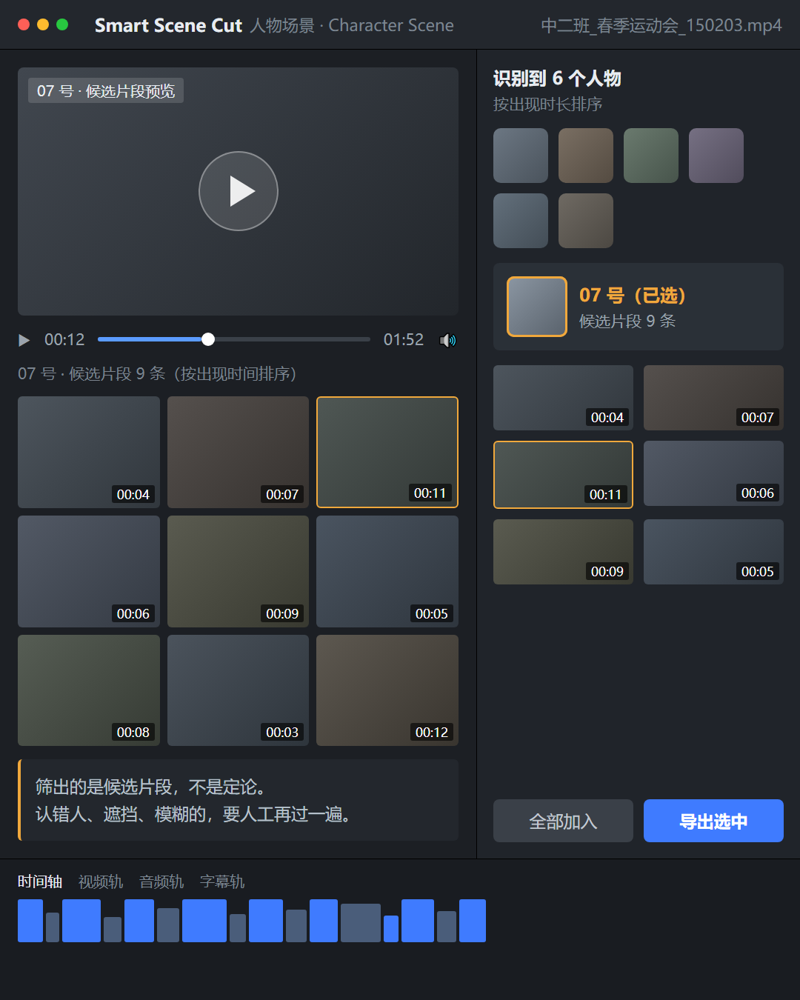
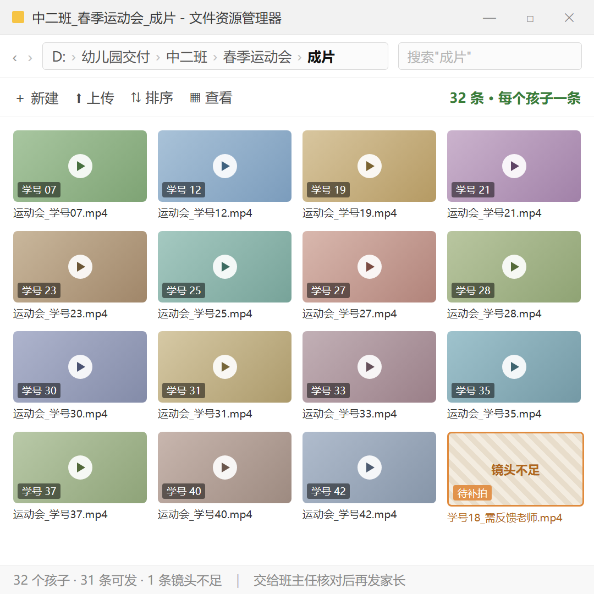
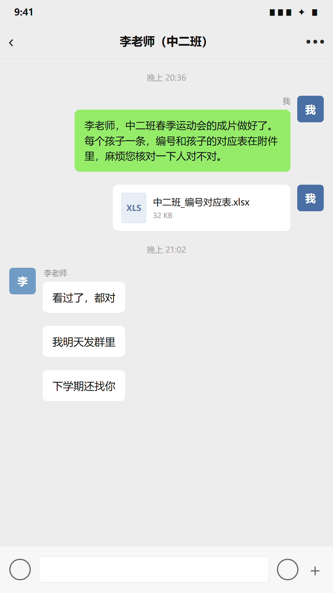

# 用 AI 给幼儿园做孩子的专属视频，月入 5 万
> 💡 备注属性未写入，可能是备注属性名称或者类型被修改了，建议将字段类型设置为 rich_text，可以在小程序-操作-修改文章数据库页面进行调整
> 原文链接:[https://mp.weixin.qq.com/s/xe-xQiqoaD0qutINkPhNyw](https://mp.weixin.qq.com/s/xe-xQiqoaD0qutINkPhNyw)
**我一个学员，一个人，给幼儿园做孩子的专属活动视频。**半年时间，做到了 10 家幼儿园，每个月 5 万块收入。
我把这个过程拆一下，其实就三步。

### 起因特别小
幼儿园每次办完活动，老师把照片和视频发到家长群，底下第一句永远是：**怎么没有我家孩子？**
老师不是不想剪。一场活动几十个孩子，一个个找镜头、一个个剪，根本忙不过来。
一场活动拍下来，原片几十条，全混在一起。谁出现在哪一条、第几秒，只能靠人一段一段拖。

### 第一步：把“全班一条视频”，改成“每个孩子一条专属记录”
原来的交付是一条大合集，发到群里，家长翻半天，也不一定找得到自家孩子。
他改成每个孩子单独一条。家长打开就是自家孩子，从头到尾不出戏。
这一个改动，是整个生意的起点。
### 第二步：素材园方给，AI 先归好类，人再过一遍
素材是园方提供的。他用 AI 把每个孩子出现的片段先归好类，把原来要拖一整天的活，压到几分钟出候选。

**这一步要说清楚：**筛出来的是候选片段，不是定论。有没有认错人、镜头是不是清楚、重复的要删掉、漏掉的要补上，都得人工再看一遍。工具不能保证一次就把全班孩子全部分准。
### 第三步：套同一个模板批量出，班主任核对后发出
他把这件事按月做成了固定交付——幼儿园月月有活动，他月月出每个孩子的那一条。
片头、字幕、音乐、结尾，都是同一套模板。他要动的，只是每个孩子对应的那几段片段。

哪个孩子镜头不足，他就反馈给老师，下次拍摄补齐。**不硬凑。**
最后幼儿园班主任核对是不是对应的孩子，再发给家长。

### 他做对了什么
**不去拍，不碰授权。**素材和授权都在园方手里，他只做整理、筛选、剪辑这一段。少一个环节，就少一份责任和风险。
**不卖工具，卖的是“每个月每个孩子都有一条”。**幼儿园月月有活动，这条收入就月月有。一次成交，后面是续着走的。
**把核对留在园方手上。**哪个孩子是哪条片子，由班主任确认。他不替老师做这个决定。
他做了半年以后，发现幼儿园反馈很好，尤其是高端私立幼儿园。
### 这件事为什么成立
对园方：老师不用再一个个剪，家长群里的抱怨也少了。
对家长：终于能拿到一条从头到尾都有自家孩子的记录。
对他：素材不用自己拍，模板可以复用，一个班几十个孩子，做的其实是同一件事。
我把 AI 变现案例的实现过程都拆解出来了。需要的，主页可以联系我，分享更多 AI 变现案例。

## 摘要

（待补充）

## 我的笔记

（待补充）
