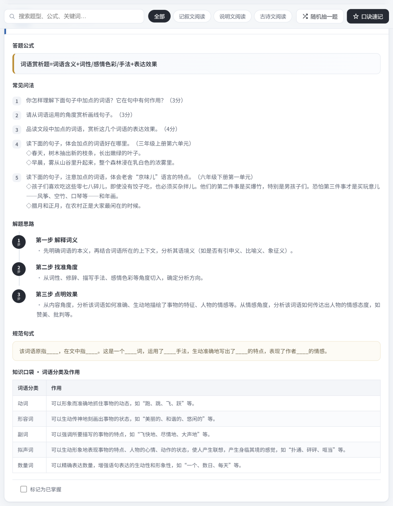
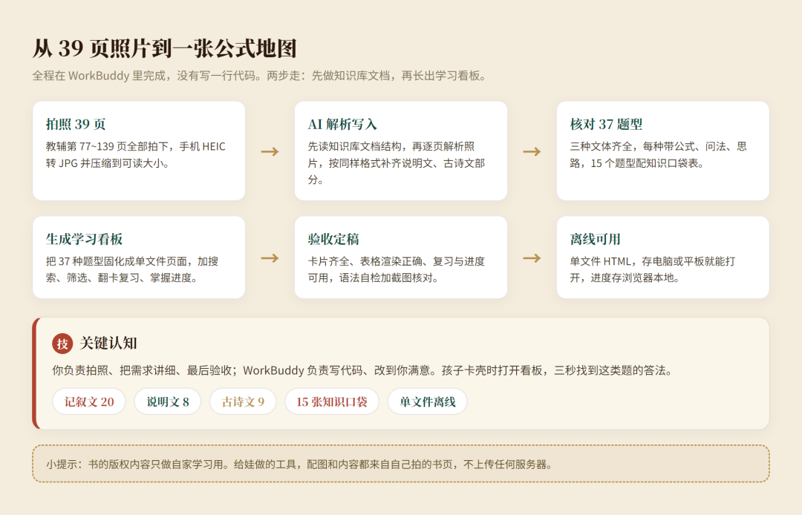

# 用 WorkBuddy 给娃把阅读理解整理成了「公式地图」：37 种题型，从输入到看板一次讲清
> 💡 备注属性未写入，可能是备注属性名称或者类型被修改了，建议将字段类型设置为 rich_text，可以在小程序-操作-修改文章数据库页面进行调整
> 💡 原文链接:[https://mp.weixin.qq.com/s?__biz=MzIxNjYwMzQyNQ==&mid=2247484922&idx=1&sn=696d6647ee513a78b93acac80606b3a7&chksm=968d065ee38d22e983cc7ce4a477a75d90d0146849094eac406cc9792c098cc19576cddbacbb#rd](https://mp.weixin.qq.com/s?__biz=MzIxNjYwMzQyNQ%3D%3D&mid=2247484922&idx=1&sn=696d6647ee513a78b93acac80606b3a7&chksm=968d065ee38d22e983cc7ce4a477a75d90d0146849094eac406cc9792c098cc19576cddbacbb#rd)
娃到了小学高年级，阅文阅读理解题经常丢分，要么答非所问，要么狠狠的摘抄了一大段，然后得分为0。后来发现，孩子喜欢阅读，但是没掌握“采分点”。
入手了一本学而思的教辅《阅读理解有公式》。书是好书，把小学阅读题拆成了三十多种题型，每种都给了答题公式。问题是它不好用。题型分散在各页，娃做题卡壳时，翻半天找不到对应那一条；公式散在文字里，背也背不齐。
我用 WorkBuddy 把它变成了一张能随手查、反复练的「公式地图」。
### 它长什么样
打开是一个浅色的知识地图，顶部是总览数字，37 种题型、三大文体、20 道记叙文题、8 道说明文题、9 道古诗文题。
往下是三栏地图，记叙文、说明文、古诗文各占一列，每一列再按题型类别分组，点哪个题型，页面就滚到哪张卡片。

每张题型卡片打开是这样：最上面是答题公式，一行写清这套题怎么答，比如「词语赏析题=词语含义+词性/感情色彩/手法+表达效果」；接着是常见问法、分步解题思路、规范句式，最后还有一张知识口袋表，把要记的分类都收进去。

### 三个让我觉得值的设计
📌 公式即开即用。不卖关子，卡片打开第一眼就是公式。娃做题卡住，找到题型，答案套路就在眼前。
🎴 口诀速记能翻卡。右上角有个「口诀速记」，点开进入复习模式，先显示题型名，心里默想公式，按一下才显示答案，左右键切换下一题。背书变成打牌。

✅ 掌握进度自己记。每张卡片底下有个「标记为已掌握」，勾掉就存进浏览器，顶部进度条实时变。哪些题还生，一眼看得见。
### 为什么这样做
小学阅读理解，丢分常常丢在「不知道这题要答什么」上。题目换个问法就懵，是因为脑子里没有一套对应题型的套路。
这张地图把套路摆在明面上。它不判分、不排名，只做一件事，让娃在卡壳时三秒内找到「这类题该怎么答」。
整个看板是一个单文件 HTML，存在电脑或平板里就能开，不联网也能用。所有进度都存在浏览器本地，没有服务器，也不上传任何数据。
### 它是怎么来的（手把手）
整套东西分两步走，先做知识库文档，再长出看板。
#### 第 1 步：先把书拍下来
学而思这本教辅从第 77 页到第 139 页，一共 39 页，我全部拍照存进一个文件夹。手机默认拍的 HEIC 格式电脑打不开，先统一转成 JPG，再压缩到能看清的大小。
#### 第 2 步：让 AI 读结构，把照片写进文档
我的知识库里本来有一份《学而思阅读理解有公式》文档，记叙文部分已经整理好，说明文和古诗文还是空的。
我给 WorkBuddy 发的是：
> 认真阅读这个文档的内容结构，解析之后，写入到文档中。
> 
它先通读文档现有结构，再逐页解析照片，把每一页的题型按同样的格式写进去。说明文 8 种、古诗文 9 种，全部补齐。
#### 第 3 步：数字对一对
写完核对一遍，文档里现在有 37 种题型，三大文体齐全。每种题型都带答题公式、常见问法、解题思路，其中 15 个题型还配了知识口袋表，比如修辞手法表、说明方法表、文言文翻译方法表，都是书里最有用的干货。
#### 第 4 步：从文档长出看板
文档能查，但翻起来还是不够快。我接着发：
> 把这些内容做成一个知识地图或者看板，方便我们学习和复习。
> 
WorkBuddy 把 37 种题型的正文固化成一个单文件页面，加上了搜索、筛选、翻卡复习和掌握进度。数据全部来自文档原文，没有一句是现编的。
#### 第 5 步：验收定稿
打开页面检查三件事：37 张卡片是不是全在、知识口袋表渲染对不对、翻卡和进度能不能用。语法跑一遍自检，截图核对每一屏，确认没问题才定稿。
关键认知：你不需要会编程。拍照、把需求讲细、最后验收，这三件事自己干；写代码、改到满意，交给 WorkBuddy。

### 你家娃卡在哪种题型
这张地图装的是小学阅读最常见的 37 种题型，从概括、理解到赏析、作用，再到说明文和古诗文，覆盖了大部分考试丢分点。
**·END· **
---
**关于我：**
分享不懂代码也能轻松上手的 AI 使用技巧和方法，开启 AI 便捷之旅

扫一扫上面的二维码图案，加我为朋友
---
