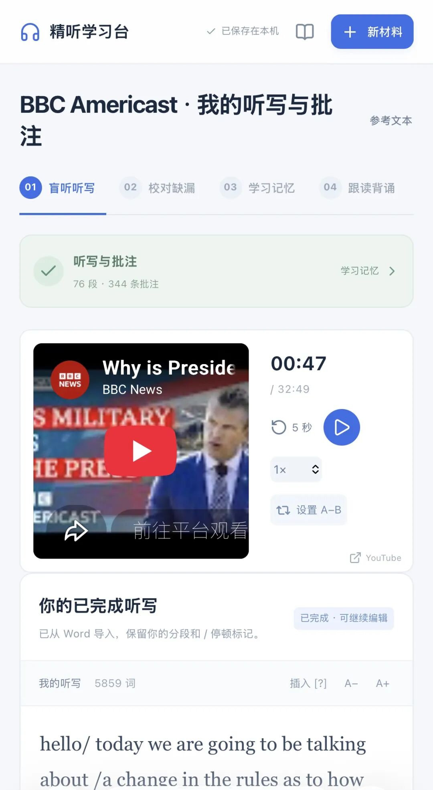
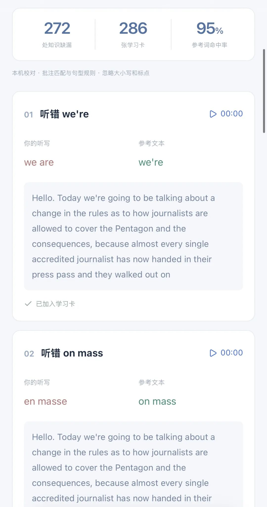
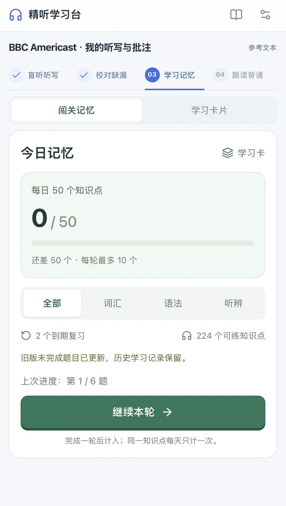
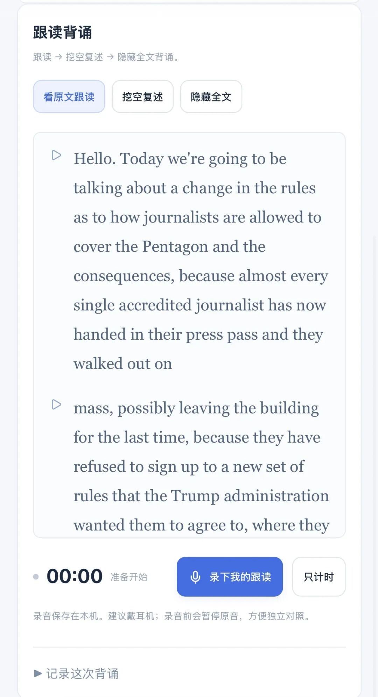

# 用AI定制了一个超牛的英语学习台
> 💡 备注属性未写入，可能是备注属性名称或者类型被修改了，建议将字段类型设置为 rich_text，可以在小程序-操作-修改文章数据库页面进行调整
> 💡 原文链接:[https://mp.weixin.qq.com/s?__biz=MzkxMjQ2OTc2OA==&mid=2247486562&idx=1&sn=194e7d1dddeba9d724d034e8d0a2cd69&chksm=c055ba4851edf7ed9dfcfcb5c2c3e11802680c3d8d90509e833922235b5487465bc3caade676#rd](https://mp.weixin.qq.com/s?__biz=MzkxMjQ2OTc2OA%3D%3D&mid=2247486562&idx=1&sn=194e7d1dddeba9d724d034e8d0a2cd69&chksm=c055ba4851edf7ed9dfcfcb5c2c3e11802680c3d8d90509e833922235b5487465bc3caade676#rd)
之前我看了尚雯婕学外语的方法，觉得很适合自己。我是那种不相信捷径、相信苦功夫的人，所以看到她的方法后，我马上就实践起来了。
这个方法本身没什么问题，但因为它涉及到大量的听写和书写，必须得有台电脑才方便。去年还好，我还有很多时间坐在电脑前去学；但今年因为种种因素，我学英语的时间完全被挤压没了。
我一直琢磨着有没有更好的办法能让我利用碎片时间把英语坚持学下去。
后来我突然想到，可以让 AI 帮我搭一个移动学习台。这样哪怕只拿着手机，去接送娃或者办事，也随时随地可以学。
执行力爆表的我花了两天时间就把学习台搞好，一边用一边让 AI 优化，现在已经非常好用了。
秀学习台前，先聊聊我目前的英语水平：
1. 日常生活完全没问题，学校沟通这些都应付得来。
2. 一旦涉及到要深入讨论某些话题，或者垂直领域的专业术语，就不行。
3. 发音还可以，但流畅度肯定比不上母语者或者一直在说英语的人；
4. 阅读还行，写作很差。
整体来说，我的英语就是能凑合的水平。
我的目标是要达到近母语水平：能流畅表达，别人聊什么话题我都能立刻get到。
现在只是日常能说，还不够，必须再往前走一步。毕竟从未来规划来看，不管是工作还是个人成长方面，绝不能受限于语言这一关，所以我现在每天都要坚持练习，慢慢把它补齐。
讲回尚雯婕的英语学习方法，主要分四步：
1. 选语料并盲听：下载一段 20 到 30 分钟的官方语料（比如我选的是 BBC 新闻，喜欢美音的可以选 ABC），挑自己感兴趣的话题。

选好之后反复盲听，听写。直到实在听不出来任何一个词为止。这里其实要花很多时间，毕竟二三十分钟的内容有好几千个词了。
2. 查漏补缺：下载原字幕去校对，找出具体是哪里没听出来，记录并整理出来，做成小册子。

3. 学习记忆：把第二步整理出来的生疏点集中学习、背诵、记忆，把缺漏补齐，彻底搞懂。

4. 跟读背诵：反复读、背这篇稿子，直到自己的表达、语速、发音等基本接近原文。

这么一套下来，一篇的学习才算结束。
我看尚雯婕说，正常人如果每天花时间去学，一个月能啃下一篇 20 到 30 分钟的语料。如果能搞定 10 个这样的练习，英语水平其实就可以用于工作了。
下一个目标很明确了。先做10份语料的练习。
我现在用 AI 解决的，就是把这整个学习流程搭成一个平台，在移动网页端实现。功能板块我参考了知名学习软件的思路与逻辑，比如百词斩的滚动记忆、多邻国的互动练习，非常适合辅助记忆。
更重要的是，它帮我省去了搜索字幕、查漏补缺等耗费时间的琐事。它直接帮我比对完并整理成学习卡，我进去直接学就行。
省下的时间可以真正花在学英语本身上。
AI 时代改变真的太大了，基本上 所有App 都可以“消失”了吧？只要有想法、有需求，完全可以自定义一个属于自己的工作台、学习台、家庭台、育儿台。
只要有想法，什么都可以做出来。
