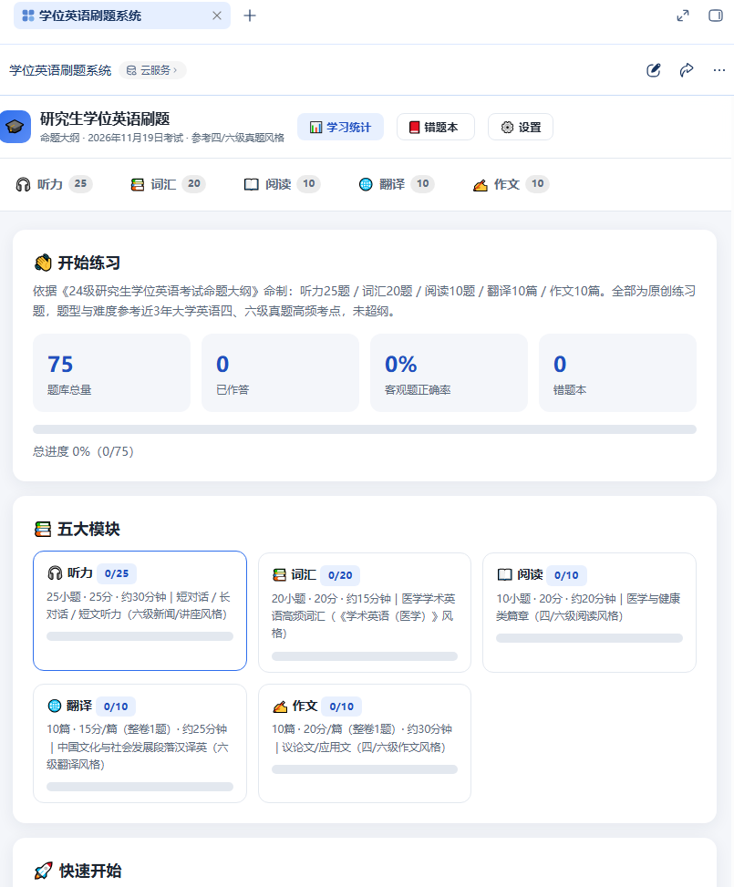

# 用workbuddy设计了一个学位英语刷题网页应用
> 💡 备注属性未写入，可能是备注属性名称或者类型被修改了，建议将字段类型设置为 rich_text，可以在小程序-操作-修改文章数据库页面进行调整
> 💡 原文链接:[https://mp.weixin.qq.com/s?__biz=MzkxMDUwOTA0Mg==&mid=2247484222&idx=1&sn=92d29d16c8894fe4c53bf8f51ee542c8&chksm=c0b1377d561aa72b99c771130e060548b0c1641426436e6299b5f92580e43bf646b23e40194c#rd](https://mp.weixin.qq.com/s?__biz=MzkxMDUwOTA0Mg%3D%3D&mid=2247484222&idx=1&sn=92d29d16c8894fe4c53bf8f51ee542c8&chksm=c0b1377d561aa72b99c771130e060548b0c1641426436e6299b5f92580e43bf646b23e40194c#rd)
活动话题 #WorkBuddy #1024程序员节

https://xuewei-english-drill.app.workbuddy.host/?sharecode=3NL3CIEVGQ
