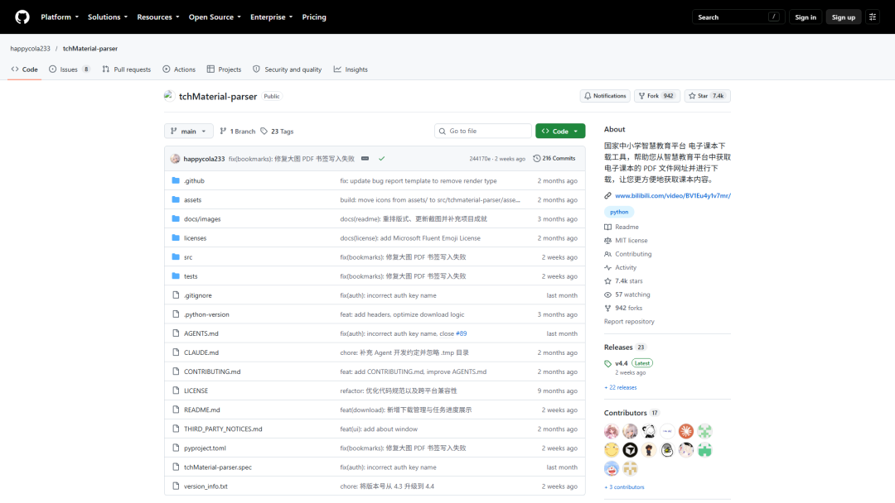
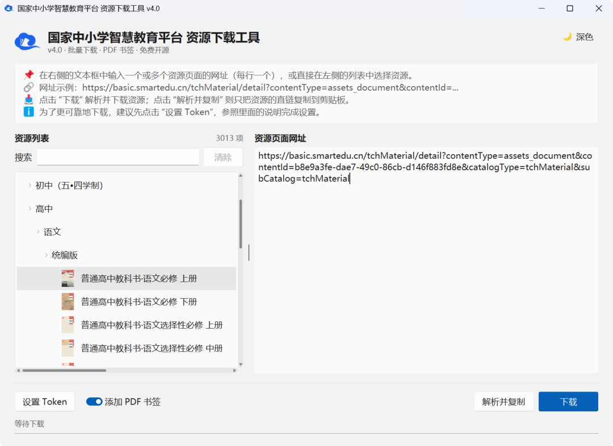
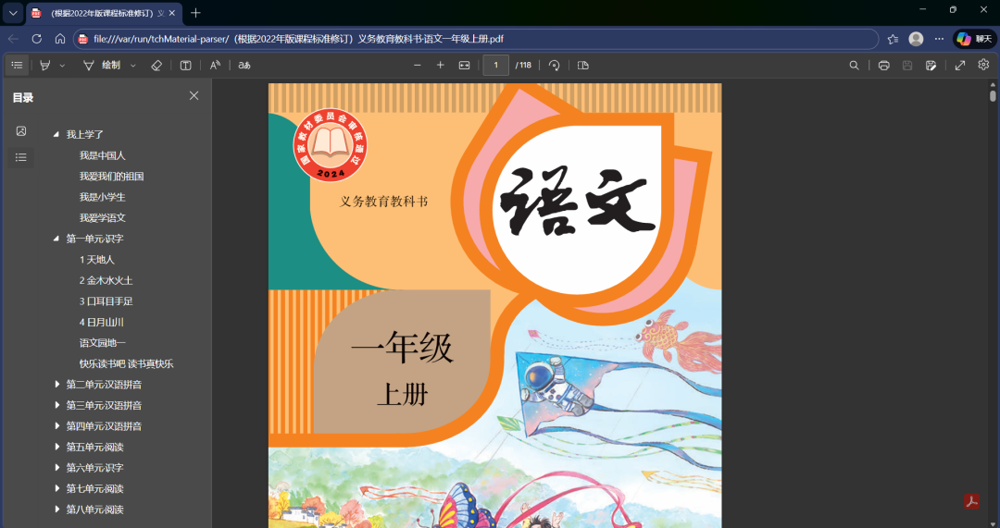
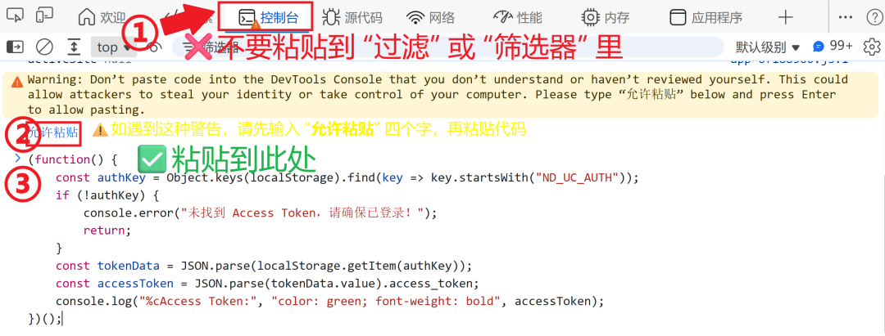

# 电子课本只能在线看？这个 7.4k star 的开源工具一键批量下载，PDF 书签都给你做好了
> 💡 备注属性未写入，可能是备注属性名称或者类型被修改了，建议将字段类型设置为 rich_text，可以在小程序-操作-修改文章数据库页面进行调整
> 💡 原文链接:[https://mp.weixin.qq.com/s?__biz=Mzk2ODA0MzkzNQ==&mid=2247485327&idx=1&sn=c0f4f6bad8467a3e6ecdb0a6254fa87d&chksm=c51d23e9cc99d74ad7681967f8b0446a928e1a1a01df0ef797dda88039831a1ed17075442087#rd](https://mp.weixin.qq.com/s?__biz=Mzk2ODA0MzkzNQ%3D%3D&mid=2247485327&idx=1&sn=c0f4f6bad8467a3e6ecdb0a6254fa87d&chksm=c51d23e9cc99d74ad7681967f8b0446a928e1a1a01df0ef797dda88039831a1ed17075442087#rd)
备课这件事，素材永远在"找"上耗时间。就说最基础的教材吧：国家中小学智慧教育平台上，小学到高中的统编教材电子版全都有，免费、正版、清晰，但平台只提供**在线预览**——没有下载按钮，PDF 的真实地址藏在加密的接口后面，右键另存为？存下来的大概率只是一个网页壳。
想离线备课、想在平板上批注、想打印某几页当堂练，全卡在这一步。
最近翻到一个叫 **tchMaterial-parser** 的开源项目，干的就是这件事：**把平台上的电子课本一键解析、批量下载到本地，而且是带着完整目录书签的 PDF。** 2023 年 8 月上线，现在 **7.4k star、942 个 fork**，今年 5 月一度冲上 GitHub Trending 总榜第三名，单日涨了约 400 星。两周前还在提交更新，最新版 v4.4。

它不是命令行玩具，而是一个正经的桌面 GUI。左半边是**内置的资源列表，一共 3013 项**——按学段、学科、年级、版本分好类，"初中（五·四学制）""高中／语文／统编版"这样一路展开，每本教材带封面缩略图，支持名称搜索和组合筛选，长名字悬停能看全。

用法简单到两句话：在左侧勾选要的课本（或者把课本预览页网址粘到右侧文本框，每行一个，支持批量），点「下载」。剩下的事工具全包了：
- • **自动命名**：文件名直接用课本的正式名称，不用自己对着一串 contentId 猜；
- • **自动跳过已下载**：整套教材重新下一遍，只会补齐缺失和上次失败的，中断了随时接着跑；
- • **随时停止**：已完成的文件保留，没下完的不留残缺文件；
- • **下载管理器**：每个文件的排队、连接、速度、进度、写书签状态逐项可见，失败的集中在「需处理」里查看错误详情，可以单本重试或一键「重试失败项」；
- • **解析并复制**：只想要直链也行，解析出来复制到剪贴板，自己用下载工具跑。
### 二、最戳人的细节：PDF 书签是做好的
课本 PDF 动辄一两百页，没有目录的话翻页是灾难。这个工具开启「添加 PDF 书签」后，下载完成会**自动把整本书的章节目录写进 PDF 书签**。

看这个实际效果：2024 修订版义务教育语文一年级上册，118 页，左边目录从「我上学了」「我是中国人」一直到「第一单元识字」下面的「天地人」「金木水火土」「口耳目手足」，点击直接跳页。这种东西手动做一本要半小时，它是零成本附赠的。
### 三、唯一的门槛：一个 Access Token
下载本身需要平台的登录凭证（Access Token，有效期约 7 天）。听起来唬人，但作者把这一步的教程做到了极致——这也是我觉得整个项目最见用心的地方。

流程是：浏览器登录平台 → F12 打开开发者工具 → 控制台 → 粘贴 README 里给的一小段 JavaScript 回车 → 把输出的 JSON 粘进工具的「设置 Token」。代码只从浏览器本地存储里读登录凭证，工具**不会上传 Token、不存云端，只用于本地请求授权**，存在系统注册表或配置文件里。不设置也能用，工具会走备用下载方式，只是那个方式不保证长期有效，所以作者建议花一分钟配上。
连"不要粘到控制台的过滤框里""Chrome 弹警告时先手动输入'允许粘贴'四个字"这种新手必踩的坑，都用红框绿字画在图上了。
### 四、安装方式：双击就能跑
项目是 Python 写的，跨平台（Windows / Linux / macOS，x86_64 和 Arm64 都有），安装姿势任挑：
- • **Releases 直接下载**：打包好的可执行程序，免安装，双击运行（Mac 用户因没签名需跑一条 xattr -cr 解除隔离）；
- • **Windows**：winget install happycola233.tchMaterial-parser；
- • **Arch Linux**：已进 AUR，yay -S tchmaterial-parser；
- • **想跟最新代码**：Python 3.10+ 源码运行。
UI 做了高 DPI 适配，浅色深色模式跟随系统，这些都是桌面小工具里少见的完成度。MIT 协议，随便用、随便改。
### 五、边界说在前面：资源是平台的，工具只铺路
项目的免责声明写得很清楚，这里也原样转达：**工具只提供下载便利，不存储、不托管、不分发任何资源，所有文件直接来自国家中小学智慧教育平台；资源版权归原平台和权利人所有，仅限个人学习与教学参考，请勿商用或二次分发；项目与平台没有任何隶属或合作关系。**
换句话说，它解决的是"正版公共资源差最后一公里"的问题——教材本来就是免费公开的，它只是替你把浏览器标签页里的课本，搬进了你自己的硬盘和备课流程。
### 写在最后
一个个人开发者，盯着一个国家级平台没照顾到的小缺口（也许永远不会照顾：在线预览符合平台的运营逻辑），用 MIT 协议把工具做出来、文档写到新手照图就能操作、坚持更新三年多，7.4k 个 star 里大概有相当一部分是一线老师。这种项目一直是 GitHub 上我最喜欢的那一类：不炫技，不追风口，就是把一件具体的麻烦事办利索。
教材年年微调，链接说变就变，趁它还在更新，把这学期要用的课本存一份本地，心里踏实。
** 觉得有收获，「赞」「推荐」「转发」就是最大的鼓励
 欢迎在评论区留下你的想法！ **
**KEEP EXPLORING…**
**🌟 点亮星标 🌟**
**愿好教材不再只活在浏览器标签页里**
