# 盘点韩国悬疑 TOP10！奥斯卡封神的《寄生虫》只排第二！
> 💡 备注属性未写入，可能是备注属性名称或者类型被修改了，建议将字段类型设置为 rich_text，可以在小程序-操作-修改文章数据库页面进行调整
> 💡 原文链接:[https://mp.weixin.qq.com/s?__biz=MzY5ODE4OTE4Nw==&mid=2247485415&idx=1&sn=9987fbe66d49975ab2345971756b00b6&chksm=f5d6ecd2a8a5e3ddee9481193206668e6acf5272dcf86f2ec655e8a1c11e401b6f5c7c952dca#rd](https://mp.weixin.qq.com/s?__biz=MzY5ODE4OTE4Nw%3D%3D&mid=2247485415&idx=1&sn=9987fbe66d49975ab2345971756b00b6&chksm=f5d6ecd2a8a5e3ddee9481193206668e6acf5272dcf86f2ec655e8a1c11e401b6f5c7c952dca#rd)
韩国电影最拿得出手的类型，悬疑片算一个。
从乡下稻田到首尔直播间，从半地下室到总统办公室，韩国导演把"猜不到结局"这件事，拍成了流水线手艺。
这份片单按豆瓣评分从高到低排，十部全在8分以上。
评分代表大众口味，不代表全部价值。真正值钱的，是每部片留给你那个问题。
**第一名《杀人回忆》8.9（2003，奉俊昊，宋康昊）**
超过85万人打分。
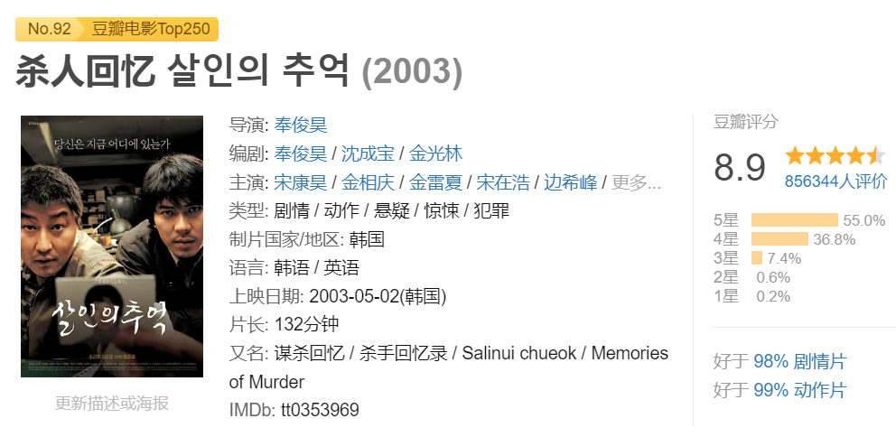
1986年，京畿道华城郡，连环案件接连发生，镇上人心惶惶。
小镇警察朴斗满（宋康昊饰）凭直觉办案，汉城来的探员苏泰允（金相庆饰）讲证据讲逻辑，两人一路吵着查案。
查了一年又一年，嫌疑人换了一茬又一茬，凶手始终没露面。
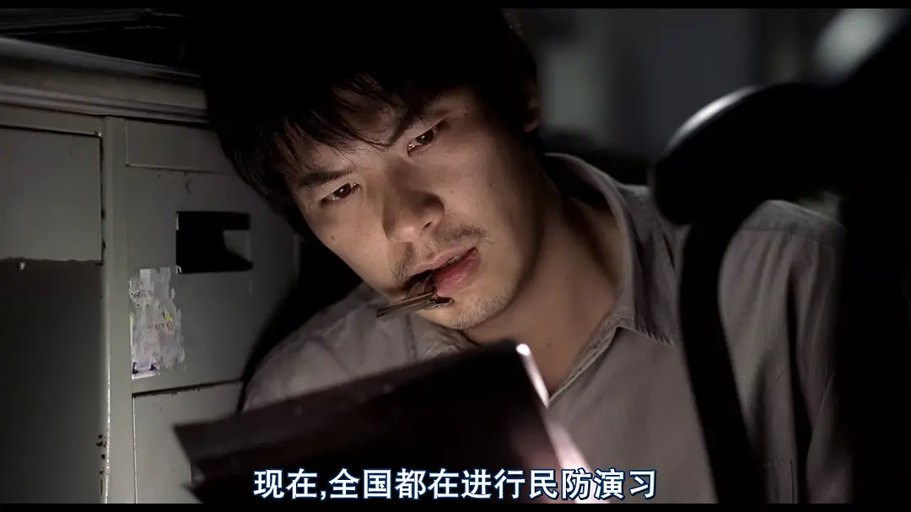
片尾，朴斗满多年后回到当年的案发地，一个小孩跑过来说见过那个人。
他扑上去抓住孩子追问：他长什么样？
孩子怯怯地反问：你为什么要问这个？
他盯着镜头，眼泪下来了。
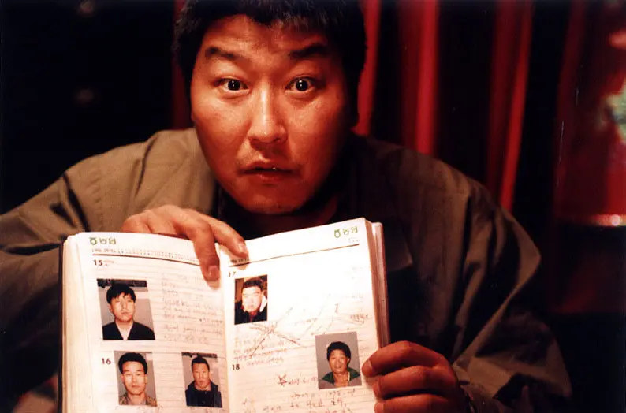
**凶手可能就坐在观众席上，这个念头比任何答案都吓人。**
电影改编自华城连环案，真实案件的真凶直到2019年才确认身份，片中的警察却永远停在那个雨夜。
**第二名《寄生虫》8.8（2019，奉俊昊）**
**戛纳金棕榈，奥斯卡最佳影片。**
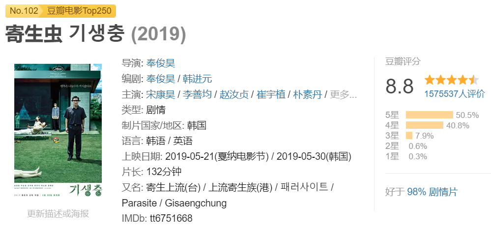
金家四口住在半地下室，蹭邻居WiFi，折披萨盒赚零钱。
儿子基宇（崔宇植饰）靠朋友介绍，进了朴社长家当家教。
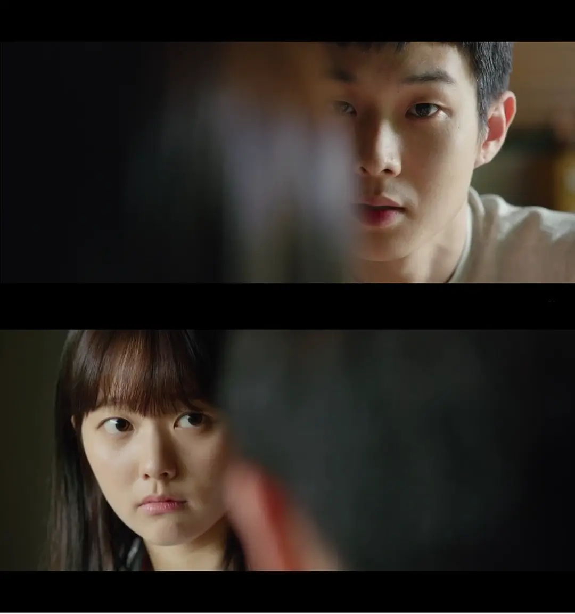
尝到甜头后，妹妹基婷（朴素丹饰）、爸爸金基泽（宋康昊饰）、妈妈忠淑（张慧珍饰）一个个被安排进这栋豪宅。
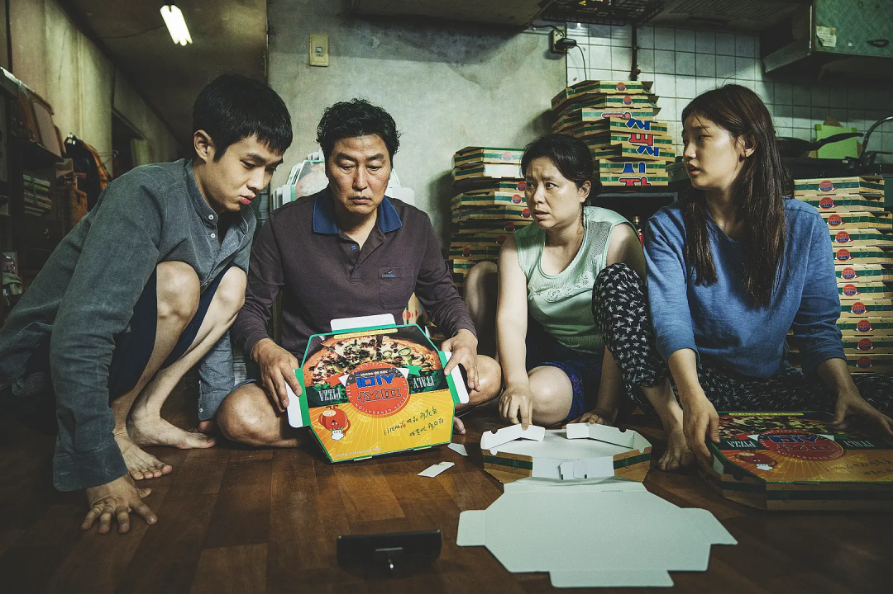
前半段像喜剧，一家人见招拆招，观众笑出声。
原保姆（李姃垠饰）深夜冒雨回来取东西，地下室的门一开，喜剧戛然而止。
暴雨那晚，金家被水泡到齐腰，朴家小孩在院子里搭帐篷，两家人一晚上都没睡好。
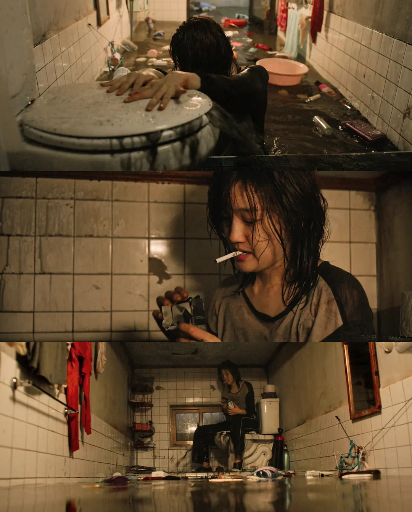
生日会成了分水岭，前面的笑全被还了回去。
**表面拍穷人富人，其实拍的是"有没有资格呼吸"的问题。**
**第三名《恐怖直播》8.7（2013，金秉祐，河正宇）**
整部电影几乎只发生在一个直播间里，成本小得可怜，紧张感大得吓人。
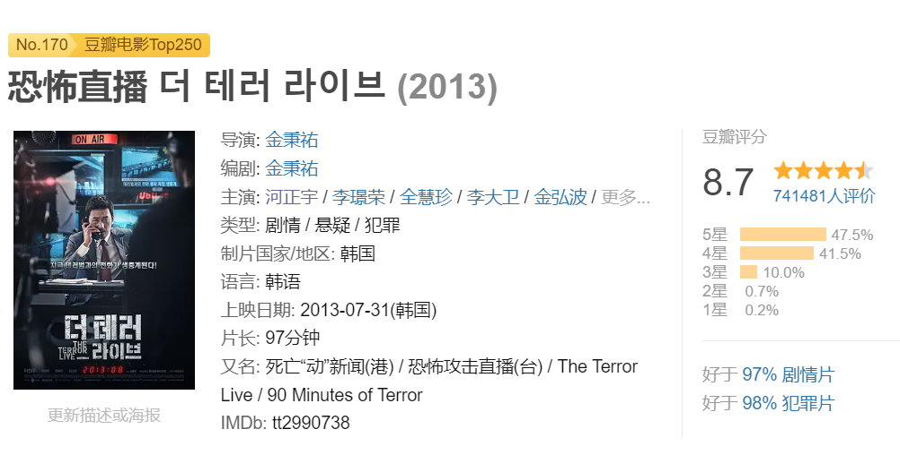
主播尹英华（河正宇饰）正播着新闻，电话响了，对方说麻浦大桥上有炸弹。
他当恶作剧挂了，桥真炸了。
聊着聊着，事情从"抓凶手"变成了"谁在利用谁"。
电话那头步步紧逼，台里这边层层施压，尹英华被架在中间，脸上一层层出汗。
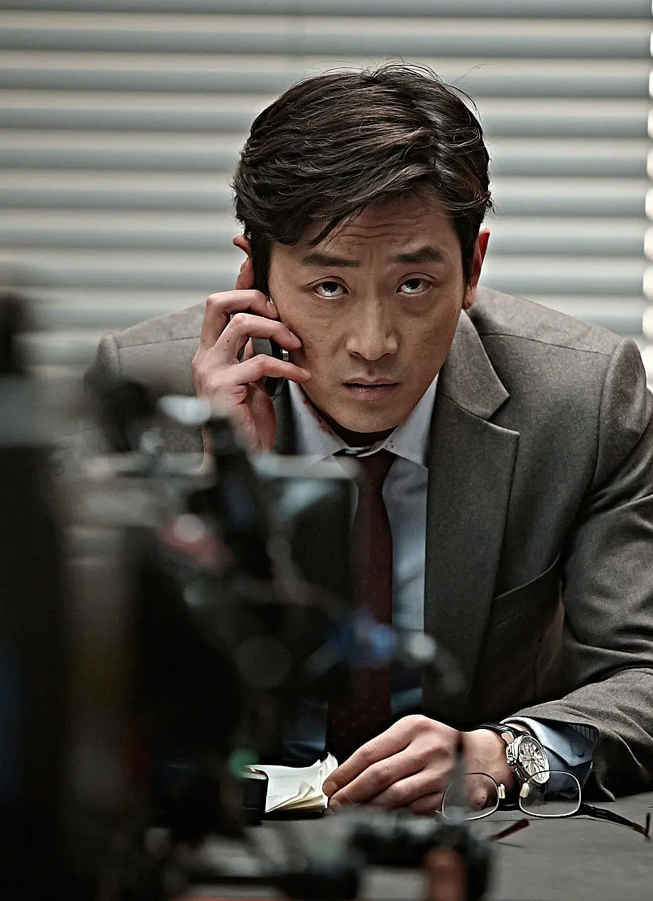

河正宇一个人撑起全片，几乎没出过直播间，演技看得人头皮发麻。
最后一通电话，他问了一句整个韩国都不敢问的话。
**密闭空间拍悬疑，这部是标杆。**
**第四名《黄海》8.5（2010，罗泓轸，河正宇）**
**豆瓣8.5。**
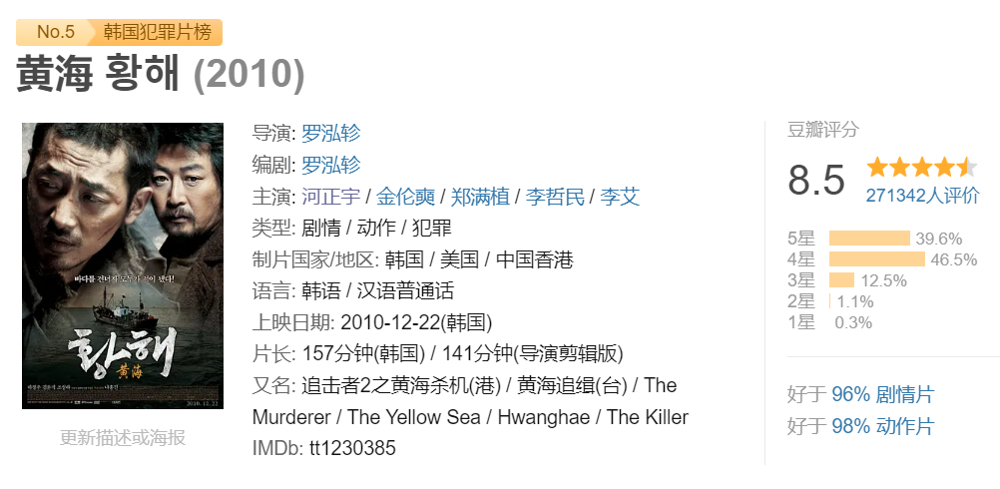
出租车司机久南（河正宇饰）欠了债，老婆去首尔打工后断了音讯。
有人给他一单活：去首尔解决一个人，钱够还债。
他连夜偷渡过去，事情办砸了，目标被别人抢先处理，他反而成了被追杀的人。
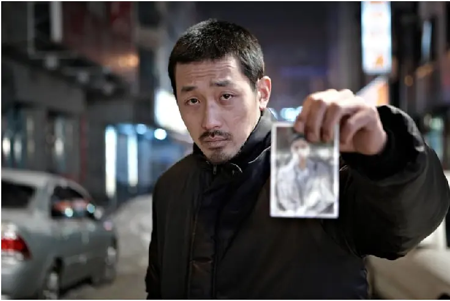
接下来两个小时，他在首尔街头被四拨人追着跑，从出租车追到地下通道，追到码头。
罗泓轸拍追逐戏是真狠，这场逃亡比很多动作大片都野。
久南没什么主角光环，他就是个想活着回家的普通人，那根牛骨头成了他最后的家伙。
**片名《黄海》，指的是他偷渡经过的那片海：跨过去是活路，跨不过去是绝路。**
**第五名《追击者》8.4（2008，罗泓轸，金允石）**
**豆瓣8.4。**
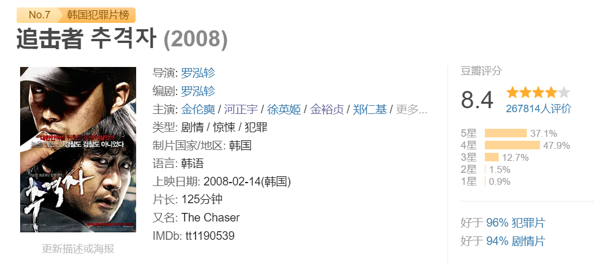
前刑警忠浩（金允石饰）开了家应召站，手下的姑娘接连出事。
他凭经验盯上常客池英民（河正宇饰），顺藤摸瓜追到乡下。
你以为找到人就是破案，其实真正的煎熬从这一刻才开始。

池英民坐在警察局里，不慌不忙，问什么答什么，就是不认账。
忠浩一边救人一边追证据，时间一分一秒过去，观众看得干着急。

结局那场戏，救护车开错了方向，希望和绝望在几分钟里换了两次边。
**罗泓轸的处女作，一出手就定了韩国犯罪片的新标准。**
**第六名《母亲》8.3（2009，奉俊昊，金惠子）**
**豆瓣8.3。**
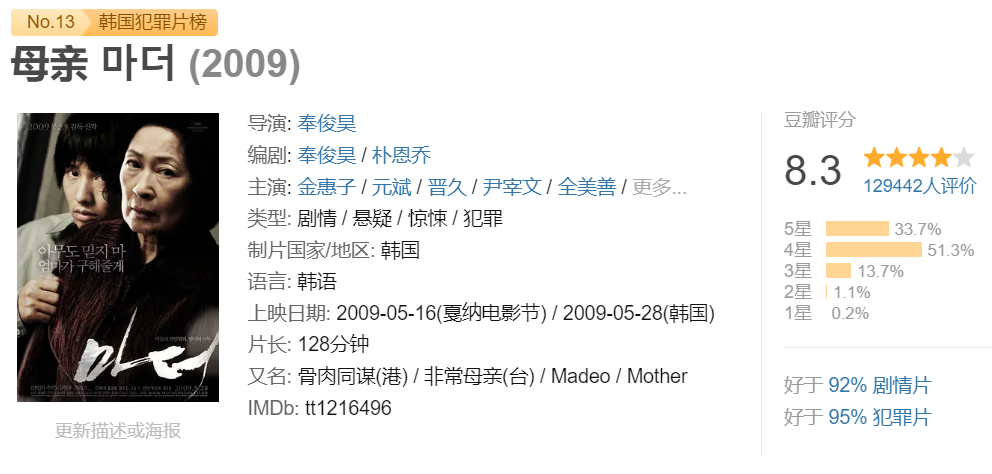
单亲妈妈（金惠子饰）和儿子道俊（元斌饰）相依为命，住在小城。
道俊智力有问题，一天，一名女学生出了事，警察认定是他。
妈妈坚信儿子没错，掏出全部家当找律师，自己也开始四处打听。
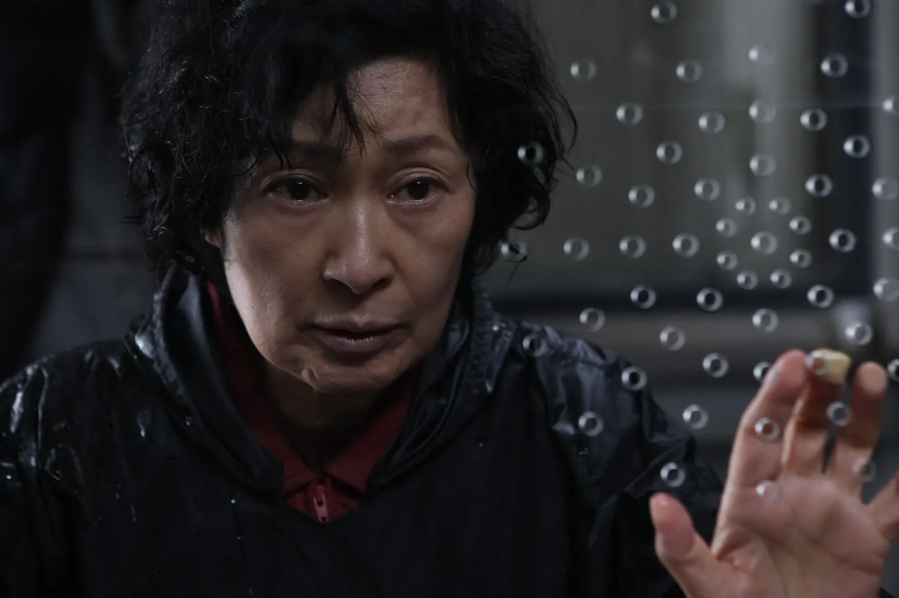
查着查着，她发现真相跟自己想的不太一样。
为了保住儿子，她做了一个母亲能做的所有事，包括最不该做的那件。
金惠子把普通老太太演成了风暴，一个背影都是戏。
**奉俊昊把母爱拍成了执念，最后一幕的反转，会让你倒回去重看前一个半小时。**
**第七名《老男孩》8.2（2003，朴赞郁，崔岷植）**
**豆瓣8.2**，33万多人打分。
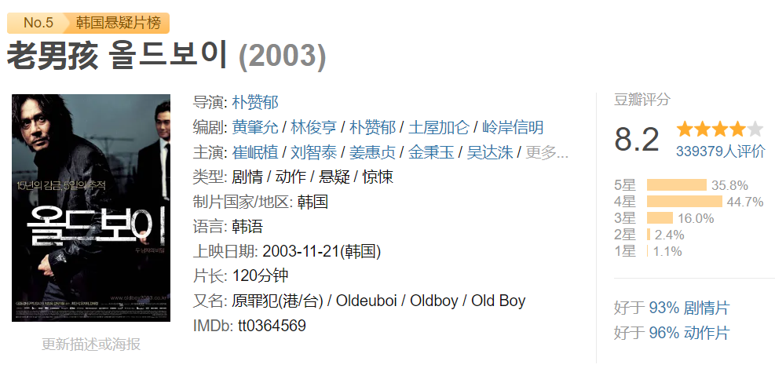
吴大修（崔岷植饰）醉醺醺回家，路上被人绑走，一关就是15年。
放他出来那天，他拿到一部手机、一笔钱，还有5天时间。
5天里找不到答案，有人就会对他在乎的人动手。

他咬着牙查，一步步接近那个把他关起来的人（刘智泰饰）。
真相揭开那一刻，全片最狠的一刀才真正落下。
朴赞郁的复仇三部曲第二部，锤子走廊那场戏单镜头拍到底，影史留名。
**这部片最怕剧透，被透了，15年的等待就白等了。**
**第八名《铁雨》8.2（2017，杨宇硕，郑雨盛）**
**豆瓣8.2。**

朝鲜特工严铁友（郑雨盛饰）护着重伤的朝鲜一号人物往南逃，一路惊险。
韩国国情院特工郭哲宇（郭度沅饰）接到命令，追着线索撞上了他。
两个本该是对立阵营的人，因为同一个危机，被迫合作。

再往后，牵扯到几国首脑和核按钮，一个失误就是全面开火。
**看完你会重新认识"朝韩题材"四个字。**
**第九名《燃烧》8.1（2018，李沧东，刘亚仁）**
**豆瓣8.1。**

李钟秀（刘亚仁饰）靠打零工过日子，偶遇儿时邻居申惠美（全钟瑞饰）。
惠美去非洲旅行，带回一个有钱人本（史蒂文·元饰）。
后来惠美不见了。

钟秀开始找她，同时慢慢发现本的一些习惯，比如他爱烧大棚。
电影改编自村上春树的小说，李沧东把它拍成了一个没有答案的谜。
结尾的镜头里，钟秀一个人站在雪地里，眼神说不清是解脱还是坠落。
**全钟瑞那场独舞，是全片最让人难忘的画面。**
**第十名《走到尽头》8.0（2014，金成勋，李善均）**
**豆瓣8.0**，好于93%的犯罪片。

刑警高建洙（李善均饰）夜里出了场事故，人没了。
他第一反应是瞒下来，处理得手忙脚乱。
偏偏同事兼对手朴昌民（赵震雄饰）盯上了他，步步紧逼。

一个想藏，一个想抓，两个警察斗了一整夜。
李善均和赵震雄互飙演技，谁也没让谁。
**这片子后来被翻拍过，但原版那股狠劲，学不来。**
**专业点评**
这十部片按时间排下来，正好串起韩国悬疑片三十年的路。
从《老男孩》的复仇寓言，到《杀人回忆》的时代伤痕，再到《寄生虫》的阶级寓言，韩国导演一直把悬疑片当社会观察的容器。

类型片研究者常讲一句话：**韩国悬疑片的高分，一半给剧本，一半给胆量。**
它们敢把镜头对准体制、贫富、南北，也敢让结局不圆满。
评分会变，片单会换，但这十部留下的问题不会过期。
想入坑的，建议从《走到尽头》这种节奏快的开始，最后再碰《杀人回忆》。
——结束——
**精彩内容回顾：**
