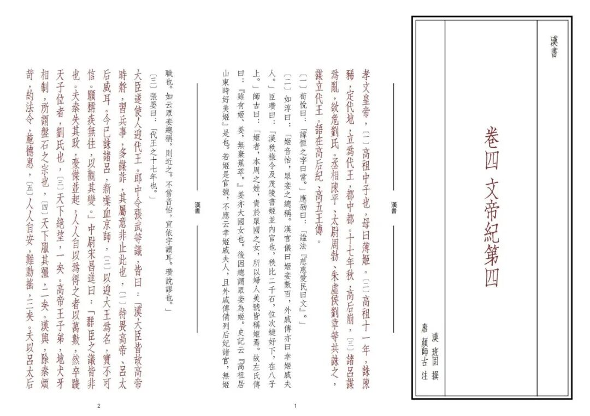
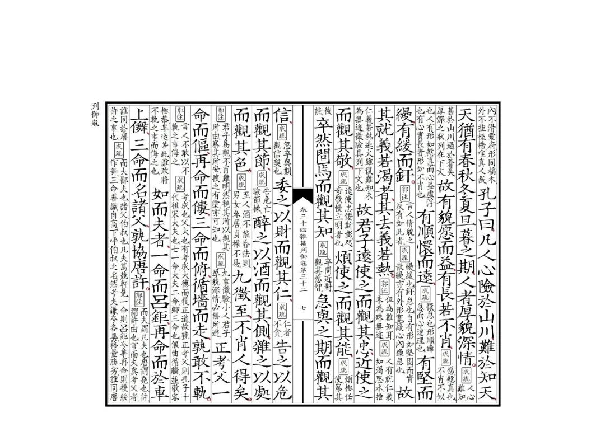
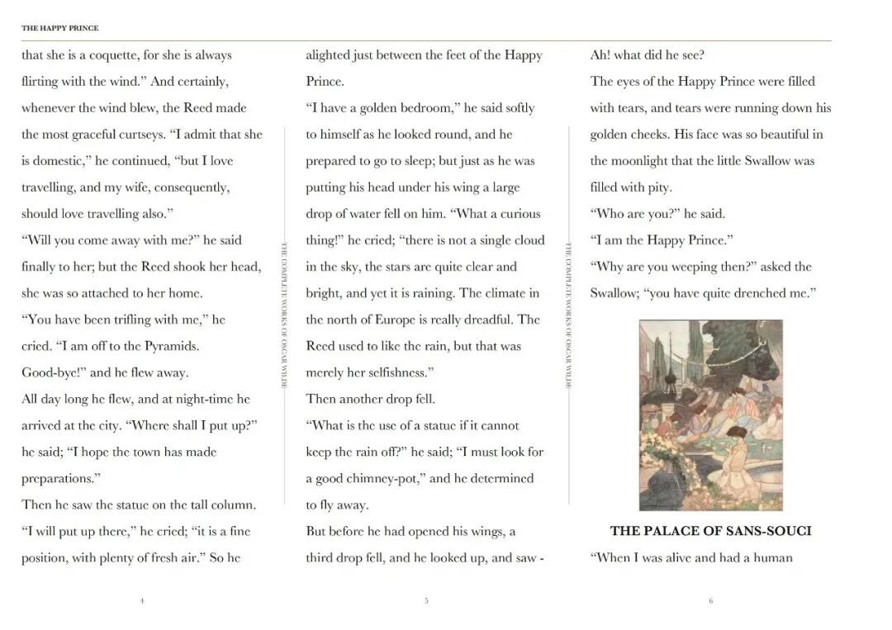

# 目录｜古籍/英文三折页电子文档目录链接一览
> 💡 备注属性未写入，可能是备注属性名称或者类型被修改了，建议将字段类型设置为 rich_text，可以在小程序-操作-修改文章数据库页面进行调整
> 💡 原文链接:[https://mp.weixin.qq.com/s?__biz=MzIzMzgxMjY3Nw==&mid=2247488096&idx=1&sn=a503cfba79453933fccd6b93a705ebfd&chksm=e9e83fd7c97859868c41a1f04392be7886731a63fc19af9d542ab695a54fd77cddaa8521b6f7#rd](https://mp.weixin.qq.com/s?__biz=MzIzMzgxMjY3Nw%3D%3D&mid=2247488096&idx=1&sn=a503cfba79453933fccd6b93a705ebfd&chksm=e9e83fd7c97859868c41a1f04392be7886731a63fc19af9d542ab695a54fd77cddaa8521b6f7#rd)
公众号文档一经发布不支持无限次修改，因此后续新增的书籍，请往下翻到评论区浏览链接！

需要阅读什么书，可以私信或者评论留言。

繁体竖排便携三折页

| 部类 | 细类 | 书目 |
| 经部 | 春秋类 | [《春秋左传正义》](https://mp.weixin.qq.com/s?__biz=MzIzMzgxMjY3Nw%3D%3D&mid=2247486410&idx=1&sn=9f5f145639b8ff3d69f6c1b63bc3a747&scene=21#wechat_redirect) |
| 经部 | 四书类 | [《四书章句》／《论语》《孟子》](https://mp.weixin.qq.com/s?__biz=MzIzMzgxMjY3Nw%3D%3D&mid=2247486541&idx=1&sn=5568c71ab8d4337ad24318c9ebebad8a&scene=21#wechat_redirect) |
| 经部 | 易类 | [《周易》](https://mp.weixin.qq.com/s?__biz=MzIzMzgxMjY3Nw%3D%3D&mid=2247486625&idx=1&sn=8337b6f563af0fdd422fd84e8e5e1834&scene=21#wechat_redirect) |
| 经部 | 小学类 | [《说文解字》](https://mp.weixin.qq.com/s?__biz=MzIzMzgxMjY3Nw%3D%3D&mid=2247487355&idx=1&sn=04c52a033baf428dc560a023c2cc3f02&scene=21#wechat_redirect) |
| 史部 | 正史类 | [《史记》](https://mp.weixin.qq.com/s?__biz=MzIzMzgxMjY3Nw%3D%3D&mid=2247486002&idx=1&sn=4c11ab5a1308fa8c573aa99fbb35123f&scene=21#wechat_redirect) |
| 史部 | 正史类 | [《汉书》](https://mp.weixin.qq.com/s?__biz=MzIzMzgxMjY3Nw%3D%3D&mid=2247487901&idx=1&sn=6a2f357dd09d1489bc355f875a2092d5&scene=21#wechat_redirect) |
| 史部 | 正史类 | [《三国志》](https://mp.weixin.qq.com/s?__biz=MzIzMzgxMjY3Nw%3D%3D&mid=2247486483&idx=1&sn=6d31ae2471992aeacfa423636fc88c38&scene=21#wechat_redirect) |
| 史部 | 正史类 | [《晋书》](https://mp.weixin.qq.com/s?__biz=MzIzMzgxMjY3Nw%3D%3D&mid=2247487713&idx=1&sn=5226754c67e68365f61df959eeac15b0&scene=21#wechat_redirect) |
| 史部 | 编年类 | [《资治通鉴》](https://mp.weixin.qq.com/s?__biz=MzIzMzgxMjY3Nw%3D%3D&mid=2247486050&idx=1&sn=7f807ff3517dc4a2aec62eef565602bb&scene=21#wechat_redirect) |
| 史部 | 地理类 | [《山海经》](https://mp.weixin.qq.com/s?__biz=MzIzMzgxMjY3Nw%3D%3D&mid=2247486841&idx=1&sn=eb6ad2776b96c1130bc647de8c433bd3&scene=21#wechat_redirect) |
| 子部 | 儒家类 | [《传习录》](https://mp.weixin.qq.com/s?__biz=MzIzMzgxMjY3Nw%3D%3D&mid=2247488006&idx=1&sn=8329378e174ad8ab31881d98ec247466&scene=21#wechat_redirect) |
| 子部 | 道家类 | [《道德经》](https://mp.weixin.qq.com/s?__biz=MzIzMzgxMjY3Nw%3D%3D&mid=2247486299&idx=1&sn=c4bcb95ccd614da574fe06dca5d38e6b&scene=21#wechat_redirect) |
| 子部 | 道家类 | [《庄子》](https://mp.weixin.qq.com/s?__biz=MzIzMzgxMjY3Nw%3D%3D&mid=2247486239&idx=1&sn=70ec556d57f23b9c60f1e0c7ccdd1249&scene=21#wechat_redirect) |
| 子部 | 兵家类 | [《孙子集注》](https://mp.weixin.qq.com/s?__biz=MzIzMzgxMjY3Nw%3D%3D&mid=2247486776&idx=1&sn=e63e50a21e2219c0c453f7284e3787d7&scene=21#wechat_redirect) |
| 子部 | 医家类 | [《重广补注黄帝内经素问》](https://mp.weixin.qq.com/s?__biz=MzIzMzgxMjY3Nw%3D%3D&mid=2247486920&idx=1&sn=398e9d66347301bede31e03c2284e269&scene=21#wechat_redirect) |
| 子部 | 医家类 | [张志聪《黄帝内经》](https://mp.weixin.qq.com/s?__biz=MzIzMzgxMjY3Nw%3D%3D&mid=2247486989&idx=1&sn=eef85c8314b65198be5225c2ca6dd572&scene=21#wechat_redirect) |
| 子部 | 小说家类 | [《新刻绣像金瓶梅》](https://mp.weixin.qq.com/s?__biz=MzIzMzgxMjY3Nw%3D%3D&mid=2247487221&idx=1&sn=4bc7eddad6cc142cc6574dc85fddeedf&scene=21#wechat_redirect) |
| 子部 | 小说家类 | [《红楼梦》](https://mp.weixin.qq.com/s?__biz=MzIzMzgxMjY3Nw%3D%3D&mid=2247487480&idx=1&sn=d9c06a5470edd37df00cbd524c55eb85&scene=21&token=1751806000&lang=zh_CN#wechat_redirect) |
| 子部 | 小说家类 | [《世说新语》](https://mp.weixin.qq.com/s?__biz=MzIzMzgxMjY3Nw%3D%3D&mid=2247487804&idx=1&sn=8fd9b9aed374fb3c92eaa71a2c5f94e2&scene=21#wechat_redirect) |
| 子部 | 类书类 | [《夜航船》](https://mp.weixin.qq.com/s?__biz=MzIzMzgxMjY3Nw%3D%3D&mid=2247487841&idx=1&sn=d562f345a3138c7bb40cc2640ab88009&scene=21#wechat_redirect) |
| 集部 | 总集类 | [《古文观止》](https://mp.weixin.qq.com/s?__biz=MzIzMzgxMjY3Nw%3D%3D&mid=2247486105&idx=1&sn=eb4c3a38311ee6da3467f30b80c986eb&scene=21#wechat_redirect) |
| 集部 | 总集类 | [《昭明文选》](https://mp.weixin.qq.com/s?__biz=MzIzMzgxMjY3Nw%3D%3D&mid=2247486382&idx=1&sn=67f89f29950fcaf9b2687da36da1760e&scene=21#wechat_redirect) |

线装书筒子页

[《史记》](https://mp.weixin.qq.com/s?__biz=MzIzMzgxMjY3Nw%3D%3D&mid=2247487091&idx=1&sn=22ce2d45eb443569496adb9de7e17381&scene=21#wechat_redirect)
[《四书章句》](https://mp.weixin.qq.com/s?__biz=MzIzMzgxMjY3Nw%3D%3D&mid=2247487158&idx=1&sn=608eab673cc8657422a7283e488572aa&scene=21#wechat_redirect)
[《庄子注疏》](https://mp.weixin.qq.com/s?__biz=MzIzMzgxMjY3Nw%3D%3D&mid=2247487251&idx=1&sn=0e553ed30b037c81f9b17c87c02535ac&scene=21#wechat_redirect)

英文名著

[英文｜王尔德全集 THE COMPLETE WORKS OF OSCAR WILDE 三折活页版](https://mp.weixin.qq.com/s?__biz=MzIzMzgxMjY3Nw%3D%3D&mid=2247487634&idx=1&sn=f71147457b6262e4892327ac21a55049&scene=21#wechat_redirect)
