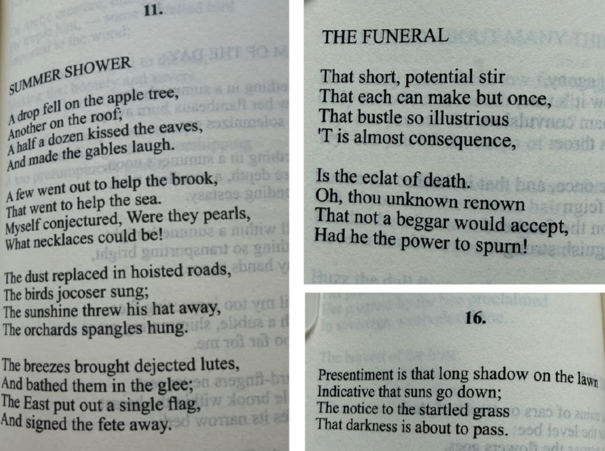
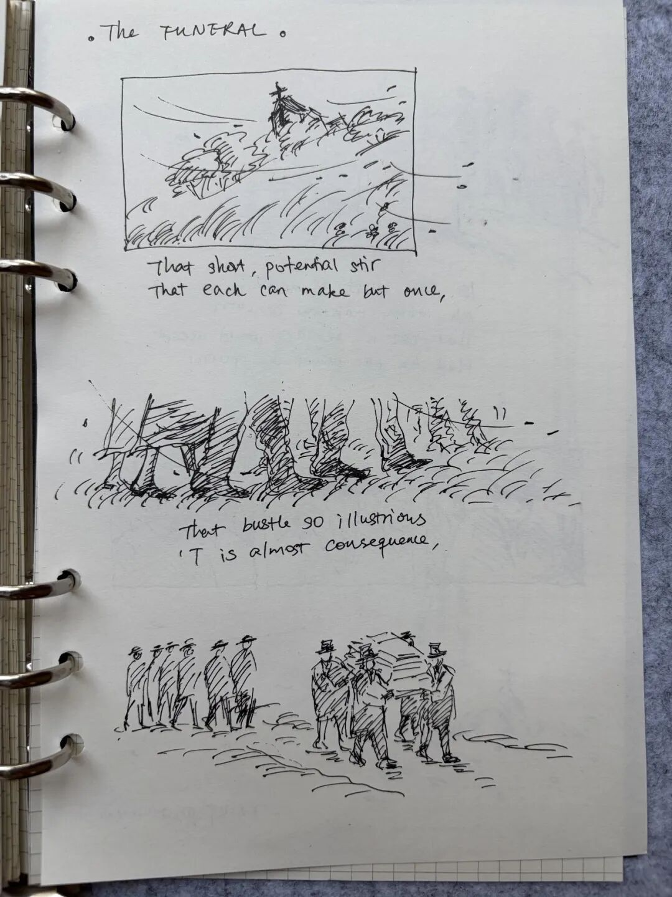
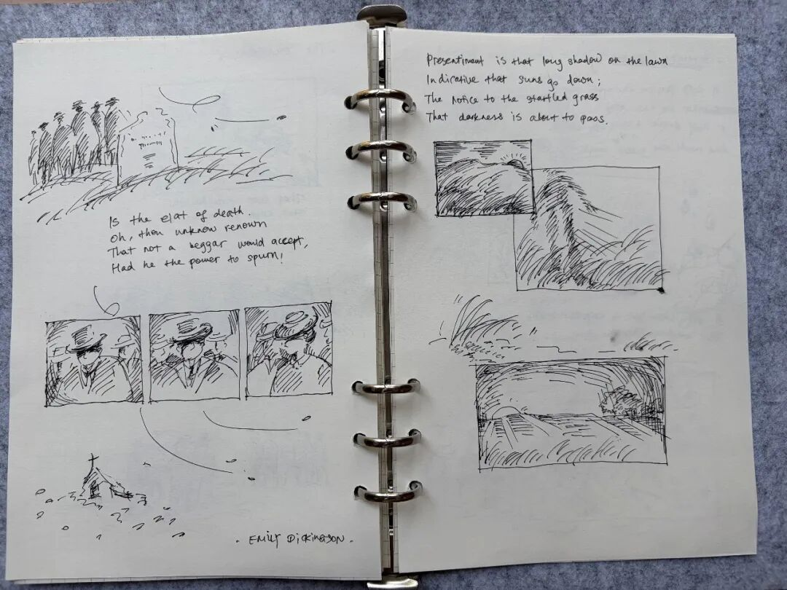
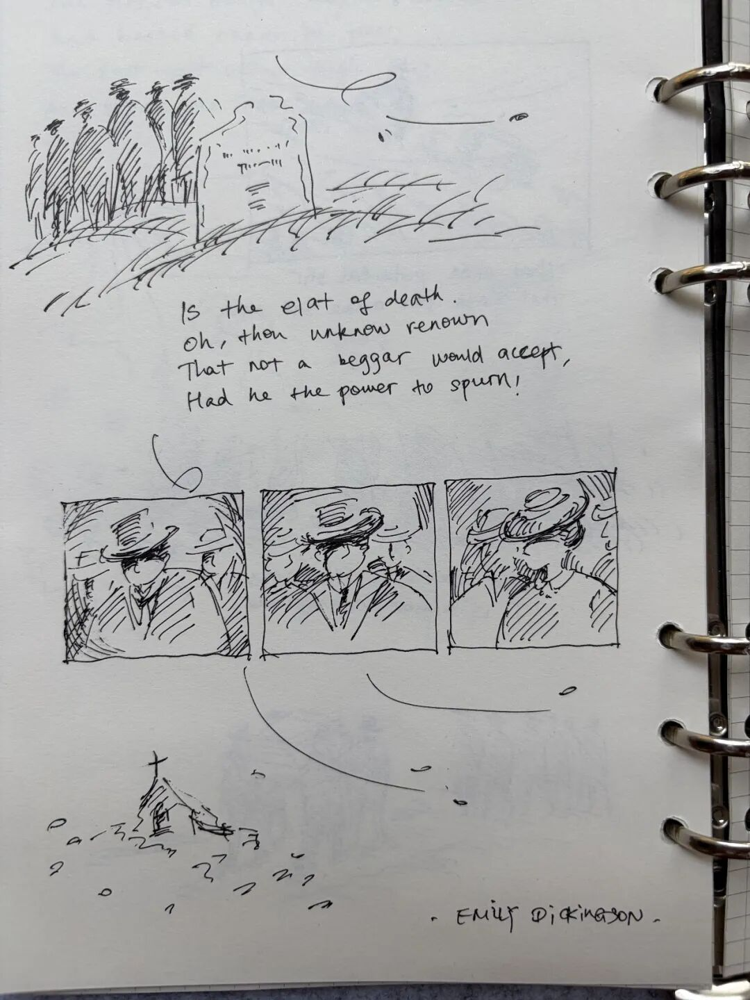
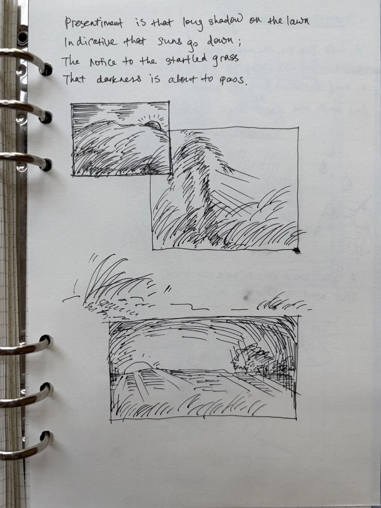
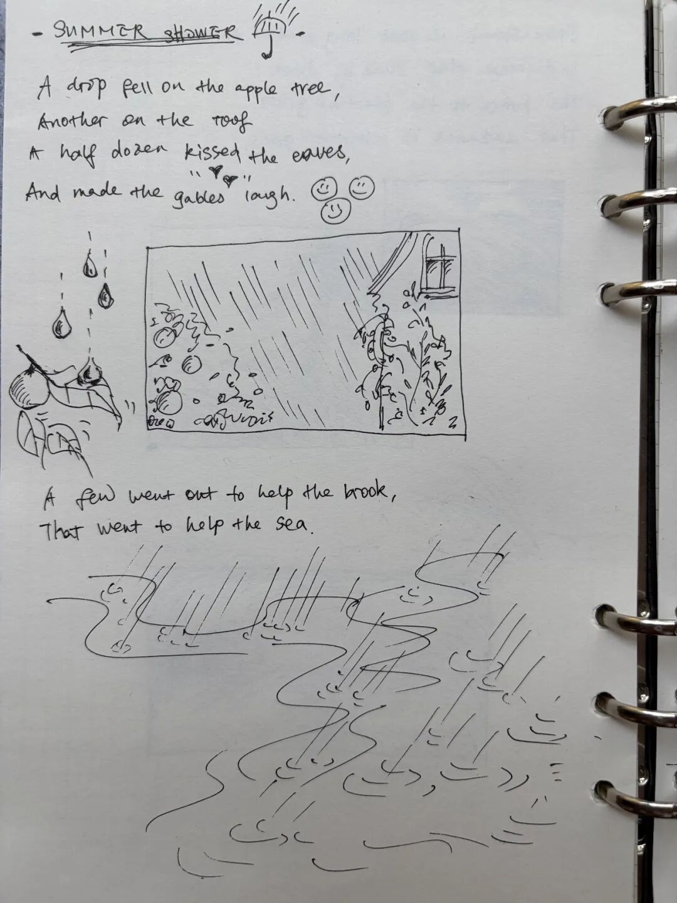
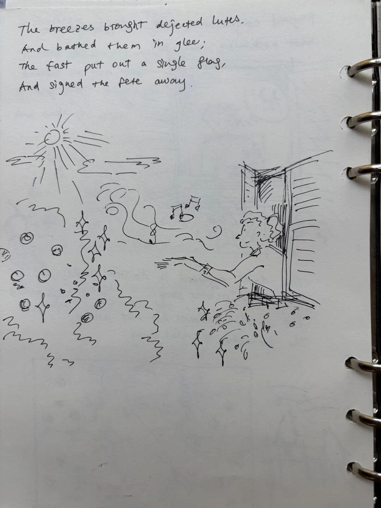

# 看书时，可以画什么？"寂静下的暗涌"
> 💡 备注属性未写入，可能是备注属性名称或者类型被修改了，建议将字段类型设置为 rich_text，可以在小程序-操作-修改文章数据库页面进行调整
> 💡 原文链接:[https://mp.weixin.qq.com/s?__biz=MzI1NTY3MzY4OQ==&mid=2247484250&idx=1&sn=73d3023713c761cf7129656a132560a2&chksm=eb6793d9ddee09fc4e7c88ac014f809590a0fe653cfff26902afde0e0cab2fe0ee61a47b1fac#rd](https://mp.weixin.qq.com/s?__biz=MzI1NTY3MzY4OQ%3D%3D&mid=2247484250&idx=1&sn=73d3023713c761cf7129656a132560a2&chksm=eb6793d9ddee09fc4e7c88ac014f809590a0fe653cfff26902afde0e0cab2fe0ee61a47b1fac#rd)
## 
## 今日草图笔记
## Sketch Notes - Emily Dickinson's poetry
## TEXT → SKETCH FOR TODAY
读艾米莉·狄金森的诗，感受到了寂静下的暗涌。
简短克制的词句，似乎不经意地记录着一个个日常的瞬间，却暗含了丰富的情感和独到的观察。
她写万物、记录鸟鸣、风声、 花开、落雨。看似寂静的画面中，生命和世界的对话徐徐展开。
可见对于她这样一位天才诗人来说，闭门幽居和隔绝喧嚣并不会影响她敏锐地观察世界并触及万物的本质，而是更精准地记录了细小而震撼的情感——微光里的复苏、凋零里的永恒、日出日落的瞬时、急雨中的遐想，都成为了可感知的意向。
平静的旁观者语调，藏着一场内敛的爆发。

Summer Shower 《夏日阵雨》
THE FUNERAL 《葬礼》
Presentiment 《预感》
不自觉地陷入思考，跟随百年前诗人的语言，在脑海中慢慢展开成一幅幅电影般的画面；但都是默片——教堂沉默的尖顶、野草在风中摇曳、步伐由远及近，无人说话——
“那短暂、蕴蓄的一阵骚动，
一生只能惊动这一回。”
"That short, potential stir 
that each can made but once"
**"The Funeral"**

当草坪出现长长的影子，预示落日即来，虽然一切仍然明亮。

“给受惊的小草通知：
黑暗即将降临。”
"The notice to the startled grass
That darkness is about to pass"
**"Presentiment"**

喜欢的文字我会反复用画去解读，可能因为优秀的作品总会在不同是时刻给读者不同的感受。
“另有几滴奔赴小溪， 
小溪奔去汇入大海。”
"A few went out to help the brook, 
That went to help the sea."
**"Summer Shower"**

“扬起的路上尘埃落定， 
阳光抛却他的斗笠。”
"The dust replaced in hoisted roads,
The sunshine threw his hat away."
“东方升起一面孤旗，
宣告盛宴的落幕“
The East put out a single flag, 
And signed the fete away.
----------------------------------------------------------------------------------
阅读随笔 + 图像式学习
Some books are to be tasted,
others to be swallowed, 
and some few to be chewed and digested.

## 摘要

（待补充）

## 我的笔记

（待补充）
