# 看典古籍OCR客户端v2.1：全面重构，一站式古籍识别工作台
> 💡 备注属性未写入，可能是备注属性名称或者类型被修改了，建议将字段类型设置为 rich_text，可以在小程序-操作-修改文章数据库页面进行调整
> 💡 原文链接:[https://mp.weixin.qq.com/s?__biz=Mzg2MDk3Mzc1Ng==&mid=2247485423&idx=1&sn=bb50a13ccdbb17b0454c10594123b8f8&chksm=cf7089bb929e0f2477227d315292fab4d3d26cc4ab69ef61c46609f15344e0be5ab2c2cd2860#rd](https://mp.weixin.qq.com/s?__biz=Mzg2MDk3Mzc1Ng%3D%3D&mid=2247485423&idx=1&sn=bb50a13ccdbb17b0454c10594123b8f8&chksm=cf7089bb929e0f2477227d315292fab4d3d26cc4ab69ef61c46609f15344e0be5ab2c2cd2860#rd)
#### 看典古籍OCR客户端v2.1：全面重构，一站式古籍识别工作台
看典古籍OCR客户端 v2.1 正式发布。
这不是一次小修小补，而是一次彻底重构升级：界面、架构、功能全面换代——旧版分散在多个弹出窗口的识别功能，整合为一个主窗口的七大功能标签页；新增文本校对、文本比对等五大功能模块；识别精度、任务管理、软件更新等全面增强。
本文分两部分：第一部分介绍 v2.1 版本更新内容，第二部分为完整的软件使用教程。
---
#### 一、v2.1 更新了什么
**1. 界面彻底重构：七大功能一站直达**
- 单窗口多标签旧版的"识别PDF""识别多图""文件识别"分散在主窗口和多个独立弹出窗口，来回切换、参数各管各的；v2.1 合并为一个主窗口的 7 个标签页——**看典古籍OCR（文本识别）、文件识别、简繁转换、文本比对、文本校对、批量重命名、文件格式转换**，一站式完成；
- 全新暖棕金古籍风与看典古籍官网视觉统一，卡片式分区、圆角现代控件、隔行高亮表格；
- 按钮分级配色核心操作金棕、危险操作红色、提醒橙色、完成绿色，一眼识别按钮用途。
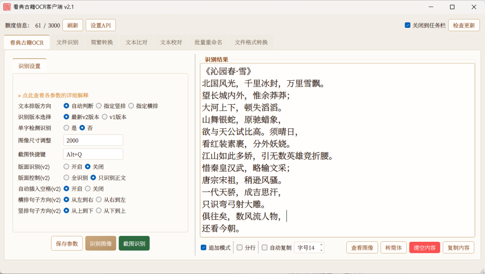
**2. 五大功能模块全新上线**
1. 文本校对打开 PDF/图像逐页对照，边看原图边校文字；支持识别本页、矩形选区、自由选区识别；标点、校对符号、常用字一键插入；查找替换、自动保存、导出 TXT/Word；校对项目自动记忆，下次打开直接回到上次的页码和位置；支持调整预览图DPI；
1. 文本比对两版文本粘贴进左右两栏即自动比对，行级 + 行内字符级双重高亮，差异上一处/下一处导航，可单处应用或整侧覆盖；
1. 简繁转换简体、繁体、台湾正体、香港繁体一键互转，双栏对照、一键复制；
1. 批量重命名多选文件或整个文件夹，前缀/后缀/查找替换/编号批量改名，先预览再执行，支持一键撤销；
1. 文件格式转换PDF转图像、图像转PDF、PDF拆分、PDF合并、图像格式批量转换，共 5 个子页，均带进度显示、停止按钮和"转换结果"一键打开。
**3. 识别功能全面增强**
- 文件识别任务记忆重启软件后任务列表自动恢复，进行到一半的任务接着跑（旧版关闭即丢失）；
- 清空列表一键清掉所有已完成的任务记录，列表不再越积越长；
- 取图精度提升送识别的取图上限由 1024px 提高到 **2000px**，密集小字识别效果更好；
- 识别多图 / 识别PDF 已并入旧版的这两个独立窗口功能全部并入"文件识别"标签页，PDF、多图、整个文件夹可混排批量，沿用断点续传（已识别页自动跳过）；
- 自动复制图像识别新增开关，识别完成后结果自动进入剪贴板；
- 参数解释识别设置区新增"点此查看各参数的详细解释"，直达官网图文说明。
**4. 软件更新与托盘**
- 检查更新v2.1 一键检查新版本、查看更新内容、软件内直接下载更新包并打开所在文件夹；
- 关闭到任务栏开启后关闭窗口驻留系统托盘，识别任务后台继续；双击图标恢复窗口、右键退出；开关状态自动记忆。
**5. 细节体验**
- 中文悬停提示从 84 项扩充到 **170+ 项**，每个按钮、每个参数都有说明；
- 补全 40+ 处静默操作的提示反馈：保存、转换、打开、停止都有明确回应，停止任务改为黄色提醒而非红色错误框；
- "所选择的文件""保存位置"等标签**点击直达所在文件夹**。
**6. 安装**
- 解压即用无需安装，配置、校对项目等用户数据自动在软件目录生成。
---
#### 二、软件下载与安装
1. 打开看典古籍官网，顶部点击"工具下载"，找到看典古籍OCR客户端，点击"立即下载"；
1. 下载完成后对压缩包进行解压（rar 格式需 WinRAR/7-Zip 等解压软件），双击"**看典古籍OCR客户端v2.1.exe**"启动软件；
1. 无需安装。、校对项目等用户数据会自动在软件目录生成，整个软件目录可随意移动、拷贝。
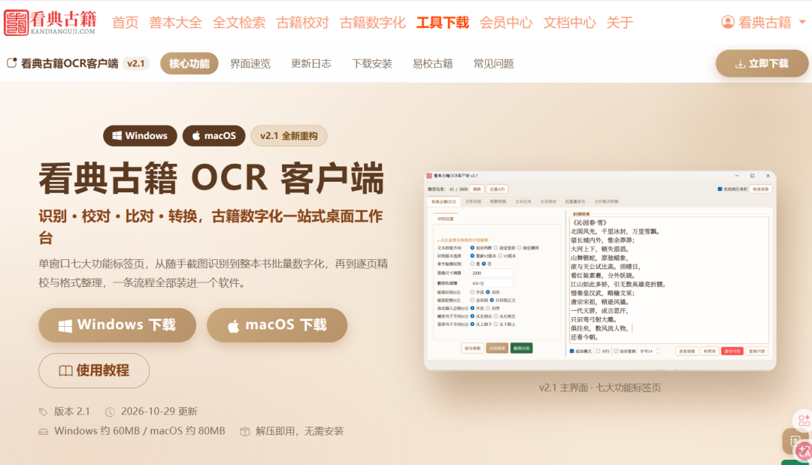
---
#### 三、首次配置：设置API
识别额度与您的看典古籍账号绑定，首次使用需要先完成 API 配置：
1. 获取 Token打开看典古籍网站，顶部点击"古籍数字化"，页面底部点击"OCR API"，复制审核通过的 Token（如还没有 Token，请先阅读官网的 API Token 申请教程）；
1. 填入软件打开软件，点击左上角"**设置API**"，在弹出的配置窗口中填入 API Token 与看典账号（窗口中也有"点击此处查看您的Token信息"直达链接），点击"**验证可用**"测试无误后，点击"**保存**"；
1. 查看额度配置成功后，软件顶部会实时显示额度信息（已用 / 总额度），点击"刷新"可随时更新，每次识别后也会自动刷新。
看到使用统计正常显示，即表示配置完成，可以开始识别。
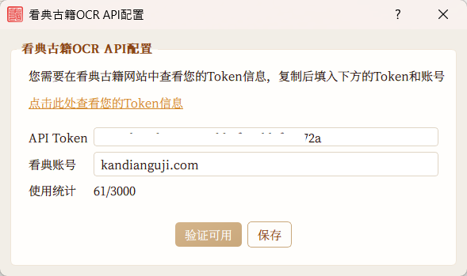
#### 四、主界面总览
v2.1 将全部功能整合进一个主窗口：顶部是额度信息与功能按钮（设置API、关闭到任务栏、检查更新），中间是 7 个功能标签页：
| 标签页 | 用途 |
| 看典古籍OCR | 单张图像识别、屏幕截图识别 |
| 文件识别 | PDF/多图/文件夹批量识别 |
| 简繁转换 | 简体/繁体/台湾正体/香港繁体互转 |
| 文本比对 | 两版文本差异比对 |
| 文本校对 | 边看原图边校对文字 |
| 批量重命名 | 文件批量改名 |
| 文件格式转换 | PDF与图像常用格式转换 |
---
#### 五、文本识别（单张识别 + 截图识别）
适用场景：随手识别一张扫描图、一段屏幕上的文字。
**1. 识别图像**：点击"识别图像"选择本机图像，识别结果自动显示在右侧"识别结果"区。
**2. 截图识别**：点击"截图识别"或在任意界面按下全局快捷键 **Alt+Q**（可在识别设置中自定义），框选屏幕区域，松开鼠标即自动识别并返回结果，看 PDF、网页里的古文随手一截就能转成文字。
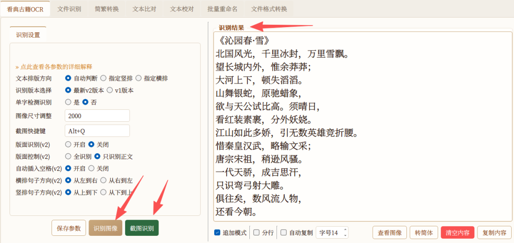
**3. 识别设置**（左侧参数区，设置后点击"保存参数"，下次打开无需重设）：
- 文本排版方向自动判断 / 指定竖排 / 指定横排，自动判断错误时手动指定识别效果更好；
- 识别版本选择默认使用最新 v2 版本；
- 单字检测识别识别单个文字条图像时选"是"，多列/行时选"否"；
- 图像尺寸调整识别时的图像大小，默认 2000，图像越小识别速度越快；
- 版面识别（v2）分栏式/多栏式古籍建议开启，识别结果按分栏显示防止文本错乱；常规不分栏图像建议关闭以加快速度；
- 版面控制（v2）开启版面识别时，可控制只识别正文或全部识别（非正文指页眉/页脚/版心等）；
- 自动插入空格（v2）字间距过大时自动插入空格；
- 横排/竖排句子方向（v2）控制文字行的阅读方向；
- 不确定参数含义时，点击设置区顶部的"**点此查看各参数的详细解释**"直达官网图文说明。
**4. 结果处理**：结果区下方提供一组开关与按钮——
- 追加模式（默认开启）：多次识别结果累加显示，关闭则每次清空后覆盖；
- 分行开启后按行显示文本，关闭后合并为整段；
- 自动复制（默认开启）：识别完成后结果自动进入剪贴板，直接去别处粘贴即可；
- 字号调节结果文字大小；
- 查看图像 / 转简体 / 清空内容 / 复制内容查看原图对照、结果一键转简体、复制编辑器中的内容等。
#### 六、文件识别（批量识别，重点功能）
适用场景：整本 PDF、成百上千张扫描图的批量数字化。
**1. 添加任务**：点击"选择PDF文件 / 选择PDF文件夹 / 选择图像文件 / 选择图像文件夹"添加识别任务，勾选"多级文件夹"可载入整棵目录树，PDF 与图像可混排。
**2. 设置保存位置与分页标志**：选择识别结果的保存目录；分页标志默认【第n页】，可自定义显示效果（如：第n页、n页）。
**3. 逐任务设置参数**：任务表格中每一行都可双击"识别范围"手动修改要识别的页码范围（如 1-100），点击"识别设置"可为该任务单独配置识别参数，互不影响。
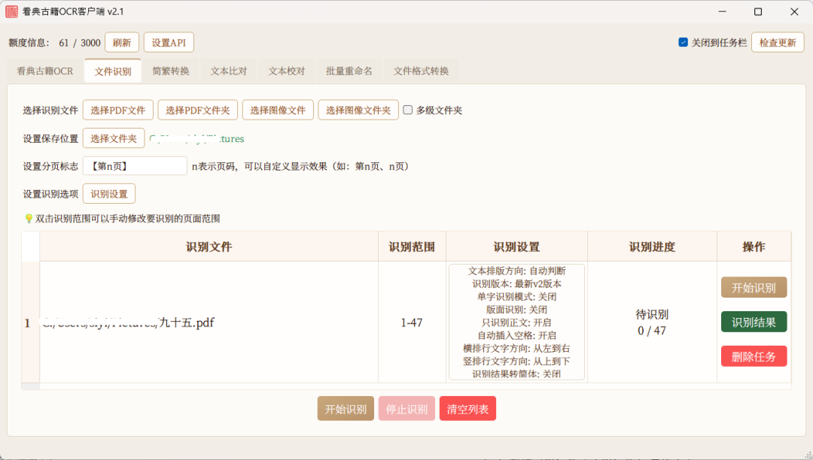
**4. 开始识别**：点击"开始识别"，任务按顺序自动执行，表格中实时显示每个任务的识别进度；"停止识别"可随时中断。
**5. 断点续传与任务记忆**：
- 每一页识别结果实时落盘，任务中断（关软件、断网）后重新运行，会自动跳过已识别页，从中断处继续；
- 关闭软件重启后，任务列表自动恢复，进行到一半的任务接着跑；
- 识别出错的页面不计入已完成，重跑时自动重试，并在状态中标注出错页码；
- 列表积攒的已完成记录，点"清空列表"一键清除。
**6. 识别结果**（在设置的保存位置，每个任务一个同名文件夹）：
- 每页 TXT（换行版 / 不换行版）与逐页 json；
- 汇总 Word 文档（含竖排版式），每次运行自动全量重建，无需手动拼接。
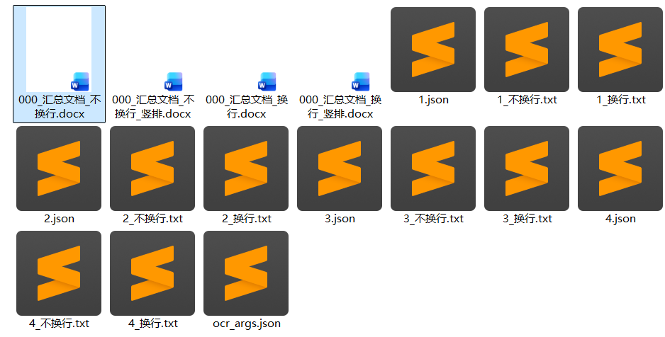
#### 七、文本校对（边看原图边校文字）
适用场景：对识别结果逐页精校，或对照原图人工录入、校对。
**1. 打开文件**：点击"打开PDF / 打开图像"载入原书文件，左侧为页面缩略图列表，点击任意页快速跳转。
**2. 图像预览**：中间为原图查看器——滚轮缩放、拖动平移、双击适窗、1:1 原大，"上一页 / 下一页"翻页；扫描件不清晰时，可调高顶部的"**预览DPI**"（72–600）后再看。
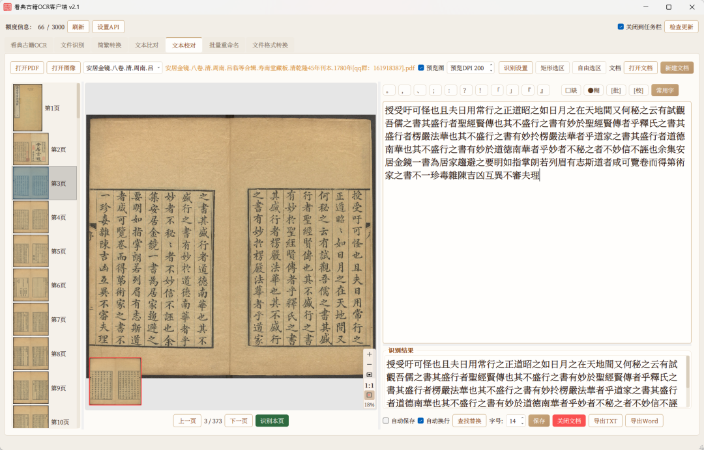
**3. 边看边识别**：右侧提供三种识别方式，结果直接进入校对文档——
- 识别本页识别当前整页；
- 矩形选区 / 自由选区框选页面局部识别，只取需要的段落。
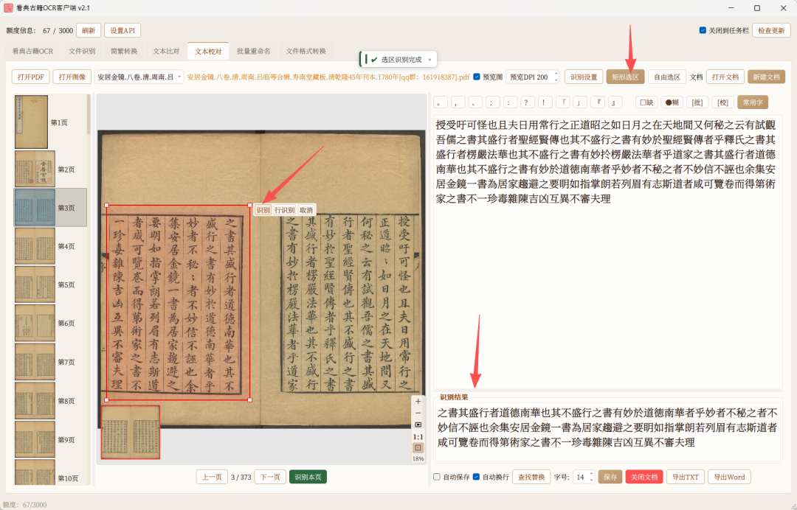
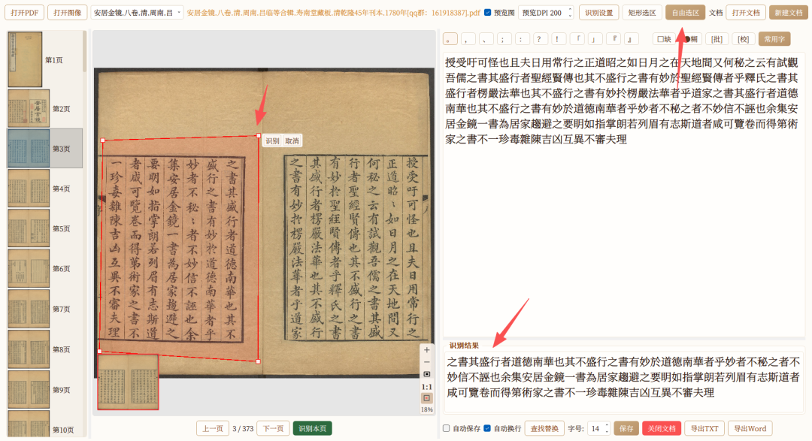
**4. 快捷插入**：文档上方一排符号按钮——常用标点（。，、；：？！「」『』）、校对符号（**□缺** 缺字、**●糊** 模糊、**[批]** 批注、**[校]** 校记）以及"**常用字**"自定义字表，点击即在光标处插入。
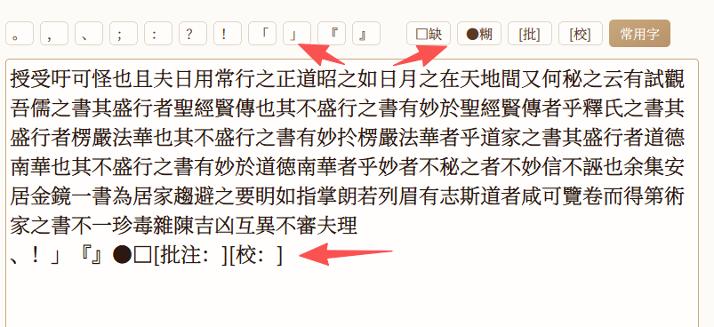

**5. 文档操作**：支持新建文档 / 打开文档、自动保存、自动换行、查找替换、字号调节、保存、关闭文档，完成后一键**导出TXT / 导出Word**。
**6. 项目自动记忆**：下次打开软件进入"文本校对"，自动回到上次的文件、页码和文档位置，接着上次继续校。
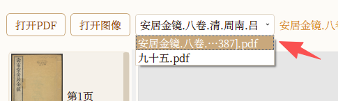
#### 八、文本比对（两版文本差异比对）
适用场景：比对识别结果与存量电子文本、两个版本整理稿的差异。
1. 把两版文本分别**粘贴进左右两栏**即自动比对，也可点击"打开左侧文档 / 打开右侧文档"载入 txt/docx；
1. 差异**行级高亮 + 行内字符级精准高亮**，改动一字也看得清；
1. 底部"**上一处差异 / 下一处差异**"在差异间快速导航；
1. 中间按钮支持将某处差异**单处应用**（→ / ←），或**整侧覆盖**（全部左→右 / 全部右→左）；
1. 两侧滚动同步，比对完成后可清空重来。
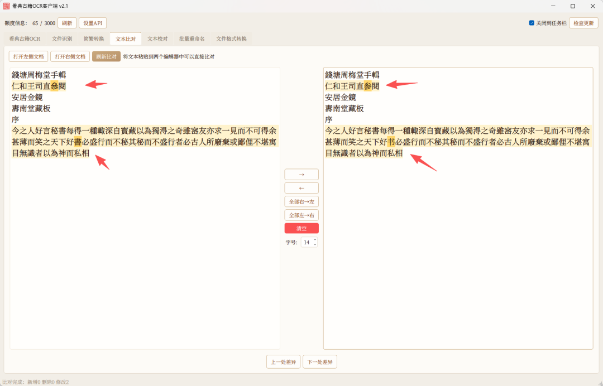
#### 九、简繁转换
1. 左栏粘贴（或打开）原文；
1. 点击"**转简体 / 转繁体 / 转台湾繁体 / 转香港繁体**"，结果即时显示在右栏；
1. "复制结果"一键复制，支持字号调节、清空。
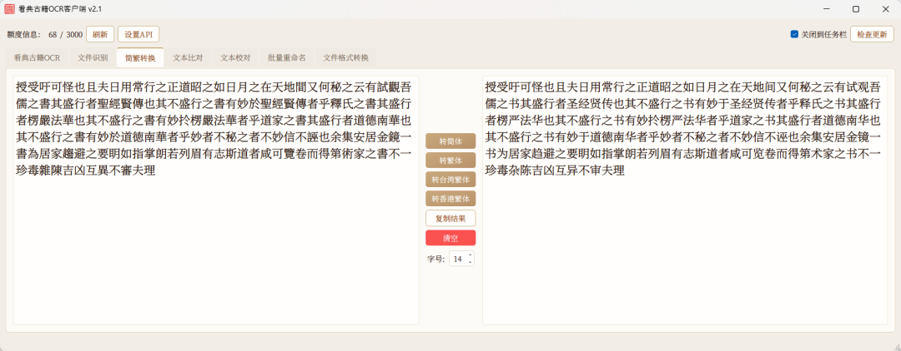
---
#### 十、批量重命名
1. 点击"选择文件"（可一次多选）或"选择文件夹"载入待改名文件；
1. 设置规则：**添加前缀、添加后缀、查找替换、编号**（起始号 + 位数，如 001、0001）；
1. 点击"**预览**"，表格中先看到每个文件的原文件名 → 新文件名对照；
1. 确认无误后点击"**应用重命名**"执行；改错了点"**撤销**"一键还原。
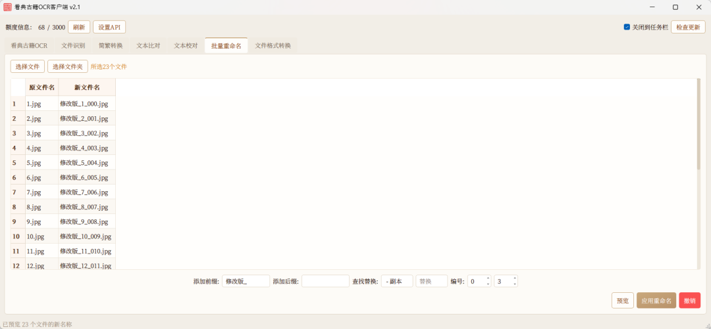
#### 十一、文件格式转换
共 5 个子页，覆盖古籍数字化的常用转换需求。所有子页均有进度条、停止按钮，转换完成后点"**转换结果**"直接打开输出文件夹：
1. PDF转图像选择 PDF 与保存位置，可勾选"新建同名文件夹"；DPI 支持 72/200/300/自定义；输出 PNG/JPG 并可调图像质量；可转换全部页面或指定起止页；
1. 图像转PDF多选图像或载入整个文件夹，按顺序合成 PDF，质量可调；
1. PDF拆分按页码范围把一个 PDF 拆成多个文件（如 1-50、51-100）；
1. PDF合并多个 PDF 按顺序合并，支持上移/下移/删除调整次序；
1. 图像格式转换PNG/JPG/BMP/TIFF/WEBP 批量互转。
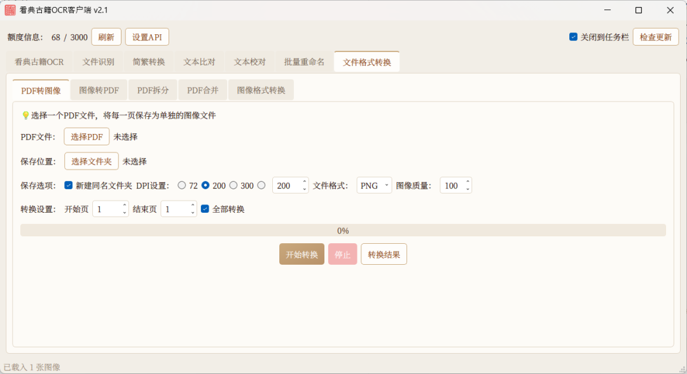
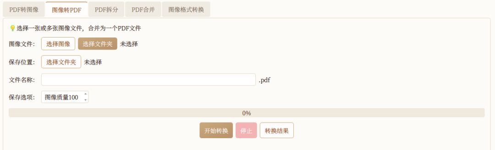
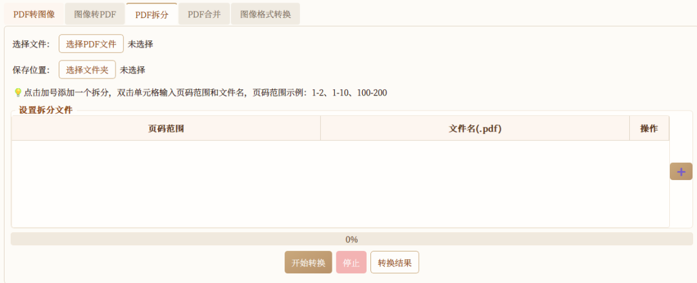
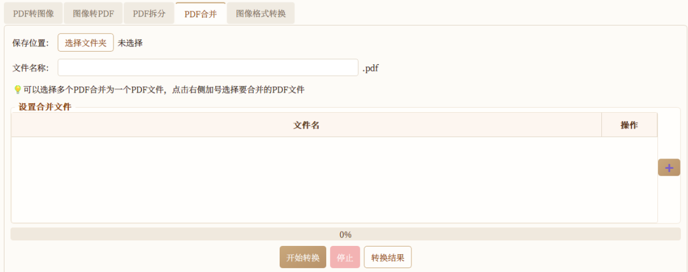
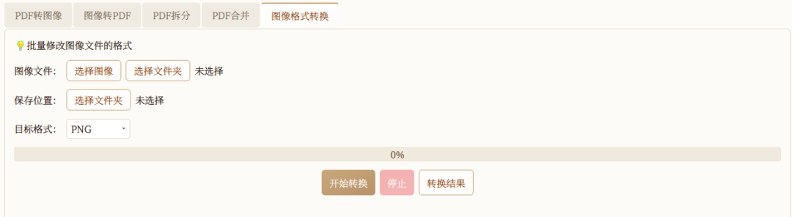
#### 十二、软件更新与托盘常驻
**1. 软件内检查更新**：点击右上角"**检查更新**"，在更新窗口中点"检查更新"获取最新版本信息与更新内容；发现新版本后点"**立即更新**"，等待下载进度完成，按提示打开所在文件夹，将压缩包解压后运行新版 exe 即可。
**2. 保留旧配置（可选）**：新版首次运行是全新设置。如需沿用旧版的配置与校对进度，请在**关闭新旧软件**的状态下，把旧文件夹中的 `Config.json` 和 `.proofread_projects` 文件夹复制到新文件夹即可。识别结果保存在您设置的保存位置，与软件目录无关，无需迁移。
**3. 关闭到任务栏**：勾选右上角"关闭到任务栏"后，关闭窗口时软件驻留系统托盘，批量识别任务在后台继续跑；双击托盘图标恢复窗口，右键图标可退出；开关状态自动记忆。

---
#### 十三、常见问题
**Q：按 Alt+Q 截图识别没有反应？**
A：全局快捷键可能被其它软件占用（占用时注册会静默失败），请在"识别设置 → 截图快捷键"中换一个键。
**Q：提示额度不足或识别失败？**
A：API 额度与看典账号绑定。请先在"设置API"中点击"验证可用"确认账号正常；额度可在官网"OCR API"页面申请/续加。软件顶部会实时显示已用/总额度。
**Q：识别结果保存在哪里？**
A：文件识别的结果保存在您设置的保存位置，每个任务一个同名文件夹；文本识别的结果在结果区复制或自动进剪贴板；文本校对的文档可导出 TXT/Word。"所选择的文件""保存位置"等标签可点击直达所在文件夹。
**Q：任务中断了怎么办？**
A：不用从头再来。文件识别支持断点续传，重新运行任务会自动跳过已识别页；软件重启后任务列表也会自动恢复。
**Q：旧版本的配置和校对进度能迁移吗？**
A：可以。2.1版本之后的软件，关闭新旧软件后，把旧文件夹中的 Config.json 和 .proofread_projects 文件夹复制到新文件夹即可。
**Q：简繁转换 / 文本比对处理大文本时变慢？**
A：界面高亮有配额保护，大文本建议单次不超过数万行，可分段处理。
---
v2.1 的目标很简单：把古籍整理工作里"识别—校对—比对—整理—归档"的整条流程装进一个软件。从随手一截的截图识别，到整本书的批量数字化，再到逐页精校与格式整理，都可以在看典古籍OCR客户端里一站完成。
以上为看典古籍OCR客户端 v2.1 的更新说明与使用教程。若您有任何意见或建议，欢迎在网站"反馈"功能中提交，或联系我们进行反馈！
感谢阅读！
**看典古籍**
2026年10月29日
