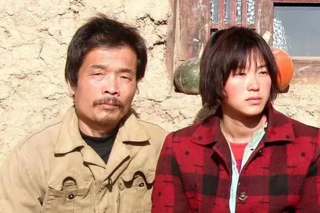
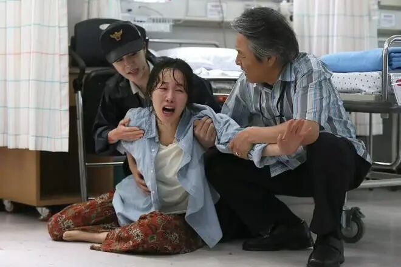
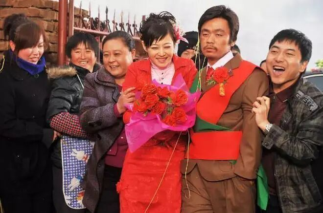
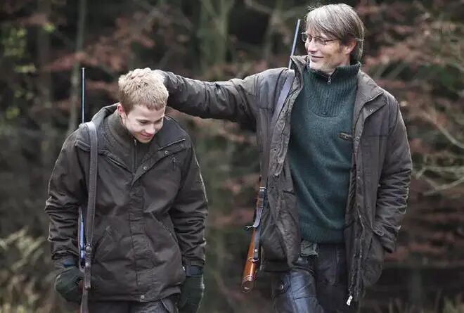
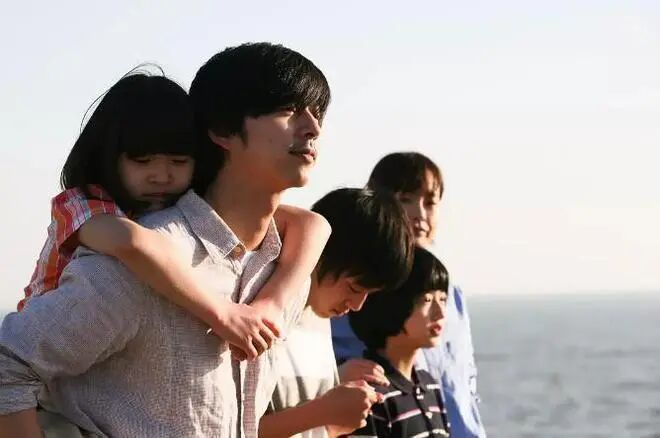
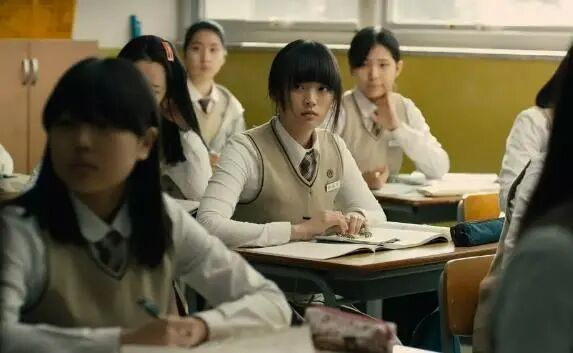
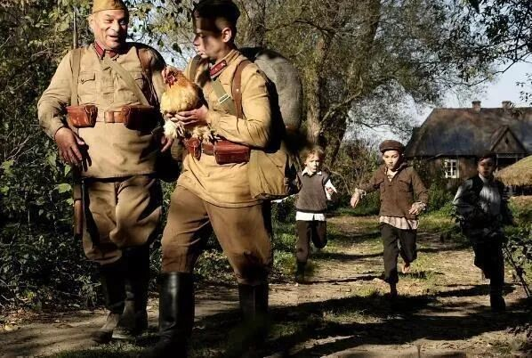

# 真实事件改编的十部高分电影，最后一部至今都是童年阴影
> 💡 备注属性未写入，可能是备注属性名称或者类型被修改了，建议将字段类型设置为 rich_text，可以在小程序-操作-修改文章数据库页面进行调整
> 💡 原文链接:[https://mp.weixin.qq.com/s?__biz=MzUyNDUxMTMyNg==&mid=2247586704&idx=1&sn=8f88f299c4bb12ae1502e31ecd80fde9&chksm=fb9531bcb71f6db4b05502a15ada2de8b391adfb2915e83cf0056f29d6c596da1fef561d20fc#rd](https://mp.weixin.qq.com/s?__biz=MzUyNDUxMTMyNg%3D%3D&mid=2247586704&idx=1&sn=8f88f299c4bb12ae1502e31ecd80fde9&chksm=fb9531bcb71f6db4b05502a15ada2de8b391adfb2915e83cf0056f29d6c596da1fef561d20fc#rd)
1、《盲山》
雪梅的遭遇真让人心里堵得慌。被逼到绝路上，拿身体换来的那点机会，到头来全被不作为的警察和缺席的司法给糟蹋了。村里人人捂着真相不吭声，说白了都是帮凶。最后她那一刀砍下去，像是给自己这辈子画了个句号，命就这么停在那儿了。海外版结局留了个口子让人琢磨，可绿领子们真能救她吗？说到头还是换了个笼子关着罢了。看完就剩一声叹气，啥也说不出来。

2、《天狗》
富大龙演的护林员，因为挡了全村盗伐的财路，没人动他一根手指头，但断水、堵井、拿可乐和面这些阴招轮着来，硬是把人逼疯了。没见血没动刀，可那种全世界都盼你死的压迫感，比砍人还难受。导演戚健用两条线交织着讲故事，结构挺扎实。片子表面说环保，其实更想说的是正义这东西到底还有没有用。看完心里五味杂陈，好人没好报这事儿，搁谁身上都憋屈。

3、《素媛》
不同于《熔炉》侧重控诉司法，《素媛》把镜头对准创伤之后的疗愈。小女孩那句“我做错什么了吗”直戳心口，父亲笨拙扮成可可梦靠近女儿的段落，温柔又心酸。苦难没有被美化，爱也没能彻底抹平伤痕，却让人看见一家人咬着牙重新接住生活的力量，后劲很大。

4、《Hello！树先生》
刚看开头还以为树先生是个受人敬重的人物，村里人打趣说他该当官，我还挺当回事儿。越往后看越不对劲，才明白那些全是拿他开涮，压根没人把他当回事。整部片子的调子也跟着往下掉，从一开始的热闹慢慢变成心酸和窝囊。树先生这人精神不太正常，活得又悲催又滑稽，越看越替他难受。说白了就是个被全村人当笑话的可怜人，看完心里挺不是滋味的。

5、《狩猎》
这电影比恐怖片还恐怖比惊悚片好惊悚，因为在我看来人性是最恐怖的，猜疑，自证这个世界上没有比这还恐怖的。在心理学上认为一个人一旦对你有了猜疑那怕只是浅浅的问一下，证明你已经不再清白，电影虽然看了无数遍了，但每次看之前还是做了很大的心理决定，因为真的好心痛，那种无声的压抑感，暴裂无声，主角像一个被冤枉的哑巴，没有人信，连自己都无法自证，这是最令人心痛的。

6、《熔炉》
电影冷静克制，没有刻意煽情，却足够震撼。聋哑孩子无声的求救，权贵层层庇护的罪恶，撕开体面之下腐烂的真相。我们一路奋战，不是为了改变世界，而是为了不让世界改变我们。看完久久无法释怀，不愿二刷，却永远不该忘记。太压抑了，心理承受能力弱的不要看。

7、《韩公主》
千禹熙凭这片拿青龙影后真的服气，表演穿透力太强。导演讲故事的功底很深，从一堆零碎片段一点点拼出全貌，节奏由浅入深很抓人。片子借女孩的遭遇折射出社会多个切面，但最让人窒息的是片中的父母——不是谁都有资格当父母，那位父亲尤其可悲。

8、《沃伦》
战争最可怕的地方，是原本一起生活的邻居，也可能在民族仇恨中变成彼此的敌人。电影没有用英雄叙事美化战争，而是直面普通人在屠杀与报复中承受的苦难，看得人沉重，很多人把这类悲剧归结为民族、宗教、意识形态等等纷争，事实上问题的根源是无政府状态，没有制约兽性的暴力机构，人类会爆发出最原始的最大的恶。

9、《告白》
用冷静刺骨的镜头，撕开校园之下人性的阴暗。一场复仇，层层反转，没有绝对的善恶。当少年之恶被忽视，伤害循环往复，冰冷的告白背后，是对生命与正义沉重的拷问。到现在还记得当时看到结尾那种被演员演技震撼的感觉，太精彩了，原著小说也很推荐。

10、《黑太阳731》
片子本身拍得挺好，画质比好多老电影都强。但故事讲得有点乱，开头聚焦那帮少年兵，中间胖军官挨了揍之后这帮孩子就没了下文，不知道哪去了。再说主题吧，友好归友好历史归历史，现在很多人倒好，只记得恨。其实仇恨这事特别复杂，煽动情绪谁都会，大部分人压根没自己脑子，就是历史里随波逐流的一粒沙子，哪边风大往哪飘，敌方我方都一样。

真实事件改编的十部高分电影，最后一部至今都是童年阴影！
