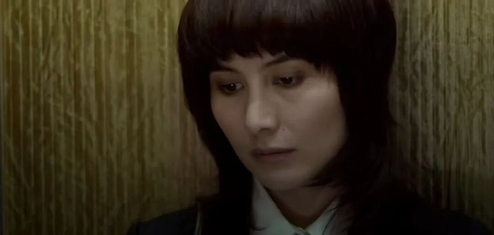
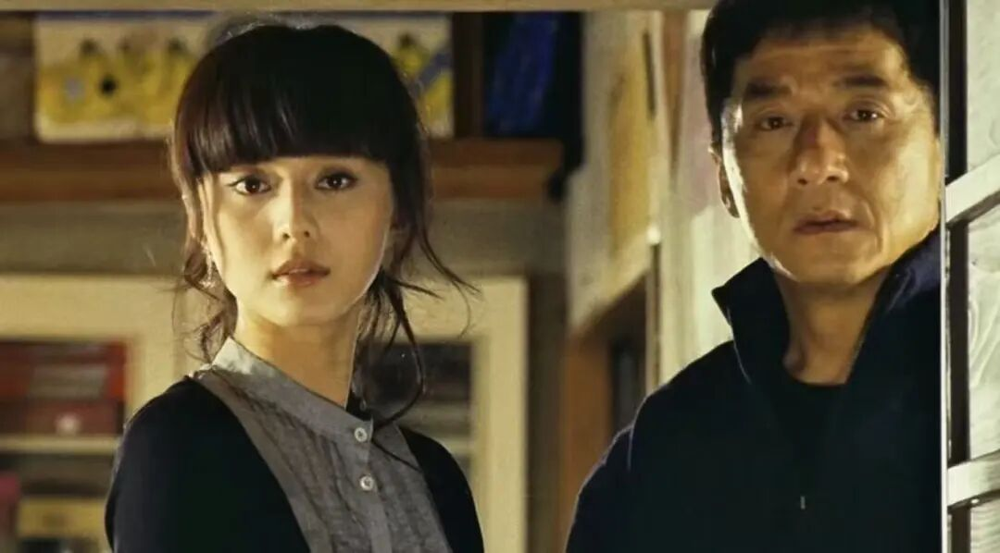
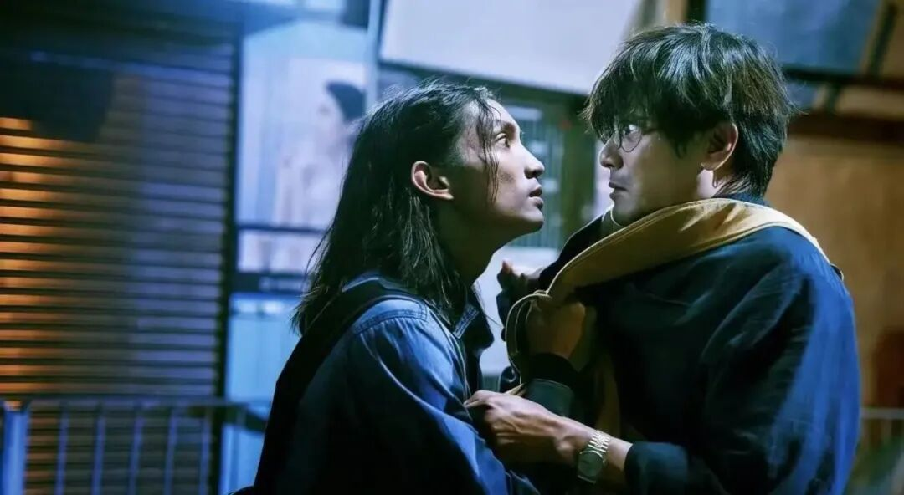
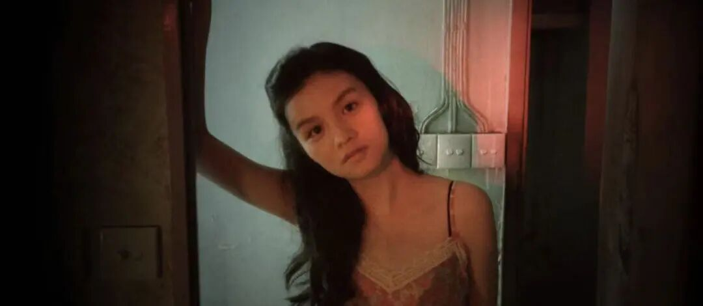
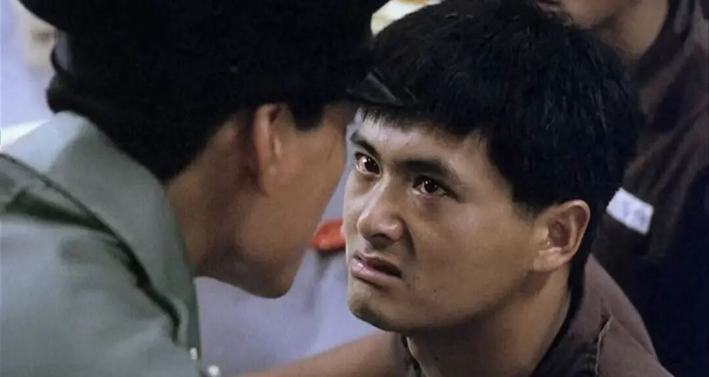
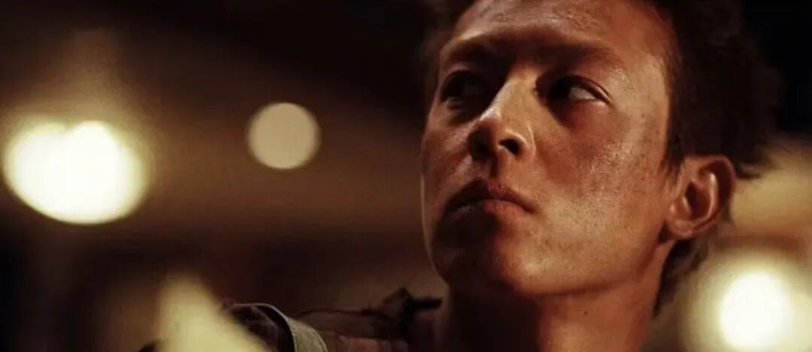
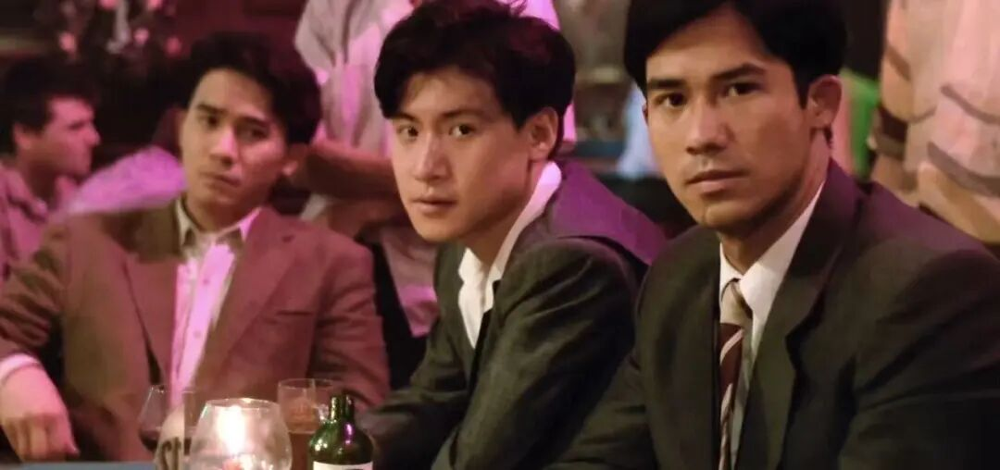
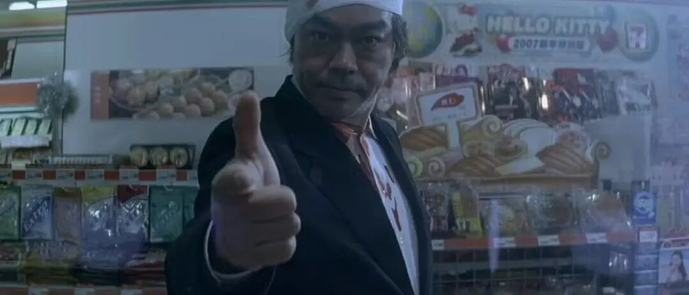
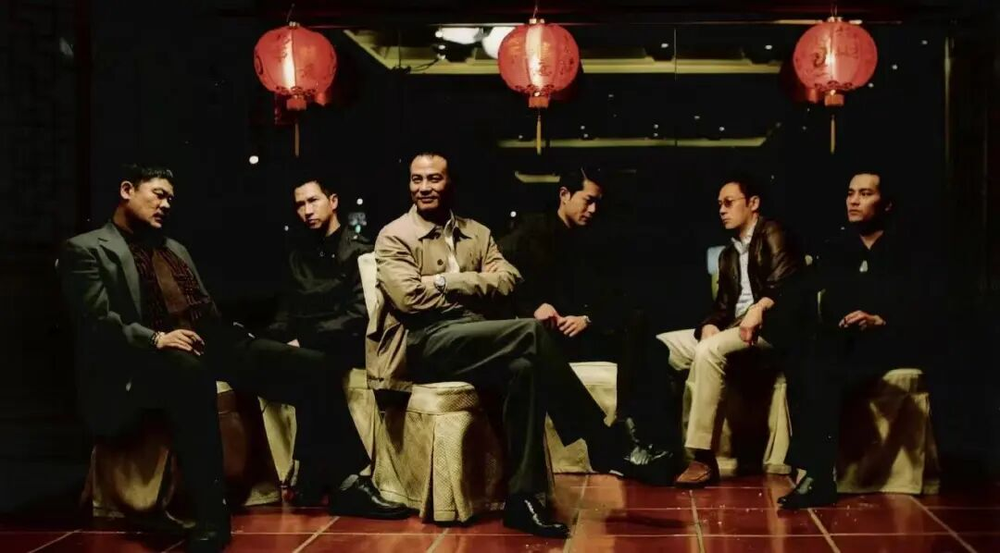

# 禁止在内地上映的港片，却在香港乃至国外大放异彩，你都看过几部
> 💡 备注属性未写入，可能是备注属性名称或者类型被修改了，建议将字段类型设置为 rich_text，可以在小程序-操作-修改文章数据库页面进行调整
> 原文链接:[https://mp.weixin.qq.com/s/23x6lYB0xyQ8hB-HtJgNsg](https://mp.weixin.qq.com/s/23x6lYB0xyQ8hB-HtJgNsg)
**上方关注我，每日更新！**
**一起解锁更多好电影！**
不知道你们有没有感觉：**我们常见的香港电影，**大多数是**武侠片、喜剧片、警匪爽片，**但是也有一部分电影，它评分非常高，在影迷心目中有很高的知名度。
但是由于题材、尺度、叙事太过锐利，从来没有在中国内地上映过。今天就带大家盘点一下那些**没有在内地公映的港片，**看看你看过几部。
**NO.10 《维多利亚一号》**

彭浩翔拍完《志明与春娇》的清新爱情，转头就拍了**这部充满讽刺意味的惊悚片。**何超仪演一个银行话务员，省吃俭用、身兼数职拼命攒首付，马上凑够了时不料房主忽然涨价。
房主临时涨价成了压垮她的最后一根稻草，她的解决办法很直接：**把这栋楼变成凶宅，价格自然就下来了。**他彻底走向疯狂，潜入楼盘接连制造凶案。极致的血腥背后，是对香港楼市畸形现状的尖锐讽刺。
**NO.9 《新宿事件》**

尔冬升执导的黑帮写实力作，**成龙突破形象的文系代表作。**东北青年铁头偷渡到日本寻找女友，却在异国他乡卷入华人帮派斗争。
他带着一群底层同胞打拼，从工地苦力到掌控歌舞伎丁，势力不断扩张，兄弟间因利益渐生嫌隙，与日本黑帮的矛盾也彻底爆发。没有功夫炫技，只有残酷现实，**道尽了海外华人求生的辛酸与无奈。**
**NO.8《命案》**

郑宝瑞与银河映像合作的犯罪奇片。**疯癫的命理大师执着逆天改命**，试图帮人化解死劫。茶餐厅少东天生嗜血，骨子里藏着杀戮冲动。老差骨坚信他本性难移，死死盯着不放。
**大师用尽风水术术想帮少年改运，却屡屡被命运捉弄。**雨夜屠夫连环作案，风尘女子命悬一线，多条线索交织碰撞，影片在宿命与反抗间拉扯，把港式癫狂与玄学氛围拉满。
**NO.7《踏雪寻梅》**

**改编自真实命案的写实佳作**，少女王佳梅从内地来港寻梦，最终沦为援交少女，惨死异乡。老警察臧警官追查案件，却一步步走进凶手与死者的内心世界。
影片不执着于破案推理，而是深入剖析**两个底层年轻人的绝望处境。**春夏与白芷的表演极具张力，将边缘人的孤独与破碎展现得淋漓尽致。冰冷的案件背后，是让人窒息的生存困境。
**NO.6《监狱风云》**

林岭东执导的监狱题材经典。广告设计师卢家耀失手伤人入狱，性格耿直的他处处碰壁，受尽欺凌。老囚犯钟天正仗义出手，两人结下深厚情谊。
狱警凶狠残暴，帮派势力凌厉，狱中生存步步维艰。钟天正本想安分服刑早日出狱，却被逼到退无可退，最终选择以暴制暴，奋起反抗。**周润发与梁家辉演技炸裂，**唱出了高墙之下底层人物的悲歌。
**NO.5《狗咬狗》**

这是郑宝瑞的经典暴力片。来自柬埔寨的杀手潜入香港执行任务，遇上性格暴躁的探员，两人从追逐对抗一步步滑向绝境。
影片抛弃了传统警匪片的正邪设定，把两个人逼成只靠生存本能行动的野兽**。陈冠希全程台词极少，用眼神和动作演绎出杀手的原始野性。**全片粗糙生猛的暴力镜头把绝望感拉到极致。
**NO.4《喋血街头》**

吴宇森，暴力美学的沧海遗珠。**三个在贫民窟长大的好兄弟为避祸远赴越南淘金。**战争背景下的西贡混乱不堪，他们劫黄金救歌女，却在逃亡途中因一箱金子反目。
细荣利欲熏心开枪打伤辉仔，阿碧含泪了结痴傻的兄弟，最终回港了结恩怨，**从兄弟情深到手足相残，子弹穿过头颅的不只是生命**，还有那段被碾碎的青春与情谊。
**NO.3《神探》**

杜琪峰与韦家辉联手打造的悬疑神作。天才警探陈贵斌能看穿人心中的鬼，却因行为怪异被当成疯子。警员失踪案迷雾重重，他受邀复出查案，发现嫌疑人身上竟藏着七重人格，**案件真相层层反转，最后镜面枪战堪称经典。**
他不只是探案故事，更是对人性深渊的极致拷问。每个角色都在欲望与良知之间挣扎，结局布局让人细思极恐。
**NO.2《树大招风》**

银河映象出品的犯罪佳作，**改编自香港三大贼王的真实经历**。季政雄谨慎阴狠行踪成谜，叶国欢从悍匪转型商人受尽屈辱，卓子强张狂肆意专榜富豪，三条故事线平行推进。
林家栋、任贤齐、陈小春三人的表演浑然天成，**拿下当年金像奖多项大奖**。它也是银河映像气质最独特的作品之一。
**NO.1《黑社会》**

杜琪峰执导的黑帮史诗，**聚焦香港最大社团，和连胜的话事人选举**。大d嚣张跋扈，四处收买元老。阿乐隐忍内敛，步步为营。双方为争夺龙头棍展开连番博弈，警方冷眼旁观，伺机而动。
影片褪去江湖浪漫滤镜，**赤裸裸展现权力斗争的残酷与虚伪**，没有快意恩仇，只有利益算计，每一步棋局都暗藏杀机，最终揭露出黑道世界最真实的生存法则。
