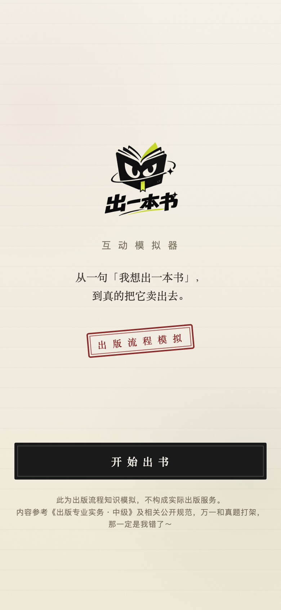
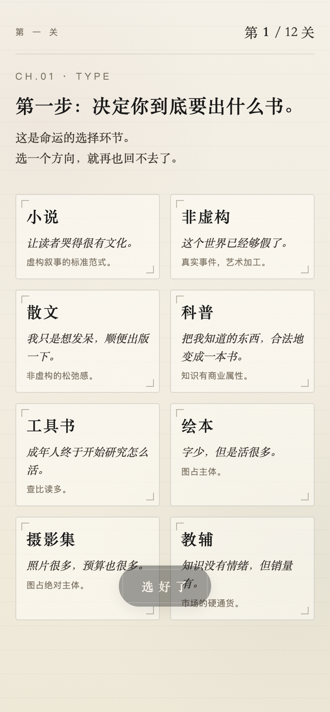
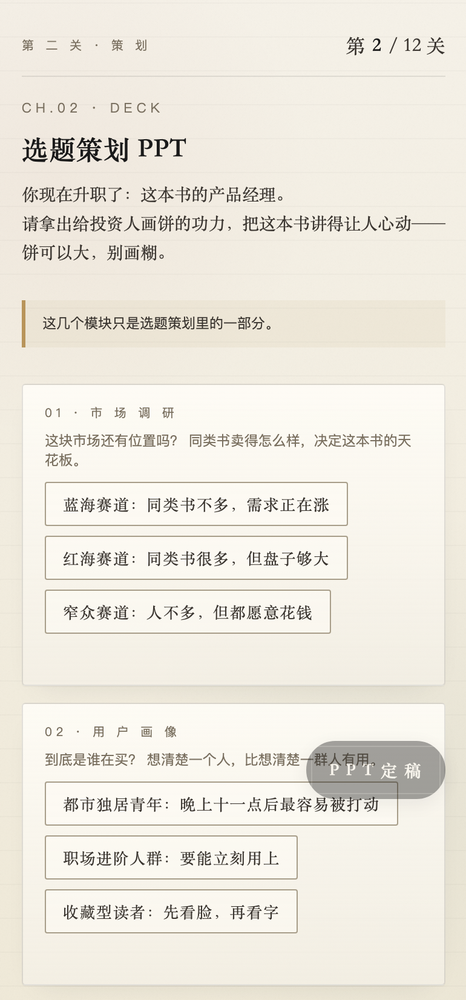
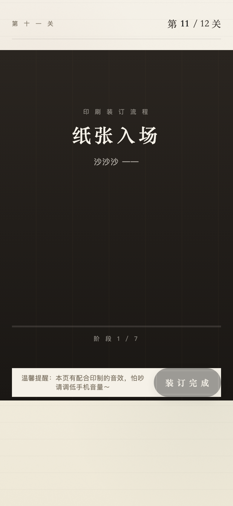
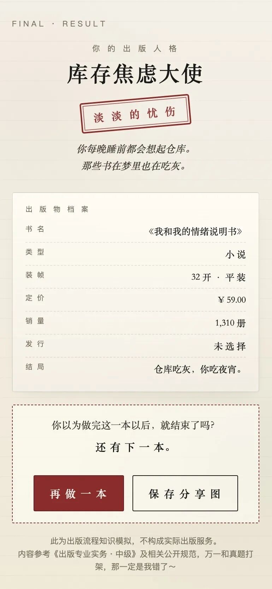
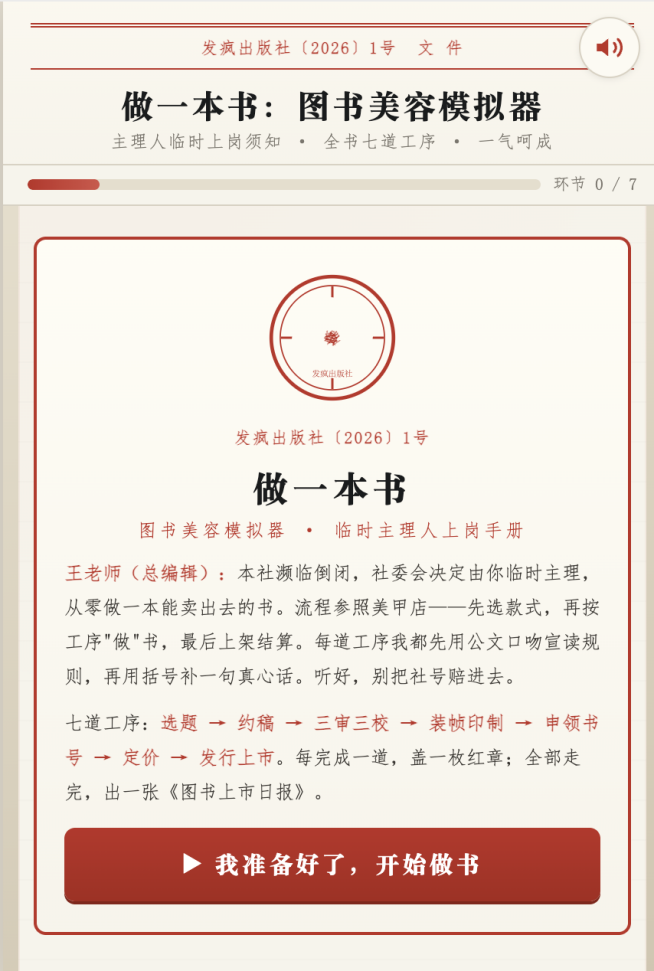
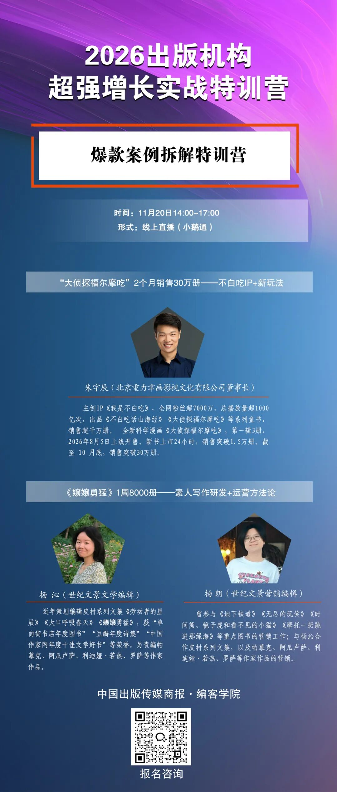

# 离开出版业后，她用AI“手搓”出书模拟器
> 💡 备注属性未写入，可能是备注属性名称或者类型被修改了，建议将字段类型设置为 rich_text，可以在小程序-操作-修改文章数据库页面进行调整
> 💡 原文链接:[https://mp.weixin.qq.com/s?__biz=Mzg4MDgyOTg5OQ==&mid=2247518153&idx=1&sn=ee1906f55b7d04440783f19a835dd086&chksm=cee7b76d8d58f5f72e24312539ae98d0ac9a3790cf75dcd41173119bf76112b3aba1c867bbc1#rd](https://mp.weixin.qq.com/s?__biz=Mzg4MDgyOTg5OQ%3D%3D&mid=2247518153&idx=1&sn=ee1906f55b7d04440783f19a835dd086&chksm=cee7b76d8d58f5f72e24312539ae98d0ac9a3790cf75dcd41173119bf76112b3aba1c867bbc1#rd)

引言

本期案例的主人公，曾深耕出版营销，离开行业之后，她借助AI，将选题策划、三审三校、申报书号到发行上市整套复杂的出版业务，打磨成《出一本书・互动模拟器》，在小红书平台成为小爆款。
没有专业开发团队，不懂代码，依靠AI反复调试迭代，单HTML文件即可运行。她的经验也引导我们思考：AI时代，出版人的核心经验，还可以有哪些新的载体与表达方式？
受访人 | 鹿邑
文末点击阅读原文，体验出书模拟器
● 近年，你是怎么跟AI一步一步深入、密切接触的？
三个阶段：工具 → 流程 → 产品。
最开始是把AI当搜索工具用，查资料、补常识、快速了解一个不熟悉的领域。后来不再局限单点查询，而是把AI嵌入日常事务里，重构工作流程——让AI承接重复性、耗心力的环节，把自己释放出来聚焦思考与决策，让工作运转更高效。
到现在，我开始用AI做一些真正满足自己需求的产品。比如**《出一本书·互动模拟器》，把出版流程做成可以互动的体验**；另一个是孩子上小学后，我根据他的学习情况做了一个学习工具台，每天跟踪学习进度、回顾错题、做时间管理。
回头看，AI的角色其实变了三次：先是“帮我查”，再是“帮我做”，现在是“按我的方法做”，把我自己的经验、判断和节奏，固化成一个能运转起来的东西。
**再往后我有个判断：以后大概不会再有“满足需求”这回事。**
倒不是需求变少了。
“满足需求”说的其实不是需求，是一种分工：我提得出来、却做不出来，于是有人按通用模板交给我一个差不多的东西。它成立的前提，是我接受“差不多”。
这一层正在被两头掏空。
一头是会用 AI 的人：过去做一个工具要有团队、预算和周期，现在一个人就能把自己的需求直接做成产品，一次做好、反复使用，边际成本几乎为零。这一头没有交付，也没有“被满足”——东西是我自己按自己的方法做出来的，比任何通用版本都更贴我。
另一头是必须落到真实场景里的事：线下的空间、面对面的服务、身体才能在场的体验。AI替代不了，人力和场地越贵，它越贵；但这类事本来就不是能被交付的东西，我只能亲自去，谈不上被谁满足。
中间那一层最尴尬：够标准，却不对准任何具体的人。一头是自己做的精准版本，一头是替代不了的在场体验，它被挤掉是迟早的事。
所以准确的说法不是“满足需求变便宜了，或者变贵了”。
是“由别人替我满足”这件事，失去了它原来站着的那一层。
需求还在，只是不再需要被满足。
● 为什么想做《出一本书·互动模拟器》？
做《出一本书·互动模拟器》，最初其实是一个很自然的念头。我原来在出版社做市场营销，后来离开出版行业，成为一名全职妈妈。虽然自己已经离开了这个行业，但身边仍然有不少朋友对出书感兴趣，甚至有人会来问我：如果我想出一本书，应该从哪里开始？需要经过哪些环节？
我突然意识到，出版对于从业者来说是一套熟悉的工作流程，但对于普通人来说，却像一扇不太容易推开的门。很多人有表达的欲望，有写一本书的想法，却不知道一本书从一个念头变成真正摆上书架的商品，中间究竟要经历什么。
我不太想再用一篇长文章或者一段语音去解释这些事情。因为出版不是简单地写完稿、找人印刷就结束了，它涉及选题策划、市场判断、印制和发行等一系列环环相扣的工作。**与其告诉别人流程是什么，不如让他们亲自走一遍。**

于是，我想到把这套专业流程设计成一个互动模拟器。让用户亲自经历一本书从策划到上市的全过程，过程中可以做出选择，也可能判断失误、被打回重来。希望用户在玩过之后，不仅对出版有更直观的认识，也能理解一本书从创意到成品背后，有多少专业分工、有多少人的付出。
对我个人而言，这也是一次对过去职业经历的重新整理。离开出版社，并不意味着过去积累的经验就失去了价值。**借助AI，我可以把原本存在于工作经验、行业知识和个人记忆中的东西，重新组织成一个别人可以体验的产品。**
当时，正好赶上中级出版专业资格考试，我也希望它能成为一个寓教于乐的小工具，让备考的人换一种方式理解和复习出版流程，而不是只面对书本和知识点。
所以，这个项目既不是单纯为了做一个AI游戏，也不是为了证明AI能够替代出版从业者。
我更感兴趣的是：当AI降低了产品制作的门槛，一个普通人能不能把自己过去积累的专业经验，转化成一个真正有用、有趣、能够帮助到别人的小产品。
**我想做的，其实就是这样一件事：把自己走过的路，整理成一张别人也能看懂、甚至可以亲自走一遍的地图。**
● 《出一本书·互动模拟器》属性是什么？主要解决什么问题？
《出一本书 · 互动模拟器》是一个互动H5小游戏。

读者记不住一本“出书说明书”，但能记住自己做过的选择。
出版流程的复杂度不在知识量，而在顺序约束和“不可逆节点”。通用模型输出的是线性文本，而我要表达的是一张带判断的流程图——必须让用户能动手、能选、能选错。所以“手搓出书模拟器”的定义不是造一个更聪明的问答，而是造一个把出版规范固化成交互的产品。
给“想出书但不懂流程”的读者一份流程直觉，尤其是那些不需要懂、但需要知道“谁在做什么、卡在哪一步”的人；给出版从业者一个结构复述器——想复习时自己跑一遍，比讲给别人听更省力。定位是“流程地图 + 常识体检”。
● 详细拆解“手搓”的过程：由哪几个部分组成？每个模块干什么活？
《出一本书 · 互动模拟器》由六个组成部分。
**▶ 单文件自包含载体。** CSS、JS全部内联，不依赖外部CDN、无后端、运行时不发起网络请求。核心目标是实现“单HTML文件分发”，不需要服务器、不用登录账号，全部计算和状态都在浏览器本地完成，拷贝到任何设备都能直接打开使用，降低使用门槛。
**▶ 关卡数据层。**把12关的题干、选项、分支权重、判断逻辑、反馈文案统一在独立数据组里，和页面渲染逻辑解耦。业务规则和引擎分离：如果出版规范、考核内容更新，只需要修改这份数据，不需要改动页面交互和底层引擎。
**▶ 交互音效模块。**给每一次选择、提交、确认动作绑定音效反馈，把答题判定做成类似“盖章确认”的仪式感；同时做了静音开关控制，兼顾沉浸感和安静使用场景。
**▶ 本地渲染&成果导出层。**在浏览器内直接生成成果分享图；移动端做兼容降级，不强制绘图导出时，给出长按保存指引。目的是在流程终点产出一张可视化成果物，给用户一个可以留存、对外分享的结果。
**▶ 自动化构建与全流程测试。**针对源码和最终产物做模拟点击，自动跑完所有关卡分支，验证判定逻辑、跳转、导出链路没有 bug，避免改一处数据引发隐性流程问题。
**▶ 版本存档与回滚体系。**每一个版本归档包固定包含：工具压缩包、源码 HTML、关卡文案文档、音效资源清单、可直接分发的 dist 试玩包、版本变更说明。所有变更留痕，随时可以回退旧版本、对比不同版本差异，可控迭代。
整套架构的核心取舍，就是优先本地化、无依赖、业务和引擎分离，适合这种轻量互动模拟器，不用上复杂服务。

● 行业经验怎么“灌”进去？
这部分主要是导入行业规范和条例，加上中级考试的电子书《出版管理条例》《图书出版管理规定》、中国国家版本馆《图书在版编目（CIP）业务办理须知》、《出版专业实务·中级》教科书电子版等。
● 替掉的是哪一段工作流？
替掉的是“向前来问流程的朋友反复口头解释一遍从选题到上市的顺序”——从“每次一条长语音”变成“对方自己跑一遍流程并带走结果页”。
出版社内部的成本测算、渠道谈判、书号申报、终审签发，没有被替代，也不应该被替代。
● 开始“手搓”工具的时候，是自己动手还是找了人帮你？
全程都是自己动手。虽然我完全不懂代码，但之前有互联网产品的从业背景，知道需求拆解、清楚功能逻辑和使用场景，这是很重要的基础。再加上现在国内像 WorkBuddy 这类平台，已经进化到对非代码人群非常友好的新模式，不需要掌握编程，只用大白话把真实的使用场景、约束条件、想要达成的效果讲清楚，**不断和 AI 对话调试、反复试错调整逻辑，就能慢慢把工具跑通。（不要心疼 token）**
对我来说，这个过程不只是“搭一个能用的东西”，更关键的是，**只有自己亲手去打磨，才能守住最贴合自身的需求细节**，不会因为外包或者别人代做，出现功能冗余、脱离实际使用场景的问题，所有迭代都跟着我真实的使用感受走。
● 别人拿到Prompt，能直接做出来吗？
不能。因为这个产品真正的核心，并不是某一句提示词，而是背后经过反复推敲的产品设计和行业理解。
最初，**我的设想其实更像一场剧本杀：用户扮演一家濒临倒闭的出版社——“发疯出版社”的临时主理人**，从零开始亲手做出一本书，再想办法把它卖出去。
整个体验有点像美甲店或者料理游戏：先选款式，也就是书的类型；再按照步骤一点点“制作”一本书；最后上架、结算。这个方向最初已经做出了初稿。
做一本书·图书美容模拟器-初稿

但真正体验之后，我发现出版和美甲、料理不一样。它是一套非常严谨的专业流程，环环相扣，而且很多环节具有不可逆性。前一个环节没有完成，后一个环节就无法成立。如果为了游戏性随意调整流程，反而会失去出版本身的逻辑。所以，后来我放弃了最初的剧本杀设定，转向更中性的互动模拟器。到现在这个版本，前后已经迭代了十来稿：从最初的 7 个流程，逐渐扩展到现在的 12 关，甚至还原了部分选题策划 PPT 环节。
有意思的是，不少体验过的小伙伴反馈说，玩着玩着竟然有一种上班的感觉。可能是因为流程还原得太沉浸了。

所以，我认为这个产品真正的核心资产有几层：
**▶ 流程结构**： 如何拆解一本书从选题到上市的完整链路，12个环节如何排列、衔接，以及彼此之间的依赖关系。
**▶ 体验设计**： 严肃的专业流程应该用什么方式呈现，怎样让普通人愿意参与，又不至于为了好玩而牺牲专业性。
**▶ 内容表达**： 每一关的文案用什么语气、给用户多少信息、在哪些地方设置选择和反馈，以及专业尺度应该如何把握。
**这些都不是一次生成就能拿到的，是在十几轮迭代、优化重来中，一点点“长”出来的。这其中有我对出版行业的理解，也有过去在具体业务里踩过的坑。**
我相信，一百个人来做“出书流程”的产品，可能会有一百种不同的理解和设计。Prompt 可以帮助别人快速搭建一个类似的框架，但很难直接做出来成品。就像图纸可以被一比一复刻，但工匠对火候的拿捏却无法照搬。
所以，**Prompt是启动工具，真正的资产是把对行业的思考翻译成产品体验的能力——这种将“隐性经验”转化为“显性交互”的过程，才是AI时代最难被替代的护城河。**
● 今年，你在AI上花了多少钱？自掏还是机构报销？
**全部都是自费，没有具体统计。**受一些客观条件影响，我现阶段主要还是以国内 AI 工具生态为主，用来做各种工具原型的试验和打磨。开销主要分成三部分：
第一块是模型调用的Token费用，也就是API调用成本。大多是用来和AI 协同写逻辑、打磨文案、调试我自己搭建的小工具，花费多少完全取决于迭代次数，改得多、调试轮次多，消耗就更高。
第二块是各类工具订阅、会员与付费插件。很多低代码平台、增强能力插件，靠订阅解锁更高的额度、更强的功能，方便我快速验证想法，不用自己从零搭建底层能力。
第三块是静态托管服务费用。我把自己“手搓”出来的网页工具，比如学习工具台、出书模拟器这类，部署在静态托管平台，方便随时在手机、网页端打开使用，属于轻量、持续的固定小额支出。
● AI时代，出版从业者的能力，哪些在被拿走，哪些反而更值钱？
正在被拿走的：检索与整理、校对、初稿、常规排版、基础数据表，以及“把流程讲清楚”这件事本身——这也是我做这个工具时被替代掉的那一段。
反而更值钱的：判断与负责（选题、内容导向、整体结构）、关系与谈判（作者、渠道、读者）、品味与审美、把书和具体读者场景连起来的能力。
AI 降低的是创造的门槛，流量和传播解决的是被看见和抵达的问题，但出版始终要回答一个更根本的问题：在这个世界上，为什么还需要多一本这样的书？
-THE END-
重磅预告

[不打折，原价爆卖14万册，这家社的底气从哪来？](https://mp.weixin.qq.com/s?__biz=Mzg4MDgyOTg5OQ%3D%3D&mid=2247518121&idx=1&sn=fbb4ace020e65b7dba0439477bffcb2a&scene=21#wechat_redirect)
[“伍尔夫”卷麻了！盲盒挂件书能突围吗？](https://mp.weixin.qq.com/s?__biz=Mzg4MDgyOTg5OQ%3D%3D&mid=2247518093&idx=1&sn=7eb08e0fbe0547b20ded8548bdb6c3be&scene=21#wechat_redirect)
[编辑“手搓”AI工具，值当吗？](https://mp.weixin.qq.com/s?__biz=Mzg4MDgyOTg5OQ%3D%3D&mid=2247518033&idx=1&sn=ba55adb5ca0287a28fb04c4306f39e54&scene=21#wechat_redirect)
编辑：王媛媛
初审：张聪聪
复审：孙 珏
终审：郑 甜
欢迎爱书的编辑大大们多多投稿
邮箱:cbbrbkzx@163.com
微信:13601185425
13521322168
▼点击下方名片关注我们
