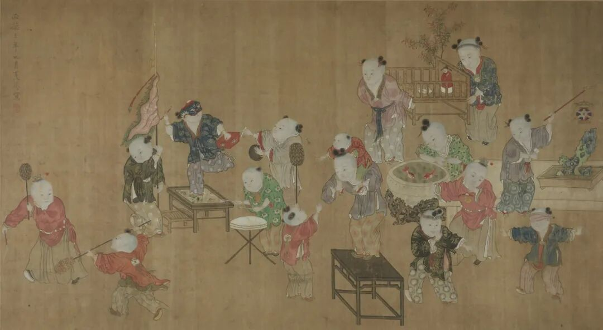
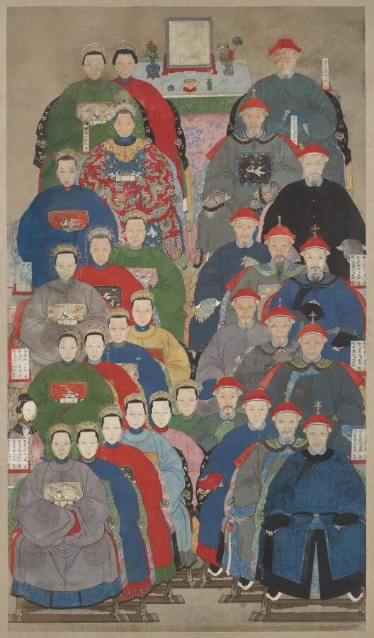

# 穿越到古代，你能生存下去的概率应该比荒野求生还低！
> 💡 备注属性未写入，可能是备注属性名称或者类型被修改了，建议将字段类型设置为 rich_text，可以在小程序-操作-修改文章数据库页面进行调整
> 💡 原文链接:[https://mp.weixin.qq.com/s?__biz=Mzg4NDY0OTk4Mw==&mid=2247484286&idx=3&sn=64f582debf380c7659cf47c3dbb75ecf&chksm=cea2819b2920ad697c5a5586b497efd0229e49f41f6e9bd58a45784836676abff37010b2c9c3#rd](https://mp.weixin.qq.com/s?__biz=Mzg4NDY0OTk4Mw%3D%3D&mid=2247484286&idx=3&sn=64f582debf380c7659cf47c3dbb75ecf&chksm=cea2819b2920ad697c5a5586b497efd0229e49f41f6e9bd58a45784836676abff37010b2c9c3#rd)
宣德四年（公元1429年），楚雄卫死了个军士，叫李志道，上虞人。按兵志的规矩，他名下该由孙宗皋补伍；不巧宗皋已经中了乡试，兵部尚书张本替他说了一句，这才免补。《明史》卷九二兵志记完这件事，跟着下了断语：「如此者绝少。」一个祖上名字在册、本人已经中举的军户之孙，想脱身尚且要碰上官开恩，那么一个没有任何册子记过他的现代人呢？网文的回答通常是科举流或从军流，几年之内功名富贵。可穿越者落地那天，学历栏里填着本科与驾照，在明代官府眼里等于零。宗皋好歹还有父祖的名字挂在楚雄卫的册子上。

画里一院孩子,击鼓的、戴面具扮戏的、驮着弟弟的、围着盆看金鱼的。本文说的就是这样的人家:他们的名字在黄册上,穿越者要活,第一步是成为这样的人家中的一个。
### 落籍：先让官府承认这个人存在
《大明律》卷四户律「脱漏户口」条写得明白：「凡一户全不附籍，有赋役者，家长杖一百；无赋役者，杖八十，附籍当差。」挨了杖还得补籍当差，这条尾巴躲不掉；里长失于取勘，「一户至五户笞五十，每五户加一等，罪止杖一百」，邻甲跟着吃笞。同卷另一条「人户以籍为定」，把籍锁死：「凡军民、驿灶、医卜、工乐诸色人户，并以籍为定。若诈冒脱免、避重就轻者，杖八十。」附《大明令》更斩截：「凡军、民、医匠、阴阳诸色人户，许各以原报抄籍为定，不得妄行变乱。违者治罪，仍从原籍。」什么籍，朝廷说了算，本人没有开口分说之地。
户口的册子也不止一本。《大明会典》载洪武三年（公元1370年）事：「诏本部籍天下户口，及置户帖，各书户之乡贯、丁口名岁，以字号编为勘合，半印钤记，籍藏于部，帖给与民，令有司点闸比对。有不合者，发充军。官吏隐瞒者处斩。」半印勘合，点闸比对，册子藏在户部，纸帖留在民家，官府随时可以当面对牌。军伍的册子更细。《明史》卷九二兵志记洪武二十一年（公元1388年）事：「令卫所核实军伍，有匿己子以养子代者，不许。」又「令卫所著军士姓名、乡贯为籍，具载丁口，以便取补。又置军籍勘合，分给内外军士，遇点阅以为验」。姓名、乡贯、丁口、勘合，四样俱全，点阅之时当面对牌。可见凭空落到明初的那个人，缺的并非某一张纸，他与官府的每一本册子都对不上。
行走一节更紧。《大明会典》卷一六七兵律「私越冒度关津」条：「凡无文引、私度关津者，杖八十。若关不由门、津不由渡而越度者，杖九十。若越度缘边关塞者，杖一百、徒三年。因而出外境者，绞。」同卷「诈冒给路引」条又补一句要紧的：「若军民出百里之外不给引者，军以逃军论，民以私度关津论。」百里是个什么数目？从县城到邻境府城，一日半的路。做小生意的、探亲的、赶考途中的，都得先向官府领一张路引。
这张引子并不好弄。同一律条里，「不应给路引之人而给引，及军诈为民、民诈为军，若冒名告给引，及以所给引转与他人者，并杖八十」；官吏若「不立文案、空押路引、私填与人」，杖一百、徒三年。连住宿与发卖也要过簿子：《大明律》卷四市廛条规定「城市乡村诸色牙行及船埠头，并选有抵业人户充应。官给印信文簿，附写客商船户住贯姓名、路引字号、货物数目，每月赴官查算」。客商住店、卖货，都得在簿子上有一个路引字号。
凭空落到明初的那个人，无籍、无引、无亲族、无产业，律学上他还不存在。他遇到的第一个问题不是如何出人头地，而是如何不被杖八十。至于出路，律文与条例自己留了两条缝。
一条是附籍与寄籍。《大明会典》载正统元年（公元1436年）令：山西、河南、山东、湖广、陕西、南北直隶、保定等府州县「造逃户周知文册，备开逃民乡里姓名、男妇口数、军民匠灶等籍……督令复业」；又「其已成家业愿入籍者，给与户由执照」。正统二年又令各处有司挨勘流民名籍，「排门粉壁，十家编为一甲，互相保识，分属当地里长带管」。寄籍亦有明文：「凡各处招抚外郡人民，在境居住……置有田地已成家业者，许令寄籍，将户丁事产报官，编入图甲，纳粮当差。仍于户下注写原籍贯址……不许止作寄籍名色。」这条路是开着的，只是要用田产与差役去换，册上还得注写原籍；穿越者恰恰没有原籍可注，这一条他走不全。
另一条是入赘与过继。律有「逐婿嫁女」之禁，有乞养异姓义子之条，身份转移的门是开着的，一个三十岁的壮劳力入赘一户务农之家，是成本最低的活路。只是问刑条例随即警告：「军户子孙畏惧军役，另开户籍，或于别府州县入赘、寄籍……及至原籍发册清勾，买嘱原籍官吏、里书人等，捏作丁尽户绝回申者，俱问罪，正犯发烟瘴地……俱充军。」入赘容易，入册难；册上那一行籍，是终身与子孙的账。
养济院一节可以不必想。洪武五年（公元1372年）诏天下郡县立孤老院。《大明令》写得清楚：「凡鳏寡孤独及笃废之人，贫穷无亲属依倚，不能自存，所在官司应收养而不收养者，杖六十」，所给是月米三斗、岁布一匹。同年又令城市乡村里身无残疾而一时缺食的人，由本里里长与同里上中人户资给，成家之后归还所资；见死不救的，查其存粮，除足用之外没入官以济贫乏。连赈济都按里甲点放，无籍的陌生人，连粥厂也挤不进去；反过来，里甲第一日就会来盘问他的来历。
### 痘疹：身体先要过一遍筛
崇祯十六年（公元1643年）的京师，《明史》卷二九五行志只记了八个字的骨架：「京师大疫，自二月至九月止。」计六奇《明季北略》收的当年情形则有血肉：「死亡枕藉，十室九空，甚至户丁尽绝，无人收敛者。」据曹树基《中国人口史》的估算，万历、崇祯两朝腺鼠疫在华北三省夺去的性命以百万计，上限可达千万。穿越者落地若逢着这样的年头，任何见识都帮不上忙。
天花是最贴身的杀手。它不挑身份，也不给讨价还价的余地。
康熙在《庭训格言》里记其事：「国初人多畏出痘，至朕得种痘方，诸子女及尔等子女皆以种痘得无恙。今边外四十九旗及喀尔喀诸藩，俱命种痘，凡所种皆得善愈。尝记初种时，年老人尚以为怪，朕坚意为之，遂全此千万人之生者，岂偶然耶!」所谓种痘方，取痘浆接种，是人痘，不是牛痘。研究清宫医案的人算过一笔账：康熙二十年（公元1681年）春以前出生的皇子，成育者不到一半；种痘在宫中推开以后出生的二十个皇子，成育十七人。研究者自认算法粗糙，账的方向不错：种痘有用。只是有用不等于保险，种痘未出等于白种一场，种坏了反可能把命种进去；道光朝宫中早有种痘之例，皇女仍有十一岁、五岁发痘而殁的。皇家尚且如此，太医尽天下之选，种痘之权尚且不全在医者手里。
现代人在天花面前既无免疫，也无疫苗，能做的只有躲。而天花偏偏拣儿童下手的多，没出过痘的成年人落在清代的城市里，城里隔几年流行一回，他躲不开；唯一的办法是种痘，种痘又赌上一命。痢疾、疟疾、刀口发炎，在没有抗生素的年月同样要命。一场痢疾泻上十天，挑担柴的力气就散了，何况家当。
### 手艺与筋骨：现代人的身体不合格
官话大致可通，写字是另一件事。穿越者习惯简体、横排、标点；场屋要的是毛笔、繁体、竖行、无标点，试卷格式另有功令。《明史》卷七〇选举二记场屋规矩极细：「试卷之首，书三代姓名及其籍贯、年甲、所习本经，所司印记。」「文字中回避御名、庙号，及不许自序门第。」连笔墨砚都要考生自带。提笔忘字、只会圆珠笔与键盘的人，在第一场就写不出合规的卷面。
八股文的难，不在题目而在语气。《明史》说得很直白：「其文略仿宋经义，然代古人语气为之，体用排偶，谓之八股，通谓之制义。」代古人语气，即替孔孟开口说话，须依朱子《集注》立论。初场四书义三道、本经义四道，黎明入场，黄昏纳卷，「未毕者给烛三枝」。今人的读书法教的是分析古人，场屋却要他冒充古人开口，历史系出身的穿越者也不见得能作。
筋骨一节，戚继光在《纪效新书》卷一《束伍篇》里立过标准：「第一，不可用城市油滑之人，但看面目光白、形动伶便者是也。」「第一可用，是乡野老实之人。所谓乡野老实之人者，黑大、粗壮、辛苦，手面皮肉坚实，有土作之色是也。」他把胆量排在武艺与力气之前：「丰大而胆不充，则缓急之际，脂重不能疾趋，反为肉累。」日行不过数千步、握笔远多于握锄、挑不起一担水的现代职员，在这份选兵册上不合格。种田流的穿越者也一样，他认不出麦苗与杂草，扶不起犁，一年节气说不全，头一季就要挨饿。
### 场屋：三代、保结与名额
科举流的第一道绝命符，写在试卷头上。《明史》卷七〇选举二：「试卷之首，书三代姓名及其籍贯、年甲、所习本经，所司印记。」穿越者没有三代可写。这不是隐瞒出身的问题：隐瞒尚可冒籍，凭空捏造便是诈；查出来，按律问罪，保人同坐。

三十个头像分代排开,每人身旁一条榜题,写着称谓名讳官职。乡试试卷头上要写的「三代姓名及其籍贯、年甲」,就是这样的东西,穿越者一样也写不出。
报名一节还要人作保。清制童生应试，取同案五童互结，再由本县廪生保结。《钦定学政全书》雍正十三年（公元1735年）奏准乡试贡监：「俱照例取该地方文结，亲身投递，仍取同考五人互结，方准考试。其新捐贡监，暂听伊等取具同乡京官印结，及五人互结，录科送考。」乾隆元年（公元1736年）又议准：「如有顶冒情弊，将本身及出结、互结之人，一并照例治罪。」互结、保结、印结，一层套一层，结的是身家清白、籍贯有据。穿越者找不到人给他作保，也找不到人同他互结；连报名这一步都迈不出去，谈何应试。
至于资格之外的禁例，《明史》选举二列得清楚：「其学校训导专教生徒，及罢闲官吏、倡优之家与居父母丧者，俱不许入试。」何炳棣考订明清举人、进士的家族背景，累代有功名者占多数，白手起家者虽非绝无，终属少数；至于倡优隶卒之家与各类贱民，则连报名的资格也没有。穿越者若为求生而投身为仆、入乐户、充隶卒，身份便永久地低了一等，子孙的场屋之门就此关闭。
冒籍这笔账要摊开算。出结的是地方官与同乡京官，互结的是同考五人，结状上具名的人，日后都要跟着担罪。寄籍一路又须年久、实有坟庐田产，然后本人或子孙方许入场。代价摆在这里：若走这条路，自己这一世考不成，要等二三十年置下坟与田，再把希望放到下一代身上。
备考的年限也不能不算。四书全经加朱子《集注》，本经一部，须成诵，再练八股笔法，自束发至弱冠方望有成。三十岁的人要学，白天还得应赋役、做工、种地，十年的经史功夫从何而来？场屋一场要写四书义三道、本经义四道，二场试判五条，判语依律意立说，连《大明律》都要熟。蒲松龄自己就是分身无术的样子：既应试，又设馆，又种十亩薄田，一生劈作三处，哪一处也做不成。
《明史》选举二把名额记得明白。洪武三年（公元1370年）开科，顺天与各省贡额各有差，直隶一百人，河南、山东诸省四十人，广西、广东二十五人；洪熙元年（公元1425年）起定额。定额里最见消息的是末梢：云南二十名，嘉靖以后贵州也是二十名，两直隶到庆历启祯年间增至一百三十余名，他省渐增而无出百名者。会试自成化乙未（成化十一年，公元1475年）以后率取三百名，偶因恩诏多五十名或百名，非恒制。清人这边，一次乡试约十六七万人应试，取举人五六千名，会试取进士约三百名。一个普通读书人一辈子碰得上的名额，全国合计不过千把人上下。
蒲松龄是这些名额底下最清楚的样本。顺治十五年（公元1658年）他十九岁，县、府、道三场童子试都取第一，山东学政施闰章赏他「观书如月，运笔成风」；此后五十多年，乡试十次，一次也没中，五十一岁那年的最后一次仍然落榜，中间在缙绅之家做了三十年西宾，靠束脩与十亩薄田过活。

三童戏笔戏砚,上配墨竹,取的是高中吉兆,旧时贴在墙上。本文算的却是另一笔账:中举之前,先要有一本册子记过你的名字。
落第的举人出路如何？《明史》选举二给了三条：「举人、贡生不第、入监而选者，或授小京职，或授府佐及州县正官，或授教职。」做小官、做教官，已是天花板。蒲松龄连这个天花板也没够到，七十二年场屋，补一个岁贡。
### 军籍：逃军四万七千与月粮二斗五升
从军流的起点，在明代不是「投军」，而是入军籍。军籍世袭，《明史》卷九二兵志说得斩截：「户有军籍，必仕至兵部尚书始得除。」又说：「盖终明世，于军籍最严。然弊政渐丛，而扰民日甚。」
逃亡的数字可以先看。兵志：「起吴元年十月，至洪武三年十一月，军士逃亡者四万七千九百余。」吴元年即至正二十七年（公元1367年），洪武三年是1370年，不到三年，逃了四万七千九百余人，平均每天四十余人弃伍。朝廷的对策是清勾：根捕本人，勾补家丁，一人逃了，原籍族里还得派人补上。兵志同卷记洪武初的连坐之法：小旗名下逃了三人便降为军，自总旗以上，俱按逃军多寡夺俸降级，「其从征在外者，罚尤严」。军官的考成里，逃军数目与战功同列。
月粮一节能解释这个数字。洪武三年（公元1370年）定军士月粮：马军米二石，步军总旗一石五斗，小旗一石二斗，军一石，屯田者减半。弘治十六年（公元1503年）以后辽东「斗米值银一钱，军士月粮一石折银二钱五分，止实米二斗五升」。名义上一石，折色到手只剩二斗五升，不到四分之一。一支军队若把士兵喂到四分之一，不到三年逃四万七千人，这笔账不必算第二遍。
洪武二十一年又令卫所把军士的姓名、乡贯、丁口写入册籍，以便取补。逃与补，两头都有册。
万历朝的清勾，数字更其触目。兵志记南京兵部尚书郭应聘之奏：「应勾之军，南直隶至六万六千馀，株连至二三十万人。」给事中徐贞明又言，勾军东南，「每军不下百金，大困东南之民」。一个卫所的缺伍，会沿着黄册追到江南的一族，解送之费每军百金。军籍之网，牵连之广，至此可见。
军籍与场屋之间，也留过一条极窄的缝，就是开头那桩上虞李氏的公案：孙宗皋已中乡试，靠兵部尚书张本一言才免补伍。兵志同卷还记，洪武二十三年曾令应补军役的生员遣归卒業，让读书人先把书读完；可《明史》对宣德那桩案子下的断语是「如此者绝少」。有籍尚且如此，无籍更不必论。
穿越者要从军，先得有一处卫所肯收他入册。戚继光募兵，入伍之前先填腰牌，营伍、住居这些来历先填，再填年貌，再量尺寸、称斤力，最后记疤记，一格填完连人带牌送下一格，填毕方入册。他特别交代，疤记不必真有疤，「纪其难假易辨者填于格空，四五字足矣」。填不出乡贯的人，第一格就过不去。侥幸进了，籍是世袭的，粮有管军官层层经手，逃军数目直接挂在管军官的考成上，至于「必仕至兵部尚书始得除」，这笔账要子孙来还。
### 发明流：禁令先于技术
穿越文最得意的一节是造东西：制火药、炼铁、煮盐、烧玻璃、做肥皂。这些东西的配方，说穿了都不难。难的是配方之外的事：朝廷准不准你造，这是头一桩；市面上有没有你卖货的名分，这是第二桩。
《大明会典》卷一六七有明文：「私自贩卖硫黄五十斤、焰硝一百斤以上者，问罪，硝黄入官。卖与外夷及边海贼寇者……为首者处斩，为从者俱发边卫充军。若合成火药卖与盐徒者，亦问发边卫充军。」硝磺在官禁之列，盐有盐籍，灶户按丁办盐，朝廷设总催督责；军器有军器局与匠户，民间私造有禁；「私出外境及违禁下海」一条，把马牛、军需、铁货、铜钱、缎匹、绸绢、丝绵一并列入出境之禁，犯者杖一百，船车货物入官。
没有路引字号的人，连牙行的簿子都上不了，货卖给谁？肥皂与玻璃纵能仿得，仿不出一个在册的身份。技术是穿越者带来的，禁令与市籍都在朝廷手里，这一节上，史实与网文的分歧最大。
### 答案：概率落在头一个月
宗皋有籍，中了乡试还差点被勾回楚雄卫补伍；蒲松龄有籍，七十二年寒窗，补一个岁贡。穿越者连籍都没有，头一个月能不能被一户良民收留，或入赘，或过继，或寄居佃仆，才是要命的问题，而这几条路，条条要有人肯替他具名作保。侥幸落进一户，痘疹与痢疾还在后头等着他。至于出人头地，科举流几乎不必讨论，三代、籍贯、保结，一样也凑不齐；从军流尚有一线，得先过选兵册上筋骨的标准，军籍一落上，子孙接着当兵。最现实的出路在识字之后做塾师、账房、医户、书手，靠手艺换一口饭。
戚继光那张收兵用的腰牌可以作个收尾。牌上自营伍、住居、年貌直到斤力、疤记，一格不缺，填过缘由还要备填入册。军中的腰牌如此，民间的户帖、黄册如此，一物一格，都是朝廷把一个活人钉在册上的手续。穿越者要活下来，先得让旁人替他填上牌上的字；要出人头地，还得让子孙接着填下去。蒲松龄填了七十二年，才填出一个岁贡生，未来人又凭啥以为能凭借对历史的粗浅了解去超脱一个时代？一个在相对公平环境下都没能出人头地的人，又如何能在吃人不吐骨头的旧社会里异军突起！
### 考证说明
《明史》选举二「回避御名、庙号」句，通行本多作「庙讳」，此处从所见文本照录，义无歧异。「京师大疫，自二月至九月止」见《明史》卷二九五行志崇祯十六年条；「死亡枕藉，十室九空」一段系《明季北略》所记，笔者未见原书，转引自今人辑述，故只作叙述之资，不作档案之凭。《大明律》卷四附《会典》条，所见文本「逃户周知文川」当作「文册」，「原籍贳址」当作「贯址」，「发兖军」当作「充军」，皆形近而讹，正文已正。兵志记洪武初逃军连坐一条，诸本句读小异，故只转述，不直引；同卷「匿已子」之「已」当作「己」，正文已正。辽东月粮折银之数，出今人据方志与档册之统计，非直引律文。蒲松龄补贡之年，旧传多称七十一岁，据其生年崇祯十三年（公元1640年）与康熙五十年（公元1711年）援例补贡推之，当作七十二；乡试次数「十次」出研究者统计，最后一次在康熙二十九年（公元1690年）。清宫皇子种痘前后成育率一节，系研究者据《清宫医案》所作统计，其本人自注算法粗糙，正文已用「据研究」字样。《柳泉蒲先生墓表》原文未见，引文转引自研究者论文，不敢径称原书。
### 来源
1. 《明史》卷七〇选举二、卷九二兵志、卷二九五行志、卷八〇食货四
2. 《大明律》卷四户律·户役、收养孤老诸条及所附《大明令》、《问刑条例》
3. 《大明会典》卷一六七兵律·关津、卷四所附户役诸条
4. 戚继光《纪效新书》卷一《束伍篇》
5. 《圣祖仁皇帝庭训格言》（雍正八年纂，四库本）
6. 《钦定学政全书》卷四十一
7. 计六奇《明季北略》（转引）
8. 张元《柳泉蒲先生墓表》（转引）
9. 曹树基《中国人口史》第四卷
10. 何炳棣《明清社会史论》
