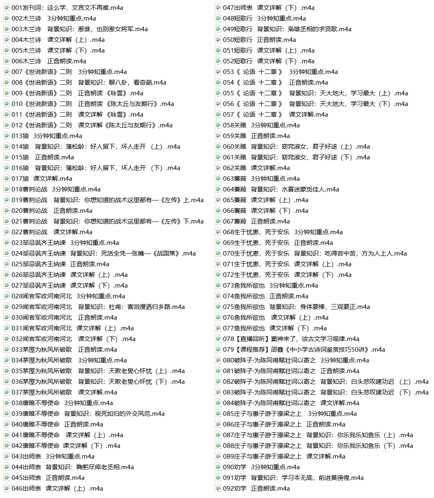
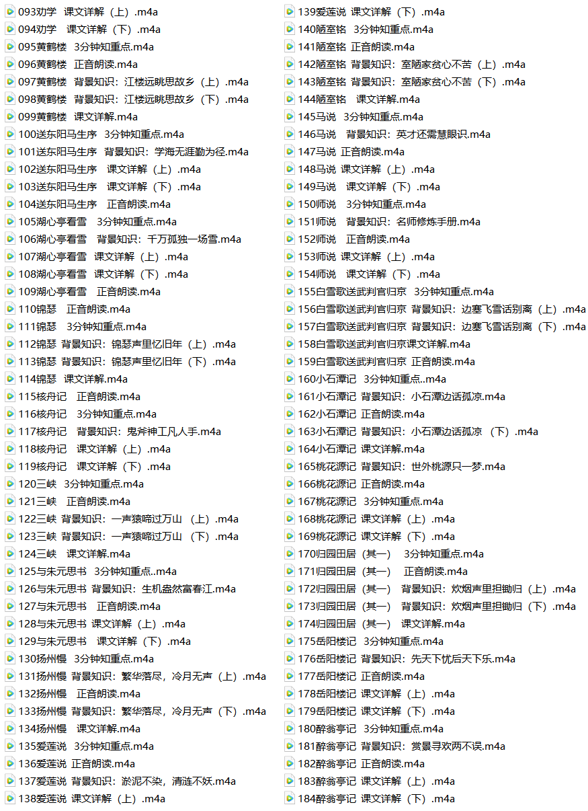

# 窦神的209节经典文言文精讲，让孩子彻底爱上古文！
> 💡 备注属性未写入，可能是备注属性名称或者类型被修改了，建议将字段类型设置为 rich_text，可以在小程序-操作-修改文章数据库页面进行调整
> 💡 原文链接:[https://mp.weixin.qq.com/s?__biz=Mzg2NDU2NTgwNg==&mid=2247503212&idx=7&sn=cf3beb0634bd42f87be8b7c91fed6603&chksm=cfd8dad2a290ed7412d1517e07b6149036820d412998c944d2b31143086ef836d7303296fd0d#rd](https://mp.weixin.qq.com/s?__biz=Mzg2NDU2NTgwNg%3D%3D&mid=2247503212&idx=7&sn=cf3beb0634bd42f87be8b7c91fed6603&chksm=cfd8dad2a290ed7412d1517e07b6149036820d412998c944d2b31143086ef836d7303296fd0d#rd)

古诗、古文难，难就难在，离生活太远，孩子没兴趣。

所以今天给大家找来窦神的209节经典文言文精讲课，讲的都是教材中的古诗文，经典性与考点兼备，有助于为孩子今后的学习考试中打下好的基础。
通过扩充大量知识帮助孩子理解作者、作品，孩子懂得文章来历、妙处，自然会产生兴趣和探究的欲望，再加上窦昕风趣易懂的语言，孩子听得有趣、过瘾。
部分资源目录如下

如果你也觉得这份资源很棒，**右下角点个在看**，然后公众号**回复“领资料”**按提示领取吧！
