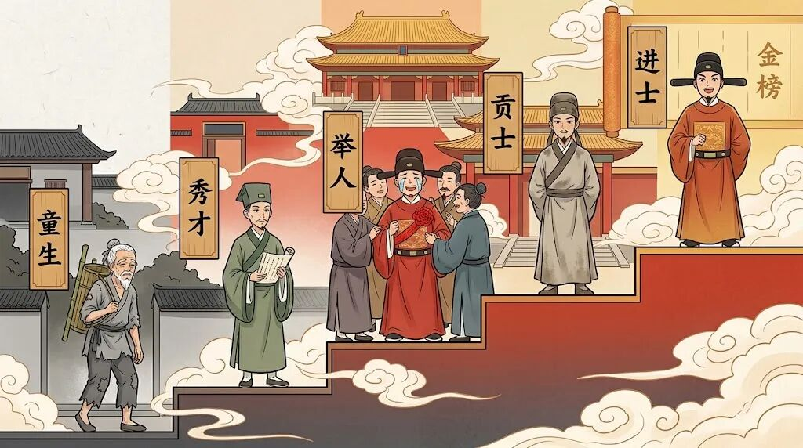
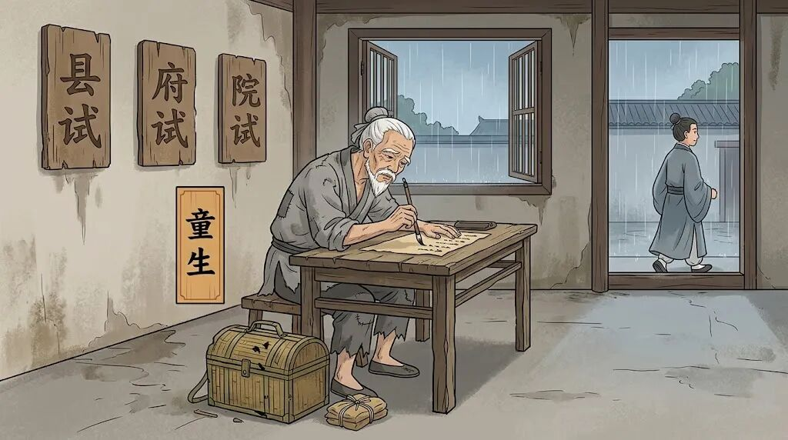
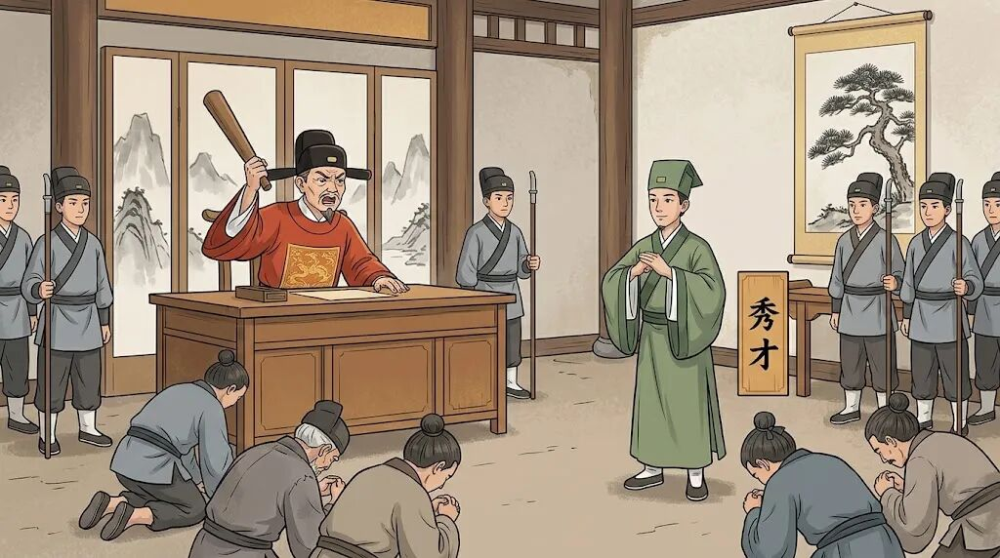
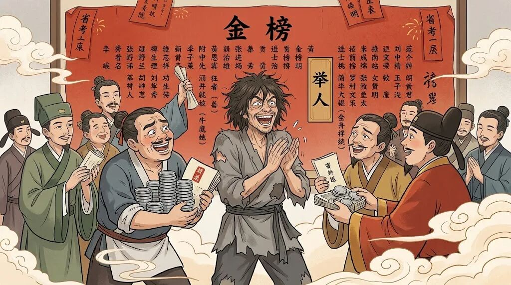
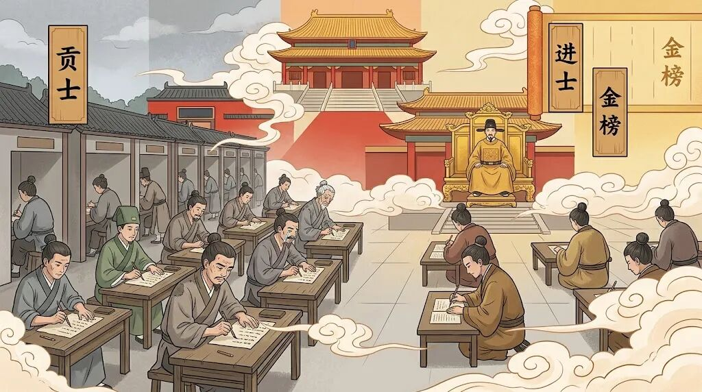
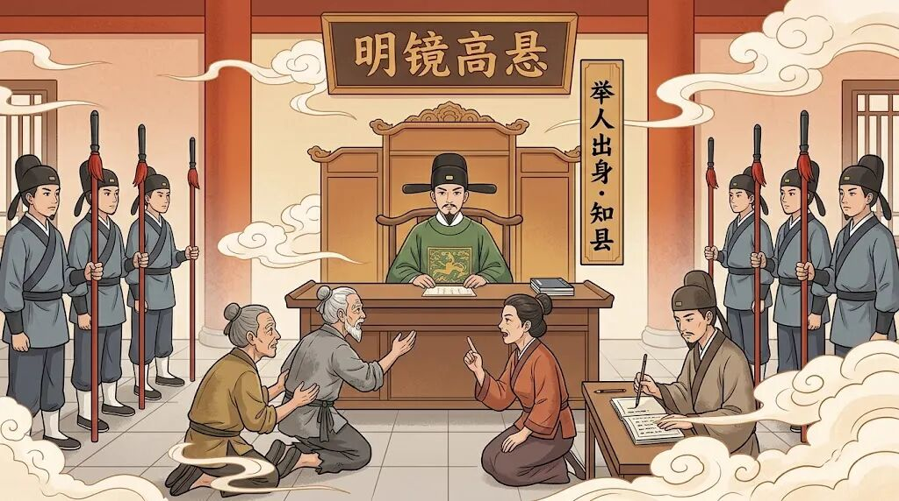
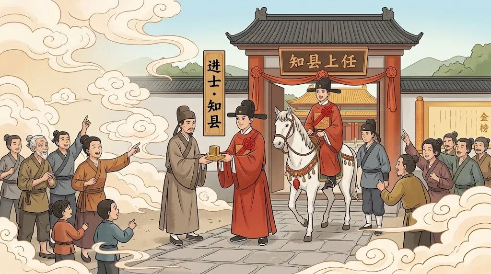
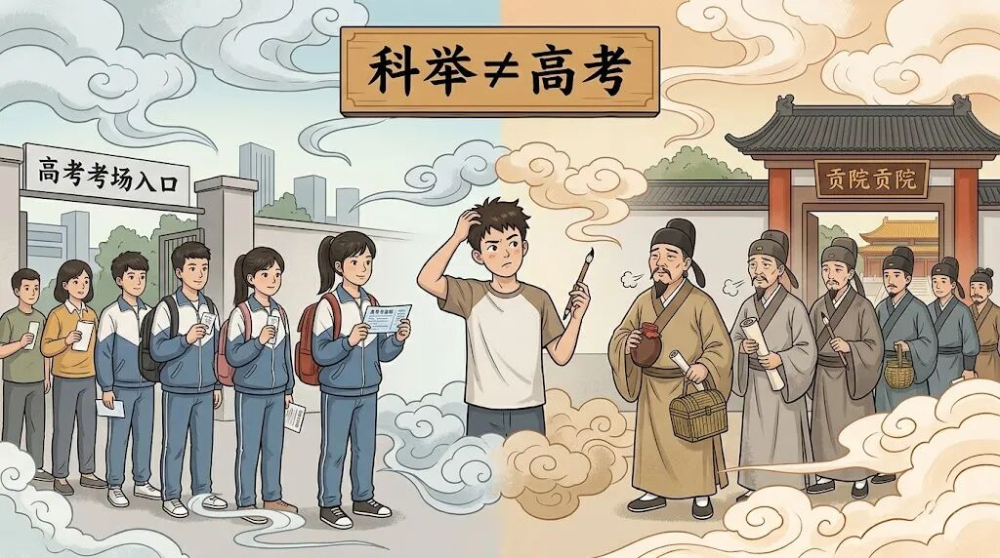

# 童生、秀才、举人、贡士、进士，相当于今天什么级别？哪一级能当县长？
> 💡 备注属性未写入，可能是备注属性名称或者类型被修改了，建议将字段类型设置为 rich_text，可以在小程序-操作-修改文章数据库页面进行调整
> 💡 原文链接:[https://mp.weixin.qq.com/s?__biz=MzYzMzE0OTkxMg==&mid=2247486627&idx=1&sn=d735d03e594aed95a864dd7282dffa6b&chksm=f1e5928688be02583f89a1422cf5a6c0ef487e86404d634b15ced6812bb0bf06347f92717c99#rd](https://mp.weixin.qq.com/s?__biz=MzYzMzE0OTkxMg%3D%3D&mid=2247486627&idx=1&sn=d735d03e594aed95a864dd7282dffa6b&chksm=f1e5928688be02583f89a1422cf5a6c0ef487e86404d634b15ced6812bb0bf06347f92717c99#rd)

很多人一聊科举，就喜欢简单粗暴地搞“学历对标”：秀才等于本科，举人等于硕士，进士等于博士。这话不能说全错，但实在过于粗糙——因为科举从头到尾就是一条选官的路，它不只是考学历，更是考“编制”。
打个不太精确的比方：**秀才相当于拿到了体制内的“准考证”，举人相当于进入了“后备干部库”，**进士才是真正端上铁饭碗、还带级别的那种。

## 先搞清楚这条“晋升路”怎么走
## 
科举的程序，明清两代最为成熟。你可以把它想象成一条不断往上爬的阶梯。
**第一级：童试。** 注意，“童生”不是说你是小孩。**一个读书人，不管你十五岁还是七十岁，只要没通过童试，统统叫“童生”。**《儒林外史》里的范进，从二十岁考到五十四岁，还是个老童生，这在当时一点都不稀奇。**童试本身又分县试、府试、院试三关，过了院试，才算“进学”，成了“生员”，也就是俗称的秀才。**

**秀才最实在的好处是什么呢？免徭役，见县官不用跪，犯了事地方官不能随便打屁股**——得先报告学政，革了你的秀才身份，才能动刑。更关键的是，你有了参加下一级考试的资格。

**第二级：乡试。 乡试三年一次，在省城举行，考中的叫举人。**这一步是质的飞跃——秀才再体面也只是“学生”，举人却是实打实的“功名”。范进中举后为什么高兴得发了疯？因为他老丈人胡屠户前倨后恭，当地乡绅立马送钱送房，一夜之间“斩断穷根”。

**第三级：会试和殿试。举人进京赶考，参加礼部主持的会试，考中者称贡士。贡士再参加皇帝亲自主持的殿试，殿试基本不淘汰，只是排个名次，考完就都是进士了。**

## 相当于今天的什么级别？
## 
先声明一点：任何类比都有“不完善”的地方，只能说是帮忙理解。
**童生，可以理解为还没考上大学的高中自修生**——在读了，但还没有任何被官方认可的身份。**秀才呢，大概相当于“考上了名牌大学本科，同时还拿到了公务员考试的报考资格”。**你能考公了，但还当不了官。
举人，这才是真正的分水岭。**举人已经进入了“候补官员”的序列。用今天的话说，大致相当于“通过了省级选调生考试，进入了后备干部库”**——你有资格被任命为县长或副县长，但什么时候任命、到哪个县去，还得等。
**贡士和进士，那就相当于“中央选调生”了，而且是排名前几十的那种。**进士做官基本没有悬念，区别只在于起点高低。
## 到底哪一级能当县长？
## 
答案很明确：**举人以上就可以当县长，但进士当县长更快、更稳、起点更高。**
先说举人。**举人一般不能立刻授官，得等。清代的规矩是，举人考了三科会试还没中进士，可以参加“大挑”——一种专门给老举人准备的选官考试。**大挑一等，授知县；二等，授教职。也就是说，举人当县长是走的“大挑”这条路，但得熬。海瑞就是典型例子：他三十六岁才中举人，之后两次进京考进士都没中，最后从福建南平的教谕做起，四十五岁才熬成浙江淳安知县。而乾隆年间举人等着铨选知县，有人等了三十年还没轮到。

再说进士。进士就顺畅多了。殿试之后，一甲三名直接进翰林院，二甲三甲分发各部或外放地方，其中相当一部分直接授知县。清代知县的来源中，“正途”出身占七成以上，其中进士占四成多，举人占两成多。换句话说，进士是知县的“主力供应商”。

顺便说一句，知县在明清是正七品，搁今天大致对应正处级——也就是县委书记、县长这个层面。所以古人说“七品芝麻官”，放到今天其实一点也不“芝麻”。
## 别把科举当成高考
## 
最后说一个容易踩的坑。很多人拿高考来类比科举，其实差别很大。高考是升学考试，科举是选官考试。一个现代清北学霸穿越回去，大概率能过童试、中个举人，但想拿状元？**唐宋八大家里没一个中过状元，李白杜甫也没戏。**

科举考的不只是知识，还有八股文的写作范式、对儒家经典的精准把握，以及那么一点运气。由此可知古代状元的含金量有多高了吧？所以短剧里那种一穿越回去就靠着科举一步登天的剧情，看完笑笑就得了，千万别当真。以普通人的知识储备水平，你穿越回去能中个举人，已经是祖坟冒青烟了，更别提成为天子门生，或在朝堂翻云覆雨的权相。
---
为了方便大家及时收到文章推送，可以给账号**星标**☆一下，之后就能在第一时间看到文章啦！
有喜欢看古代奇案或案件解读的，可以关注下面这个账号哦！
**往期热门文章：**
[一口气看完古代的11个社会阶层！在古代，你属于什么身份？](https://mp.weixin.qq.com/s?__biz=MzYzMzE0OTkxMg%3D%3D&mid=2247486533&idx=1&sn=c391b5e2c25dce1565121abb379f9b13&scene=21#wechat_redirect)
[为什么姑父的父是父亲的“父”，而姨夫的夫却是丈夫的“夫”？二者谁更亲？](https://mp.weixin.qq.com/s?__biz=MzYzMzE0OTkxMg%3D%3D&mid=2247486397&idx=1&sn=255c3a25d7d9c87bec6110d33d449734&scene=21#wechat_redirect)
[李白是诗仙，诗圣、诗魔、诗佛、诗鬼、诗豪、诗杰又是谁？一文搞清](https://mp.weixin.qq.com/s?__biz=MzYzMzE0OTkxMg%3D%3D&mid=2247486300&idx=1&sn=f03c1c67a3f85c5bd6700683343b394a&scene=21#wechat_redirect)
[如何分清“狡、猾、诡、诈、奸、佞”六种人，该如何对付他们？](https://mp.weixin.qq.com/s?__biz=MzYzMzE0OTkxMg%3D%3D&mid=2247486184&idx=1&sn=a56b6aa14391e8e38ffdd643aa078ace&scene=21#wechat_redirect)
