# 终于找到一个能学习电脑上万文件的 AI，真的太丝滑了！
> 💡 备注属性未写入，可能是备注属性名称或者类型被修改了，建议将字段类型设置为 rich_text，可以在小程序-操作-修改文章数据库页面进行调整
> 💡 原文链接:[https://mp.weixin.qq.com/s?__biz=MzI3NTkyMjA4NA==&mid=2247525554&idx=1&sn=cf60008cbf66399bbe2b8c6c8703feda&chksm=ea1adf903e8c2518a40aed8c051649675a80bf3b8bf2ab24b980edae6af6cdf15904a05b6a91#rd](https://mp.weixin.qq.com/s?__biz=MzI3NTkyMjA4NA%3D%3D&mid=2247525554&idx=1&sn=cf60008cbf66399bbe2b8c6c8703feda&chksm=ea1adf903e8c2518a40aed8c051649675a80bf3b8bf2ab24b980edae6af6cdf15904a05b6a91#rd)
你好，我是郭震！
今天这篇跟大家汇报下DeepLocals最新V3.5.3升级情况。
可能有朋友第一次看到DeepLocals，简单介绍一句，它是自动学习你电脑文件的AI：

最大特色支持海量文件学习，好几万都可以，比如我已经让DeepLocals学习了我的3万6千+文件：
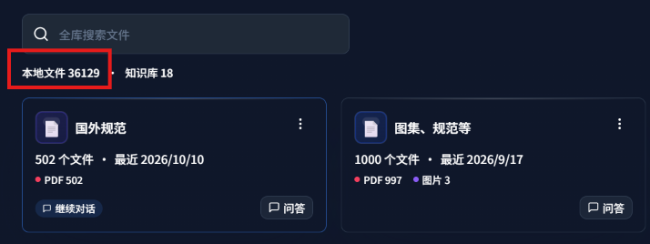
最新版V3.5.3共覆盖69种文件格式，文档，音频，短视频，长视频文件都能查询分析：
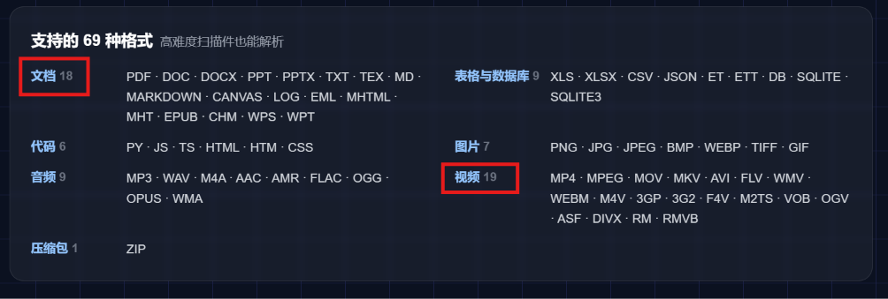
**第一节：为啥要使用知识库DeepLocals？**
电脑用久了，几千、几万个文件堆在一起：合同、论文、会议纪要、扫描件、Excel、录音……真要按意思找答案，哪怕一个数字，往往翻半小时也找不到。
交给通用智能体，从我们电脑找文件，几分钟也无法做到，如下图在Claude中根本无法找到：
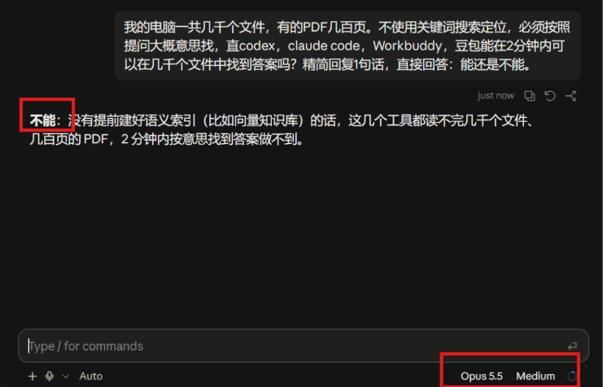
因为通用智能体，没有学习我们的本地文件，所以临时查询，从几百几千文件中临时找，基本不可能。
更头疼的是，你经常根本不记得关键词，只记得"大概是讲某件事的"。传统搜索按关键词匹配，词对不上就什么也搜不到。
因此，最佳解决办法，就是使用RAG（检索知识增强）技术，提前把我们的本地文件学习一遍，只需要一遍，不必重复，**就可以做到不到1分钟从几千文件中找答案**：
以上视频未做任何剪辑处理，所有保持原来初始速度，看到回复响应速度是10秒左右，感兴趣的可以观看下。
DeepLocals和其他知识库，如腾讯IMA，NotebookLM区别主要以下几点：
1）DeepLocals支持上万文件学习，如文章一开始截图所示
2）支持学习格式达69种，包括音视频，扫描件，尤其是排版复杂的扫描件，也能高质量解析，如下表格和图片排版几乎和导入前排版一致：
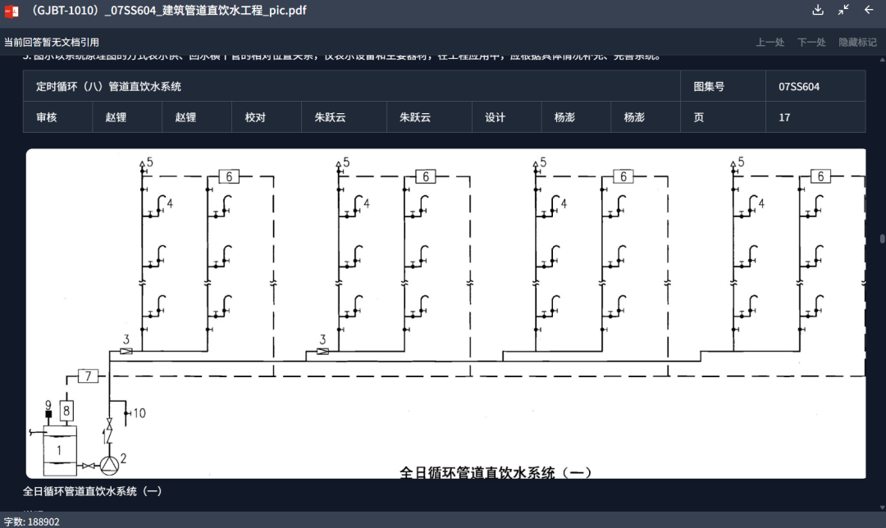
3）支持配备本地大模型，这样可以不限次使用，且回答精度很高：
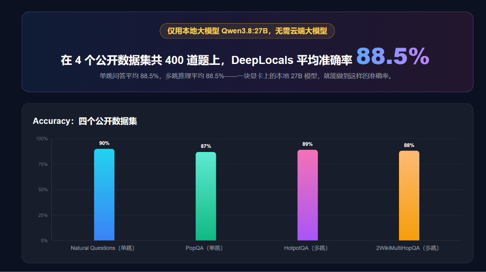
**第二节：本次更新核心功能介绍**
### 1 支持四种提问模式，快速问答，智能体，自由聊天，深度研究：
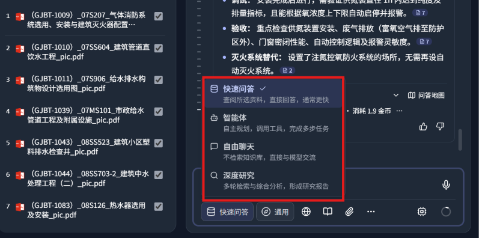
### 2 同时输入栏还多了一个"专业领域"按钮，可以选通用、法律、医学、科研。这次更新我们强化了四大领域的能力：
### 
选好领域后，检索方式、联网搜索和回答结构都会跟着调整。比如法律领域会重点找条款号和案号，科研领域会重点找结论段落。
如下图所示：
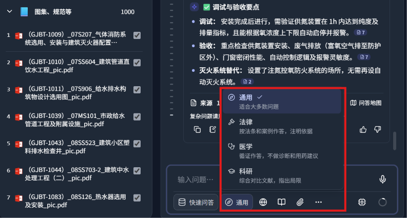
### 3 支持 69 种格式，包括按照语义查询你的长短视频了，如下mp4文件被检索到：
### 
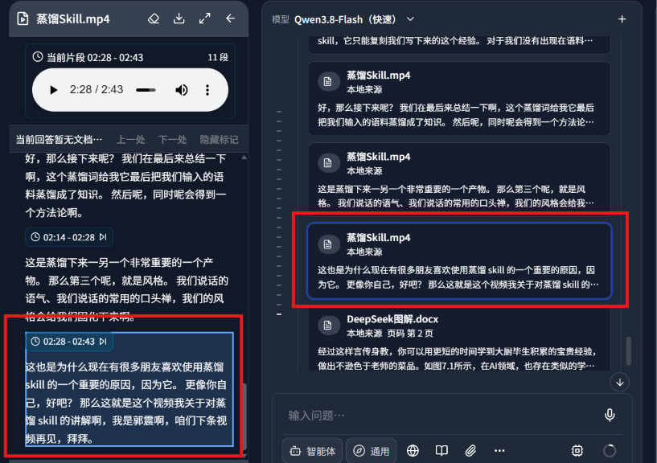
### 4 数据库也能直接问了，DeepLocals 现在可以导入 SQLite 数据库（.db、.sqlite、.sqlite3），而且能和 PDF、Word 一起选中提问。
### 
### 5 强化深度研究能力，长报告的标题、表格和图文排版优化：
### 
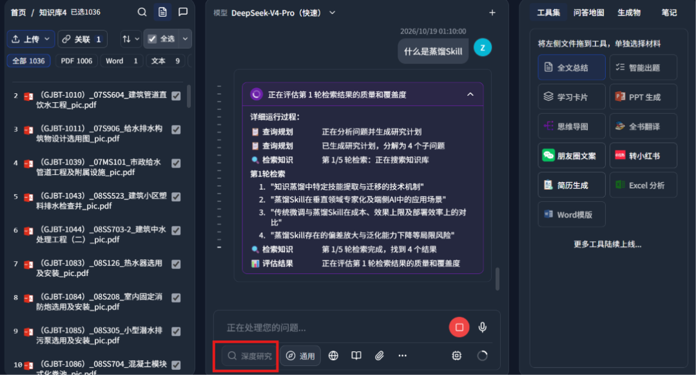
### 
回答截图如下所示：
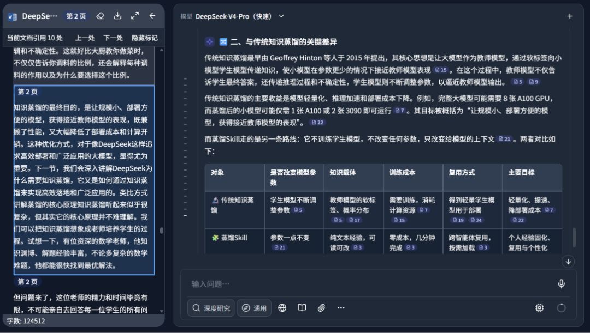
每一句话回答，都有证据，点击引用角标，自动对齐到左侧文本。
6 接入了更多顶尖云端大模型。
### 7 大幅提升了用户使用体验，现在各个界面加载和打开响应时间更快，使用更加丝滑了：
### 
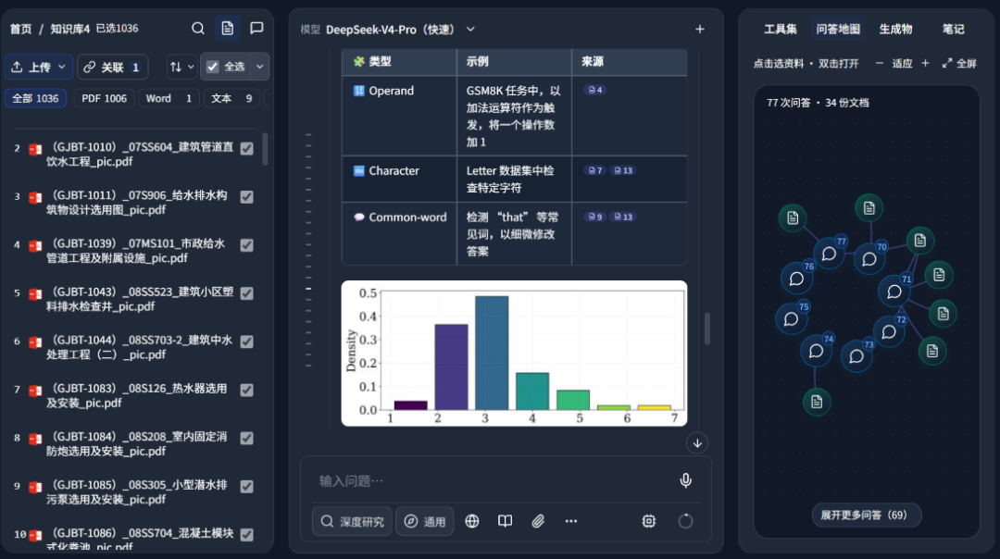
回复中支持图文，右侧看到问答地图。
**第三节：DeepLocals知识库使用逻辑**
DeepLocals使用非常简单，安装后开箱即用。
第一步新建知识卡片：
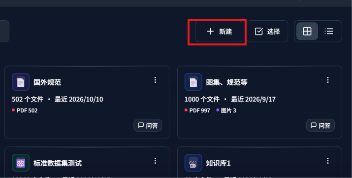
一个知识卡片就是一个知识库
第二步，上传你的电脑里的文件：
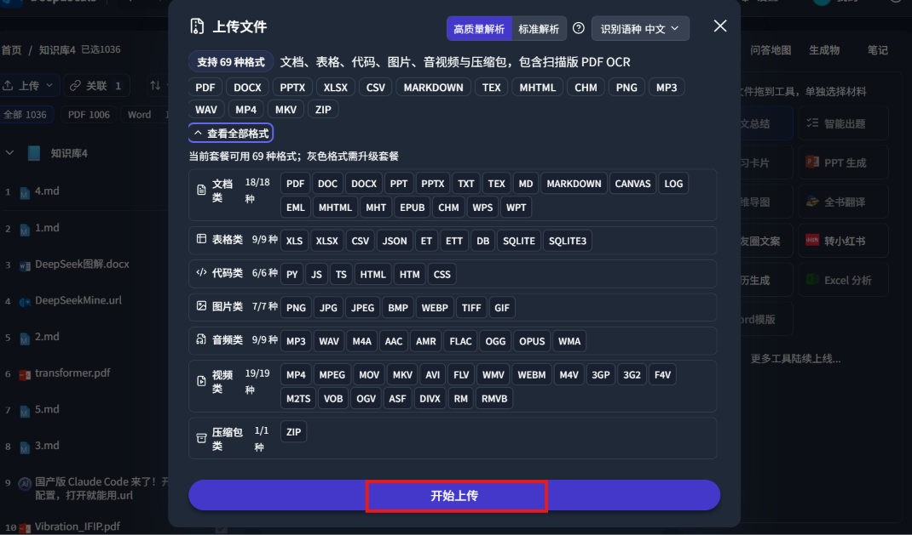
第三步：直接开始问答，它会自动根据你的提问意思，从文件中检索答案，然后总结给你：
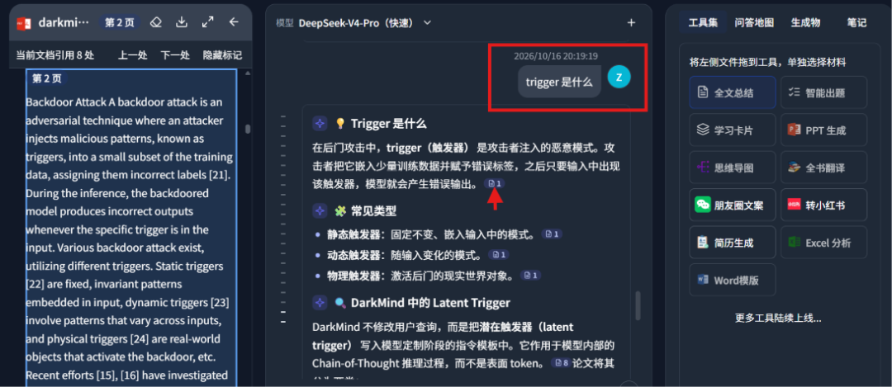
点击引用角标， 自动跳转到对应文本，若左侧高亮部分所示。
对回答还可以添加笔记：
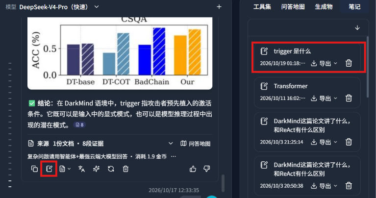
添加笔记后还可以进一步编辑：
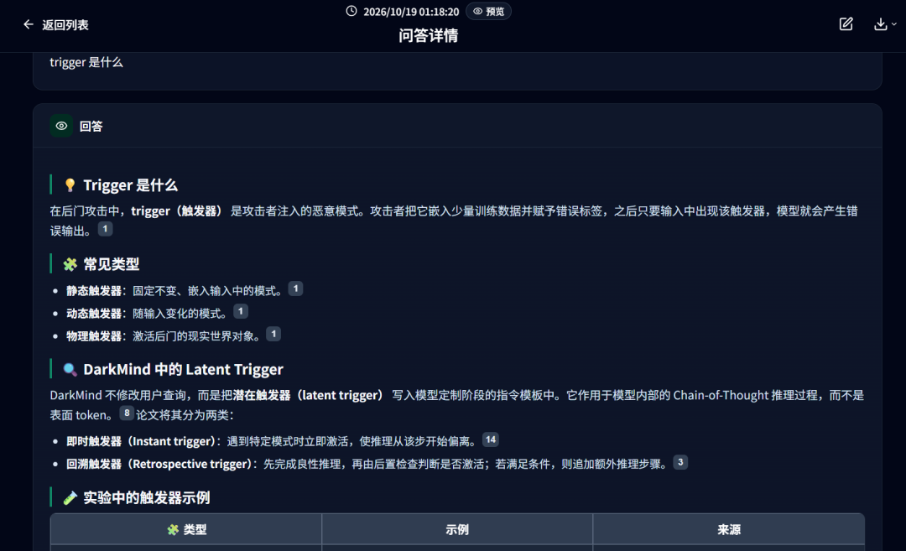
更多功能，大家搜索网页：DeepLocals，安装电脑版，自行去使用。
**最后总结一下**
一句话判断：电脑里资料多、只记得大概意思的人，DeepLocals 值得立刻试一试。
最适合：律师、医生、科研人员、学生，以及经常和合同、报告、录音、数据表打交道的人。
这次 v3.5.3 的重点：数据库能直接问，专业领域更懂行，视频也能检索引用。普通电脑就能用，有显卡还能跑本地大模型。
全文约 1389字，21 图，如果你觉得这篇文章对你有帮助，也欢迎给我一个三连击：点赞、转发和在看；如果可以，再帮我点一个⭐️。谢谢你看到这里，我们下篇再见。

## 摘要

（待补充）

## 我的笔记

（待补充）
