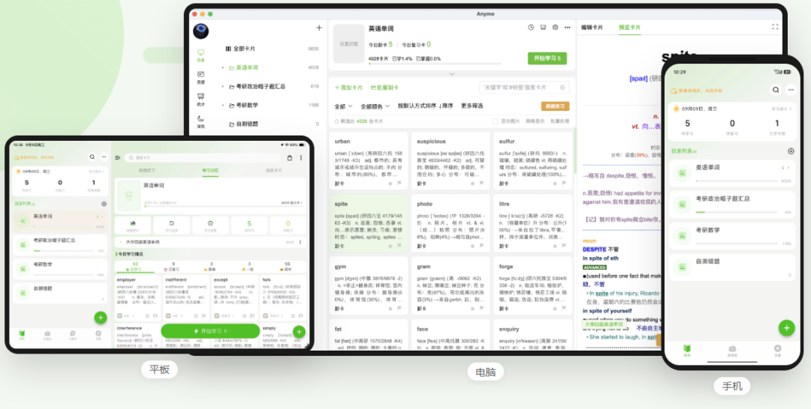

# 终身受用的抗遗忘卡片-Anymo
> 💡 备注属性未写入，可能是备注属性名称或者类型被修改了，建议将字段类型设置为 rich_text，可以在小程序-操作-修改文章数据库页面进行调整
> 💡 原文链接:[https://mp.weixin.qq.com/s?__biz=MzY4NjAzNDUzNw==&mid=2247483667&idx=1&sn=21325c81fca18482a8d9e81d11675cfa&chksm=f209e0eb90ffac4a6488a75e07ecfee6e28d58ad82072fa30a9ac5760cd69247d42a72d78966#rd](https://mp.weixin.qq.com/s?__biz=MzY4NjAzNDUzNw%3D%3D&mid=2247483667&idx=1&sn=21325c81fca18482a8d9e81d11675cfa&chksm=f209e0eb90ffac4a6488a75e07ecfee6e28d58ad82072fa30a9ac5760cd69247d42a72d78966#rd)
基于艾宾浩斯遗忘曲线与Anki SM2，结合多年行业经验自研间隔重复算法。支持正反面卡片、文字挖空、图片遮挡，让每一次复习都刚好发生在快要忘记的时候。
适用于**学生备考、语言学习、职场考证、儿童学习**等多种场景。
**电脑／平板／手机•数据云同步挖空·图片遮挡/网页版**

## 为什么选 Anymo？
界面克制、卡片优先，和你在客户端里看到的风格一致：干净、好读、不打扰。
## 软件功能亮点体现在哪里？
### 1、间隔重复
结合艾宾浩斯曲线与SM2，在快遗忘时提醒你复习，少花时间、多留下记忆。
### 2、多种卡片
正反面、文字挖空、图片遮挡，按内容选择互动方式，不再只是干巴巴地看一遍。
### 3、三端同步
电脑整理、平板浏览、手机复习，学习数据跟着走，打开就能继续当天进度。
### 4、学习统计
待学、待复习、已学天数和掌握进度一眼能看清，今天该做什么不用再犹豫。
### 5、目录与标签
按学科建目录，用标签和颜色标记难点。卡片多了也不乱，找得到、学得完。
### 6、全场景适用
英语单词、考研政数、医学名词或职场考证，它是纸笔一样的基础记忆工具。
需要的小伙伴可以去官网下载体验。
