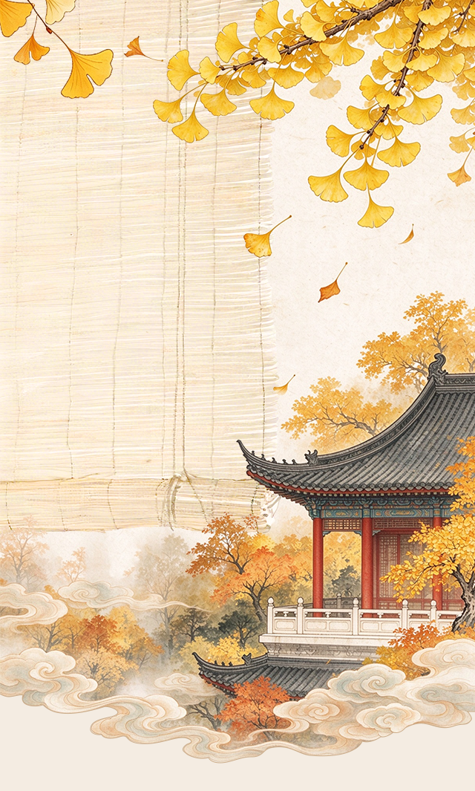

# 经典宋词300首
> 💡 备注属性未写入，可能是备注属性名称或者类型被修改了，建议将字段类型设置为 rich_text，可以在小程序-操作-修改文章数据库页面进行调整
> 💡 原文链接:[https://mp.weixin.qq.com/s?__biz=MzkxNTU2MjI5Nw==&mid=2247501861&idx=1&sn=65bf26f9a28f74c0d5db6f829b2683a0&chksm=c057c69b600b99d0054bd88eacd1baeb34ed01bd349ddd971170ca9fcc073810e1de442b4aac#rd](https://mp.weixin.qq.com/s?__biz=MzkxNTU2MjI5Nw%3D%3D&mid=2247501861&idx=1&sn=65bf26f9a28f74c0d5db6f829b2683a0&chksm=c057c69b600b99d0054bd88eacd1baeb34ed01bd349ddd971170ca9fcc073810e1de442b4aac#rd)

**江城子·乙卯正月二十日夜记梦**
宋·苏轼
十年生死两茫茫，不思量，自难忘。千里孤坟，无处话凄凉。纵使相逢应不识，尘满面，鬓如霜。
夜来幽梦忽还乡，小轩窗，正梳妆。相顾无言，惟有泪千行。料得年年肠断处，明月夜，短松冈。
**定风波·莫听穿林打叶声**
宋·苏轼
三月七日，沙湖道中遇雨，雨具先去，同行皆狼狈，余独不觉。已而遂晴，故作此(词)。
莫听穿林打叶声，何妨吟啸且徐行。竹杖芒鞋轻胜马，谁怕？一蓑烟雨任平生。
料峭春风吹酒醒，微冷，山头斜照却相迎。回首向来萧瑟处，归去，也无风雨也无晴。
**念奴娇·赤壁怀古**
宋·苏轼
大江东去，浪淘尽，千古风流人物。故垒西边，人道是，三国周郎赤壁。乱石穿空，惊涛拍岸，卷起千堆雪。江山如画，一时多少豪杰。
遥想公瑾当年，小乔初嫁了，雄姿英发。羽扇纶巾，谈笑间，樯橹灰飞烟灭。故国神游，多情应笑我，早生华发。人生如梦，一尊还酹江月。
**水调歌头·明月几时有**
宋·苏轼
丙辰中秋，欢饮达旦，大醉，作此篇，兼怀子由。
明月几时有？把酒问青天。不知天上宫阙，今夕是何年。我欲乘风归去，又恐琼楼玉宇，高处不胜寒。起舞弄清影，何似在人间。
转朱阁，低绮户，照无眠。不应有恨，何事长向别时圆？人有悲欢离合，月有阴晴圆缺，此事古难全。但愿人长久，千里共婵娟。
**江城子·密州出猎**
宋·苏轼
老夫聊发少年狂，左牵黄，右擎苍，锦帽貂裘，千骑卷平冈。为报倾城随太守，亲射虎，看孙郎。
酒酣胸胆尚开张。鬓微霜，又何妨！持节云中，何日遣冯唐？会挽雕弓如满月，西北望，射天狼。
**蝶恋花·春景**
宋·苏轼
花褪残红青杏小，燕子飞时，绿水人家绕。枝上柳绵吹又少。天涯何处无芳草。
墙里秋千墙外道，墙外行人，墙里佳人笑。笑渐不闻声渐悄。多情却被无情恼。
**望江南·超然台作**
宋·苏轼
春未老，风细柳斜斜。试上超然台上看，半壕春水一城花。烟雨暗千家。
寒食后，酒醒却咨嗟。休对故人思故国，且将新火试新茶。诗酒趁年华。
**临江仙·送钱穆父**
宋·苏轼
一别都门三改火，天涯踏尽红尘。依然一笑作春温。无波真古井，有节是秋筠。
惆怅孤帆连夜发，送行淡月微云。尊前不用翠眉颦。人生如逆旅，我亦是行人。
**卜算子·黄州定慧院寓居作**
宋·苏轼
缺月挂疏桐，漏断人初静。谁见幽人独往来，缥缈孤鸿影。
惊起却回头，有恨无人省。拣尽寒枝不肯栖，寂寞沙洲冷。
**西江月·中秋和子由**
宋·苏轼
世事一场大梦，人生几度秋凉？夜来风叶已鸣廊。看取眉头鬓上。
酒贱常愁客少，月明多被云妨。中秋谁与共孤光。把盏凄然北望。
**临江仙·夜归临皋**
宋·苏轼
夜饮东坡醒复醉，归来仿佛三更。家童鼻息已雷鸣。敲门都不应，倚杖听江声。
长恨此身非我有，何时忘却营营。夜阑风静縠纹平。小舟从此逝，江海寄余生。
**浣溪沙·游蕲水清泉寺**
宋·苏轼
游蕲水清泉寺，寺临兰溪，溪水西流。
山下兰芽短浸溪，松间沙路净无泥，萧萧暮雨子规啼。
谁道人生无再少？门前流水尚能西！休将白发唱黄鸡。
**定风波·南海归赠王定国侍人寓娘**
宋·苏轼
王定国歌儿曰柔奴，姓宇文氏，眉目娟丽，善应对，家世住京师。定国南迁归，余问柔：“广南风土， 应是不好？”柔对曰：“此心安处，便是吾乡。”因为缀词云。
常羡人间琢玉郎，天应乞与点酥娘。尽道清歌传皓齿，风起，雪飞炎海变清凉。
万里归来颜愈少。微笑，笑时犹带岭梅香。试问岭南应不好，却道：此心安处是吾乡。
**行香子·述怀**
宋·苏轼
清夜无尘，月色如银。酒斟时、须满十分。浮名浮利，虚苦劳神。叹隙中驹，石中火，梦中身。
虽抱文章，开口谁亲。且陶陶、乐尽天真。几时归去，作个闲人。对一张琴，一壶酒，一溪云。
**浣溪沙·细雨斜风作晓寒**
宋·苏轼
元丰七年十二月二十四日，从泗州刘倩叔游南山
细雨斜风作晓寒，淡烟疏柳媚晴滩。入淮清洛渐漫漫。
雪沫乳花浮午盏，蓼茸蒿笋试春盘。人间有味是清欢。
**水龙吟·次韵章质夫杨花词**
宋·苏轼
似花还似非花，也无人惜从教坠。抛家傍路，思量却是，无情有思。萦损柔肠，困酣娇眼，欲开还闭。梦随风万里，寻郎去处，又还被、莺呼起。
不恨此花飞尽，恨西园、落红难缀。晓来雨过，遗踪何在？一池萍碎。春色三分，二分尘土，一分流水。细看来、不是杨花，点点是离人泪。
**水调歌头·黄州快哉亭赠张偓佺**
宋·苏轼
落日绣帘卷，亭下水连空。知君为我新作，窗户湿青红。长记平山堂上，欹枕江南烟雨，杳杳没孤鸿。认得醉翁语，山色有无中。
一千顷，都镜净，倒碧峰。忽然浪起，掀舞一叶白头翁。堪笑兰台公子，未解庄生天籁，刚道有雌雄。一点浩然气，千里快哉风。
**行香子·过七里濑**
宋·苏轼
一叶舟轻，双桨鸿惊。水天清、影湛波平。鱼翻藻鉴，鹭点烟汀。过沙溪急，霜溪冷，月溪明。
重重似画，曲曲如屏。算当年、虚老严陵。君臣一梦，今古空名。但远山长，云山乱，晓山青。
**鹧鸪天·林断山明竹隐墙**
宋·苏轼
林断山明竹隐墙。乱蝉衰草小池塘。翻空白鸟时时见，照水红蕖细细香。
村舍外，古城旁。杖藜徐步转斜阳。殷勤昨夜三更雨，又得浮生一日凉。
**满庭芳·蜗角虚名**
宋·苏轼
蜗角虚名，蝇头微利，算来著甚干忙。事皆前定，谁弱又谁强。且趁闲身未老，尽放我、些子疏狂。百年里，浑教是醉，三万六千场。
思量。能几许，忧愁风雨，一半相妨，又何须抵死，说短论长。幸对清风皓月，苔茵展、云幕高张。江南好，千钟美酒，一曲满庭芳。
**西江月·平山堂**
宋·苏轼
三过平山堂下，半生弹指声中。十年不见老仙翁，壁上龙蛇飞动。
欲吊文章太守，仍歌杨柳春风。休言万事转头空，未转头时皆梦。
**行香子·秋与**
宋·苏轼
昨夜霜风，先入梧桐。浑无处、回避衰容。问公何事，不语书空。但一回醉，一回病，一回慵。
朝来庭下，光阴如箭，似无言、有意伤侬。都将万事，付与千钟。任酒花白，眼花乱，烛花红。
**南乡子·和杨元素时移守密州**
宋·苏轼
东武望余杭，云海天涯两杳茫。何日功成名遂了，还乡，醉笑陪公三万场。
不用诉离觞，痛饮从来别有肠。今夜送归灯火冷，河塘，堕泪羊公却姓杨。
**点绛唇·闲倚胡床**
宋·苏轼
闲倚胡床，庾公楼外峰千朵。与谁同坐，明月清风我。
别乘一来，有唱应须和。还知么，自从添个，风月平分破。
**菩萨蛮·回文夏闺怨**
宋·苏轼
柳庭风静人眠昼，昼眠人静风庭柳。香汗薄衫凉，凉衫薄汗香。
手红冰碗藕，藕碗冰红手。郎笑藕丝长，长丝藕笑郎。
**浣溪沙·簌簌衣巾落枣花**
宋·苏轼
簌簌衣巾落枣花，村南村北响缲车，牛衣古柳卖黄瓜。
酒困路长惟欲睡，日高人渴漫思茶，敲门试问野人家。
**念奴娇·中秋**
宋·苏轼
凭高眺远，见长空万里，云无留迹。桂魄飞来，光射处，冷浸一天秋碧。玉宇琼楼，乘鸾来去，人在清凉国。江山如画，望中烟树历历。
我醉拍手狂歌，举杯邀月，对影成三客。起舞徘徊风露下，今夕不知何夕？便欲乘风，翻然归去，何用骑鹏翼。水晶宫里，一声吹断横笛。
**沁园春·孤馆灯青**
宋·苏轼
赴密州，早行，马上寄子由。
孤馆灯青，野店鸡号，旅枕梦残。渐月华收练，晨霜耿耿；云山摛锦，朝露漙漙。世路无穷，劳生有限，似此区区长鲜欢。微吟罢，凭征鞍无语，往事千端。
当时共客长安，似二陆初来俱少年。有笔头千字，胸中万卷；致君尧舜，此事何难？用舍由时，行藏在我，袖手何妨闲处看。身长健，但优游卒岁，且斗尊前。
**西江月·顷在黄州**
宋·苏轼
顷在黄州，春夜行蕲水中，过酒家饮，酒醉，乘月至一溪桥上，解鞍曲肱，醉卧少休。及觉已晓，乱山攒拥，流水锵然，疑非尘世也。书此语桥柱上。
照野弥弥浅浪，横空隐隐层霄。障泥未解玉骢骄，我欲醉眠芳草。
可惜一溪风月，莫教踏碎琼瑶。解鞍欹枕绿杨桥，杜宇一声春晓。
**南乡子·重九涵辉楼呈徐君猷**
宋·苏轼
霜降水痕收，浅碧鳞鳞露远洲。酒力渐消风力软，飕飕，破帽多情却恋头。
佳节若为酬，但把清尊断送秋。万事到头都是梦，休休，明日黄花蝶也愁。
**永遇乐·彭城夜宿燕子楼梦盼盼因作此词**
宋·苏轼
彭城夜宿燕子楼，梦盼盼，因作此词。
明月如霜，好风如水，清景无限。曲港跳鱼，圆荷泻露，寂寞无人见。紞如三鼓，铿然一叶，黯黯梦云惊断。夜茫茫，重寻无处，觉来小园行遍。
天涯倦客，山中归路，望断故园心眼。燕子楼空，佳人何在，空锁楼中燕。古今如梦，何曾梦觉，但有旧欢新怨。异时对，黄楼夜景，为余浩叹。
**阮郎归·初夏**
宋·苏轼
绿槐高柳咽新蝉，薰风初入弦。碧纱窗下水沉烟，棋声惊昼眠。
微雨过，小荷翻，榴花开欲然。玉盆纤手弄清泉，琼珠碎却圆。
**西江月·梅花**
宋·苏轼
玉骨那愁瘴雾，冰姿自有仙风。海仙时遣探芳丛，倒挂绿毛么凤。
素面翻嫌粉涴，洗妆不褪唇红。高情已逐晓云空，不与梨花同梦。
**浣溪沙·端午**
宋·苏轼
轻汗微微透碧纨，明朝端午浴芳兰，流香涨腻满晴川。
彩线轻缠红玉臂，小符斜挂绿云鬟，佳人相见一千年。
**浣溪沙·渔父**
宋·苏轼
西塞山边白鹭飞，散花洲外片帆微，桃花流水鳜鱼肥。
自庇一身青箬笠，相随到处绿蓑衣，斜风细雨不须归。
**减字木兰花·莺初解语**
宋·苏轼
莺初解语，最是一年春好处。微雨如酥，草色遥看近却无。
休辞醉倒，花不看开人易老。莫待春回，颠倒红英间绿苔。
**浣溪沙·荷花**
宋·苏轼
四面垂杨十里荷，问云何处最花多，画楼南畔夕阳和。
天气乍凉人寂寞，光阴须得酒消磨，且来花里听笙歌。
**贺新郎·夏景**
宋·苏轼
乳燕飞华屋。悄无人、桐阴转午，晚凉新浴。手弄生绡白团扇，扇手一时似玉。渐困倚、孤眠清熟。帘外谁来推绣户，枉教人、梦断瑶台曲。又却是，风敲竹。
石榴半吐红巾蹙。待浮花、浪蕊都尽，伴君幽独。秾艳一枝细看取，芳心千重似束。又恐被、秋风惊绿。若待得君来向此，花前对酒不忍触。共粉泪，两簌簌。
**菩萨蛮·回文秋闺怨**
宋·苏轼
井桐双照新妆冷，冷妆新照双桐井。羞对井花愁，愁花井对羞。
影孤怜夜永，永夜怜孤影。楼上不宜秋，秋宜不上楼。
**南乡子·自述**
宋·苏轼
凉簟碧纱厨，一枕清风昼睡馀。睡听晚衙无一事，徐徐，读尽床头几卷书。
搔首赋归欤，自觉功名懒更疏。若问使君才与术，何如，占得人间一味愚。
**减字木兰花·春月**
宋·苏轼
二月十五夜，与赵德麟小酌聚星堂
春庭月午，摇荡香醪光欲舞。步转回廊，半落梅花婉娩香。
轻云薄雾，总是少年行乐处。不似秋光，只与离人照断肠。
**定风波·重阳**
宋·苏轼
与客携壶上翠微，江涵秋影雁初飞。尘世难逢开口笑，年少，菊花须插满头归。
酩酊但酬佳节了，云峤，登临不用怨斜晖。古往今来谁不老，多少，牛山何必更沾衣。
**菩萨蛮·回文冬闺怨**
宋·苏轼
雪花飞暖融香颊，颊香融暖飞花雪。欺雪任单衣，衣单任雪欺。
别时梅子结，结子梅时别。归不恨开迟，迟开恨不归。
**菩萨蛮·回文**
宋·苏轼
峤南江浅红梅小，小梅红浅江南峤。窥我向疏篱，篱疏向我窥。
老人行即到，到即行人老。离别惜残枝，枝残惜别离。
**菩萨蛮·回文**
宋·苏轼
落花闲院春衫薄，薄衫春院闲花落。迟日恨依依，依依恨日迟。
梦回莺舌弄，弄舌莺回梦。邮便问人羞，羞人问便邮。
**青玉案·元夕**
宋·辛弃疾
东风夜放花千树，更吹落、星如雨。宝马雕车香满路。凤箫声动，玉壶光转，一夜鱼龙舞。
蛾儿雪柳黄金缕，笑语盈盈暗香去。众里寻他千百度。蓦然回首，那人却在，灯火阑珊处。
**永遇乐·京口北固亭怀古**
宋·辛弃疾
千古江山，英雄无觅，孙仲谋处。舞榭歌台，风流总被，雨打风吹去。斜阳草树，寻常巷陌，人道寄奴曾住。想当年，金戈铁马，气吞万里如虎。
元嘉草草，封狼居胥，赢得仓皇北顾。四十三年，望中犹记，烽火扬州路。可堪回首，佛狸祠下，一片神鸦社鼓。凭谁问：廉颇老矣，尚能饭否？
**破阵子·为陈同甫赋壮词以寄之**
宋·辛弃疾
醉里挑灯看剑，梦回吹角连营。八百里分麾下炙，五十弦翻塞外声，沙场秋点兵。
马作的卢飞快，弓如霹雳弦惊。了却君王天下事，赢得生前身后名。可怜白发生！
**丑奴儿·书博山道中壁**
宋·辛弃疾
少年不识愁滋味，爱上层楼。爱上层楼，为赋新词强说愁。
而今识尽愁滋味，欲说还休。欲说还休，却道“天凉好个秋”！
**西江月·夜行黄沙道中**
宋·辛弃疾
明月别枝惊鹊，清风半夜鸣蝉。稻花香里说丰年，听取蛙声一片。
七八个星天外，两三点雨山前。旧时茅店社林边，路转溪桥忽见。
**水龙吟·登建康赏心亭**
宋·辛弃疾
楚天千里清秋，水随天去秋无际。遥岑远目，献愁供恨，玉簪螺髻。落日楼头，断鸿声里，江南游子。把吴钩看了，栏杆拍遍，无人会，登临意。
休说鲈鱼堪脍，尽西风，季鹰归未？求田问舍，怕应羞见，刘郎才气。可惜流年，忧愁风雨，树犹如此！倩何人唤取，红巾翠袖，揾英雄泪！
**南乡子·登京口北固亭有怀**
宋·辛弃疾
何处望神州？满眼风光北固楼。千古兴亡多少事？悠悠，不尽长江滚滚流。
年少万兜鍪，坐断东南战未休。天下英雄谁敌手？曹刘，生子当如孙仲谋。
**菩萨蛮·书江西造口壁**
宋·辛弃疾
郁孤台下清江水，中间多少行人泪。西北望长安，可怜无数山。
青山遮不住，毕竟东流去。江晚正愁余，山深闻鹧鸪。
**贺新郎·甚矣吾衰矣**
宋·辛弃疾
邑中园亭，仆皆为赋此词。一日，独坐停云，水声山色，竞来相娱。意溪山欲援例者，遂作数语，庶几仿佛渊明思亲友之意云。
甚矣吾衰矣。怅平生、交游零落，只今余几！白发空垂三千丈，一笑人间万事。问何物、能令公喜？我见青山多妩媚，料青山见我应如是。情与貌，略相似。
一尊搔首东窗里。想渊明、停云诗就，此时风味。江左沉酣求名者，岂识浊醪妙理。回首叫、云飞风起。不恨古人吾不见，恨古人不见吾狂耳。知我者，二三子。
**清平乐·村居**
宋·辛弃疾
茅檐低小，溪上青青草。醉里吴音相媚好，白发谁家翁媪？
大儿锄豆溪东，中儿正织鸡笼。最喜小儿亡赖，溪头卧剥莲蓬。
**鹧鸪天·代人赋**
宋·辛弃疾
晚日寒鸦一片愁，柳塘新绿却温柔。若教眼底无离恨，不信人间有白头。
肠已断，泪难收，相思重上小红楼。情知已被山遮断，频倚阑干不自由。
**摸鱼儿·更能消几番风雨**
宋·辛弃疾
淳熙己亥，自湖北漕移湖南，同官王正之置酒小山亭，为赋。
更能消、几番风雨，匆匆春又归去。惜春长怕花开早，何况落红无数。春且住，见说道、天涯芳草无归路。怨春不语。算只有殷勤，画檐蛛网，尽日惹飞絮。
长门事，准拟佳期又误。蛾眉曾有人妒。千金纵买相如赋，脉脉此情谁诉？君莫舞，君不见、玉环飞燕皆尘土！闲愁最苦！休去倚危栏，斜阳正在，烟柳断肠处。
**太常引·建康中秋夜为吕叔潜赋**
宋·辛弃疾
一轮秋影转金波，飞镜又重磨。把酒问姮娥：被白发，欺人奈何？
乘风好去，长空万里，直下看山河。斫去桂婆娑，人道是，清光更多。
**鹧鸪天·送人**
宋·辛弃疾
唱彻《阳关》泪未干，功名馀事且加餐。浮天水送无穷树，带雨云埋一半山。
今古恨，几千般，只应离合是悲欢？江头未是风波恶，别有人间行路难！
**鹧鸪天·送廓之秋试**
宋·辛弃疾
白苎新袍入嫩凉，春蚕食叶响回廊。禹门已准桃花浪，月殿先收桂子香。
鹏北海，凤朝阳，又携书剑路茫茫。明年此日青云上，却笑人间举子忙。
**贺新郎·同父见和再用韵答之**
宋·辛弃疾
老大那堪说。似而今、元龙臭味，孟公瓜葛。我病君来高歌饮，惊散楼头飞雪。笑富贵千钧如发。硬语盘空谁来听？记当时、只有西窗月。重进酒，换鸣瑟。
事无两样人心别。问渠侬：神州毕竟，几番离合？汗血盐车无人顾，千里空收骏骨。正目断关河路绝。我最怜君中宵舞，道男儿到死心如铁。看试手，补天裂。
**水调歌头·和马叔度游月波楼**
宋·辛弃疾
客子久不到，好景为君留。西楼着意吟赏，何必问更筹？唤起一天明月，照我满怀冰雪，浩荡百川流。鲸饮未吞海，剑气已横秋。
野光浮，天宇迥，物华幽。中州遗恨，不知今夜几人愁？谁念英雄老矣？不道功名蕞尔，决策尚悠悠。此事费分说，来日且扶头！
**西江月·遣兴**
宋·辛弃疾
醉里且贪欢笑，要愁那得工夫。近来始觉古人书，信著全无是处。
昨夜松边醉倒，问松我醉何如。只疑松动要来扶，以手推松曰“去！”
**一剪梅·中秋无月**
宋·辛弃疾
忆对中秋丹桂丛，花在杯中，月在杯中。今宵楼上一尊同，云湿纱栊，雨湿纱栊。
浑欲乘风问化工，路也难通，信也难通。满堂唯有烛花红，杯且从容，歌且从容。
**贺新郎·别茂嘉十二弟**
宋·辛弃疾
绿树听鹈鴂。更那堪、鹧鸪声住，杜鹃声切。啼到春归无寻处，苦恨芳菲都歇。算未抵、人间离别。马上琵琶关塞黑，更长门、翠辇辞金阙。看燕燕，送归妾。
将军百战身名裂。向河梁、回头万里，故人长绝。易水萧萧西风冷，满座衣冠似雪。正壮士、悲歌未彻。啼鸟还知如许恨，料不啼清泪长啼血。谁共我，醉明月。
**鹧鸪天·有客慨然谈功名因追念少年时事戏作**
宋·辛弃疾
壮岁旌旗拥万夫，锦襜突骑渡江初。燕兵夜娖银胡䩮，汉箭朝飞金仆姑。
追往事，叹今吾，春风不染白髭须。却将万字平戎策，换得东家种树书。
**水调歌头·壬子三山被召陈端仁给事饮饯席上作**
宋·辛弃疾
长恨复长恨，裁作短歌行。何人为我楚舞，听我楚狂声？余既滋兰九畹，又树蕙之百亩，秋菊更餐英。门外沧浪水，可以濯吾缨。
一杯酒，问何似，身后名？人间万事，毫发常重泰山轻。悲莫悲生离别，乐莫乐新相识，儿女古今情。富贵非吾事，归与白鸥盟。
**一剪梅·游蒋山呈叶丞相**
宋·辛弃疾
独立苍茫醉不归，日暮天寒，归去来兮。探梅踏雪几何时。今我来思，杨柳依依。
白石冈头曲岸西，一片闲愁，芳草萋萋。多情山鸟不须啼。桃李无言，下自成蹊。
**水龙吟·过南剑双溪楼**
宋·辛弃疾
举头西北浮云，倚天万里须长剑。人言此地，夜深长见，斗牛光焰。我觉山高，潭空水冷，月明星淡。待燃犀下看，凭栏却怕，风雷怒，鱼龙惨。
峡束苍江对起，过危楼，欲飞还敛。元龙老矣！不妨高卧，冰壶凉簟。千古兴亡，百年悲笑，一时登览。问何人又卸，片帆沙岸，系斜阳缆？
**玉楼春·风前欲劝春光住**
宋·辛弃疾
风前欲劝春光住，春在城南芳草路。未随流落水边花，且作飘零泥上絮。
镜中已觉星星误，人不负春春自负。梦回人远许多愁，只在梨花风雨处。
**生查子·独游雨岩**
宋·辛弃疾
溪边照影行，天在清溪底。天上有行云，人在行云里。
高歌谁和余，空谷清音起。非鬼亦非仙，一曲桃花水。
**定风波·暮春漫兴**
宋·辛弃疾
少日春怀似酒浓，插花走马醉千钟。老去逢春如病酒，唯有，茶瓯香篆小帘栊。
卷尽残花风未定，休恨，花开元自要春风。试问春归谁得见？飞燕，来时相遇夕阳中。
**鹧鸪天·博山寺作**
宋·辛弃疾
不向长安路上行，却教山寺厌逢迎。味无味处求吾乐，材不材间过此生。
宁作我，岂其卿，人间走遍却归耕。一松一竹真朋友，山鸟山花好弟兄。
**临江仙·再用前韵送祐之弟归浮梁**
宋·辛弃疾
钟鼎山林都是梦，人间宠辱休惊。只消闲处过平生。酒杯秋吸露，诗句夜裁冰。
记取小窗风雨夜，对床灯火多情。问谁千里伴君行。晓山眉样翠，秋水镜般明。
**鹧鸪天·代人赋**
宋·辛弃疾
陌上柔桑破嫩芽，东邻蚕种已生些。平冈细草鸣黄犊，斜日寒林点暮鸦。
山远近，路横斜，青旗沽酒有人家。城中桃李愁风雨，春在溪头荠菜花。
**水调歌头·我饮不须劝**
宋·辛弃疾
淳熙丁酉，自江陵移帅隆兴，到官之三月被召，司马监、赵卿、王漕饯别。司马赋《水调歌头》，席间次韵。时王公明枢密薨，坐客终夕为兴门户之叹，故前章及之。
我饮不须劝，正怕酒樽空。别离亦复何恨？此别恨匆匆。头上貂蝉贵客，苑外麒麟高冢，人世竟谁雄？一笑出门去，千里落花风。
孙刘辈，能使我，不为公。余发种种如是，此事付渠侬。但觉平生湖海，除了醉吟风月，此外百无功。毫发皆帝力，更乞鉴湖东。
**西江月·示儿曹以家事付之**
宋·辛弃疾
万事云烟忽过，一身蒲柳先衰。而今何事最相宜，宜醉宜游宜睡。
早趁催科了纳，更量出入收支。乃翁依旧管些儿，管竹管山管水。
**水调歌头·我志在寥阔**
宋·辛弃疾
赵昌父七月望日用东坡韵叙太白、东坡事见寄，过相褒借，且有秋水之约。八月十四日，余卧病博山寺中，因用韵为谢，兼寄吴子似。
我志在寥阔，畴昔梦登天。摩挲素月，人世俯仰已千年。有客骖鸾并凤，云遇青山赤壁，相约上高寒。酌酒援北斗，我亦虱其间。
少歌曰：神甚放，形如眠。鸿鹄一再高举，天地睹方圆。欲重歌兮梦觉，推枕惘然独念，人事底亏全？有美人可语，秋水隔婵娟。
**丑奴儿近·博山道中效李易安体**
宋·辛弃疾
千峰云起，骤雨一霎儿价。更远树斜阳，风景怎生图画。青旗卖酒，山那畔、别有人家，只消山水光中，无事过这一夏。
午醉醒时，松窗竹户，万千潇洒。野鸟飞来，又是一般闲暇。却怪白鸥，觑着人、欲下未下。旧盟都在，新来莫是，别有说话。
**声声慢·寻寻觅觅**
宋·李清照
寻寻觅觅，冷冷清清，凄凄惨惨戚戚。乍暖还寒时候，最难将息。三杯两盏淡酒，怎敌他、晚来风急！雁过也，正伤心，却是旧时相识。
满地黄花堆积，憔悴损，如今有谁堪摘？守着窗儿，独自怎生得黑！梧桐更兼细雨，到黄昏、点点滴滴。这次第，怎一个愁字了得！
**一剪梅·红藕香残玉簟秋**
宋·李清照
红藕香残玉簟秋。轻解罗裳，独上兰舟。云中谁寄锦书来？雁字回时，月满西楼。
花自飘零水自流。一种相思，两处闲愁。此情无计可消除，才下眉头，却上心头。
**如梦令·昨夜雨疏风骤**
宋·李清照
昨夜雨疏风骤，浓睡不消残酒。试问卷帘人，却道海棠依旧。知否，知否？应是绿肥红瘦。
**武陵春·春晚**
宋·李清照
风住尘香花已尽，日晚倦梳头。物是人非事事休，欲语泪先流。
闻说双溪春尚好，也拟泛轻舟。只恐双溪舴艋舟，载不动许多愁。
**如梦令·常记溪亭日暮**
宋·李清照
常记溪亭日暮，沉醉不知归路。兴尽晚回舟，误入藕花深处。争渡，争渡，惊起一滩鸥鹭。
**渔家傲·记梦**
宋·李清照
天接云涛连晓雾，星河欲转千帆舞。仿佛梦魂归帝所，闻天语，殷勤问我归何处。
我报路长嗟日暮，学诗谩有惊人句。九万里风鹏正举，风休住，蓬舟吹取三山去！
**醉花阴·薄雾浓云愁永昼**
宋·李清照
薄雾浓云愁永昼，瑞脑销金兽。佳节又重阳，玉枕纱厨，半夜凉初透。
东篱把酒黄昏后，有暗香盈袖。莫道不销魂，帘卷西风，人比黄花瘦。
**鹧鸪天·桂花**
宋·李清照
暗淡轻黄体性柔，情疏迹远只香留。何须浅碧深红色，自是花中第一流。
梅定妒，菊应羞，画阑开处冠中秋。骚人可煞无情思，何事当年不见收。
**点绛唇·蹴罢秋千**
宋·李清照
蹴罢秋千，起来慵整纤纤手。露浓花瘦，薄汗轻衣透。
见客入来，袜刬金钗溜。和羞走，倚门回首，却把青梅嗅。
**永遇乐·落日熔金**
宋·李清照
落日熔金，暮云合璧，人在何处。染柳烟浓，吹梅笛怨，春意知几许。元宵佳节，融和天气，次第岂无风雨。来相召、香车宝马，谢他酒朋诗侣。
中州盛日，闺门多暇，记得偏重三五。铺翠冠儿，捻金雪柳，簇带争济楚。如今憔悴，风鬟霜鬓，怕见夜间出去。不如向、帘儿底下，听人笑语。
**清平乐·年年雪里**
宋·李清照
年年雪里，常插梅花醉。挼尽梅花无好意，赢得满衣清泪。
今年海角天涯，萧萧两鬓生华。看取晚来风势，故应难看梅花。
**浣溪沙·闺情**
宋·李清照
绣面芙蓉一笑开，斜飞宝鸭衬香腮，眼波才动被人猜。
一面风情深有韵，半笺娇恨寄幽怀，月移花影约重来。
**摊破浣溪沙·病起萧萧两鬓华**
宋·李清照
病起萧萧两鬓华，卧看残月上窗纱。豆蔻连梢煎熟水，莫分茶。
枕上诗书闲处好，门前风景雨来佳。终日向人多酝藉，木犀花。
**临江仙·梅**
宋·李清照
庭院深深深几许，云窗雾阁春迟。为谁憔悴损芳姿。夜来清梦好，应是发南枝。
玉瘦檀轻无限恨，南楼羌管休吹。浓香吹尽有谁知。暖风迟日也，别到杏花肥。
**减字木兰花·卖花担上**
宋·李清照
卖花担上，买得一枝春欲放。泪染轻匀，犹带彤霞晓露痕。
怕郎猜道，奴面不如花面好。云鬓斜簪，徒要教郎比并看。
**行香子·天与秋光**
宋·李清照
天与秋光，转转情伤，探金英知近重阳。薄衣初试，绿蚁新尝。渐一番风，一番雨，一番凉。
黄昏院落，恓恓惶惶，酒醒时往事愁肠。那堪永夜，明月空床。闻砧声捣，蛩声细，漏声长。
**行香子·七夕**
宋·李清照
草际鸣蛩，惊落梧桐。正人间、天上愁浓。云阶月地，关锁千重。纵浮槎来，浮槎去，不相逢。
星桥鹊驾，经年才见，想离情、别恨难穷。牵牛织女，莫是离中。甚霎儿晴，霎儿雨，霎儿风。
**钗头凤·红酥手**
宋·陆游
红酥手，黄縢酒，满城春色宫墙柳。东风恶，欢情薄。一怀愁绪，几年离索。错、错、错。
春如旧，人空瘦，泪痕红浥鲛绡透。桃花落，闲池阁。山盟虽在，锦书难托。莫、莫、莫！
**卜算子·咏梅**
宋·陆游
驿外断桥边，寂寞开无主。已是黄昏独自愁，更着风和雨。
无意苦争春，一任群芳妒。零落成泥碾作尘，只有香如故。
**诉衷情·当年万里觅封侯**
宋·陆游
当年万里觅封侯，匹马戍梁州。关河梦断何处？尘暗旧貂裘。
胡未灭，鬓先秋，泪空流。此生谁料，心在天山，身老沧洲。
**长相思·云千重**
宋·陆游
云千重，水千重，身在千重云水中。月明收钓筒。
头未童，耳未聋，得酒犹能双脸红。一尊谁与同。
**鹊桥仙·一竿风月**
宋·陆游
一竿风月，一蓑烟雨，家在钓台西住。卖鱼生怕近城门，况肯到红尘深处？
潮生理棹，潮平系缆，潮落浩歌归去。时人错把比严光，我自是无名渔父。
**鹧鸪天·懒向青门学种瓜**
宋·陆游
懒向青门学种瓜，只将渔钓送年华。双双新燕飞春岸，片片轻鸥落晚沙。
歌缥缈，舻呕哑，酒如清露鲊如花。逢人问道归何处，笑指船儿此是家。
**鹧鸪天·家住苍烟落照间**
宋·陆游
家住苍烟落照间，丝毫尘事不相关。斟残玉瀣行穿竹，卷罢《黄庭》卧看山。
贪啸傲，任衰残，不妨随处一开颜。元知造物心肠别，老却英雄似等闲！
**木兰花·立春日作**
宋·陆游
三年流落巴山道，破尽青衫尘满帽。身如西瀼渡头云，愁抵瞿塘关上草。
春盘春酒年年好，试戴银旛判醉倒。今朝一岁大家添，不是人间偏我老。
**临江仙·离果州作**
宋·陆游
鸠雨催成新绿，燕泥收尽残红。春光还与美人同。论心空眷眷，分袂却匆匆。
只道真情易写，那知怨句难工。水流云散各西东。半廊花院月，一帽柳桥风。
**乌夜啼·纨扇婵娟素月**
宋·陆游
纨扇婵娟素月，纱巾缥缈轻烟。高槐叶长阴初合，清润雨馀天。
弄笔斜行小草，钩帘浅醉闲眠。更无一点尘埃到，枕上听新蝉。
**点绛唇·采药归来**
宋·陆游
采药归来，独寻茅店沽新酿。暮烟千嶂，处处闻渔唱。
醉弄扁舟，不怕黏天浪。江湖上，遮回疏放，作个闲人样。
**蝶恋花·禹庙兰亭今古路**
宋·陆游
禹庙兰亭今古路，一夜清霜，染尽湖边树。鹦鹉杯深君莫诉，他时相遇知何处。
冉冉年华留不住，镜里朱颜，毕竟消磨去。一句丁宁君记取，神仙须是闲人做。
**清商怨·葭萌驿作**
宋·陆游
江头日暮痛饮，乍雪晴犹凛。山驿凄凉，灯昏人独寝。
鸳机新寄断锦，叹往事、不堪重省。梦破南楼，绿云堆一枕。
**雨霖铃·寒蝉凄切**
宋·柳永
寒蝉凄切，对长亭晚，骤雨初歇。都门帐饮无绪，留恋处，兰舟催发。执手相看泪眼，竟无语凝噎。念去去，千里烟波，暮霭沉沉楚天阔。
多情自古伤离别，更那堪，冷落清秋节！今宵酒醒何处？杨柳岸，晓风残月。此去经年，应是良辰好景虚设。便纵有千种风情，更与何人说？
**蝶恋花·伫倚危楼风细细**
宋·柳永
伫倚危楼风细细，望极春愁，黯黯生天际。草色烟光残照里，无言谁会凭阑意。
拟把疏狂图一醉，对酒当歌，强乐还无味。衣带渐宽终不悔，为伊消得人憔悴。
**望海潮·东南形胜**
宋·柳永
东南形胜，三吴都会，钱塘自古繁华。烟柳画桥，风帘翠幕，参差十万人家。云树绕堤沙，怒涛卷霜雪，天堑无涯。市列珠玑，户盈罗绮，竞豪奢。
重湖叠巘清嘉，有三秋桂子，十里荷花。羌管弄晴，菱歌泛夜，嬉嬉钓叟莲娃。千骑拥高牙，乘醉听箫鼓，吟赏烟霞。异日图将好景，归去凤池夸。
**八声甘州·对潇潇暮雨洒江天**
宋·柳永
对潇潇暮雨洒江天，一番洗清秋。渐霜风凄紧，关河冷落，残照当楼。是处红衰翠减，苒苒物华休。唯有长江水，无语东流。
不忍登高临远，望故乡渺邈，归思难收。叹年来踪迹，何事苦淹留。想佳人妆楼颙望，误几回、天际识归舟。争知我，倚阑杆处，正恁凝愁！
**鹤冲天·黄金榜上**
宋·柳永
黄金榜上，偶失龙头望。明代暂遗贤，如何向。未遂风云便，争不恣游狂荡。何须论得丧？才子词人，自是白衣卿相。
烟花巷陌，依约丹青屏障。幸有意中人，堪寻访。且恁偎红倚翠，风流事、平生畅。青春都一饷。忍把浮名，换了浅斟低唱！
**少年游·长安古道马迟迟**
宋·柳永
长安古道马迟迟，高柳乱蝉嘶。夕阳岛外，秋风原上，目断四天垂。
归云一去无踪迹，何处是前期？狎兴生疏，酒徒萧索，不似少年时。
**玉蝴蝶·望处雨收云断**
宋·柳永
望处雨收云断，凭阑悄悄，目送秋光。晚景萧疏，堪动宋玉悲凉。水风轻、蘋花渐老，月露冷、梧叶飘黄。遣情伤。故人何在，烟水茫茫。
难忘，文期酒会，几孤风月，屡变星霜。海阔山遥，未知何处是潇湘。念双燕、难凭远信，指暮天、空识归航。黯相望。断鸿声里，立尽斜阳。
**忆帝京·薄衾小枕凉天气**
宋·柳永
薄衾小枕凉天气，乍觉别离滋味。展转数寒更，起了还重睡。毕竟不成眠，一夜长如岁。
也拟待、却回征辔；又争奈、已成行计。万种思量，多方开解，只恁寂寞厌厌地。系我一生心，负你千行泪。
**少年游·参差烟树灞陵桥**
宋·柳永
参差烟树灞陵桥，风物尽前朝。衰杨古柳，几经攀折，憔悴楚宫腰。
夕阳闲淡秋光老，离思满蘅皋。一曲阳关，断肠声尽，独自凭兰桡。
**二郎神·炎光谢**
宋·柳永
炎光谢。过暮雨、芳尘轻洒。乍露冷风清庭户，爽天如水，玉钩遥挂。应是星娥嗟久阻，叙旧约、飙轮欲驾。极目处、微云暗度，耿耿银河高泻。
闲雅，须知此景，古今无价。运巧思、穿针楼上女，抬粉面、云鬟相亚。钿合金钗私语处，算谁在、回廊影下。愿天上人间，占得欢娱，年年今夜。
**浪淘沙·把酒祝东风**
宋·欧阳修
把酒祝东风，且共从容。垂杨紫陌洛城东。总是当时携手处，游遍芳丛。
聚散苦匆匆，此恨无穷。今年花胜去年红。可惜明年花更好，知与谁同？
**玉楼春·尊前拟把归期说**
宋·欧阳修
尊前拟把归期说，欲语春容先惨咽。人生自是有情痴，此恨不关风与月。
离歌且莫翻新阕，一曲能教肠寸结。直须看尽洛城花，始共春风容易别。
**踏莎行·离别**
宋·欧阳修
