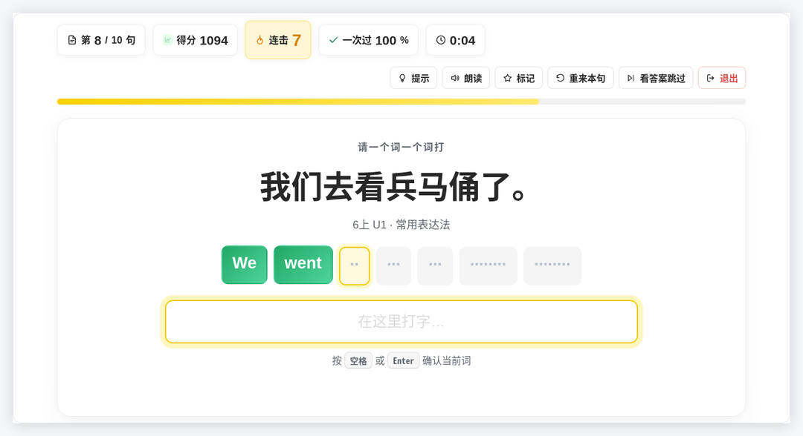
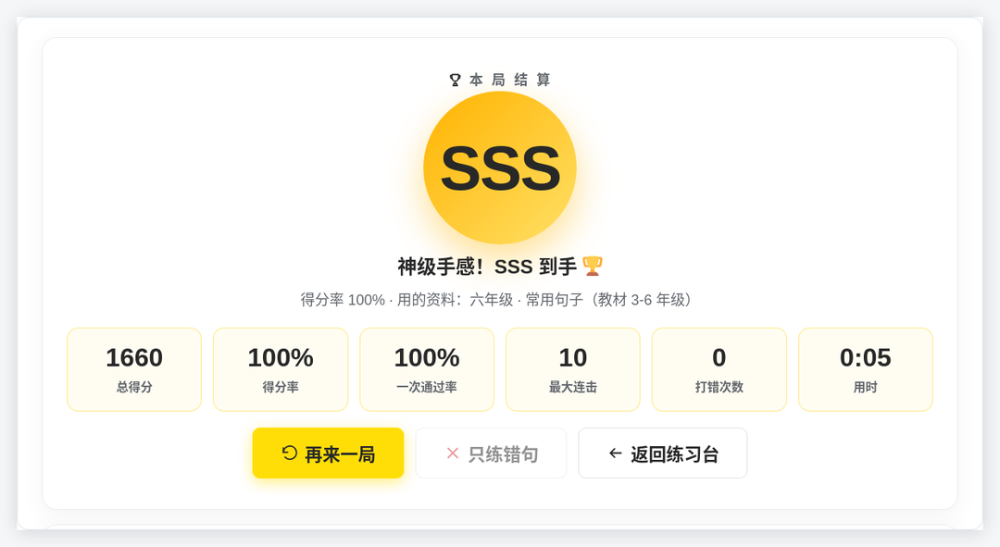

# 给孩子做了一个背英语单词又能练习打字的单机版游戏
> 💡 备注属性未写入，可能是备注属性名称或者类型被修改了，建议将字段类型设置为 rich_text，可以在小程序-操作-修改文章数据库页面进行调整
> 💡 原文链接:[https://mp.weixin.qq.com/s?__biz=MzcwOTQ1Mjc0NA==&mid=2247485139&idx=1&sn=0e23ec4b2a3223aded43dc6436ec7ff1&chksm=f44f769bf87c3aa8c8fead1c94e1c8581d1a7a12c19c23cf10155817a0c2cf3a319facf5497c#rd](https://mp.weixin.qq.com/s?__biz=MzcwOTQ1Mjc0NA%3D%3D&mid=2247485139&idx=1&sn=0e23ec4b2a3223aded43dc6436ec7ff1&chksm=f44f769bf87c3aa8c8fead1c94e1c8581d1a7a12c19c23cf10155817a0c2cf3a319facf5497c#rd)
## TOPIC给六年级娃做了个打字练习台背单词，终于不用抄十遍
### 01为什么自己做一个
我家孩子上六年级，单词背得快，一默写就漏字母。抄十遍他烦我也烦，用 App 又总撞上收费、广告和联网。后来干脆自己做了个：**一个 HTML 文件，双击就能用，不安装、不注册、不联网**。

**双击打开就是这一屏，零安装零联网**
### 02打对了连击，打错了重来
玩法很朴素：屏幕给一句中文，孩子把英文**一个词一个词打出来**，空格确认。打对了连击涨、分数跟着翻倍（**20 连击**），打错了连击清零、这句从头再来。一局结束给 **C 到 SSS 评级**，列出错句，点「只练错句」就能专补。没打出的词只显示占位块，不泄答案；卡住可点「提示」。三种打法：逐词、整句、逐字，练指法、默写古诗也行。
> 抄十遍是任务，冲 SSS 是游戏。孩子愿意多打一遍，目的就达到了。
> 

**看中文逐词打英文，打对的词变绿，连击实时加分**

**一局结束给评级、得分率和错句清单**
---
### 03数据来自人教版教材
数据按**人教版（PEP）小学英语 3 上到 6 下**的教材 PDF 整理：取书末「单元词汇表」「常用表达法」两个附录，共 **1220 条**（917 个单词 + 303 个常用句子），按年级分成 8 套包，六年级的常用句子我挑得最细。打开在「选一套资料」里选一下就行，不用导入；备注标了册次单元，只复习 6 上 U1 也找得到。

**内置 8 套人教版课程包，也能自己上传资料**
### 04三步上手，也能自己换教材
**三步上手**：① 双击 HTML（Chrome / Edge）；② 选课程包和打字方式，题量默认 10 句；③ 点「开始练习」，空格确认、Enter 提交。成绩和错句存在本机浏览器，换电脑用「导出备份」。
想换教材也不用求人：把 PDF 下载好，交给 WorkBuddy，让它按「中文提示 | 英文答案 | 备注」一行一句整理成 txt；再到「我的资料」拖进虚线框即可。TXT、CSV、Excel、JSON 都认，Excel 两列也能直接粘贴。
---
### OUTRO写在最后
工具和数据包都在一个文件夹，拷进 U 盘就能带走，投屏还能当课堂小竞赛。初衷很朴素：让他心甘情愿多打一遍。想换别的教材、或加个计时赛，留言告诉我。
