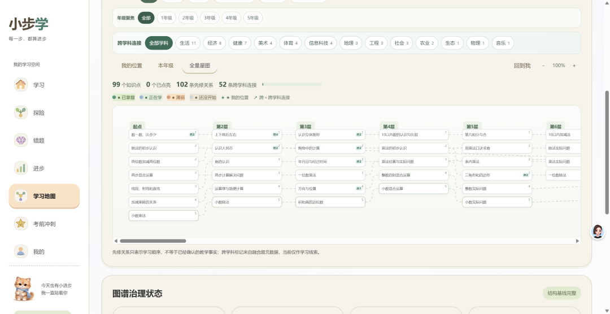
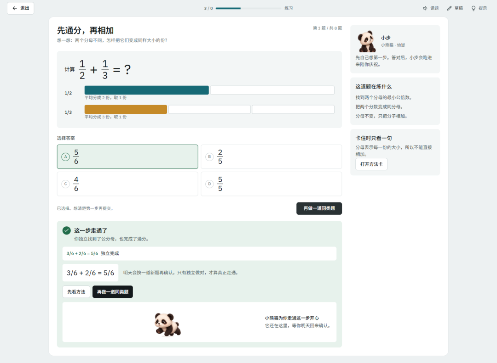
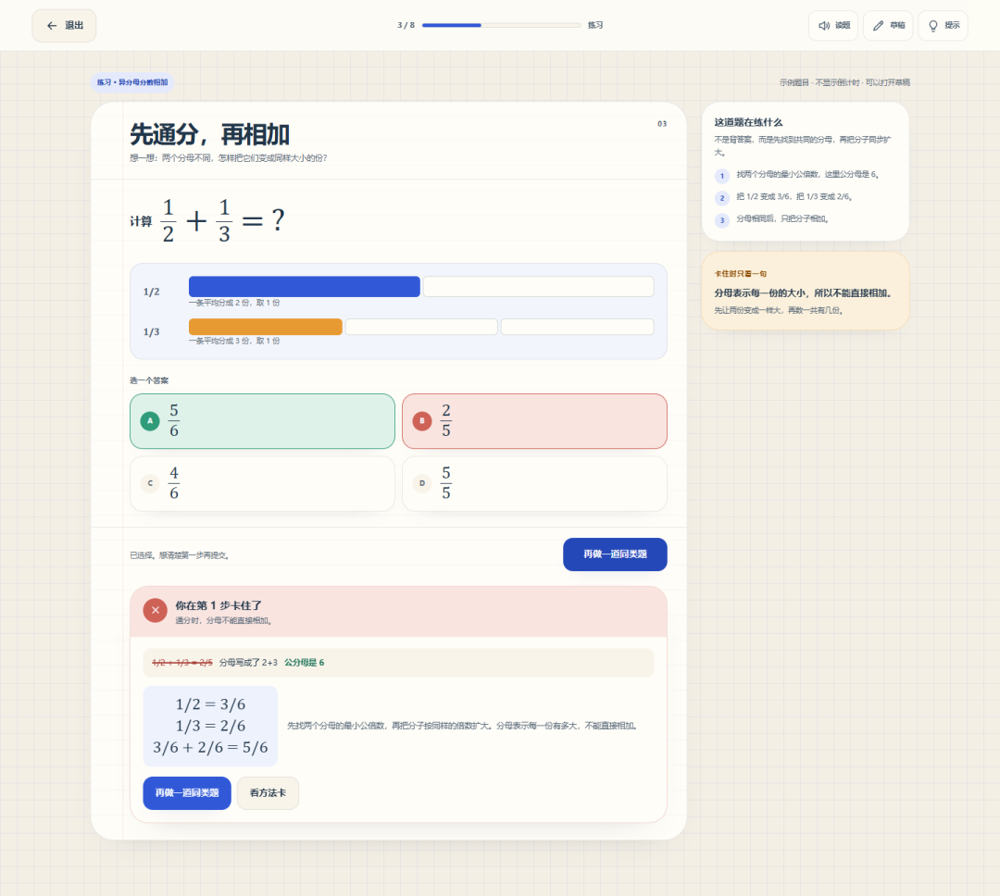
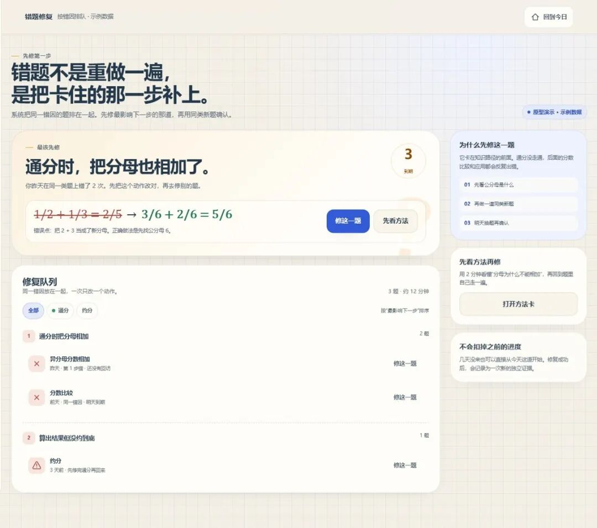

# 给孩子做的自适应中小学学习系统（人教版&沪教版），免费分享
> 💡 备注属性未写入，可能是备注属性名称或者类型被修改了，建议将字段类型设置为 rich_text，可以在小程序-操作-修改文章数据库页面进行调整
> 💡 原文链接:[https://mp.weixin.qq.com/s?__biz=MzIyMjQxOTExOQ==&mid=2247483881&idx=1&sn=12edc337305ebde6400e32ce8588e17c&chksm=e94d5a99947ebd3dd41bd4dbd9177a3a7a1f0fc18a3b2aded8767a1d65a079fa5fe51ae70fcd#rd](https://mp.weixin.qq.com/s?__biz=MzIyMjQxOTExOQ%3D%3D&mid=2247483881&idx=1&sn=12edc337305ebde6400e32ce8588e17c&chksm=e94d5a99947ebd3dd41bd4dbd9177a3a7a1f0fc18a3b2aded8767a1d65a079fa5fe51ae70fcd#rd)
为了提升家里小朋友们的数学成绩，夯实基础，我给他们做了一套自适应数学学习系统，叫“小步学”。名字是 Codex 帮取的，我也认同，就不改了：每一步，都算进步。
从有想法到搭出平台，花了大约一周的时间。但是优化这个平台，却持续了一个月。
---
**这个平台有什么用？**
- 它和普通刷题工具最不一样的地方，是能找到错题的 “根”。
- 题目不瞎出：宁少勿滥，要贴合课本，还要讲得明白。
- 跟着孩子的节奏走，不用家长费心安排。

孩子预习、练习、复习、上传错题，系统都会自动分析他错在哪、哪类知识点薄弱，然后匹配对应的练习题。
不用家长盯着找题，也不用孩子按部就班刷已经会/不会的内容 —— 哪里弱，就重点补哪里。
做错的题会自动收进错题本，也支持拍照上传试卷错题，系统会自动配同类题和讲解，定期拉出来复盘巩固。
考前想集中练，也可以选单元选知识点，直接生成一份冲刺练习卷，后续也会支持打印出来做纸质版。
---
**如何登录**
点击“阅读原文”。
进入平台后，有游客模式和注册模式，目前2种模式都能用，都不记录你的注册信息（因为我太懒，还没有心思和时间去做这一块，我的后台也没有你的注册信息）。
游客模式：每天能做30道题（其实也够的），知识图谱只能看到第一单元，做题信息在7天后会自动抹除（我的后台也没有，还是因为我不想做......）
注册模式：全部开放（其实就是登录模式）。
---
**这个平台有什么？**
**1、知识图谱 **
我搭出了 1-9 年级人教版的数学知识图谱（554 个知识点）和 1-5 年级沪教版的数学知识图谱，把知识点之间的关系拉了出来成为知识链。后来去翻阅了大量的教育论文，才知道，这叫 “修边”。
也就是：你要学会后边的知识点，得先掌握前面的那个。
**举个例子：**认识分数 -- 通分 -- 异分母分数加减，如果孩子没有认识分数，就学不会通分，学不会通分，异分母加减就出错。
如果孩子在 “异分母加减” 上做错，我们可以顺着这条链往回找，是通分没学会？还是更早的认识分数没掌握？
我原来打算展示一张全面的知识图谱 / 学习地图给孩子看（如下图），让他们知道都有哪些知识、自己现在处在哪个位置？后来发现，这会吓到他们。所以，我把知识图谱放入了数据库中，拆成三个界面：1、儿童的学习地图、2、高年级学生的 “知识星图” 3、家长的 “完整图谱”。

对于低年级孩子来说，只需要看到前面学了什么，下一步要学什么。其他的，就成为探险地图的一部分吧。
**2、溯源诊断 **
从上面提到的链条往回找的过程，就是溯源诊断的过程。
我一直认为，一道题不会做，不一定就是当前的知识点没掌握的问题，也有可能是之前的知识不牢靠，孩子不能随时调取前面的信息。所以我产生了要往回找原因的念头。
经过好几周的不断调试，我终于把知识图谱和溯源诊断跑出来，并在系统中实现了。
**3、题库 **
知道了薄弱知识点，就需要在练习中不断理解和夯实。我需要一个有效的题库和题目讲解。
无论是 workbuddy 还是 codex，你都可以一句话让他做出一个所谓的 “题库” 和 “题目解析”，但是 AI 自由发挥出来的题目和讲解，经常会陷入自己的幻觉当中。而且题库的质量并不高，与真实的考试测试有一定的差距。
我去查阅了教育部的数学课程标准和考试命题要求，发现如今越发的强调真实情境、思维过程和综合运用，而不是基础计算。
但是在没有版权的情况下，是不能去扒各种出版社的习题集，或者改个数字名字直接用的。
而我，还是希望孩子做的题目，既能把基础知识做熟，又能贴近教纲。
经过N次试错后，我做出了一个**出题引擎**：单知识点题目（用于理解知识点）+ 多知识点应用 + 多学科融合题+6维度考核。
题型包括填空题、选择题、多小问题、判断题、综合应用题等。
对题目的生成质量也设置了多重闸门进行审核。

**4、学情分析（错因分析）和自适应出题**
当孩子在预习、练习、复习或者提交错题时候，系统平台会把这些题目的知识点进行分析、错因归类，然后给出合适的题目做，而不是按部就班的继续用原来的题目让孩子刷题。
知道错了，知道哪里错了，知道为什么错了，还得知道怎么避免错误，然后再练习再寻找解题技巧，提升数学感觉。

**5、错题集**
把历次做错的题目都汇集到错题集里，如果考试了，也支持拍照上传卷子，系统识别题目和错误点，再配上相关的题目和讲解，继续夯实。数据多了，能形成学情分析，单元考试或者期末考试的时候，可以再复习复习。

**6、考前冲刺**
支持选择知识点 / 单元，形成一份考前冲刺的练习卷。后期会实现打印功能，让孩子可以做纸质题目。
---
写在最后
说实话，我原以为用 AI 搭一个平台是个简单的事情，但是如同学习知识一样，要把这件事做好，是需要深入研究、仔细琢磨的，在一次次的失败（不如预期）中吸取教训，并不断优化的。
这个系统做得越深入，我越意识到 AI 的到来，可能会加深教育的鸿沟。我相信网络上有大量的父母都在给孩子搭建各种错题本、练习库，这些家长都是有时间、有精力、有认知的高知人士，孩子在用一种相对高效的方式提升成绩。
而更多的，是那些没有时间、没有精力、没有工具、或者没有意识到 AI 能如何帮助孩子的家长。他们忙于生计、奔跑于市井，能给孩子的可能只是回家后问一句：你今天作业写完了没？至于如何辅导孩子、如何帮助孩子相对有效率的学习，他们只能寄希望于学校、老师和孩子自己的自觉与勤奋。
我把这个平台分享出来（**点击阅读原文**），也希望能帮助那些暂时没有时间和精力去搭建、专研孩子课程教育的家长，不知道能有多少人看到，有多少人愿意用。
我不敢说孩子用了一定会得高分，因为我们家小孩也才用没多久，在一课一课中夯实基础。我需要从他们每个单元的掌握程度、单元测试成绩、期中成绩和期末成绩来检验。
我还会继续对这个学习平台进行持续优化，可能下一步，会是用 AI 技术把每个知识点的动画做出来，加深理解？或许是把数学的各种解题技巧做出来？又或许，开发语文和英语版本？
如果你有想法或有建议，欢迎告诉我，谢谢！
