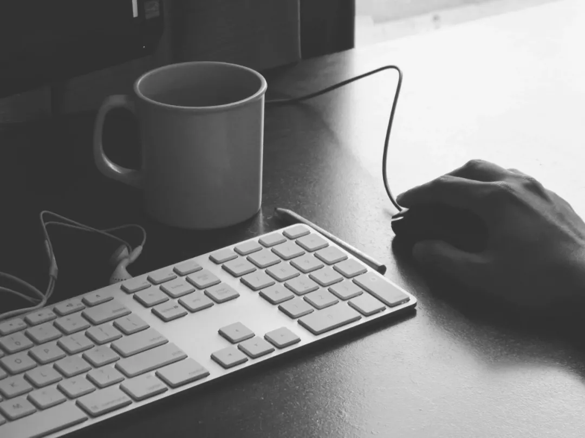
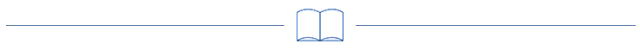

# 罗素：屏蔽力是一个人最顶级的能力，任何消耗你的人和事，多看一眼都是你的不对！
> 💡 备注属性未写入，可能是备注属性名称或者类型被修改了，建议将字段类型设置为 rich_text，可以在小程序-操作-修改文章数据库页面进行调整
> 原文链接:[https://mp.weixin.qq.com/s/smSEYH_qeOqPdp8Tmsx14A](https://mp.weixin.qq.com/s/smSEYH_qeOqPdp8Tmsx14A)

——

很多人把屏蔽力理解成 “不听坏话、不碰烂事” 的鸵鸟心态，觉得这是逃避、是懦弱。
罗素说的屏蔽，不是捂住耳朵自欺欺人，而是一种主动的精神主权 —— 你有权决定什么东西有资格进入你的注意力，什么人配得上占用你的情绪。
不值得的人和事，多看一眼、多想一秒，都是你主动把精神主权拱手让人。从这个角度说，消耗之所以能伤到你，本质上都是你自己允许的。
### 先掐断 “舆论的暴政”
### 
尊重舆论，仅限于保证温饱与不触犯法律的程度；超出这个限度，就是自愿接受不必要的暴政。
绝大多数人一辈子的内耗，都栽在 “别人怎么看我” 这件事上。
穿一件新衣服要先想会不会被人议论，做一个选择要先掂量会不会被人笑话，发一条动态要反复编辑删除，连拒绝别人都要愧疚半天，怕对方觉得自己不好相处。
你把情绪遥控器交到每一个路人手里，人家随口一句话、一个眼神，就能让你翻来覆去琢磨大半天。
可真相极其扎心，那些议论你的人，转头就忘了自己说过什么。
同事的一句吐槽、亲戚的一句评判、陌生人的一句恶意评论，他们说完就继续过自己的日子，只有你自己捡起来，反复咀嚼，反复自我审判，把人家几秒钟的随口之言，变成折磨自己好几天的精神刑罚。
罗素看得透，大部分人对你的评价，根本不是基于真实的你，只是基于他们自己的偏见、情绪和认知水平。
你为这种东西内耗，等于为别人的浅薄买单。
真正的屏蔽，不是骂回去，也不是赌气证明自己，是根本不接招。
对方扔过来的情绪垃圾，你不伸手接，它就落回对方自己那里。你越在意，它的重量就越大；你视若无物，它就轻如鸿毛。
### 终止 “自我反刍” 的内循环
### 
比外人的议论更消耗人的，是你自己脑子里停不下来的自我审判。
白天说错一句话，晚上躺在床上反复回放当时的场景，懊恼自己怎么那么蠢；
一件事没做好，连着好几天都在复盘失败的细节，越想越觉得自己一无是处；
一段关系早就结束了，还在一遍遍假设 “如果当初那么做会不会不一样”。
很多人把这叫 “自省”，罗素会告诉你：这根本不是反思，是毫无价值的自我凌迟。
真正的自省是闭环的，找到问题，得出改进方案，这事就翻篇，所有思考都指向行动。
而自我反刍是开环的，你只是在一遍遍重温窘迫、愧疚、不甘，把自己反复丢回负面情绪里，除了耗光精力，什么改变都不会发生。
他给的方案简单到近乎粗暴，**明智的人，只在有必要的时候思考烦恼，其余时间，去想别的事情。**

这不是教你逃避问题，是教你给情绪设一个开关。该解决问题的时候，集中精力处理；事情已经过去、无法改变的时候，就主动把思绪从这件事上挪开。
你放任大脑在烂人烂事里打转，就等于允许过去的失败，持续消耗现在的你。多看一眼，多琢磨一秒，都是你自己在给它续能。
### 主动退出 “攀比的游戏”
### 
他那句 “乞丐不会妒忌百万富翁，但他一定会妒忌收入更高的乞丐”，道破了攀比的本质，痛苦从来不是因为你过得差，是因为你总盯着身边人的参照系。
同学涨了工资、朋友换了新车、熟人晒了旅行照，明明你自己的日子也过得去，可只要一对标，瞬间就觉得索然无味。
你本来对生活没什么不满，可刷半小时社交平台，立刻觉得自己处处失败。
这种消耗最隐蔽，也最无休无止 —— 你永远能找到比你过得好的人，永远有新的东西可以攀比，追着别人的影子跑，永远没有尽头。
很多人以为屏蔽攀比，是逼着自己 “不羡慕、不嫉妒”，靠意志力硬压。

攀比之所以能伤到你，是因为你默认了同一条评价标准：赚得多就是成功，房子大就是体面，被人羡慕就是赢家。你只要还在这个赛道里，就永远会被比下去。
真正的屏蔽，是不玩了。我有我自己的标尺，我的日子好不好，不需要和任何人对标。
### 屏蔽不是逃避，是筛选权重
- 能改变、能解决的事，去行动，不叫消耗，叫做事；
- 既改变不了、又只会搅动情绪的事，还反复去想、反复去看，才叫无谓消耗。
比如工作里的问题，该承担的责任，真实存在的缺陷，这些不能屏蔽，要直面，去解决。
但旁人的闲言碎语，无关紧要的对错之争，已经发生无法挽回的懊悔，八竿子打不着的八卦戾气，这些东西，多看一眼都是浪费。
现实里很多人恰恰搞反了。对真正该解决的问题，他们装聋作哑、拖延逃避；对那些毫无价值的闲言碎语、情绪垃圾，却句句上心、句句较真，揪着不放。
他们不是没有屏蔽力，是舍不得放弃那点情绪爽感 —— 和人抬杠能获得短暂的胜利感，咀嚼委屈能获得 “我是受害者” 的道德感，攀比焦虑能获得 “我还在努力” 的虚假安全感。
他们主动凑上去被消耗，转头又抱怨生活太累。
### 终极的屏蔽，不是 “堵”，是 “疏”
真正顶级的屏蔽力，是你把自己的世界变大。当你的注意力投注在更广阔的事物上 —— 一本书，一项爱好，一个和你切身利益无关的领域，一片更辽阔的世界，那些龌龊的，消耗人的东西，自然就落不到你眼里。
就像你站在山顶，脚下的碎石杂草根本不会碍眼；可你要是蹲在泥坑里，一粒沙子都能硌得你难受。
他说幸福的秘诀，是尽量扩大你的兴趣范围，对感兴趣的人和物尽可能友善。这句话的另一面就是：当你的世界足够丰富，就没有多余的位置留给消耗你的人和事。你不需要费力去屏蔽谁，因为它们根本挤不进来。
你的注意力，是你这辈子最稀缺的资源，你把它花在哪里，你就会成为什么样的人。
没有谁能主动跑到你精神世界里来捣乱，所有的消耗，本质上都是你开门请进来的。学会关门，筛选，把目光从不值得的东西上挪开。这不是冷漠，是对自己的生命最基本的责任。

。
**推荐关注**
**上方公号内回复 999 有惊喜**
——
