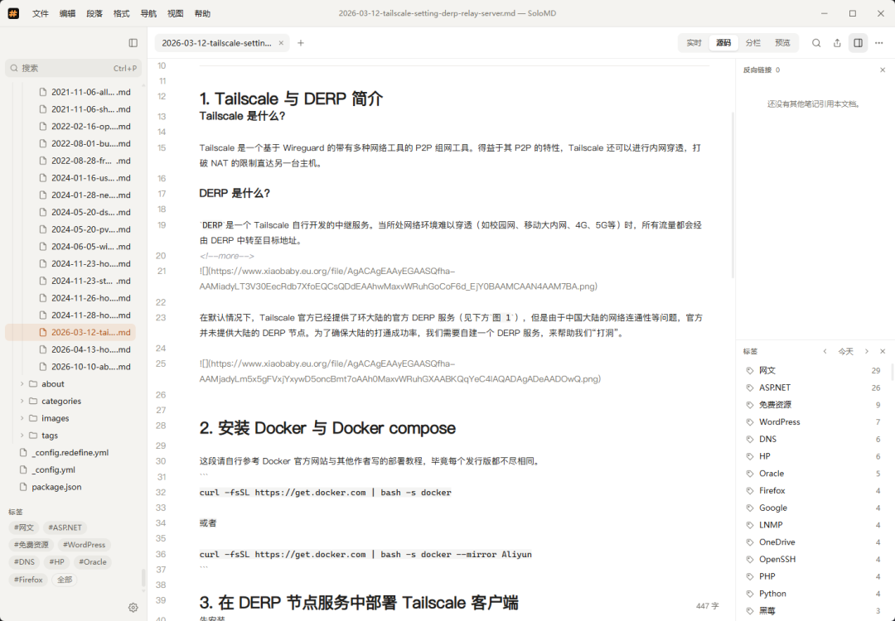

# 老周推荐:Typora 能做的，它全能做
> 💡 备注属性未写入，可能是备注属性名称或者类型被修改了，建议将字段类型设置为 rich_text，可以在小程序-操作-修改文章数据库页面进行调整
> 💡 原文链接:[https://mp.weixin.qq.com/s?__biz=MzI0MDU5MTc0Mg==&mid=2247483681&idx=1&sn=065f4560112f247a38dcd1386b380a9a&chksm=e8d3bf555d598c8aaf6317ca9a6ca00db2c37f09582807b421c8f60089d83c0e6d7a18dc5360#rd](https://mp.weixin.qq.com/s?__biz=MzI0MDU5MTc0Mg%3D%3D&mid=2247483681&idx=1&sn=065f4560112f247a38dcd1386b380a9a&chksm=e8d3bf555d598c8aaf6317ca9a6ca00db2c37f09582807b421c8f60089d83c0e6d7a18dc5360#rd)
AI时代，人人都可以做开发，也是重复造轮子的时代，今天我想介绍一个markdown编辑器`SoloMD`，1.3K star，截止目前下载量超过81k，`SoloMD`既是markdown编辑器，又内置了`Agent`面板，一些活可以交给AI处理。
### 卖点：Typora 能做的，它全能做。免费。
所见即所得实时预览、多标签、主题、PDF / Word 导出 。并且还有 AI 改写、文件夹同步、原生 iOS 与 Android 应用。MIT 开源，无账号、无订阅、无广告。
### 卖点：技术架构新，macOS · Win · Linux · iPad/iOS/安卓统统拿下
技术架构：
- Tauri2
- Vue3
- Codemirror6
系统要求： Windows 10+、macOS 10.15+、主流 Linux 发行版、iOS 15+、Android 7+(API 24)。
### 卖点：隐私与安全
纯客户端。你的`.md`文件留在你选的文件夹里。`API key`存在系统钥匙串(macOS Keychain / Windows Credential Manager / Linux libsecret),永远不进 localStorage 或配置文件。AI 请求从你的机器直连厂商 —— 不经 SoloMD 中转。RAG 嵌入索引和 AutoGit 仓库都是本地。MCP server 默认走 stdio;可选的 HTTP 传输默认只监听本机,并可要求 Bearer token。整个代码库 MIT 协议,可审计。
Agent 安全护栏(v4.0)。 每次 Recipe 运行都开自己的 AutoGit 分支 —— main 在你点 Accept 之前一动不动。单次 write-cap(默认 5,硬上限 50)防止失控循环。Recipe runner 在工作区脏时直接拒绝启动(agent commit 不会扫到你的 WIP)。所有接受用户传入路径的 Tauri / MCP / REST 端点都前置拒绝 .. 段和绝对路径。
E2EE 同步用 Argon2id(RFC9106 默认参数)→ XChaCha20-Poly1305,确定性 nonce + path-as-AAD。明文留在你的设备上;远端只看到密文。sync.json 解析失败会拒绝推送,绝不降级到明文(v3.0.x 审计修过的一条)。

目前最新版本：v5.0.1
官方网站：SoloMD.app
github仓库：zhitongblog/solomd

## 摘要

（待补充）

## 我的笔记

（待补充）
