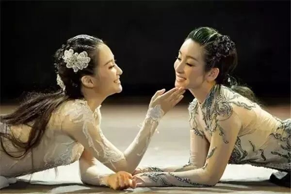

# 胡兰成：女人就是美
> 💡 备注属性未写入，可能是备注属性名称或者类型被修改了，建议将字段类型设置为 rich_text，可以在小程序-操作-修改文章数据库页面进行调整
> 💡 原文链接:[https://mp.weixin.qq.com/s?__biz=MzA3NTU1NTUxNQ==&mid=2652856156&idx=1&sn=0a50516d26c5e29ecb85ce660287169e&chksm=853ea41fca36b2acb01805e0cda4bddd2ae9240b3e35d4d811da1c61568680036c37046da5f2#rd](https://mp.weixin.qq.com/s?__biz=MzA3NTU1NTUxNQ%3D%3D&mid=2652856156&idx=1&sn=0a50516d26c5e29ecb85ce660287169e&chksm=853ea41fca36b2acb01805e0cda4bddd2ae9240b3e35d4d811da1c61568680036c37046da5f2#rd)

**点击蓝字，关注我们......**

女子的一生本来如花，有蓓蕾时节，初花与半开满开时节，一一皆好。乃至枝上一面开得炽烈，微风起处，落花綷綷如雨，飘落得一地，亦是奢侈得好，再以后花尽叶生，亦自有一种意思。
古诗：“五岁拜新月，七岁乞巧思，八九敬诸兄，人事知婉嫕，才及十岁余，秀茁如花枝，十一有志气，十二自画眉，十三能织素，十四学裁衣，十五为君妇……”其后十七八，二十余，三十边，直到得像杨贵妃的三十八岁，一期有一期的风姿，皆是天然。而现在的女人是廿几岁了才来追慕少女，三十四十了才来追慕少妇，总是脱了班，所以不自然，变得妖里妖气。于不注意处，有社会人的邪恶与过时的凄惨。
以前的女子，十二三岁就已是大人，如林黛玉初到荣国府时时十二岁。出淘得早，可比一枝鲜花清晨初阳里就开起，有长长的日子。现在女子高中生还是幼稚，等读了大学出来，又是社会人了，结婚又迟，及至有蓓蕾开花已是半下昼了。林黛玉的美，是人世礼仪生在年青姑娘的志气与新鲜里。现在如日本女子，是出了学校，要进公司做事了，或要出嫁了，才开始学礼仪，但已是二十几岁的人了，虽学的礼仪，亦是不能与她的心思，与她的肌肤生在一起的了。日本女子到了二十几岁才开始穿和服，已和服与她的人不能生为一个风姿，何况礼仪。她只能有社会人的老巧与不合年龄的妖魅。
中国旧时女子之美，多见于诗。诗里多是写到红妆二八年为止。《红楼梦》里写王熙凤的美，是写她从十八岁到廿一二岁。宋人画本与宝卷与平话里的官人娘子，便是好似碧天迢迢里的满月。李清照的画像，刻在她的词集，画她三十一岁时手执菱花，比少女另是一番清远秀抜，平实而丽冶。京戏里的王宝钏，也是三十几岁的人了，而她十八年在寒窑，养儿待夫，有志气如新。中国旧时的中年妇人，是使你对她生出敬意，人世的庄严里却有着一片私情美意，如仙凡之思。
以前女子十四五岁就出阁，这个作法也是对的。女儿在娘家时是娇客，出嫁是她一生做人的开始，许多事情是个未知数，要她至心至意的去创造。而如今的女子迟婚，先在那里就职趁钱，成了个社会人，等到结婚，锋头已经钝了，再没有那样人生的新鲜了。
男女之爱，父子之亲，朋友之义，一颦一笑可以是千秋万代的感激，但是不干生理学的事。太阳于人的兴发，可以是无际限的，如唐诗的一句“落日满秋山”，又古乐府的“日出东南隅，照我秦氏楼”，这里的人世的无际限即是不朽，而与人工卫星所观测太阳的报告很少有关系。中国是现世真有不朽的东西，故可以不需要宗教。
女子是花，而男人则是光，女子的美好要男人的光来照耀。武则天比慈禧太后好，是武则天曾在李世民身边服事过，及她临朝，亦当初创业佐命诸人尚存，朝廷与外面的天下世界有男人的庄严，而慈禧太后之时则满清已没有了好男子。
从来写贵人家的男女情事，多是肮脏的，如贾珍贾琏贾蓉他们。可是亦有贾宝玉与林黛玉的真真人如天仙。至于历朝宫廷的淫乱更有一种惨，也容易生厌。但是文明太后的恋爱真有像平民的喜气。两人相对时，在于男人的面前，文明太后亦只是一个女人。她这样的英气，而此刻对她心爱的男人，说出话来惟是这样自己人的说话。她不学人家妇人女子的修饰，此刻却亦会生出爱娇，说话任性。她是这样的对于男人有尊敬。她的爱不作前后的打算，那糊涂是她的明白事理与旷达为一。
男女之爱必要是结婚，若不能结婚，心里终有所不尽，如乐曲的非声尽意不尽，即意尽声不尽。但如中国的古诗与乐曲亦有戛然而止，几于没有起讫，而能声意俱收尽者，所以古来每有恋爱仙凡之说。文明太后于她所爱的男人，当然是不能与之结婚，她一要能不妒忌，不破坏人家的家庭，二要能不妨害彼此的人生态度与日常工作事情，饶这样亦依然可以是恣情任性的相爱。
譬如在电车中逢见一个生得好看的女子，待要起什么念头，到底什么念头亦未形成得，而单这一刻的相对不相识，—— 如梁武帝问对朕者谁，达摩曰：不识，—— 亦已够想她个十年八年，乃至留传千古。
若是同时爱两个男人，那是不可能想象会得好，但也许可以非常好。因为凡她所做的，皆有着天地清旷，人世风景的壮阔。
晴雯最亲者宝玉，但她满足于只是自己与宝玉这样接近的同生同在于大观园的好日子里。晴雯是抱有未有名目的大志，她对宝玉之情都大到是未有名目的，所以无人可以抢得。她不但对黛玉不妒忌，对袭人与秋纹麝月等她亦不妒忌。在这点上，晴雯是还更高过黛玉。
我一向非常看重晴雯，却不曾把来深刻的想过，更没有把宝玉的对她来深刻的想过。今经天文一提，我才来仔细想了，想得欢喜起来，而觉得张爱玲这所说的并不懂得宝玉，也不甚懂得晴雯。
宝玉见着晴雯即是见着未有名目的黛玉的人了，只是觉得亲是有的，却未有适当的感情与言语。这就是宝玉的对晴雯了，怡红院里日常晴雯的人在眼前，是像十八相送的路上梁山伯与祝英台在一道，眼前的就是最最亲的人了，但是他胡涂了。与晴雯，是宝玉在神前与最素朴的黛玉相见，他觉得不是这样的，甚至与自己不相干，所以会说出“明儿你自己当家立业”的话。
男人能无，女人能有。男人多毁，女人多成。有而非无，成而不毁，则历史之机熄，所以西洋与印度的宗教皆恶女人。可是非有何无，不成何毁，所以中国文明于此但曰“男尊女卑”，而不恶女人。女人是属于一切有部，因此被当作财产，与玉帛归在一起，固然不对，但是男尊则女美，事实如此。我向来相信《红楼梦》里贾宝玉的女清男浊说，很觉得高兴，如今我才有了与他相异的见识，又是很高兴。
从来是战争与新朝的开启出美人，大破坏当时与直后，是男性发挥的极致，所以女性也清扬了。而承平时则一切都有着了，一切都规定了，如此就成了女人的天下，男卑则女恶，入于历史的沉滞。在于现代福祉国家的日本，今天虽尚随处可以看到好女子，亦只是一个照眼觉得好，不足托以心腹之事。
我觉太古女人文明当时的女人最美，那是自足的，女人的绝对的美，不为对于男人。后世女人为对于男人而妆成的美，虽然更艳，更女性化了似的，但是变得小了，是女人的变得有一种哀意的美。在衣裳上就最看得出来。巫女的冠饰与衣裳不但那式样，便是那颜色亦是自足的绝对的女人的美，不为对男人的。
猜你喜欢：
[汪曾祺: 偷看女同志洗澡](https://mp.weixin.qq.com/s?__biz=MzA3NTU1NTUxNQ%3D%3D&mid=2652855896&idx=1&sn=806b49d2d5892d46c5b7dc5192a1613e&scene=21#wechat_redirect)
[鲁迅：【No.3418】经典一句](https://mp.weixin.qq.com/s?__biz=MzA3NTU1NTUxNQ%3D%3D&mid=2652855791&idx=2&sn=51dc6a443979c64d55c59662957d6b2b&scene=21#wechat_redirect)
[【今日推荐】柏拉图：爱情的伟大是精神恋](https://mp.weixin.qq.com/s?__biz=MzA3NTU1NTUxNQ%3D%3D&mid=2652855897&idx=1&sn=c34d0ca0d597545ece53796c52b8023e&scene=21#wechat_redirect)
[【短篇小说】陆文夫：献身](https://mp.weixin.qq.com/s?__biz=MzA3NTU1NTUxNQ%3D%3D&mid=2652855901&idx=1&sn=33f3b3a95eff5b662ee4e99fea63e49c&scene=21#wechat_redirect)

## 摘要

（待补充）

## 我的笔记

（待补充）
