# 能把小学奥数给孩子讲透彻的，我就服这三部B站视频
> 💡 备注属性未写入，可能是备注属性名称或者类型被修改了，建议将字段类型设置为 rich_text，可以在小程序-操作-修改文章数据库页面进行调整
> 原文链接:[https://mp.weixin.qq.com/s/hTpAK6LDVybm9zcIqpGmMg](https://mp.weixin.qq.com/s/hTpAK6LDVybm9zcIqpGmMg)
资源君：专业“寻宝”的资源君，最近分享了一系列优质资源（[小学数学](http://mp.weixin.qq.com/s?__biz=MjM5MTgzNDM0MA%3D%3D&mid=2652507105&idx=5&sn=d9e2ccbf605e0602cef5f0bbfa6d0637&chksm=bd41226a8a36ab7cb8c22539001a3bb5b987c161dab445cbadfab3fe063837861405fc0768d6&scene=21#wechat_redirect)、[初中数学](http://mp.weixin.qq.com/s?__biz=MjM5MTgzNDM0MA%3D%3D&mid=2652510120&idx=5&sn=eafcef5d7c5805a09d09c7f53c4ad7bc&chksm=bd413e238a36b735f754f7a7cc9bab1e8b23ed260189a14bb8aafca0782cb1d22839b8ad085e&scene=21#wechat_redirect)、[英语口语](http://mp.weixin.qq.com/s?__biz=MjM5MTgzNDM0MA%3D%3D&mid=2652510513&idx=5&sn=86773b4b736b6d3bbd5128854d782fb6&chksm=bd4130ba8a36b9ac8d413f4b9b4401fe334d7bbc3b693e6ea3deaf09e732ba7d4ab6dec47e83&scene=21#wechat_redirect)、[小学语文](http://mp.weixin.qq.com/s?__biz=MjM5MTgzNDM0MA%3D%3D&mid=2652511539&idx=5&sn=46a2b85cd64d2aef0b2b35219a13f3df&chksm=bd4134b88a36bdae23cde06a5b4d64c489b921c019deb464219236221c5cd643914c33b4c218&scene=21#wechat_redirect)、[初中语文](http://mp.weixin.qq.com/s?__biz=MjM5MTgzNDM0MA%3D%3D&mid=2652511171&idx=5&sn=bc82cd5f5ee3615efee1effe7721988b&chksm=bd4132488a36bb5e01fecbebec8916e30b6f555797b06cd2520faed1a25f98b21f7c648ea217&scene=21#wechat_redirect)、[中学物理](http://mp.weixin.qq.com/s?__biz=MjM5MTgzNDM0MA%3D%3D&mid=2652512279&idx=5&sn=bc79ad252aa6f2fa0ad3ffca2f1185ec&chksm=bd41099c8a36808a4247c7d22ec081975e6ee4a360a21febece49ffee8429d25353d3774715a&scene=21#wechat_redirect)、[中学化学](http://mp.weixin.qq.com/s?__biz=MjM5MTgzNDM0MA%3D%3D&mid=2652514066&idx=5&sn=22f1c048f42348bacf5fd1e1a28a30eb&chksm=bd410e998a36878fa4533e969534c2fadf6ca4a57425c2c87fe13a8f959c72cb1ab36c31ee60&scene=21#wechat_redirect)、[中学历史](http://mp.weixin.qq.com/s?__biz=MjM5MTgzNDM0MA%3D%3D&mid=2652513094&idx=5&sn=dc70717e26e07fe380cf22cb9e825cda&chksm=bd410acd8a3683db3c2a952b161009a62547ef3c1b6635c1e9182b99123ecdf20f2e7a6556b1&scene=21#wechat_redirect)、[中学地理](http://mp.weixin.qq.com/s?__biz=MjM5MTgzNDM0MA%3D%3D&mid=2652517403&idx=5&sn=46fec79da75b9e41c9e8d022c1486971&chksm=bd411d908a3694866397b4c833a2dbfea064c2ae6b54cb31714f3038e082cea78e886974393c&scene=21#wechat_redirect)、[中学生物](http://mp.weixin.qq.com/s?__biz=MjM5MTgzNDM0MA%3D%3D&mid=2652517542&idx=5&sn=12e778ca6e38e56b0c63b45d728913f0&chksm=bd411d2d8a36943b43d761775365cc35d00e053fde29b35ae9f065eced4585ed7dcff61747c6&scene=21#wechat_redirect)），很受花友欢迎（点击蓝字复习）。
今天，小学奥数来了！我们来看看这**三部适合小学娃的B站奥数视频**（大家还想要什么资源，留言告诉我~）
这3部视频的讲解重点分别是：**动画入门奥数思维、动画讲解奥数题、梳理奥数知识点。**

今天，选的这三部视频，都很🐂，能把小学奥数的重要概念讲清楚，让孩子弄明白！
文末有所有资源的链接，别忘了查看哦～
 01 
**高斯奥数动画**
**人大附中给孩子的奥数思维课 **
高斯的大名想必很多家长都有所耳闻，高斯出品必属精品，堪称数学低分的救星，数学尖子生的必修课！
高斯数学是国内领先的创新思维数学课程，由人大附中（中国人民大学附属中学）、仁华学校教研室（人大附中创办的培养尖端学生的基地）、北大数学系组成的教研团队研发而成，历经十五年课堂实践，数百万中小学生学习体验。

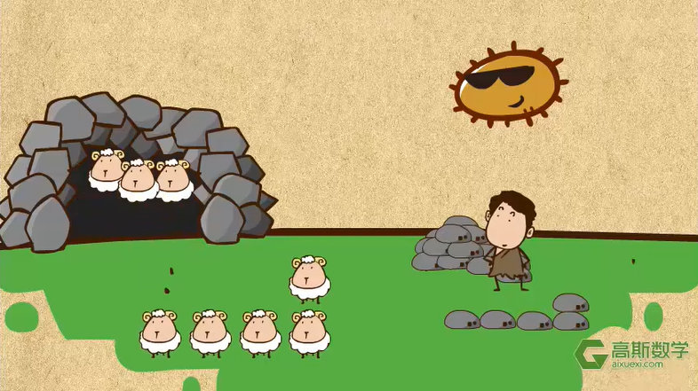
这套动画以丰富有趣的动画形式，激发学习兴趣，再也不会出现家长给小朋友讲，怎么讲也讲不明白，相爱相杀的名场面了，无论是在家辅导孩子的家长，还是数学老师，讲解数学知识点的任务完全可以交给这套资源。
动画共429集，涵盖了小学奥数中 99％的知识点，以孩子们的兴趣点出发，按照1-6年级划分。
视频集动画、游戏于一体，每集只有2-3分钟，短小精悍，却可以将知识点讲透，引人入胜，还会进行知识拓展，丰富小朋友的知识面，每天3分钟，让孩子轻松掌握小学99%的奥数知识点。
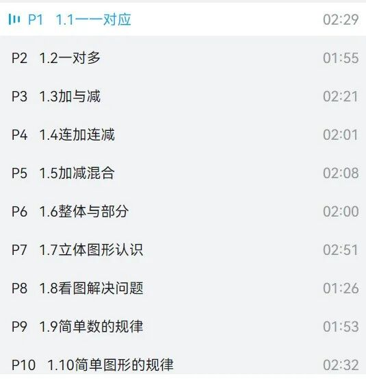
对于低年级的小朋友，高斯奥数动画就像是动画片一样，用武力值的大小来比较多个数字的大小。
比如第一集中的【一一对应】：
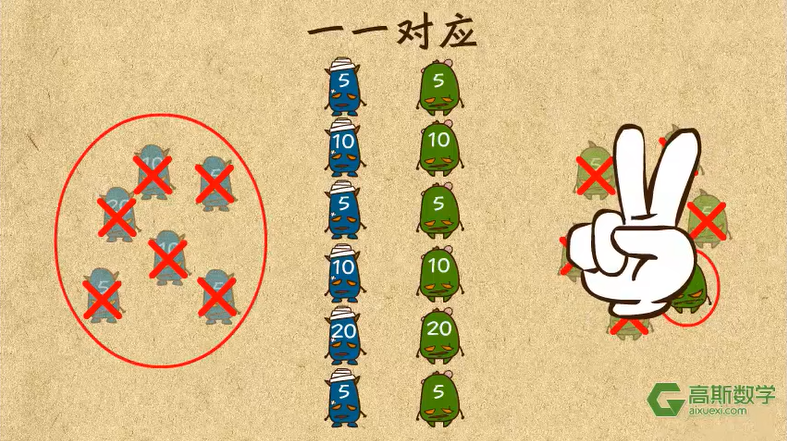
数学是需要记忆的，但是要求理解记忆，这套动画将知识点从课内慢慢延伸到奧数思维，由浅入深，这种知道了知识背后原理的记忆，让孩子真的学透奥数。
网友评价：30+看小学数学，教给孩子，老师讲的真好，我小时候都没这么好的老师[思考]。
 02 
**超级课堂**

**图形化讲解小学奥数题**
奥数类资源给大家推荐一个“超级课堂”。由浙大硕士创立的教育课程——《超级课堂》的视频教学大片，以活泼的语言和精致的动画，让孩子吸收知识变得高效而系统。

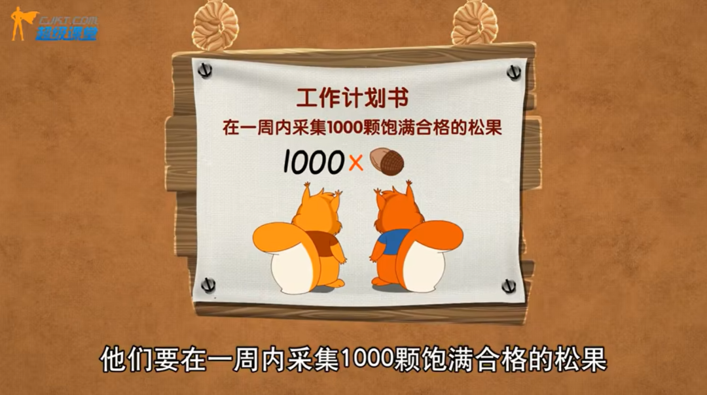
《超级课堂》的动画奥数以一个完整的动画呈现，甚至还有专门构造的世界观：**将小森林里的小动物每天遇到的问题巧妙地转化为奥数题目**，生动又新颖，非常吸引孩子。
动画学奥数37节视频，每个视频就是一个小故事，一个小故事背后就是一个奥数题型。简单明了，又具有逻辑性，让学生学起来更轻松。
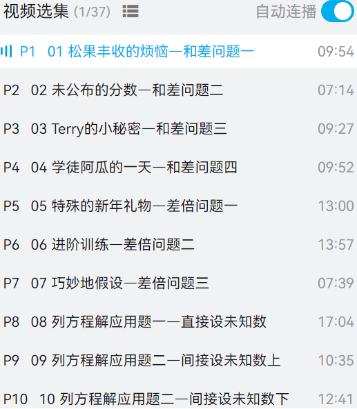
比如这道题：小明家里有一群小猫，今天他拿了一桶鱼来分给它们，如果每只小猫拿走6条鱼就会差20条鱼，如果每只小猫拿走5条鱼就会剩下15条鱼，请问一共有几只小猫和几条鱼呢？

其实这道题解法很简单，2个式子就搞定了：
小猫：（20+15）÷（6-5）=35（只）
鱼：35×6-20=190（条）
在奥数上，这就是一道典型的《盈亏问题》题型，对于“一盈一亏”，要用这个公式：
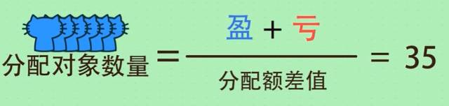
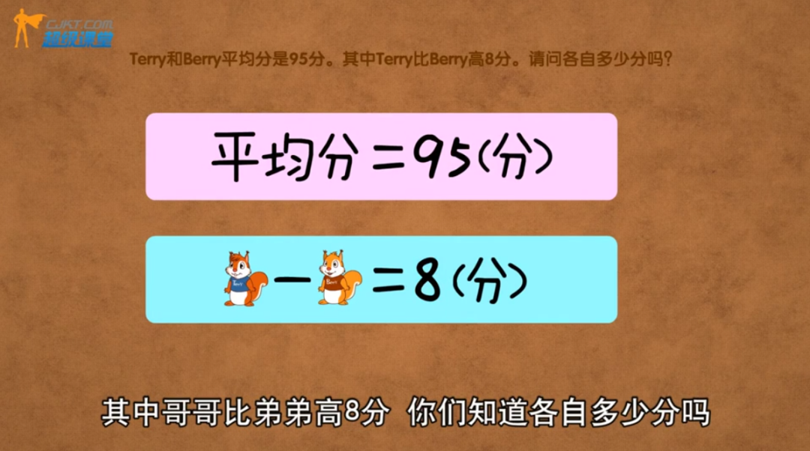
每一个步骤都很清晰，孩子跟着动画中的思路，自然而然地就能推导出公式，等熟悉了其中的逻辑关系之后，就可以直接代入公式计算，事半功倍。
网友评价：拆解题型讲的多，大多数是小学数学常见的题型，讲得很细致，分类明确，孩子接受的很快，对校内知识点很有帮助。
 03 
**小学奥数全集**
**超完整的小奥数知识点梳理**
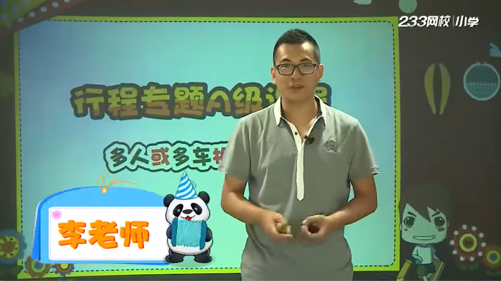
这位教奥数很厉害的老师，他制作的小学奥数视频，初衷很简单：致力于打破传统教学的陈腐、冗余以及枯燥，以**生动并且贴近学生的语言去解读知识**，并附以全新的教学方法和通俗易懂的记忆方式，用最短的时间满足学生的真实学习需求。

视频非常受欢迎，共有97集，在B站有40+万播放量。知识是实打实的扎实，把小学奥数知识点都讲到了，一些初高中的奥数概念，也有涉及到。
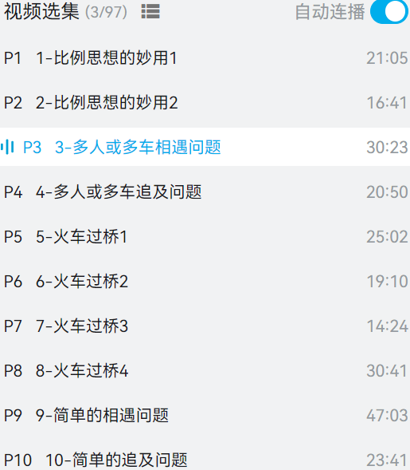
再感受下李老师的画风，幽默有趣，孩子学的津津有味。
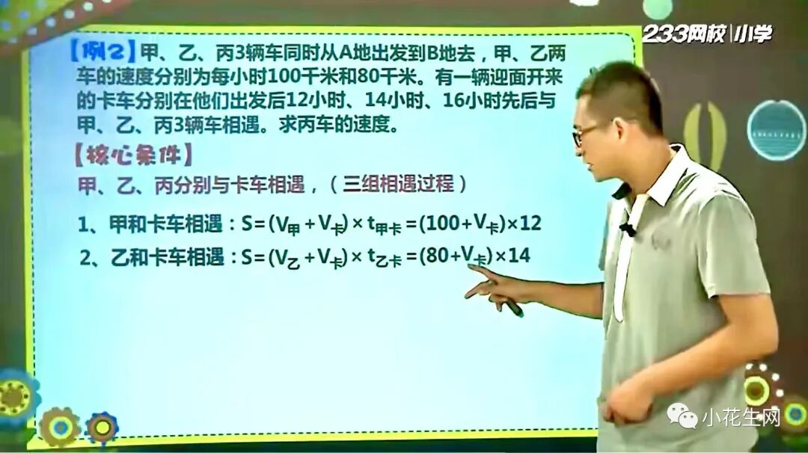
网友评价：非常感谢李老师，把小学奥数常见的题型，讲得很细致、有趣，对小学娃太友好了，感觉初中娃也可以过来补课。
**- THE END -**
**最后，福利！**
**扫码进入小花生学习群👇**
**发“资源@小助理”领取**
**资源！**
注：已经进群的花友可以直接去领，不需要重新加群啦！

**相关阅读**
- [又发现一个宝藏网站，免费承包娃小学阶段的数学学习！](http://mp.weixin.qq.com/s?__biz=MjM5MTgzNDM0MA%3D%3D&mid=2652514015&idx=5&sn=cae362f418e381216455fcfa426e8d0f&chksm=bd410f548a3686420934602ee501ca49d61a862e7043f8cf97c99ecb12b541dfa25f61cfdf26&scene=21#wechat_redirect)
- [杀死孩子的数学逻辑混乱, 就狂刷这3部数学纪录片！](http://mp.weixin.qq.com/s?__biz=MjM5MTgzNDM0MA%3D%3D&mid=2652515641&idx=5&sn=b1ee2962d40397b985004bed4af1256d&chksm=bd4104b28a368da4b23855037b259721fbd597e49416e66f6d983d63a65e05d191bd5b1330bc&scene=21#wechat_redirect)
- [不报班！在家带娃学好数学, 这3款APP能帮上大忙](http://mp.weixin.qq.com/s?__biz=MjM5MTgzNDM0MA%3D%3D&mid=2652510787&idx=5&sn=c65aabb7477656bbd310c6b5f8a0710e&chksm=bd4133c88a36badead50a47f1c544e50a99ac050bc92e0f4d0caf6b093f13e3e2040a967d52f&scene=21#wechat_redirect)

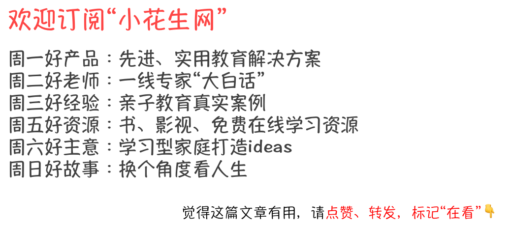
