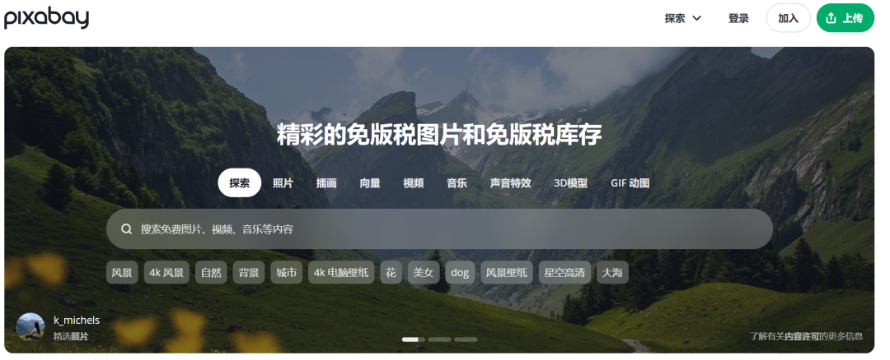
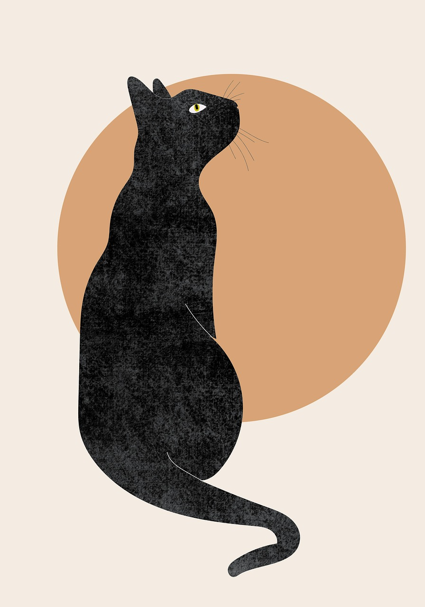
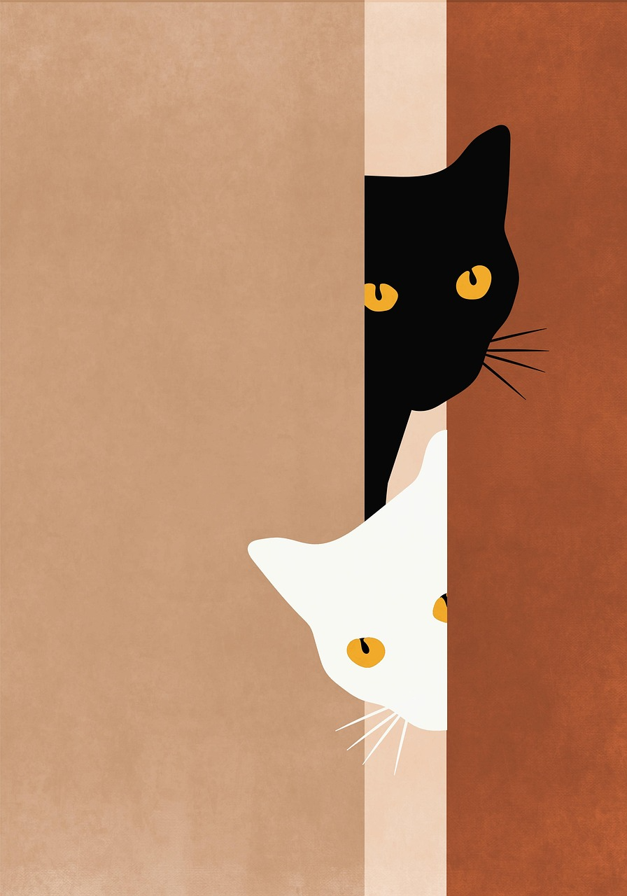
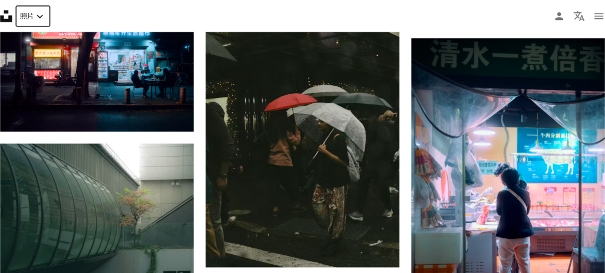
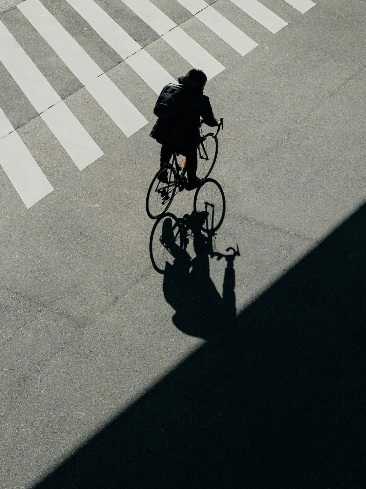
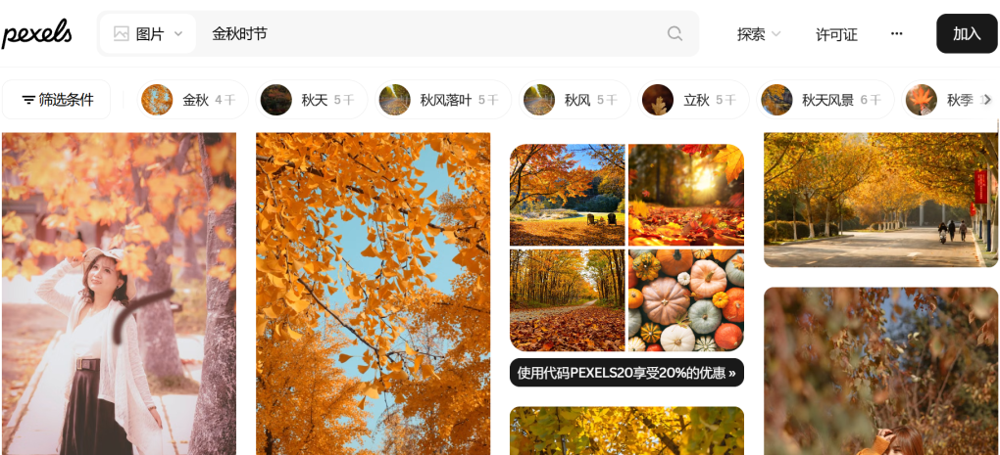
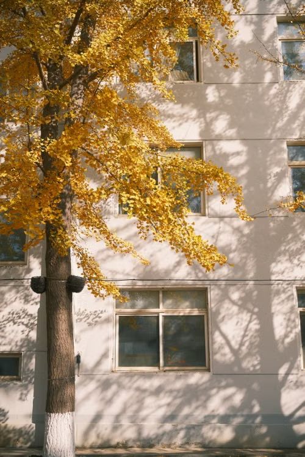

# 自媒体新手收藏：免费高质量图片网站，AI真替代不了
> 💡 备注属性未写入，可能是备注属性名称或者类型被修改了，建议将字段类型设置为 rich_text，可以在小程序-操作-修改文章数据库页面进行调整
> 💡 原文链接:[https://mp.weixin.qq.com/s?__biz=MzY4NDQ5MTY3OA==&mid=2247483756&idx=1&sn=da5a73f04bbc25ba0410f8a4518ac0f9&chksm=f2052dcbffb96cd68b61e4465426667f34a72b65d76a0e94ea679823807e6974e4c303c87387#rd](https://mp.weixin.qq.com/s?__biz=MzY4NDQ5MTY3OA%3D%3D&mid=2247483756&idx=1&sn=da5a73f04bbc25ba0410f8a4518ac0f9&chksm=f2052dcbffb96cd68b61e4465426667f34a72b65d76a0e94ea679823807e6974e4c303c87387#rd)
文丨粥粥
点个关注，一起成长
现在AI很厉害，可以写出文笔很好的文章，还可以生成很炫酷的配图。
但我始终认为AI无法代替人工，也无法生成真实、细腻、有生活气息的图片。
做自媒体写公众号过分依赖AI，也会被平台限流。
所以新手写公众号必须要储备自己的素材库，平时文章配图建议可以用自己拍摄的照片。
如果实在不会拍，也可以从网上下载。分享我常用的免费、好看、高质量的配图网站。
**01**
**pixabay**

pixabay素材内容很全面，有照片、视频、插画、音乐等，支持中文搜索。

**02**
**unsplash**

unsplash素材质量很好，有很多文艺感、艺术感和氛围感照片。

**03**
**Pexels**

Pexels有很多生活化照片，很适合新手自媒体使用。还支持中文，和按照颜色筛选。

