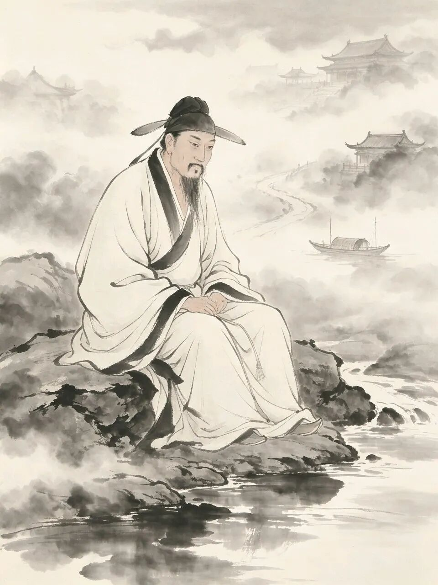
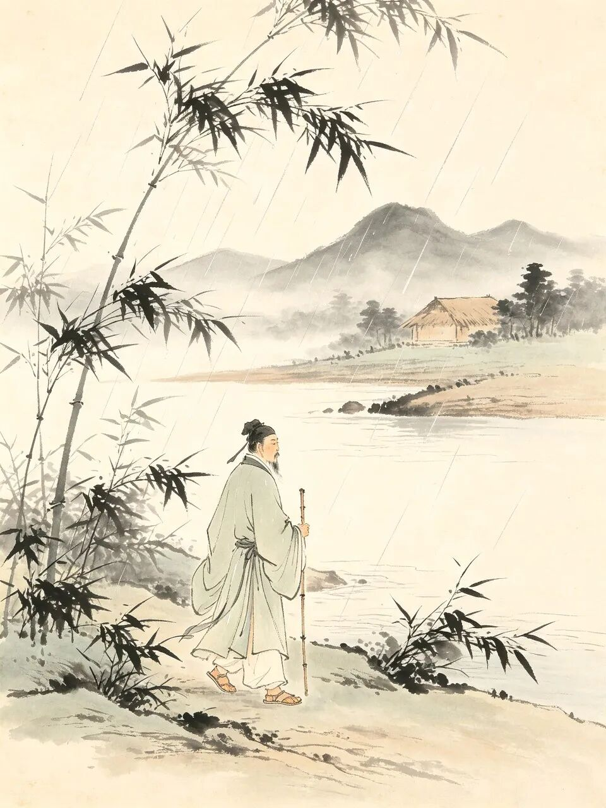
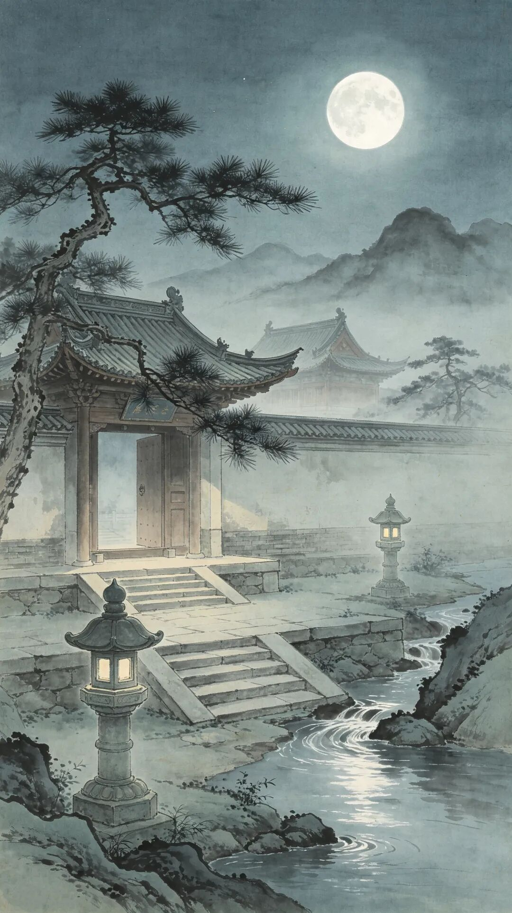
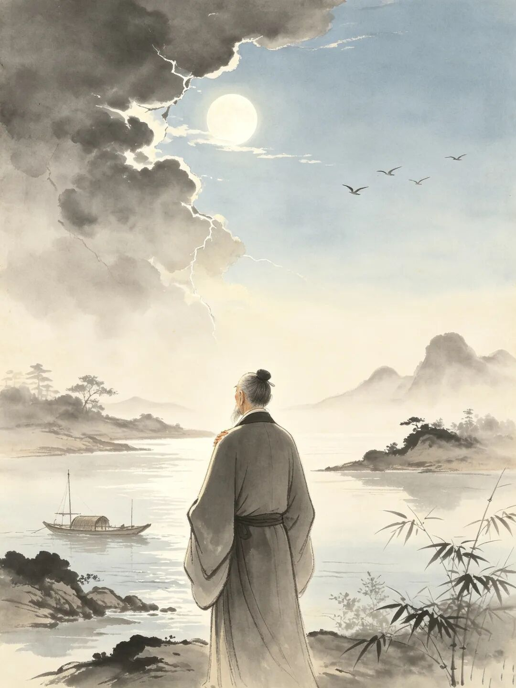
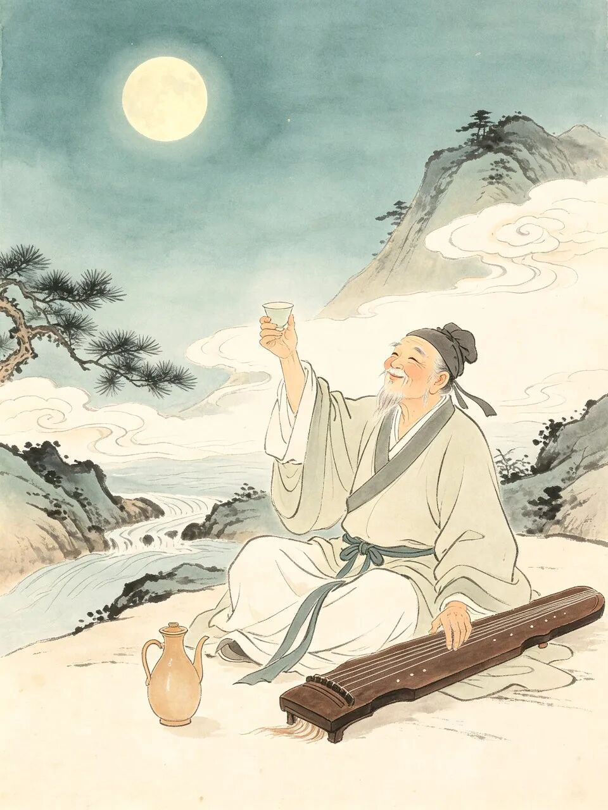
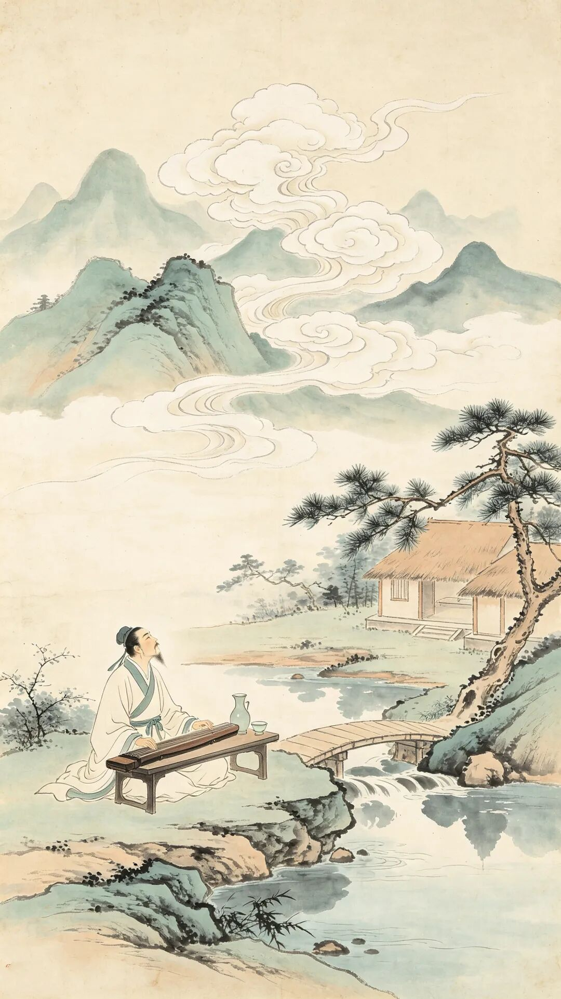
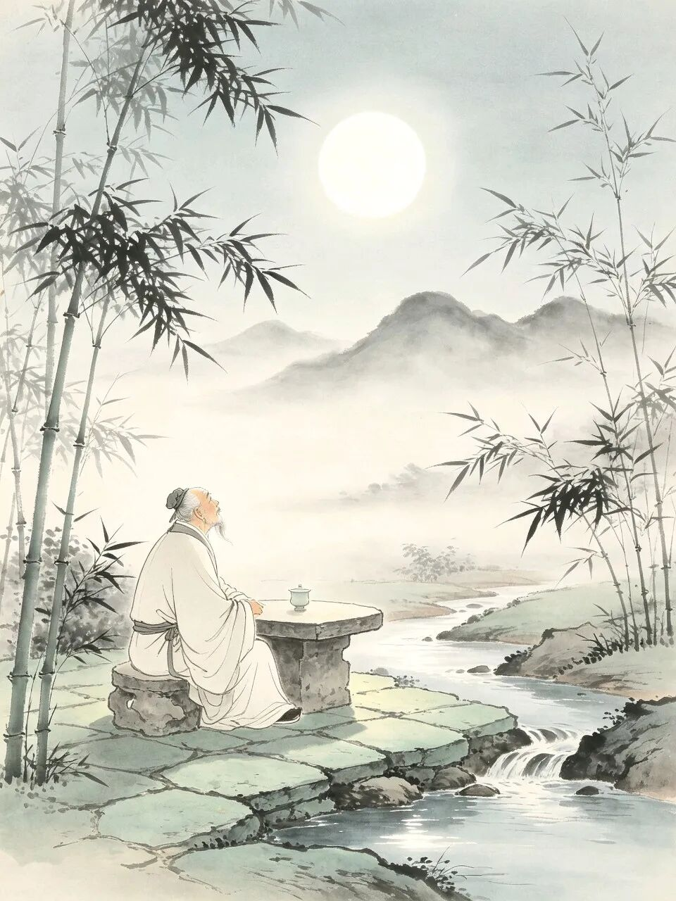

# 苏轼晚年大彻大悟，写下最旷达的一首词，百读不厌，抚慰后世千百年
> 💡 备注属性未写入，可能是备注属性名称或者类型被修改了，建议将字段类型设置为 rich_text，可以在小程序-操作-修改文章数据库页面进行调整
> 💡 原文链接:[https://mp.weixin.qq.com/s?__biz=MzkzNzYzMjYzMg==&mid=2247493489&idx=1&sn=63565928070f682fbfa9a37904a64775&chksm=c3e02e802c23954912f1aa491e74fc09b5eee81e11d63c3528e143cc0871e8b5a144b7d2add4#rd](https://mp.weixin.qq.com/s?__biz=MzkzNzYzMjYzMg%3D%3D&mid=2247493489&idx=1&sn=63565928070f682fbfa9a37904a64775&chksm=c3e02e802c23954912f1aa491e74fc09b5eee81e11d63c3528e143cc0871e8b5a144b7d2add4#rd)
说起大文豪苏轼的一生，那可是半生颠沛，半生流离。

早年的乌台诗案一事，让苏轼历尽凶险。之后，苏轼又遭数次贬谪，使得他一生漂泊，尝遍了人间的冷暖、世态的炎凉。

苏轼先后流落到了黄州、惠州、儋州等地。一处又一处的蛮荒之地，磨平了苏轼的棱角，滋养了他的灵魂。
自此，他不再执着于功名的得失，不再纠结人生的缺憾。因为风雨半生，让他读懂了世间的万事。

尤其到了晚年，苏轼更是褪去少年时的书生意气，洗尽了一世的铅华凡尘。终与生活和解，让自己释怀。
此时，他写下了一首极其旷达的词，表达了“我想透彻了”的思想。这首词就是《行香子·述怀》，其词如下：
> 清夜无尘，月色如银。酒斟时、须满十分。浮名浮利，虚苦劳神。叹隙中驹，石中火，梦中身。
> 
> 虽抱文章，开口谁亲。且陶陶、乐尽天真。几时归去，作个闲人。对一张琴，一壶酒，一溪云。
> 

公元1097年，苏轼乘坐一叶孤舟，来到了儋州，这是海南最荒凉的地方之一。放逐到了这里，在宋朝仅比满门抄斩罪轻一等。
此时的苏轼，已步入晚年时期。公元1100年，刚刚即位的宋徽宗大赦天下，苏轼得以渡海北归。
公元1101年，已是风烛残年的苏轼到达了常州，在路上奔波了将近一年。不久之后，苏轼病逝于此。
而本文的《行香子·述怀》大概就写于北归的途中，或者写于到达常州的前后。
此时的苏轼，已在六十三岁左右，人生的千种辛酸，他早就吃尽了，人生的万般滋味，他也尝遍了。
“**清夜无尘，月色如银。酒斟时、须满十分**”
这几句描绘了月色如银之夜的景象，清辉万里，天朗气清，惠风和畅，没有一丝纤尘。

在这样美妙的月夜，得把酒斟满，对月当歌，尽情豪饮。
苏轼为人豪爽，写词豪放，喝酒也是豪饮，完全是一副“对酒当歌，人生几何”的模样，少有小酌啜饮、浅尝辄止的习惯。
可此时的苏轼，再也没有“把酒问青天”的豪情，再也没有了“起舞弄清影”的洒脱。
他只想在这空旷寂静而又神秘的夜晚，静下心来思索人生，寻找自我解脱的途径。
所以接下来苏轼以一种突如其来的转折，写出了整首词最形象、也最直达本质的三个比喻。
“**浮名浮利，虚苦劳神。叹隙中驹，石中火，梦中身。**”
人生中的名与利，不过是过眼浮云，你若劳神费力地去追逐，到头来肯定是一场空。

此时的苏轼觉得：人生像是在缝隙中看跑马，倏然间便消失得无影无踪；也像石头敲击迸出的火花，一瞬间便灰飞烟灭；更像是美妙的梦幻，天明便无迹可寻。
所以人生不仅短暂，而且虚无，一切都缥缈如烟。既然如此，那在熙熙攘攘的人世之中，还有什么可争的呢？
在这几句词中，苏轼用很多人都觉得极端的三个比喻，来证明虚名浮利不值一提，更不值得我们去苦苦追寻。
因为人生短暂，虚无缥缈，如梦似幻，费尽心机地去追逐，到头来不过梦幻一场。这样的比喻不是消极的观点，而是一种极其清醒的认识。
因为他不是提倡人生短暂需及时行乐，而是说人生这么短暂，如果还把时间花在那些虚名浮利之上，那就是巨大的浪费。
**“虽抱文章，开口谁亲。且陶陶、乐尽天真。”**
虽然我文章满腹，可彼此能交心的人，却寥寥无几。既然无人懂我，那我何不自娱自乐，释放出所有的天真，忘掉人生的种种烦恼？

苏轼文章，那是有目共睹，尤其是在策论方面，更是见解独到，可惜一旦失势，再也无人肯听他的。不但没有人听，而且还有人落井下石。
这里的“**陶陶**”二字，表达了苏轼自娱自乐，自我陶醉的样子。把天性里的天真全部释放出来。
“**乐尽天真**”则强调释放天性的苏轼无拘无束，毫无保留的样子，像孩童一般。
这就是苏轼最让人佩服的地方，世界可以辜负他，别人可以抛弃他，但他却从不自暴自弃，也不叹天，不怨地。只求善待自己，不辜负自己，对自己好。
**“几时归去，作个闲人。对一张琴，一壶酒，一溪云。”**
几时才能不再为世事束缚？几时才能归隐田园，弹一张琴，饮一壶酒，徜徉于山水之间？

“**几时归去**”表达了苏轼在经历了官场的起起伏伏之后，厌倦了官场的尔虞我诈，想要从里面真正地脱身出来。
“**作个闲人**”流露出苏轼想要摆脱一切俗务，过那种自由自在，逍逍遥遥的闲云野鹤一般的日子。
这样的日子，哪怕只有“一张琴，一壶酒，一溪云”，也心满意足了。
这几句是全词最核心的地方，也是苏轼在厌倦世事后最想要的人生规划。
有了一张琴，他可以自娱自乐，有了一壶酒，他可以人生得意须尽欢，有了一溪云，忙了闲了，他都可以坐看花开花落，云卷云舒。
有了这些东西，苏轼可以自娱自乐，可以自我陶醉，体验人生与自然。有了这些东西，他觉得什么都不缺了。
然而，苏轼还没安安稳稳地享受生活，不久后便在常州病逝。而此时，他仍然还没有到达北归的目的地。

他在文中所说的“**一张琴，一壶酒，一溪云**”，最终也没有得到实现，这算得上是苏轼生命中一个小小的遗憾。
有人说，苏轼通过此词，展现出他面对困境时的苦闷，在一定程度上表达了人生虚无的消极思想。
这种说法不能说没有道理，但如果我们结合苏轼的人生际遇来看，苏轼自乌台诗案之后，先后在黄州、惠州、儋州等地待过。
在这些地方，他经历了无数的困扰、纷争和痛苦。但无一例外的是，他都能在这些困扰、纷争和痛苦中找到人生的出口，达到一种解脱、旷达、乐观的认识。
就比如本文的这首《行香子·述怀》，它没有悲叹身世的凄苦，没有抱怨命运的不公，却藏着最治愈一切的人生智慧，有着历经人世沧桑后的淡然与旷达。

对于这首词，您又是怎么看的呢？欢迎在评论区留下您正能量的精彩发言！
