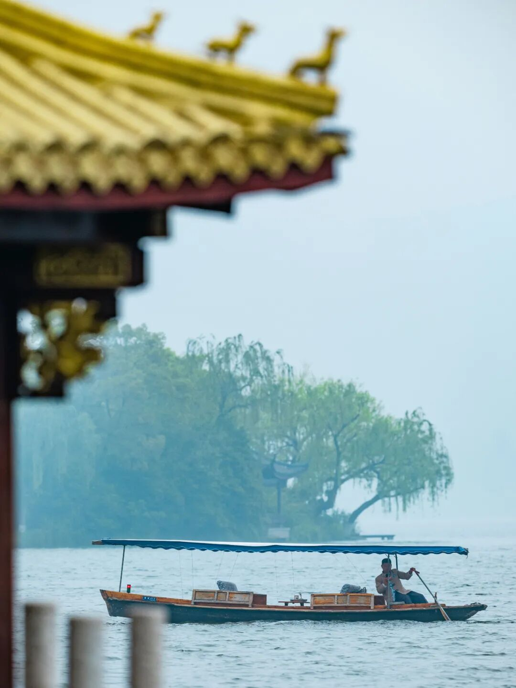
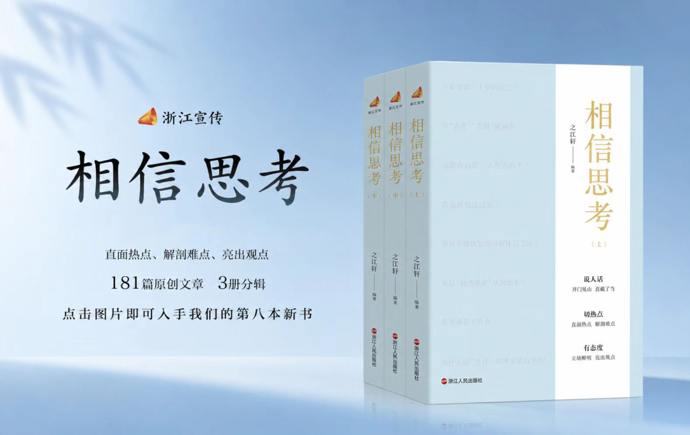

# 苏轼生命中的三场雨
> 💡 备注属性未写入，可能是备注属性名称或者类型被修改了，建议将字段类型设置为 rich_text，可以在小程序-操作-修改文章数据库页面进行调整
> 💡 原文链接:[https://mp.weixin.qq.com/s?__biz=Mzg5Mjc3NzQzMA==&mid=2247581732&idx=2&sn=fa6ff933b9aa7ee1021ac0acae27b2f7&chksm=c1d1c70210c3fa9d4ac8dc23c2d988b48815fe086177a5137e731f4a47e8904fa32e40373e45#rd](https://mp.weixin.qq.com/s?__biz=Mzg5Mjc3NzQzMA%3D%3D&mid=2247581732&idx=2&sn=fa6ff933b9aa7ee1021ac0acae27b2f7&chksm=c1d1c70210c3fa9d4ac8dc23c2d988b48815fe086177a5137e731f4a47e8904fa32e40373e45#rd)
**▲ 戳蓝色字关注我们！**
人的一生中，常常会遇到一场场性情各异的雨。比如，绵长轻柔的细雨，“一夕轻雷落万丝，霁光浮瓦碧参差”；或是来去如奔马、痛快淋漓的骤雨，“珍珠乱撒，打遍新荷”；或是涤荡心灵的凉雨，“空山新雨后，天气晚来秋”。
苏轼笔下的雨，尤其值得细品。宦海浮沉，朝堂风雨几番相扰，当他行至命运的三个渡口，又恰有三场雨先后落下，随着心境流转，映照出他对自然与世事的思索。
**自然的雨与人生的雨交织，落在苏轼身上的，便不再仅仅是雨，而是关于如何面对恶意、穿越低潮、理解苦难的一种答案。**

图源：视觉中国
**一**
**第一场雨骤然而至时，苏轼身在西湖畔的望湖楼，酒意未散。**
“黑云翻墨未遮山，白雨跳珠乱入船。”黑云借着风势，如打翻的墨汁般翻滚，豆大的雨点如脱线的玉珠，狂乱地砸向船舱，天地一时混沌迷蒙。苏轼却从中看见了大自然的张力，也听见了雨水“大珠小珠落玉盘”的韵律。
**这样的急雨，很像他当时遭遇的那场风波，骤然来袭，不容分说。**彼时，苏轼遭人劾奏，被诬在扶丧归蜀途中夹带私盐等物贩卖。变法正酣，因政见不合，他早已成了新党针锋相对的靶子。朝堂之上党争渐起，而他天性坦荡，“性不忍事，心里有话，如食中有蝇，非吐不可”，对新法屡屡直言不讳。尽管宵小之辈的构陷最终查无实据，但正值壮年报国之时，却不得不黯然离京，可以想见苏轼心中的无奈与郁结。
而后两句“卷地风来忽吹散，望湖楼下水如天”，写的也许不只是风雨过后的平静湖面，更是苏轼面对流言与恶意的心境。他没有执着于为自己辩白，只是相信黑云压得再低，终究遮不住远山；湖面动荡再久，也终会归于平静。正是这份不畏风雨的胸襟，让他在往后数十年的跌宕人生中，无论面对何种磨难，始终不曾沉沦颓废。
多年后，苏轼重返杭州。那天又下起了雨，“白雨跳珠”仿佛仍在眼前，他叹道：“还来一醉西湖雨，不见跳珠十五年。”昔日惊天动地的风雨，一醉而过，化作云淡风轻。
**人生路上，我们难免遇到生活中的误解、职场里的流言、网络上的中伤，它们常如骤雨般袭来，让人措手不及。全心付出却被无端曲解，行得端正却平白招来非议。那些突如其来的恶意，像暑天骤然聚拢的黑云，令人一时难以招架。可既然这一切本就毫无道理，又何必把这场风雨视作对自己的摧折？不如把它当作一场历练，沉淀出内心的从容与定力。**

雨中西湖 图源：“杭州西湖景区资讯”微信公众号
**二**
**第二场雨，下在黄州。“殷勤昨夜三更雨”，只一句便将夜雨写得有了情意，它来得正是时候，天地随之清朗。**
树林尽头，远山愈见分明；翠竹掩墙，乱蝉鸣于衰草；白鸟翻空，红蕖照水，细香隐隐。苏轼信步于村舍外、古城旁，觉得昨夜那场“三更雨”，既洗净了草木的尘意，也替炎夏里的身心换来片刻清凉。
在经历了那场几乎要了他性命的“乌台诗案”后，苏轼在长江边的这座偏僻小城里，担了个“团练副使”的虚衔，“不得签书公事”，经济上也颇为拮据。好在城东有块荒地，任他开垦耕种。于是，他便学着寻常农家看天吃饭。“殷勤”二字格外耐人寻味，仿佛这世间唯有天公肯施以眷顾，在深夜送来一场好雨。接着笔锋一转，“又得浮生一日凉”，虽有些化用“偷得浮生半日闲”的意思，情绪却不大轻快，毕竟仕途失意、中年飘零的境遇，并未真正随着这场及时雨散去。
倘若把黄州时期的几首雨中之作放在一起看，便更能明白苏轼当时心境的复杂。有一年春，他写下“一蓑烟雨任平生”，何其豁达；而在某个夏夜，他的笔下又流露出关于“浮生”的低回。除此之外，还有“萧萧暮雨子规啼”的凄冷，和“昨夜东坡春雨足”的欣慰等等。黄州的雨还是那些雨，落在衣衫上并无不同，真正不断变化的是看雨之人的心境。今日还觉天地宽，明日或许又会忽然勾起愁绪来。
苏轼并非无坚不摧的“超人”，在受过命运重创之后，也难以一下子就从低谷走到平地。他是在起起伏伏中与命运周旋的。后人常说，其创作高峰在黄州。四年多时间，他写赤壁，写躬耕，写月夜寻怀民，也写寻常日子里那些细小而真切的悲喜，一面承受党争的余波，一面在山水田园里安顿自己。
**当那样的瓢泼倾落，我们一时想不通、振作不起来，本是常情，并非软弱。被雨淋透的人，总要等上一阵，身上的湿冷才会慢慢褪去，若天色尚未放晴，不妨先接住这一日的凉意。只要仍然向前走，不失心气，终能度过衣衫尽湿、满路泥泞的时日。**

图源：“诗刊社”微信公众号
**三**
**元符三年（1100年），苏轼生命里那场淅淅沥沥的“苦雨”，终是放了晴。**
宋徽宗即位，苏轼遇赦北归，离开儋州。此时的他，已是“白须萧散满霜风”的病翁，颠沛半生，到这时，命运才略略松了手，让他还能再望一眼中原。
六月的一个夜晚，他乘船渡海。连日阴风苦雨的海上，忽而云开月出，海天一片澄明，遂写下：“参横斗转欲三更，苦雨终风也解晴。云散月明谁点缀，天容海色本澄清。”写的是海上景象，照见的却是他随风浪动荡的晚年。
儋州是涛声最急的一处。在宋人的想象里，这里几近绝地，苏轼到儋州前，原已作了不归之计。其间的苦楚不难想见，“食无肉，病无药，居无室，出无友”。可他终究没有把自己困住，反而读书著述，笔耕不辍，在这片海隅之地留下了绵长的文化回响。其中的《纵笔三首》，被后人评价为“平淡之极，却有无限作用”。这份平淡背后的筋骨，正是在极苦之地一寸寸长出来的。
但真正动人的，是苏轼对那段岁月的定义。所谓“问汝平生功业，黄州惠州儋州”，并非时过境迁后的粉饰，而或许是想告诉世人：苦难未必滋养人，却常常逼人拓宽眼界、磨砺心性，也让文章抵达新的境界。于是，才有了那句“九死南荒吾不恨，兹游奇绝冠平生”。曾经几乎把人逼到绝处的际遇，置于整个人生里再看，竟成了“奇绝冠平生”的一程。**
**
**苏轼带给今人的启示，大概正在于此。许多人真正走不出的，往往不是当时的风雨本身，而是围绕风雨的那段旧的叙事，委屈、挫败与失落反复回潮，最后几乎给整个人生定了调。而他则提供了另一种视角：人生很长，伤过你的也会重塑你；影响你来路的，不能决定你的去路。**
若你也曾与一场雨相逢，或许会与千年之前的苏轼不期而遇。
**本文播音：马悦**
---

**声明：稿件未经授权，不得转载。**
---
▼ 点击下方名片关注浙江宣传 ▼
往 期 精 彩 内 容
- [“说话之道”救不了蔡康永们](https://mp.weixin.qq.com/s?__biz=Mzg5Mjc3NzQzMA%3D%3D&mid=2247581704&idx=1&sn=642a2f7405eac237ee8fb64f11e8669b&scene=21#wechat_redirect)
- [套餐不该是忽悠人的套路](https://mp.weixin.qq.com/s?__biz=Mzg5Mjc3NzQzMA%3D%3D&mid=2247581668&idx=1&sn=473732db4e68b99740a8017bb20ae634&scene=21#wechat_redirect)
- [“诗教”有什么价值](https://mp.weixin.qq.com/s?__biz=Mzg5Mjc3NzQzMA%3D%3D&mid=2247581668&idx=2&sn=d316df5046abcdfaa9eff895d312c998&scene=21#wechat_redirect)
---

