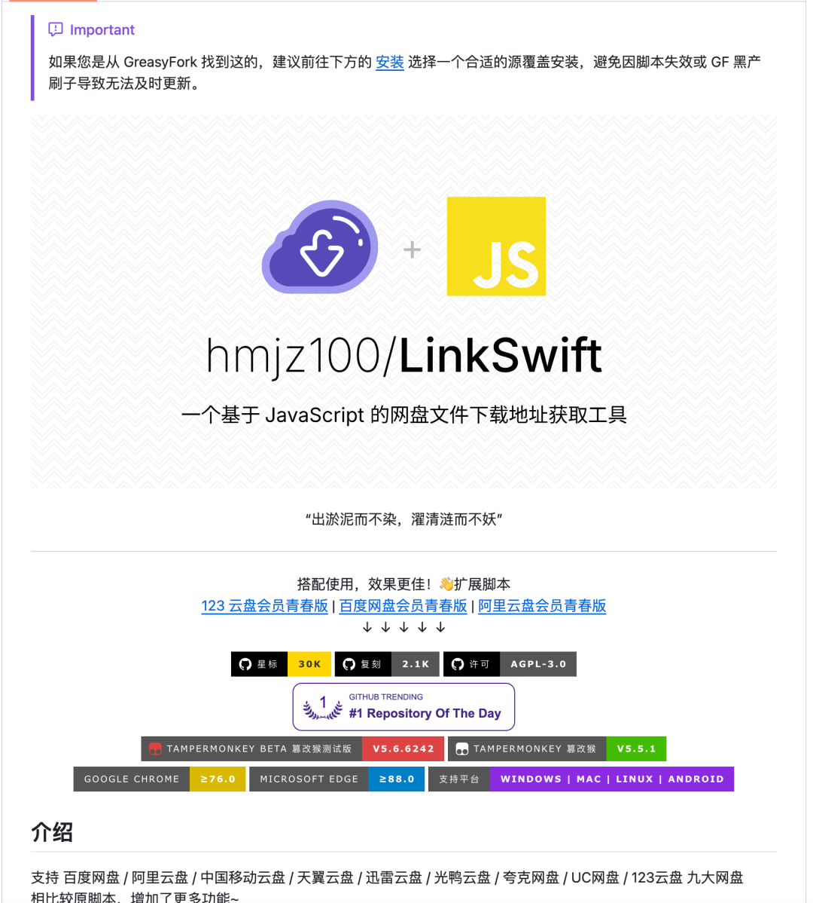

# 苦各种网盘VIP久已，网盘严父来了
> 💡 备注属性未写入，可能是备注属性名称或者类型被修改了，建议将字段类型设置为 rich_text，可以在小程序-操作-修改文章数据库页面进行调整
> 💡 原文链接:[https://mp.weixin.qq.com/s?__biz=MzIxNzY5NDk5MA==&mid=2247486119&idx=1&sn=706e941037aa41ddf75e94746d7370d0&chksm=96e450ca9551657db42e0f21adb5c75efeb8a14e1a4b88dbbf30510da8e2b2ede6dc2c263b35#rd](https://mp.weixin.qq.com/s?__biz=MzIxNzY5NDk5MA%3D%3D&mid=2247486119&idx=1&sn=706e941037aa41ddf75e94746d7370d0&chksm=96e450ca9551657db42e0f21adb5c75efeb8a14e1a4b88dbbf30510da8e2b2ede6dc2c263b35#rd)
网盘界最严厉的父亲来了！！！
GitHub 已有 2.81 万颗星，这个开源工具叫 LinkSwift，
它绕过网盘限速，直接拿到地址，不破解、不上传，纯本地运行。
支持百度、阿里、移动、天翼、迅雷、夸克、UC、123 等网盘，开发版还增加了光鸭云盘支持。
不用每换一个网盘，就重新找一遍工具。
浏览器内自带多块、多线程，可以直接推送给 IDM、Aria2，用哪个都行，都可以把你家的带宽吃满。
官方说明，只调用公开接口，不改动网盘速度策略。
项目从 2022 年发布，到现在已经四年多。今年 9 月的测试版，还在增加网盘支持、修复适配问题，就真的很香。
👉 GitHubhttps://
github.com/hmjz100/LinkSwift先收藏，下次找直链的时候回来抄作业！

