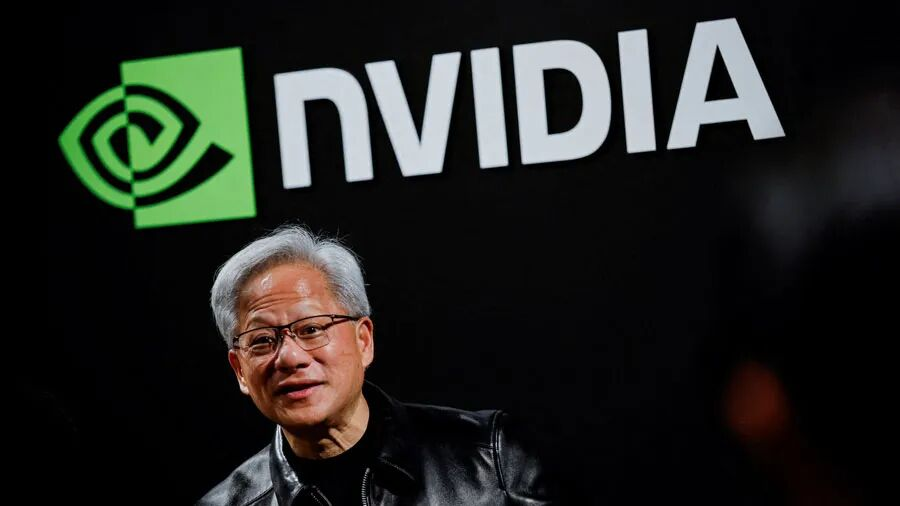
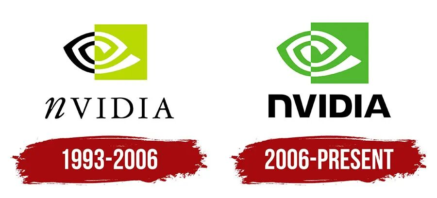

# 英伟达为何取名 Nvidia？又为什么用“绿眼睛”作标志？
> 💡 备注属性未写入，可能是备注属性名称或者类型被修改了，建议将字段类型设置为 rich_text，可以在小程序-操作-修改文章数据库页面进行调整
> 💡 原文链接:[https://mp.weixin.qq.com/s?__biz=MzI2NDM0MzA2OQ==&mid=2247498371&idx=1&sn=448ef82eca20129041304f82c8194924&chksm=ebb565c9b5e9f3022be98a8e8a03d267c08f49fc381f60f4d5f84fe533d098c81337d530bd34#rd](https://mp.weixin.qq.com/s?__biz=MzI2NDM0MzA2OQ%3D%3D&mid=2247498371&idx=1&sn=448ef82eca20129041304f82c8194924&chksm=ebb565c9b5e9f3022be98a8e8a03d267c08f49fc381f60f4d5f84fe533d098c81337d530bd34#rd)

今天，英伟达（Nvidia）早已是 GPU、AI 算力领域的代名词，其绿色眼形标识遍布显卡、服务器、消费数码的包装之上。
很多人熟悉这个绿色标志，却很少知晓：这个 Nvidia 并非随意拼凑的科技新词，这只“绿眼睛”也不是单纯为了好看而设计出来的图形，它藏着三位创始人在创业之初，从拉丁语和古典意象中埋下的一句野心宣言。
1993年，硅谷一家 Denny’s 餐厅里，三个工程师围着一壶可以无限续杯的咖啡，在一张餐巾纸上画一块能替电脑“画”出 3D 图形的芯片。他们当时还没有公司名，所有工程文件都躺在一个潦草的临时标签下：**NV**，意思是“Next Version（下一版）”。
因此，当这三位创始人——黄仁勋、克里斯·马拉科夫斯基和柯蒂斯·普里姆——在敲定公司名时，就想保留那个已经写顺手了的“NV”前缀。他们首先想到的是 NVision ，一个听起来像“视觉”与“未来”拼接起来的词，完美贴合图形芯片“看见画面、渲染图像”的赛道定位。
但好巧不巧，这个充满画面感的名字已经被一家卫生纸厂商注册了，只能放弃。于是他们翻开拉丁语词典，找到了 **invidia** 。
在拉丁语中，**invidia** 的意思是“嫉妒”，同时也是英文 envy 和昨天小站讲的 [invidious](https://mp.weixin.qq.com/s?__biz=MzI2NDM0MzA2OQ%3D%3D&mid=2247498365&idx=1&sn=d878d0e881e9fee154ccb99666c24062&scene=21#wechat_redirect) 的词源。去掉首字母 i ，正好把“NV”嵌进去，Nvidia 就此诞生。

在古罗马神话中，Invidia 还是嫉妒女神的名字，传说她生着一双发绿的眼睛，光是她的凝视，就能把嫉妒的毒注入人心，腐蚀人的心智。因此，西方文学中常流传一句经典说法：green with envy（嫉妒得眼睛发绿）。
说到这里，有同学可能会问：“嫉妒”不是个贬义词嘛，为什么要用一个贬义词作为公司名呢？
没错，绝大多数公司在取名时都会避开负面词汇。而英伟达之所以将“嫉妒”嵌进品牌的核心，其用意坦率得近乎赤裸：**做出足够强的图形芯片，让竞争对手嫉妒**。
英伟达后来甚至直接把“green with envy”用作产品宣传语，把“嫉妒得发绿”这个短语变成了自家品牌的注脚。
名字落定之后，“绿眼睛” 标志（logo）就顺理成章诞生了。
这个标识虽然没有官方长篇的释义说明，但符号逻辑和名字完全锁死：绿色，直接取自西方俗语“green with envy”里的绿；眼睛，既是 Invidia 嫉妒女神的标志性特征，也是 vision 视觉的具象化符号。
值得注意的是，我们如今熟悉的这枚绿眼，不是写实的人眼，而是经过抽象重构的连续曲线图形：螺旋回旋的轮廓，既像瞳孔与虹膜的眼型，也可以被解读成镜头光圈、不断流转的数据流、向前汇聚的光束，暗合图形渲染、光影成像的工作原理。

其早期版本是黑白 + 绿色搭配，2006年迭代为现在更简洁、高识别度的纯绿块眼标，小写 n 的旧字体也换成统一大写的 NVIDIA 字标，但“眼睛”这个核心符号三十多年始终保留，没有换掉。
此外，在古罗马民俗里， Invidia 的注视也关联着“邪眼（evil eye）” 概念，一种带有强大穿透力的凝视。放到科技语境里，它褪去了古老的诅咒意味，转化成一种锐利的洞察——洞察图形技术的方向，看见算力的未来，看见别人还没有看见的技术路线。
总而言之，英伟达的英文名 Nvidia 没有说谎：它确实让人嫉妒。只是嫉妒的对象，从当年的图形芯片同行，变成了今天几乎所有试图追赶 AI 算力的人。而那只眼睛，依旧在绿着。
